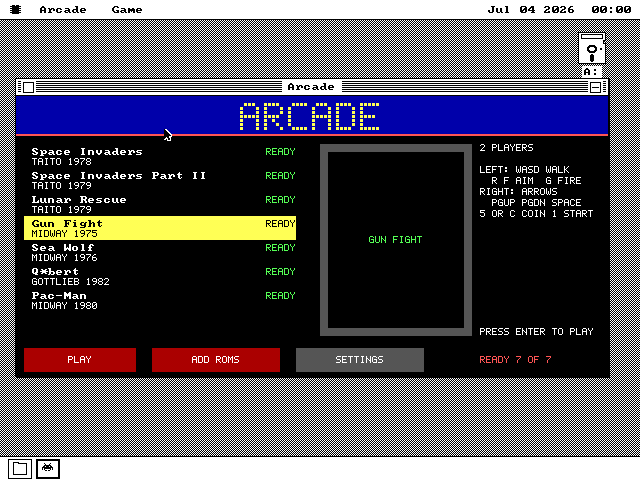
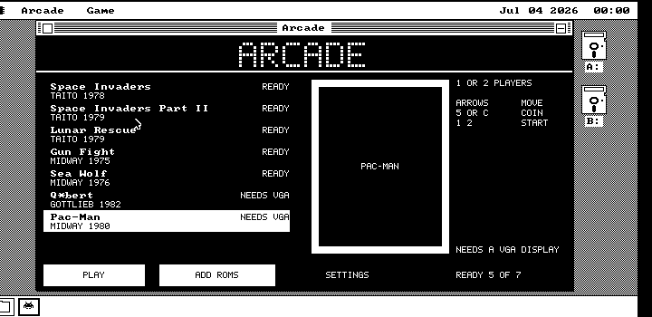
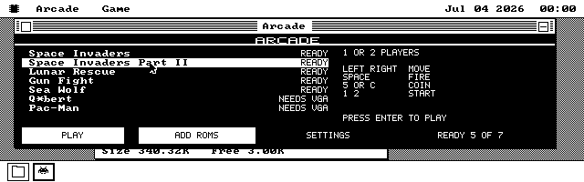

# How ARCADE was built

A diary of `apps/arcade/`, kept as the work happened, for later reuse. It
records what was decided, what was measured and what was learned the hard
way. It is NOT how ARCADE works today: docs/ARCADE-SPEC.md is the
authority on that, and docs/plans/ARCADE-EMU-PLAN.md has the stories.

## The question

The emulator survey (docs/plans/EMU-SURVEY-286.md) put Space Invaders and
Pac-Man in the tier a 16 MHz 286 should run at full speed. The owner asked
for an arcade emulator with cores for several games, aimed at the 286 but
"as fast as possible" on an 8088, and said interpreted, recompiled or
ahead-of-time were all fair.

## Day one (2026-11-03)

**Space Invaders first.** Its CPU is an 8080, whose PSW is bit for bit what
the 8086's LAHF loads. Its screen is a one-bit bitmap. And its ROM is public
on archive.org (`arcade_invaders`), where every public item for Pac-Man is
not. (The owner later supplied a Pac-Man set for the Z80 wave.)

**A model before a design.** `tools/arcsim.py` began as a 200-line Python
8080 with the board's shift register and two interrupts. Run on the real
ROM with a scripted coin, start and play, it gave numbers no estimate would
have:

- 4,365 instructions a frame in play, 30% of them in the interrupt
  handlers.
- **One loop - counting the live invaders - is a third of everything**, and
  the main loop runs it 3.85 times a frame when once would do.
- Only 20 VRAM bytes a frame actually change.

**Ahead of time, not interpreted.** An 8KB ROM that never banks can be
translated whole when the package is built. Every 8080 instruction becomes
a label and a few 8086 instructions, and a 16K-word table maps every PC
for RET, PCHL and interrupts. The 8080's flags simply stay in the 8086's
FLAGS, and a liveness pass decides where a sequence of ours must save them.
The output is NASM text that the translator assembles itself, re-emitting
any short branch NASM finds out of range.

**The proof is a lockstep.** `tests/arclock.py` runs the generated code
under Unicorn beside the Python model and compares registers at every
instruction. Building it surfaced four honest differences, each of which is
now a stated rule:
- NOPs share an offset with the next instruction.
- The translation's own CALLs scribble below the stack.
- AC differs after a logical op (only DAA reads it).
- Flags that are dead at an interrupted instruction are garbage, legally.

It finished at 2.29 million instructions over 600 frames, all agreeing.

**The clock is the PC's.** The two interrupts are delivered on the PIT, not
by counting 8080 cycles. Space Invaders keeps its game time in its
interrupt handlers, so a slow host keeps game speed and only loses
main-loop passes.

**The first boot on MartyPC's 8088 ran the game at a crawl**, and the bugs
were all in the host:
- **The run length was measured in 16 bits.** Runs past 55 ms wrapped to
  small numbers, and the budget doubled forever.
- **Every interrupt handler's EI ended the run early.** The budget read
  those runs as "too short" and doubled again, until runs took 85 ms.
- **Budgets counted poll points, not work.** A spin-wait polls every few
  instructions and the main loop every few hundred. Weighting each poll
  point by its loop's size fixed that.

**Then a profile, not a guess.** Sampling CS:IP on MartyPC during play
showed the *host* taking 40% of the 8088. Fixed in turn, each measured
again:
- The per-write list became a per-CELL list, deduplicated by a flag at the
  cell's own key, and a store that changes nothing no longer lists anything.
- `IN 3` went inline.
- Key polls went from nine a frame to four.
- The CGA put was unrolled.

The 5150 went from about 2 frames a second to **59.62, the board's 59.54**,
with 1.2-1.5 main-loop passes a frame.

**A miss that looked like a hang.** Once, mid-game, the 8088 seemed to
stop. In fact the game had jumped through PCHL to an object handler (050E)
that the model's script had never reached. The package stopped correctly,
and the test script's own Space key kept relaunching it. That handler sits
in a ROM table the game copies to RAM, so the translator now walks every
word of the ROM's data tentatively, keeping only walks that decode cleanly.
Most of what that adds is zero bytes, which translate to nothing: 444 bytes
of code for 2,189 instructions.

**The 286 has room to spare.** On 86Box's 16 MHz 286 with VGA the main
loop runs about twelve times as often as on the real board, before any 286
tuning at all.

## Pac-Man: the second board, and the Z80

**The owner played Invaders on 86Box at full speed** and asked for the
next wave. Pac-Man's ROM came from the owner, not from an archive: a MAME
`pacman.zip` uploaded to the session, checked against MAME's hashes by
`tools/getarcrom.py pacman --from`, and never committed.

**The Z80 is the 8080 plus five problems**, each of which found us in
turn:
- **The code no longer fits a segment.** 16K PCs of jump table plus 57KB
  of translation is over 64KB, so the table moved to the AUX segment and
  every dispatch became `jmp word [es:si]`.
- **The 8086 has no parity-or-overflow flag.** P/V is the 8086's PF after
  logic and its OF after arithmetic; where a reader of P/V follows an
  arithmetic op, the translation copies OF into PF. N is not kept at all:
  every DAA in Pac-Man is reached only from additions, which the
  translator proves rather than assumes.
- **Helpers may not use the guest's stack.** Pac-Man reads the word below
  its own SP (`DEC SP` tricks), so a CALL into a block-move helper
  clobbered live data. Helpers now return through a cell (`ST_RET`) by a
  jump; nothing pushes below the guest's SP.
- **RST is a call with data after it.** Pac-Man's RST 28h is followed by
  three bytes of arguments, and the return lands past them. The model
  (`tools/arcpac.py seeds`) learns each RST's return distance by watching
  it come back; a first guess of +5 for RST 20h, seen once, was wrong, so
  a distance now needs RET or JP (HL) at the same SP in 90% of the runs.
- **(IX+d) can wrap past 32K.** Pac-Man's IX tables sit where IX+d sets
  bit 15, which on the board is a mirror. The translation masks A15 only
  where the decoder cannot prove it clear.

**The lockstep paid for itself again.** Unicorn runs the translation
beside a Python Z80 with the Namco board, comparing every instruction:
4.2 million Z80 instructions over 600 frames, through the boot tests, a
coin, a start and play. The harness itself had a bug worth recording: a
PC divergence was once skipped silently; it fails now.

**The picture was the work.** Pac-Man is 224x288 portrait; on VGA mode 12h
it is drawn 448x432, centred. The first composer decided a pixel at a
time and ran at a few frames a second on the 286. In order:
- **Planes, not pixels.** A host-side table (`arcpmgfx.py`) gives each
  tile row a mask per colour value; with a palette's four selectors, a
  plane byte is four ANDs and three ORs.
- **Sprites are boxes**, old and new, at most 4x4 tiles, composed with the
  tiles under them, so nothing is erased and redrawn.
- **A shadow of the screen**: a byte goes to VRAM only if it differs.
- **A per-tile plane cache**, invalidated by the board's tile writes, so
  a sprite box recomposes mostly from cache.

Three bugs there looked like the emulation and were the renderer: a
helper that clobbered BX (the row) overran the stack, a selector copy that
moved DI, and an 8-bit MUL for the shadow row that wrapped past row 255
and smeared the lower maze.

**Result**: full speed on 86Box's 16 MHz 286 with VGA, no frames dropped
in play (86Box is not cycle accurate; the proportion is the claim). The
5150 is not a Pac-Man target. Invaders kept its 59.4 frames a second on
MartyPC's 5150 through the multi-board refactor.

## Sound: a Sound Blaster, an AdLib, and nobody's recordings

**The ask** was Sound Blaster support "and/or AdLib, if it makes more
sense". It made sense to do both, because the two games ask different
things of a card. Pac-Man's sound chip, Namco's WSG, is three voices
reading 32-sample waveforms out of a PROM: that is PCM already, so on a
Sound Blaster it can be mixed exactly. Space Invaders' sound board is
analog circuits, so there is nothing to emulate - only something to
imitate. And an AdLib is the only card many period machines have.

**Space Invaders' sounds were synthesised, not sampled.** Emulators play
recordings of the real board; we ship none. `apps/arcade/arcsfx.py`
builds ten clips from a sentence each about what the circuit does - a
noise burst through a falling filter for the shot, a triangle swept by a
slower triangle for the saucer, a soft-edged square for each fleet step -
with a fixed noise seed, so the part is the same bytes on every build.

**One stream, fed to a lead.** The package keeps a 4KB ring the card plays
in place, and once a frame tops it up to 768 bytes past what the card has
consumed. Filling to a lead rather than "a frame's worth" follows the
card's crystal, so the two clocks never drift.

**Three things the driver taught us.** The open must stage a full 2KB
half, whatever block size the ring asks for. Asking the driver for the
stream's state every frame was a measurable share of an 8088, so it is
asked only when the consumed count stands still. And `op_fetch` - the
lazy read of the clips - may show a toast, which a full-screen bracket in
a foreign video mode may not, so it happens on the desktop first.

**The 8088 needed two passes.** The first mixer laid silence and then
added each clip into the ring byte by byte; the 5150 dropped 46 half
frames in 30 seconds. A CS:IP profile showed sound at about 4% of the
machine, with the game already near its edge. Now an 8086-class machine
mixes at 4,000 Hz (every other sample of the clips), every clip is summed
in registers in one pass and stored once, and at most three play at once.
The result: 0 or 1 half frames dropped in 20 seconds of play with fire
held.

**An hour lost to the instrument.** MartyPC's audio capture came back
empty - zero Sound Blaster samples, a full-length but silent AdLib file -
while the guest plainly played. The capture is drained only while the
emulator free-runs, and our scripts stepped it with `advance`. Reading the
mixed bytes back out of the guest's own ring sidestepped it for the
stream; for FM the row now plays under `run` and waits on guest time.
docs/MARTYPC-DEBUG.md carries the warning now.

**Pac-Man on the 286.** The mixer is a four-instruction inner loop per
voice per sample, four samples a pass. 86Box shows the chase and death
scenes dropping a few frames a second with a card in the machine whichever
route plays - the cost of the sound driver being loaded at all, since the
same scenes drop none on the same machine without a card.

## Wave 7: two more boards that were mostly a table

**The cheapest new games were the ones the 8080 translator already knew.**
Taito's Space Invaders Part II and Lunar Rescue run on the Space Invaders
board with ROM at 4000h as well and a colour map PROM. MAME's 8080bw driver
says what differs - which ports read what at rest, which sound bits mean
what, how a cell's colour is found - and in the package that became a
board's WIRING, a small table, not new code. Both ROM sets are public on the
Internet Archive and their CRCs are MAME's.

**What had to change underneath:**
- The translator's idea of "the ROM" became regions, and a colour board's
  second region ends at its last chip that is not all zeros. Without that,
  a speculative walk ran through Part II's empty 4800-4FFFh and into a jump
  past the board's address space.
- The PC table grew to 4FFFh's PC and ran into the write list, which moved
  above everything at C000h.
- The package had always loaded every part. With four boards that would
  have been half a megabyte, so every board became LAZY: Game reads the
  board it picks and drops the one before.

**The colour took three tries.** The first picture had brown where cyan
belonged: mode 12h's attribute palette sends pixel value 6 to DAC register
14h. The second had the left 32 pixels black and half the header missing:
MAME indexes the colour map from the start of RAM, 2000h, not from video
RAM at 2400h, so every lookup was four bands off. The third was right, and
the screen and a dump of the guest's own video RAM agreed byte for byte.

**Lunar Rescue dropped a frame every third of a second on the 5150.** A
profile put 63% of the 8088 in one four-instruction loop - LDA, ANA A,
OUT 6, JNZ - the game waiting for its interrupt. Each pass was cheap in
the run budget's units, so the budget grew, and the runs after it ran long.
The plan had a lever for this (its "idle rule"): a loop that reloads A,
touches nothing else, stores nothing and leaves only by its own branch can
only be ended by an interrupt, so its branch is now a HLT. The host sleeps
to the next interrupt; 32 half frames dropped in 10 seconds became 1. The
first try made Part II worse - a run a HLT ended looked "short" and doubled
the budget - until halted runs, like EI-ended ones, stopped teaching the
budget anything.

**The lockstep found two of its own bugs.** Two 8080 PCs can share one
8086 offset (a NOP translates to nothing), and the harness named an
interrupt by the first of them; and it handed the 8086 side the next
frame's inputs one instruction early, so an IN right before the boundary
read the future. Both were the harness, both are fixed, and all four
boards now agree through their play.

**Sound came along for free, almost.** Part II's sound bits are Space
Invaders', so it plays the same synthesised clips. Lunar Rescue got five
of its own - the thrust, two footsteps, the count of the men saved, the
rescue ship's beep - and borrowed the rest. Its end-of-level tunes are a
one-bit waveform the CPU toggles in time, which a once-a-frame latch cannot
carry, so they are not played.

## Gun Fight and Sea Wolf: the board the right way up

**Midway's two oldest games here** run on the same 8080 board as Space
Invaders, but the monitor stands the right way up, the ports are wired
differently, and the controls are not buttons. Gun Fight decodes its OUT
port with three AND gates, so one OUT can set the sound, the shift count
and the shift data at once; Sea Wolf reads the shifter bit-reversed. A
small per-board port map in the translator covers both. Gun Fight's aim
lever and Sea Wolf's periscope are positional encoders read through
MAME's tables; on a keyboard they became levers that move a notch while a
key is held. Gun Fight is two players at one keyboard.

**They draw past the bottom of the screen**, into ROM at 4000h, which the
board ignores. The translator now drops stores into ROM - for a constant
address at build time, for a computed one on the video path only.

**A picture the lockstep could not see was wrong.** Sea Wolf showed
"INSERT COIN" in the middle of a game. The 8080 erases its screen by
pointing SP into video RAM and pushing zeros, and a PUSH listed no cells
for the host to redraw. RAM agreed with the model to the byte, so the
lockstep was green. Two new checks close that gap: `arclock --marks`
holds the write list to the screen, and `tests/arcglass.py` stops on the
host's renderer and compares the Hercules page with video RAM cell by
cell. It finds 54 bad cells without the fix and none with it. (It also
had to stop at the renderer's end: before that, the glass lagged video
RAM by a frame, and a slow ship looked like a bug.)

**The idea that did not survive measurement.** Neither game's main loop
ever waits. A dispatcher runs a task list round and round, and a task
that is not due returns at once - two thirds of everything Gun Fight's
8080 runs. Treating those returns as a HLT looked like the obvious lever.
The model said otherwise: halting at every such return changed the
picture in 1,035 of 1,500 frames; halting only where an oracle proved the
pass idle, in 1 for Gun Fight and still 1,106 for Sea Wolf, because
resuming at the loop's head moves where the next interrupt lands. One of
Sea Wolf's even ran with interrupts off, a hang as a HLT. So it is not
done; the instrument (`arcsim.py idles`) and the finding stay.

**Speed.** On the 5150 both keep the board's 59.5 frames a second. Some
early measurements of these two came out at 40-44 frames a second; every
measurement of the tree as committed, alone or two at once, holds the
board's rate, and the rows `arcspeedgf` and `arcspeedsw` keep asking. The
slow figures were not reproduced and are not explained.

## Q*bert: the arcade CPU this machine is

**Gottlieb's Q*bert board has an 8088.** Its program is flat in one 64KB
space, and its reset sets every segment register to 0. So the plan
proposed a probe rather than a translator: run the ROM as it is, in a
segment of the PC, and measure.

**The probe came first, off the machine.** A Unicorn harness loaded the
program at A000h of a segment that was not 0, NOPped the three segment
loads, and delivered the board's NMI as the hardware does. The attract
mode came up right away: the logo, the instructions, the pyramid demo. A
coin and a start played a level, all the way to the high-score table.
An 8088 cycle table put the game's work at about **7,500 cycles a frame**
of the 77,700 a 4.77 MHz 8088 has at the board's 61.42 Hz. Gottlieb's own
5 MHz 8088 was mostly idle.

**Making it a board took 17 patch lines and a 103-byte core.** The game
writes its watchdog, sound latch and outputs to 5800-5807h, where it also
reads its inputs. The host fills the inputs there, so those 14 stores were
moved 8 up. Its two waits for the next frame became far calls into the
N88 core, which saves the game's registers on the game's own stack and
returns to the host loop as if the game had halted. The NMI is delivered
on the next run, through the vector the game itself wrote. The patch file
holds addresses only, and the build refuses any address whose bytes do
not have the expected shape. The game runs with interrupts off, so nothing
of the host's ever lands on its stack.

**On the 286 it simply runs**, at the board's full rate, every frame
drawn. **On the 8088 it was the picture that did not fit.** A 3 x 3-tile
box around a moving sprite cost about 70,000 cycles to put on the VGA,
and turning the VGA writes off changed nothing. It was not the bus: an
8088 at 4.77 MHz spends that long just comparing 288 bytes with a shadow,
a few instructions a byte. Three rounds of tightening helped by a quarter
each:
- the put row by row, with REPE CMPSB over the unchanged bytes;
- the second screen row copied through the VGA latches;
- the board's parked sprites dropped before each box.

What made the 8088 work was conceding the picture's frame rate: draw only
when not already late, and let the game's own frames, at 8,000 cycles
each, catch up. Now the GAME keeps all 61.42 frames a second on the 5150
model, with none dropped, and the picture updates about ten times a
second when things move.

**The first glass test reported pixels wrong in whole rows.** They were
not wrong. The emulator's rendered frame is the last one the raster
FINISHED, so a box put after the beam passed is not in it yet. The test
now reads the VGA's four planes directly and compares them with MAME's
picture of the game's memory. 0 pixels differ, including the stretch where
the background has priority over the sprites. Taking the priority pass
and the latch copy out turns it red.

**Not done: sound.** Q*bert's sound is a second board with a 6502, a DAC
and the Votrax chip behind the famous swearing. The game's commands to it
land where nothing reads them.

## A line taken out, and two boards on either side of it

**The owner's test found Pac-Man stuck in its RAM test**, its screen a
scrolling field of hex digits. Bisecting builds on 86Box's 286 put the
break in the Gun Fight and Sea Wolf wave, not in Q*bert's. One line had gone
from the host loop: when a board's interrupt was masked, the loop used to go
back and run the guest without advancing the frame's clock, so the
interrupt went in at the guest's EI. Without the line the interrupt was
simply lost until the next period. Pac-Man masks it through its whole
start-up, which then crawled at 3 frames a second.

**Putting the line back explained an old mystery.** With it, Gun Fight and
Sea Wolf ran at 40 frames a second on the 5150, the slow figure the
previous wave had measured early on and could not reproduce. The line had
been taken out by accident, which fixed them and broke Pac-Man. The two
boards want different things:
- the 8080 boards: the clock goes on, and the masked interrupt waits to go
  in the moment the EI ends a run;
- Pac-Man: its clock waits until the interrupt is taken (`BDF_HOLD`),
  because its RAM test rewrites the screen and a frame drawn every period
  there is what made it crawl.

Both are in the loop now, and every board's row passes.

**And a hole the seeds never had.** The owner's next run stopped Space
Invaders Part II with "no code at 1F52" a frame or two in. That code loads
1F52 into HL, pushes it, and jumps away: a return address built by hand.
The routine it jumps to RETs there, to an instruction no walk reaches and
no seeding run had hit. The translator now tries every constant that is
loaded and pushed at once as a tentative entry, under the same rules as
the data words it already tries. Part II gained that one instruction and
Lunar Rescue 24 more that had the same hole.

## Release wave R1: a package with no ROM in it

**The translation ships as a recipe.** Every byte of a translated board
that came from its ROM is left as a hole, and a list says which ROM byte
fills each. Finding the holes took no bookkeeping in the translator. It
emits the code twice: once as it is, once with every data immediate
inverted and nothing else changed. The bytes that differ are the holes.
Six boards have 327 to 2,034 holes each, and a filled recipe is the
translation byte for byte (row `arcrecipe`).

**The user's ROM is a `.ROM` file**: a 32-byte header, the board image and
its CRC-32. A pick reads it, checks it, fills the recipe, and builds the
rest. Pac-Man's turned tiles and Q*bert's turned sprites and patched
program used to be made by Python on the host. Now 8086 makes them, and
the result is held byte for byte to the Python tools' (row `arcbuilt`).
The package went from 261KB to 184KB, and the development disk carries all
seven `.ROM` files beside it on 360KB.

**Three things the measurements caught.**
- *A toast that lied.* The `.ROM` check refused Pac-Man as "not the set".
  The name check's `lodsb` had overwritten the low byte of the bytes-read
  count. Every other set's length happens to end in 00, so only Pac-Man's
  6220h noticed.
- *A build that was too slow.* Turning Q*bert's 65,000 sprite pixels took
  7.6 s on the 8088. As an unrolled gather (AND, NEG puts "any" in carry,
  RCL) it takes 4.2 s.
- *A picture that stalled the game.* With the speed test's coin now timed
  from the board's first frame, Q*bert ran at 45 frames a second. The
  culprit was not the new code: a change of scene repainted 64 boxes in
  one draw, 1.7 s on the 8088. Changed tiles now mark their box, and each
  draw composes boxes until the next frame is due. A priority change still
  repaints at once, because a box left for later shows the wrong order
  exactly where a sprite crosses a tile. The glass test proved that by
  going green with the priority pass removed, until it did.

**Open:** a Q*bert pick from floppy on the 8088 takes about 15 s: the 64KB
read, the CRC, the build. That is R2's to shorten.

## R2: from a MAME zip to a `.ROM`, on the machine

**The question the owner asked** was the right one: how does a user get from
a `.zip` of chips to a `.ROM`? Through **Game > Add ROM sets...**, the
system's own file chooser, and a pick of the zip. ARCADE reads the whole zip
(up to 448KB), finds its directory from the end, past a comment, matches the
members it needs by name against the pins `tools/getarcrom.py` already held,
and refuses on the directory's CRC before inflating anything. Each chip is
inflated or copied, and its CRC is checked again on the bytes. Then
`<SET>.ROM` is written beside the zip, and the folder goes in `ARCADE.DAT`.

**A second inflater, on purpose.** The plan said to move PIXEL's out to a
shared include. Reading it changed that: PIXEL's decoder is table-driven
and streams a PNG through a 32KB ring on a worker, with its state in the
part's own variables. A ZIP member is small and decoded once, straight into
its destination. `apps/os88inflate.inc` is zlib's `puff` in 8086: the
Huffman codes decoded a bit at a time against each length's count, about
1KB of work space, the output its own window. Row `inflate86` holds it to
zlib on 345 streams under Unicorn.

**invaders.zip is the hard one**, which is why the test uses it: forty clone
sets in folders, the parent's four chips at the root, and a TorrentZip
comment after the directory.

**Three things the run caught.**
- *The chooser moves you.* After a pick in `ROMS\`, ARCADE was standing in
  `ROMS\`, and its next part fetch read `ARCADE.O88` there: "Cannot read my
  parts". It now goes home after every chooser.
- *A remembered folder that was not.* `ARCADE.DAT` never persisted, because
  the disk had no `SYSTEM\APPDATA` and `os88data` refuses without one. The
  arcade disks carry the folder now, as every application disk does.
- *A far call cannot be a tail jump.* `jmp OSAPI_FILE_GOTO_QM` returned
  into nothing. It is `call`, then `ret`, twice over before it stuck.

**Tested** (row `arcimport`, MartyPC VGA XT, 720KB B:): a zip with one bit
wrong in one chip writes nothing. invaders.zip and qbert.zip each write a
`.ROM` byte for byte the one `make arcaderoms` writes. Both games run. After
ARCADE is closed and reopened from `B:\`, Q*bert is found in `ROMS\` through
`ARCADE.DAT`. **Not done:** sets as loose files in a folder, and an import
timed on the 5150.

## R3: one cabinet

The owner's rule was one generic cabinet, not one per machine, so R3 went
straight to code instead of a round of mockups. The window became a game
browser: a marquee of bulbs spelling ARCADE (generated from rows of `#` in
`tools/arcart.py`, with a 5x7 small-caps face), the list with each game's
state, a screen in a bezel, the game's card, and a coin door of buttons.
Every field is one band put down in one blit, so moving the selection
redraws two rows, the screen and the card, and nothing else.

**Opening is a look now, not a load.** ARCADE used to read the first game
it could find when it opened. Now it only checks where each `.ROM` is, and
a game is read when it is played.

**The screen shows a picture the game drew itself.** No artwork ships. The
first time a game is left, ARCADE samples the screen it was on into a
120 x 144 picture and writes it beside the `.ROM` as `<SET>.PIC`.

**Three things the emulator caught.**
- *A segment that emptied.* The first build looked for the ROMs after
  creating the window, which declares the package's region movable. A file
  call inside the entry proc then let the heap move the package while it
  was still running. The look now comes before the window.
- *A window called through a null record.* `OSAPI_ABOUT_SET` takes the
  window in BX, and a new call before it had used BX. The kernel later
  called the About handler for window 0.
- *Solid bands in the picture.* Space Invaders' colour overlay is a plane
  of its own that shows black. Counting "any plane set" as lit filled the
  shields' band solid. Lit now means a colour number whose DAC entry is
  not black, and the VGA is put in read mode 0 first.

**Tested** on MartyPC's VGA XT, Hercules and CGA (rows `arcface`,
`arcfaceherc`, `arcfacecga`): the states, keys and clicks, no transient
pixel on a move, the incremental face equal to a whole repaint, and the
picture written. Breaking the move (not redrawing the row it left) turned
the identity check red at 120 rows.

 

## R4: settings, scores, pause and help

**Pause and help draw on the game's own screen.** In a game the desktop's
drawing calls are off limits, so ARCADE copies the system font before
entering and writes its box straight into the framebuffer: all four VGA
planes at once, or the Hercules and CGA banks. To put the picture back
afterwards it calls the board's own setup again, which already knew how to
draw every cell.

**Settings in words, and only the certain ones.** Space Invaders' bases
and bonus, and Pac-Man's lives, bonus, difficulty and ghost names, come
straight from MAME's switch definitions. The other boards get no SETTINGS
rather than a guess: a wrong bit on Q\*bert would flip the screen of a
renderer that does not know how.

**A best score is a few bytes of RAM**, put back after the game's power-on
test has cleared it. The test pokes 0123 into Space Invaders' RAM, leaves
the game, switches it on again and finds 0123 back. Without the put-back
it reads 0000.

**Not done:** key remapping, and Q\*bert's score table.

## R5: Q*bert's sound board

**Measured before building.** Q*bert's sound is a second board: a 6502,
a timer chip, a DAC and a speech chip, running a program of its own. The
first step was the board in Python (`tools/qbsnd.py`), to answer one
question: could each sound be rendered once and kept? It found 28 sounding
codes, 36.4 seconds of sound in all, and 11.7 seconds for the 13 codes the
game actually sends. Kept beside the ROM, that would be a quarter of a
360KB disk. So the board runs **live**, into the Sound Blaster stream.

**The core was written by a second agent**, against the Python board, and
its test caught a bug in the reference: Python read the cycle count before
a branch added its own cycles, so every branch cost 2. A tone made by a
delay loop came out a quarter high; the lengths, timed by the board's
timer, moved by under 2%. Its speed estimate also changed
the plan. At about 82 286-cycles a 6502 instruction, the board alone is a
29 MHz 286's worth, so live sound needs a 386. The owner's 16 MHz 286
plays Q*bert silent, like the 8088.

**The first measurement was silence.** The board waits for a rising edge
on one pin. The model started that pin high, so the game's strobe never
rose and no command was heard.

**One sample at a time.** Each sample the stream asks for is the DAC after
the 6502 has run its share of the clock: 81 cycles and 28,490/65,536 of
one more, so the pitch is the board's exactly. The timer chip's interrupt
line is refreshed after every access to it. Without that, an interrupt
handler that finished inside one sample would be taken twice.

**Tested** under Unicorn: the core opcode by opcode against the Python
6502, and the whole board as ARCADE assembles it, sample for sample,
against the Python board over 640 frames of the game's own commands.
Moving the cycle fraction by one 65,536th fails it at frame 42.

**Not done:** the speech chip, the knocker, and a measurement on a real
386.

## kern_mega: the same package, in protected mode

The owner's rule is that every new application runs on kern_mega, the
286-and-up kernel, and ARCADE had shipped refusing to start there. The
owner chose protected mode over a real-mode bracket around the game loop.
That way the region and the small claims can live above 1MB, leaving
conventional memory for larger ports later. The arm rides a floppy of its
own, the twin of ARCADE's release disk: 399 of 2,847 clusters.

**A selector is not a segment.** On kern_mega every segment ARCADE holds
is an index into a descriptor table. Adding 2 to the ROM's claim to skip
its header does not move 32 bytes along. It names a different descriptor,
and the first try on kern_mega died in the frontend's picture slots before
the window opened. Every such sum now goes through one door, `ar_sub`. In
the shipped build it is still the sum; in the arm it asks the kernel for a
window based there. The zip walk could not take the obvious answer, a
window re-aimed at each read: on kern_mega a small claim lives in a pool
that packs whenever any task claims memory, and a re-aimed window does not
follow its claim. So the walk takes the 32KB granule an offset falls in,
a window that moves with the claim, at most 14 of them over 448KB.

**Stores through CS.** The kernel completes a write through a code
selector, at about 77 microseconds a fault. The inflater wrote its work
space through CS several times a bit, Pac-Man's screen pass once a row,
and its sprite build 32,768 times a pick. Each now goes through DS, the
stack or a spare register. The inflater's test now runs both versions
against zlib, and fails on a single write into the code's segment.

**The limits found three old bugs.** A real-mode segment reaches 64KB
whatever it was given; a selector reaches exactly its claim. Three
defects had been shipping silently, and each was fixed in both builds:

- Q\*bert's power-on wrote 2 bytes 8KB past its sprite part. Only the
  translated boards have the write list it was resetting.
- Pac-Man started with the Z80's stack pointer at FFFFh, as MAME does. The
  host runs the core on the game's own stack, so anything pushed before
  the game set its stack landed 64KB above the board's memory. On
  kern_mega that was a stack fault and a reboot.
- Pac-Man's list of changed tiles can hold all 1,024 of them, which a
  screen clear makes before the first frame is drawn. The last entry fell
  one word past the 50KB part that holds it. The part is 51KB now.

**Measured** on Bochs with a kernel that logs every protection fault: all
seven boards, coined and played for 20 seconds each, at their own frame
rates and with no fault from ARCADE. Bochs is a 386 that keeps no time, so
the speed on a real 286 is still to be measured.

**On a 286.** On 86Box's copy of the owner's 16 MHz mr286, every board
plays under kern_mega. Against kern_big on the same machine, protected mode
costs nothing that can be measured. Q\*bert's spare time, counted as idle
turns of the loop, is the same to within 0.1%. Pac-Man falls about a sixth
short of its frame rate there on both kernels, so that is the game's own
cost.

**Every block can move.** A pinned block is a wall in the heap, and ARCADE
had twelve. The owner's reading was that they only need to move while the
window is up, and the kernel's rules make that true by construction: only
the window task compacts, and only inside a claim it makes. In a full-screen
bracket every other program is frozen, and a game claims nothing. Each
block now has a procedure that puts its words right. One of them has a
twist: Q\*bert's suspended game keeps its own segment on its stack, as the
return address from its last wait for the frame, and that word has to
follow too. A new test moves eleven blocks under a paused Q\*bert and
Pac-Man and plays on. With that one procedure emptied, the test goes red.
Doing this also found a slip of my own: the declaration at ARCADE's entry
overwrote the register holding the view's segment, a stray four-byte write
on kern_big and a refused start on kern_mega.
