# How the CD-ROM driver was built

A diary of `CDROM.DRV` and the CD Player (SPEC.md §119,
[plan](plans/CDROM-PLAN.md)), kept as the work happened. Observations and
intentions are kept apart; what was tested is named.

## The ask

"Add CD-ROM data and audio support to the operating system as a driver."

## Wave 0 — mapping the OS first

The first question was not "how do I read ISO 9660" but "where does a file
system that is not FAT go in this OS". The answer was already in the tree:
§62.9's **file redirector**. A `DRVC_FILE` driver answers `FSV_*` questions
about files - list this folder, stand in that one, read these bytes - and
the kernel never reads a sector of the volume. The parallel-port cable and
the RAM disk are its two clients. A CD-ROM is the third: the kernel learns
nothing about ISO 9660, and the Disk window, the desktop zone, `..`, the
loader, the file dialog and the copy engine work on a CD unchanged.

Decisions taken here, each against what the tree already does:

- **A class of its own, `DRVC_CD` = 9**, not a share of `DRVC_FILE` or
  `DRVC_FILE2`: a class is one publication slot, and sharing one would make
  the CD and the cable (or the RAM disk) mutually exclusive - the exact
  defect §62.9.19 fixed for the RAM disk.
- **ATAPI on the IDE task file, on a 286 or better**, the same refusal as
  HDD.DRV's rung 1 (§52.1): a 16-bit data port on an XT's 8-bit bus loses
  every high byte.
- **Audio is the drive's.** `PLAY AUDIO MSF` and `READ SUB-CHANNEL`; the
  drive does the rest and the CPU does nothing. Ripping (`READ CD`) to a
  Sound Blaster is out of scope and written down as such.
- **Handles are positions.** A §62.9 handle is 16 bits; a CD has ~330,000
  sectors. A directory record is at least 34 bytes and starts on an even
  offset, so `offset >> 5` is unique within a sector: a handle is
  `(LBA - lowest directory LBA) x 64 + offset / 32`. It is stable for as
  long as the disc is in the drive, which is what the loader and the copy
  engine need, and it needs no table in the driver.

## Wave 1 — the row, the drive, the volume

**Kernel cost** (`tools/kernsize.py`, kern_big): `.text` +38 (the row, its
two strings, `drv_fptr9`'s pair, a `drv_svcix` byte), `.bss` +38 (the class's
owner word and its service-table copy), `.ovl` +1 (`drv_cfgbit`). The image
rung went from 121 bytes left to 45 - **no rung crossed**, `KERN_SIZE`
unchanged at 97,792. The `DVK_FILE` test in `dsk_vol_add` became `jae`
instead of `je`, which covers every file class from `DRVC_FILE2` up at no
cost. kern_small has no driver layer and is byte-identical.

**The driver**: 8,335 bytes of image (about 3 KB of it the sector buffer and
the TOC, zero state), a 9 KB claim when loaded, 4,774 bytes on the floppy
packed.

**The first boot** showed the CD-ROM zone on the desktop at once: the probe
found QEMU's drive at 170h, `IDENTIFY PACKET DEVICE` gave `QEMU DVD-ROM`,
and the volume registered as D: (C: is reserved for a hard disk). Opening it
listed nothing. Reading the driver's state out of the guest showed the TOC
right and the first `READ (10)` failed with **a timeout** - in microseconds.
The wait's safety net (a poll count under the tick bound, for a machine
whose tick has stopped) was initialised to zero, so the first poll that saw
BSY ended it. `TEST UNIT READY` and `READ TOC` had worked only because QEMU
answers them synchronously and never shows BSY. The driver now keeps the
last refusal's sense key and command (`cd_lkey`, `cd_lop`) for the next
diagnosis of this kind.

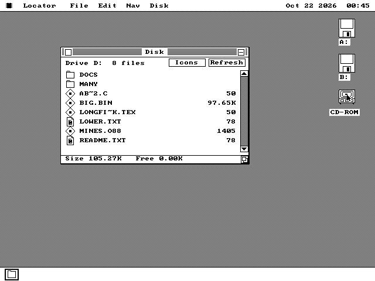

With that fixed the root listed what `tools/os88cdiso.py list` says it
must: `Long File Name.text` as `LONGFI~K.TEX`, `A.B.C` as `AB~2.C`,
`lower.txt` as `LOWER.TXT`. Two folders down and back:

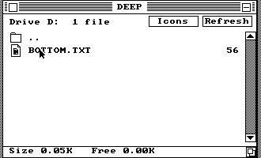

and Minesweeper launched off the disc:

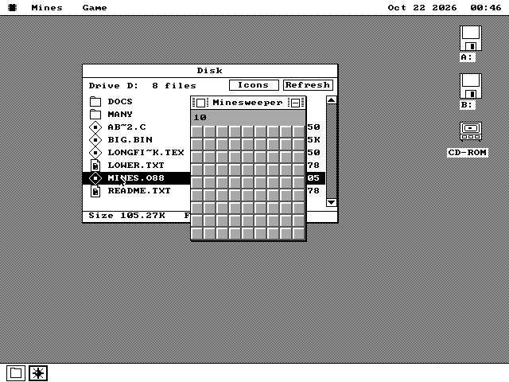

**The fixture's sixty-name folder** was eighty at first, and listed 63: the
kernel's listing holds `DSK_NENT` = 64 rows, `..` included, on every volume.
That is the listing's cap, not the driver's, so the fixture was cut to sixty
- still a directory two sectors long, which is what it is there to test.

**Tested** (`tests/cdrom.py`, QEMU): the row loads and finds the drive; the
root, `DOCS`, `DOCS\DEEP`, `..` twice and `MANY` all list what the reference
lists; `MINES.O88` launches off the CD; `BIG.BIN` (100,001 bytes, over 64 KB
and not a whole number of sectors) copied to B: with Edit > Copy and Paste
is byte-identical on the host; an empty drive mounts nothing and A: still
opens after it.

## Wave 2 — audio, and the CD Player

**The door** (`drivers/cdrom/cdpkg.inc`) is eleven verbs through
`OSAPI_DRV_CALL`: identify, the drive's model, the disc's TOC, one track,
play, pause, resume, stop, where the drive is (`READ SUB-CHANNEL`), eject,
and the drive's own output volume (mode page 0Eh). Every one is the UI
task's: each waits on the drive.

**The player** (`apps/cdplayer/`, 2.6 KB) is the Timer's shape (§111): a
fixed window, the standard buttons, a one-shot timer re-armed every 9
ticks, and only the display line that changed is lettered. On QEMU's data
disc it says so and greys everything but Eject; Eject opens QEMU's tray
(`info block` says `tray open`) and the player says **No disc**, and a
second press closes it and the data disc is found again - the media change
noticed through UNIT ATTENTION.

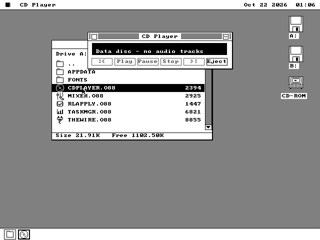

**It went in `SYSTEM\`, not on the apps floppies.** The first build put it
in `APPS_TOOLS` and the 720 KB apps disk answered `packages need 715
clusters; disk holds 713`. The Mixer (§34.15) had already solved the same
problem the same way: an optional program that belongs to a driver rides
`SYSOPTIONAL`, in `SYSTEM\` on the 720 KB, 1.2 MB and 1.44 MB system disks.
That is also where the driver is.

**86Box is the only emulator here that plays CD audio**, and nothing on this
host can click into it. Two things made it usable anyway. A small Swift tool
lists 86Box's windows (`CGWindowListCopyWindowInfo`), so `screencapture -l`
captures our machine's window even when another session's 86Box is in
front - the first whole-screen capture showed somebody else's VESA bench.
And `\AUTOSTRT` can open a document, so the gate floppy opens
`D:\TRACK02.CDA` with nobody at the machine.

On the first boot the player came up from a package link and read the
generated disc exactly - three tracks, 40, 30 and 20 seconds, 1:30 in all:

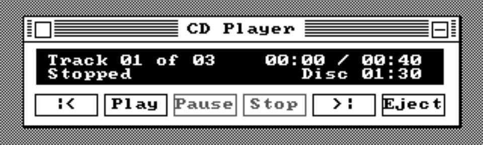

The `.CDA` link opened nothing, silently. Three things were wrong, found one
at a time, and only the last was where it looked:

1. **A drive just powered on reports UNIT ATTENTION twice** - the reset, then
   the medium - and `cd_cmd` retried once. The player had hidden it: its
   first poll failed and its second did not. Now `CD_UA_N` = 4.
2. **A link's document open does not sweep `ASSOC.DAT`.** Reproduced on
   QEMU with a test build of the driver that gives QEMU's one-track disc
   three fake audio tracks (`-DCDSIM_AUDIO`, never shipped): the kernel's
   association table held only the five built-ins at boot, and
   docs/plans/ASSOC-FIND-PLAN.md §1 already describes the gap - a
   double-click sweeps, a link and `OSAPI_PKG_START` do not. That is the
   kernel's open item, not the driver's, so the gate floppy opens `A:\SYSTEM`
   first, which teaches the machine whose `.CDA` is.
3. **The player's own read of the file** used `OSAPI_FILE_GOTO_Q`, which
   does not move the package's folder - so the name resolved in `A:\SYSTEM`
   and the read was refused. `GOTO_QM` is the quiet move that does, the one
   the Audio Player uses.

Then, captured every six seconds through the boot:

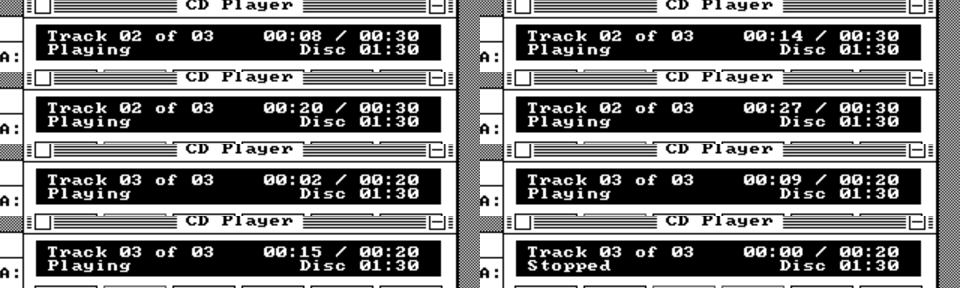

On QEMU (with the test build) the same double-click opens the player, which
reads the 44 bytes of `TRACK02.CDA` - byte-identical to SPEC.md §119.3.5's
layout - stands on track 2, and says the drive plays no audio:

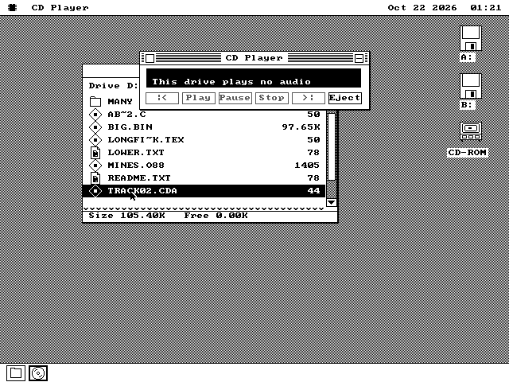

**Tested**: `tests/cdrom.py --sim` (row `cdromsim`, QEMU) for the listing,
the association, the file's bytes and the player's state; `vm/386-cdrom`
(86Box, looked at) for the play itself.

## Wave 3 — a disc on the desktop

The CD-ROM's zone wore the hard-disk icon: the kernel draws a volume as its
MEDIUM, and every driver volume was "fixed", so a drive whose disc comes out
read as one that never does. A fourth kernel picture would have been ~150
resident bytes on every machine and would have crossed kern_big's image rung
(45 bytes were left). §26.7 had already settled where a driver's desktop
picture belongs - in the driver, The Wire's reel being the precedent - so
the kernel gained a `DSV_CAPS` bit, `FSCAP_ICON`, and asks a file driver
that sets it to paint its own volume through its door (§26.4.2): **46 bytes
of `.cold`, no rung crossed, `.text` unchanged**. The disc is generated as
quadrant records (`drivers/cdrom/cdico.inc`, the art kept in its comments),
14 rows tall on the CGA so it is round there.

It composes into the cell's band like The Wire's reel, so selection inverts
it with no extra code:

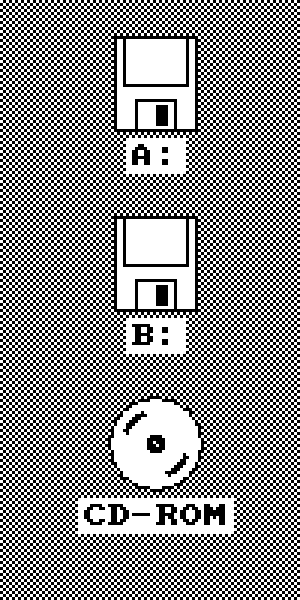 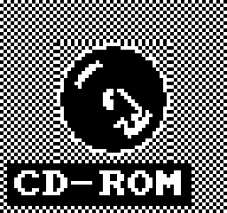
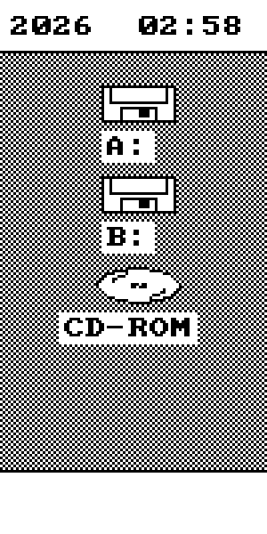

## Acceptance, and a second pair of eyes

An independent reviewer read the new assembly with no access to my
reasoning and found twelve defects, all real. The worst would have hung a
real machine: `READ SUB-CHANNEL`'s absolute address was divided by 75
unguarded, and a drive idle at FFFFFF6Ah - legal - makes that `div`
overflow; nothing here handles INT 0, and a 286 re-runs the faulting
instruction for ever. Others: a failed read inside a folder walk reported
as "end of folder" (a copy would have stopped early and called it done),
CD-Extra discs' last audio track running 11,400 frames into the session
gap, every key whose ASCII is 0 acting as Space in the player, and a
DRQ block of length 0 spinning with no timeout. All twelve are fixed in one
commit; the three CD rows passed again and 86Box played the disc through.

The soak union's one failure, `install`, fails the same way on `origin/main`
built from scratch - it is not this branch's. `test-full` passed.

## Wave 4 — CDRack

The ask was a redesign: the owner sent three mockups (kept in
`docs/cdrack/design/`) of an 80s rack CD player called CDRack - a charcoal
deck with a cyan seven-segment LCD, picture buttons with their captions
inside, a track grid, toggles and a track list; the same player in black
and white; and a compact mini player for small monochrome screens. In-package
graphics and a custom font, a colour theme and a black and white one picked
from a menu, colour by default on EGA and VGA.

**The pictures are made, not drawn.** `tools/os88cdart.py` defines every
picture as code or ASCII art and writes `build/cdart.inc`: five
seven-segment digit sets, a 5x7 small-caps face for the panel lettering, the
logo, the transport icons at 13 rows and at the CGA's 7, the disc mark - 92
pictures, 5,261 bytes. No image is read; the same run writes the same bytes;
`make` runs its `--selfcheck` first.

**One band, one blit.** Every field - an LCD number, a caption, a whole
button's face - is composed into a band the size of the FIELD and put down
with one `OSAPI_GFX_BLIT1` under a pen. The band's clear bits are its paper,
so a shorter value erases a longer one in the same call. A button is two
calls whatever state it is in. On a one-bit display the pen is not read and
lit means white, so black ink is the band turned over first.

**A theme is a table.** Every primitive takes a role - "the LCD's segments",
"a latched button's face" - and the theme maps the role to a colour, or to a
dither in black and white.

**What changes is an element with a key.** Thirty-two fields on the full
player each compute a sixteen-bit key for what they would show and draw only
when it moved. The paint forgets every key and runs the same code, so the
full paint and the incremental one are one path - and the check proved it:
after picking a track, two toggles and a programmed track, an About card up
and down repainted everything, and the window was **identical to the pixel**
(`diff bbox: None`). Expand after Compact gave the same answer.

What the first look found:

- **Every label at an odd x lost its first letter** - `DRack`, `RACK`,
  `IGITAL AUDIO`. SPEC.md 5.4.2.8 says why: off the byte grid, a band starts
  at the byte column HOLDING x and its first `x & 7` pixels are skipped. The
  band carries a slack byte a row, and `cr_bout` now shifts it right by `x & 7`
  first.
- **The compact LCD's digits were dots and dashes.** At 16 rows with a
  3-pixel stroke, a mitred vertical segment has no straight part left. The
  small sets became "block" segments - full-height verticals with the
  horizontals between, a cheap calculator's LCD - and the selfcheck gained
  the check that would have caught it: a `1` must be inked on every row but
  its three strokes'.
- **The menu draws no check mark**, and SPEC.md already says so: "an app menu
  has no check mark". Each Options item names its state instead -
  `Repeat: On`, `Time: Remaining`, `Theme: Black and White`.
- **The mockups drew a Help menu.** docs/INDEX.md exists because SHEET and
  CHART did that instead of using `OSAPI_ABOUT_SET`; About is the application
  menu's own.
- **QEMU's drive cannot play audio**, so to look at a disc the face shows a
  disc whose drive refuses audio as a disc - its tracks in the grid and the
  list - with every transport button grey.

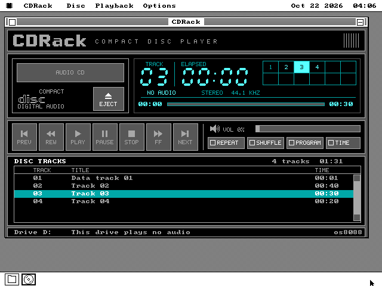 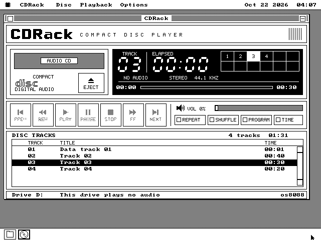

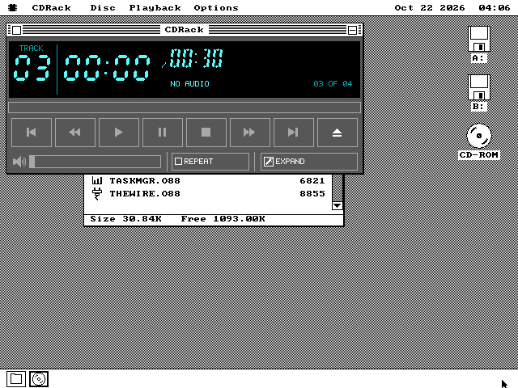
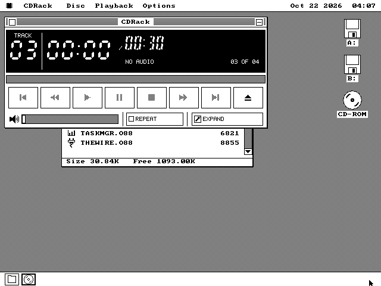

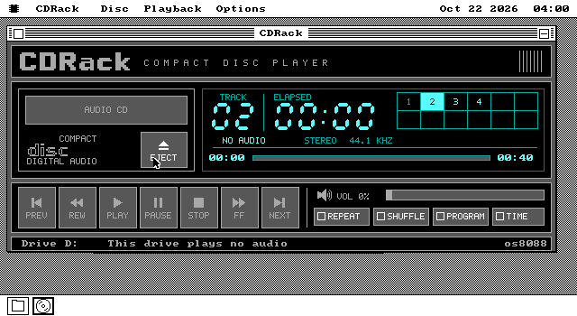
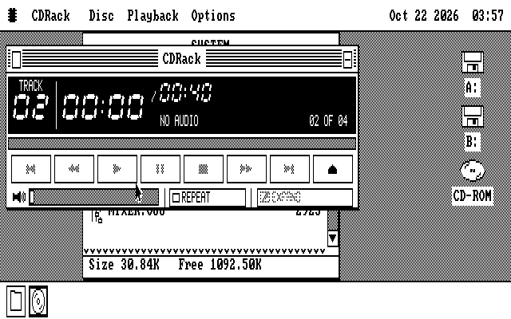

Hercules shares the MID layout with EGA and the one-bit path with the CGA;
QEMU cannot show a Hercules mode at all (docs/HERCULES-TESTING.md), so it was
not looked at.

**The play itself was the owner's to see.** QEMU's drive plays no audio, and
86Box cannot be keyed from this host, so when `vm/386-cdrom`'s BIOS stopped in
setup after its config was reset, the agent could only capture the prompt.
The owner cleared it, booted the machine into `D:\TRACK02.CDA`, and watched
CDRack play the disc cleanly - the last story of the wave.
