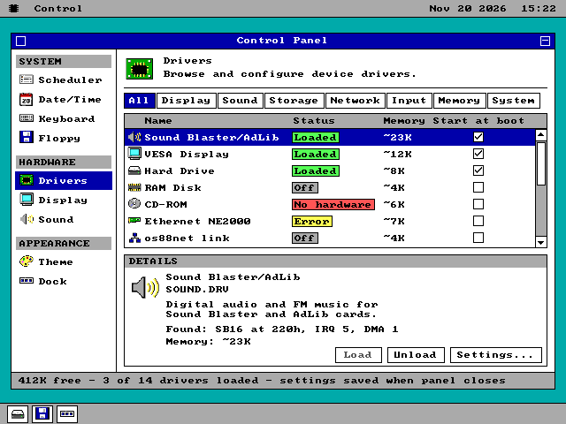
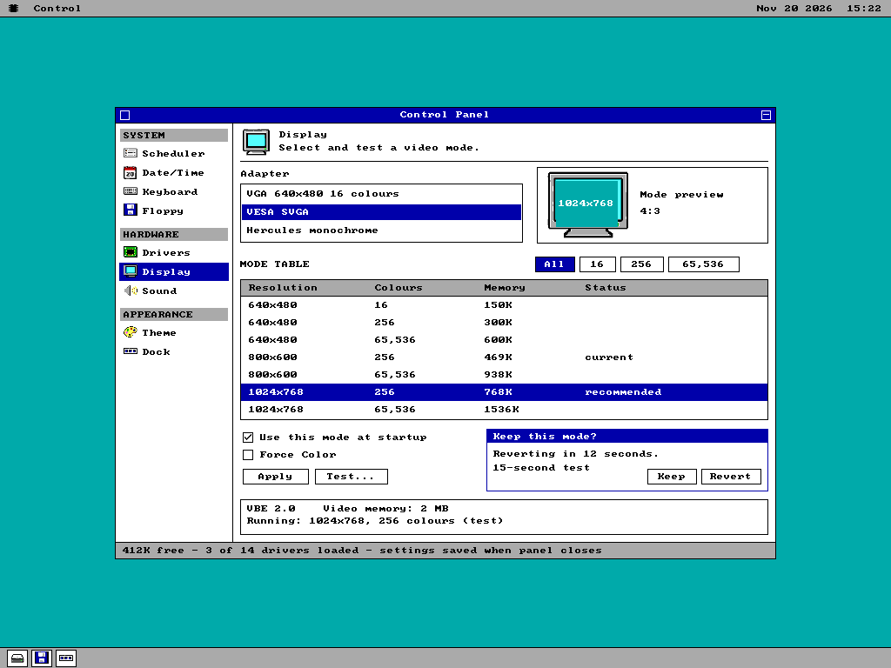
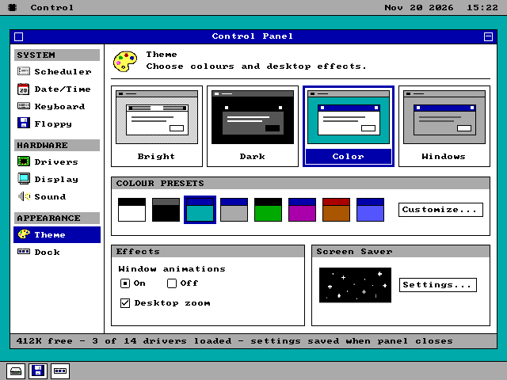

# How the wide Control Panel was built

A diary, kept as the work happened, for later reuse. Observations are
marked as such; intentions are marked as plans. The contract is SPEC.md 134
and the story list is [docs/plans/CPWIDE-PLAN.md](plans/CPWIDE-PLAN.md).

## 2026-11-21 - the brief, and why a second face

The owner asked for a Control Panel redesign for VGA and VESA, loaded
modularly "without bloat", with a much better Drivers view (the driver
library will grow), a more powerful video mode changer and a richer theme
changer.

What we found first (observed, at main 528648017):

- The panel is 320x151 because CGA is 200 rows; SPEC.md 31.1 pins 151 as
  the minimum that holds nine list rows. Its page pane is 221x132.
- `CTRL.DRV`, the on-demand module that IS the panel, was 16,200 bytes on
  `kern_big` and 16,431 on `kern_mega`, against a 17,408-byte module cap. A
  wide face could not live inside it.
- The pages' click procs are hit test, state change and redraw in one body,
  and on `kern_big` the same body is re-run as the probe that finds the
  control under the pointer. Rewriting that logic for a second face would
  have been the bloat the owner ruled out.

So the design (SPEC.md 134) is a SECOND module loaded beside the first only
on a colour display of 640x480 or more: `CTRL.DRV` keeps every state change
and every compact page; `CPWIDE.DRV` draws the wide chrome and three pages
natively, hosts the rest at an origin inside its larger page area (the
compact page contract already takes its origin in registers), and reaches
the logic through one gate entry. Any refusal opens the compact face.

## The mockups and icons

Codex CLI's image generation drew three full-screen mockups at real
resolution and two icon sheets in the 16-colour palette, from the prompts
kept in `docs/cpwide/MOCKUP-PROMPT.md` and `kernel/cpwart/ICON-PROMPT.md`.
Each run took about five minutes. The mockups came back pixel-exact, in the
8x8 font and the EGA palette, which made them directly buildable rather than
mood boards.

