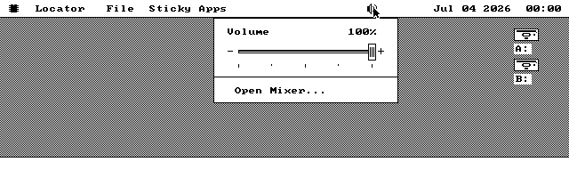
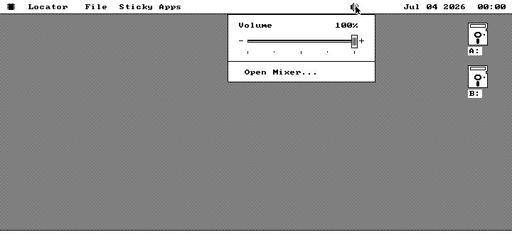
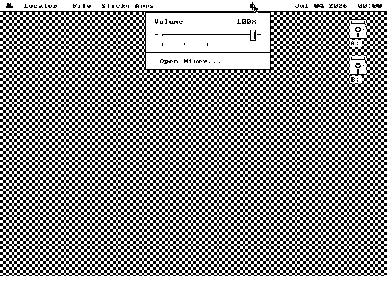
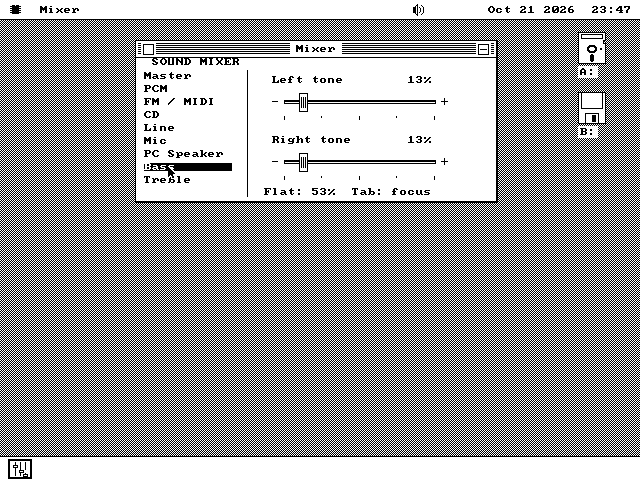

# How Mixer was built

## Foundation

The request combines a global desktop control with optional installed
software. The API index and Sticky Apps menu showed two reusable conventions:
quiet discovery each opening, and doing a package launch only after the
tracker releases the graphics lock. SOUND.DRV already owns the card's ports
and accepts package verbs, so the kernel needs no new mixer API cells.

The hardware reference is Creative's Sound Blaster Hardware Programming
Guide, chapter 4. A DSP is not evidence of a mixer: ordinary SB 1.x/2.0 and
AdLib hardware need no speaker affordance. The three mixer generations have
different channel masks and bit depths; the driver exposes percentages and
reads back the real quantized setting.

The visual brief is an engraved scale and a ridged mechanical thumb, drawn
from shared source for the popup and package. The face must be designed in
black and white first so Hercules and CGA are first-class presentations.

The checked [delivery plan](plans/MIXER-PLAN.md) separates implementation
from verified acceptance.

## Hardware wave

SOUND.DRV now owns descriptors for the three mixer families and offers
INFO/GET/SET through its existing package door. Detection checks two values
and restores the tested register. Source percentages round to the actual
3/4/8/16/32-level hardware, stereo transactions are atomic, and the driver
saves only exposed registers for detach. Mixer availability is independent
of PCM-buffer ownership and the selected sound tier.

Host verification: `make small` and `make` passed all 55 fast checks after
building the small system disks required by the install-manifest check.
Hardware and interaction evidence belongs to the final mixer rows.

## Quick-volume wave

The first CGA boot showed the intended compact mechanical slider. It also
exposed two defects worth looking for in assembly UI work: loading a color
into AL after calculating AX changed a rectangle's x coordinate, and file
discovery left the busy/activity affordance up for the life of the popup.
The drawing paths now set colors before loading geometry, and the kernel's
small modal bridge finishes file activity and owns cursor/event bookkeeping.

The slider is composed with os88gfx.inc and emitted as one opaque band.
Only the control band changes during a drag; its baseline stereo ratio
survives silence and return. Save-under is sized for the actual adapter and
optional command: 2/3KB on mono, 8/10KB on color. It is freed at dismissal.

The driver exceeded the original HMA address window. The C000 origin gives
16KB of offsets, keeps owner aliases below FB00, and leaves the 24KB pool
unchanged. The host build checks relocation against a second assembly.
Affected final rows include mixerhost, mixer adapter/UI rows, hmadrv,
sndmove, stikmenu and toastbar.

## Optional package wave

The native Mixer now builds and opens from the discovered command. The first
VGA inspection showed the shared fader, a channel list, clear mono balance
status and the system About convention. The source list comes from the
driver; unsupported entries use the standard disabled pen. Bass and treble
use left/right cut/boost controls instead of a volume balance ratio.

MIXER.O88 joins SYSTEM on the larger system floppies and live media; it is
omitted from the 360KB system disk and every small-kernel disk. A large-disk
installation copies it as an ordinary file. Discovery is repeated at each
opening and at launch. The popup's Open Mixer row now has a separator and
an inverted hover treatment.

The initial idea borrowed three cells from the clock. Review of the toast
contract rejected that: its maximum message needs the existing field. The
right-hand boundary now moves left by three cells while the speaker is
present, preserving the entire clock and toast field. Application menu
layout keeps its existing prefix rule.

## Acceptance and pictures

The CGA, Hercules and VGA sessions passed the same gestures: click-open,
Home/End, a held drag beyond the track, release, Escape, click-away, discovery,
launch, native source selection, About and close. The save-under comparison
checks every covered desktop pixel. Each dismissal frees its claim. CGA
also boots without the package and without mixer hardware, checking that
the command and speaker disappear at their respective boundaries.

QEMU's CT1745 supplies nine actual mixer channels, independent stereo
readback, and separate left/right bass controls. The session runs with 1MB
and 128MB so the driver executes from the heap and HMA respectively.

The independent register-model row executes the shipping driver with
SS different from DS. It checks every percentage against all three Creative
register maps, native quantization, stereo independence, unchanged neighboring
channels, invalid writes, floating/stuck buses, interrupt protection, probe
restoration and exact detach restoration. A deliberately wrong SB Pro
register is the negative control and must fail.

The final union also passed `hmadrv`, `hmahiber`, `sndmove`, `fmrefuse`,
`stikmenu` and `toastbar`. The UI retries exposed test-instrument defects:
duplicate assembler map requests, QEMU's `spc` key name, and mouse pacing
that needed QEMU's guest ticks. Those were corrected in the harness; the
adapter rows were repeated only after the final code review found two
interaction defects: the key handler owed SI back, and a captured drag
needed to keep tracking x outside the panel's vertical extent. Both paths
now have gesture coverage.

The final pixel review found a separate boot interaction: a progress widget
could be armed against the old clock boundary before SOUND.DRV published
its mixer. Its finish cleared the speaker's outer rows but left trough
hatching in its text rows, beyond the menus' new bound. The widget now
invalidates the speaker when its old span overlaps that segment. Acceptance
compares every speaker pixel with its source bitmap after boot and package
activity; the progress regressions are `fpgcold` and `fpgnotch`.

Resource measurements, compared with the foundation build: kernel text
43,250 bytes (+316), with BSS, low BSS, cold and video scratch unchanged.
Rounded kernel size stays 97,792 bytes. The budget gate leaves 3,072 bytes
on kern_big and 2,560 each on kern_small and kern_emu, without raising a
budget. SOUND.DRV is 11,602 bytes and rounds to 12KB; Mixer packs to 2,925
bytes on disk and has a 1,056-byte private drawing buffer.
The emulator kernel crosses one 512-byte image rung; its total is 98,304
bytes. The small kernel stays at 61,440 bytes. The measured hot-code
alignment is preserved by moving a padding byte across the UI task.

The background-service leg uses the existing SB Test fixture with 19,200
bytes staged at 4,000 Hz. Its default build is byte-identical to the base;
the longer test arm leaves time for QEMU's pointer and disk interactions.
On both heap and HMA, the popup opens before the stream ends, changes its
volume, and remains open until the card consumes every byte. Closing the
player frees its stream buffer and the driver holds no scratch claim.

The guide's three program captures were inspected as pictures, including
the About card. They caught its packed-text terminator reading beyond the
line table; the table uses the shared library's end marker. A stereo
gesture also checks that moving focus to Balance erases the previous Level
marker, even when its numerical value has not changed.

An independent FAT12 walk finds SYSTEM/MIXER.O88 on the 720KB, 1.2MB and
1.44MB system floppies. The 360KB image omits it and has 13,824 bytes free.
The larger floppies have 145,408, 646,144 and 889,856 bytes free respectively.
The live-media payload uses the same optional SYSTEM file, which an installed
system can also receive by an ordinary file copy.

MartyPC's mixer is a raw register bank without analog attenuation. It proves
the XT UI and adapter pixels; the independent masks and QEMU prove register
behavior. Physical loudness, channel wiring and analog balance still need
a listening check on real Creative cards. No emulator result here claims
that measurement.

Final gate: all 13 affected soak rows passed. `make test-full` passed 62 of
63 rows initially; `kernresident` could not start because the reused emulator
assets lacked its 128KB VGA machine definition. The definition from the
repository was added to a private configuration, and only that failed row
was rerun: it passed, proving the desktop boots on 128KB and stays inside
the resident budget. All 63 full-tier rows therefore passed, including the
C toolchain, both mono-adapter boots, small-kernel boot, hot alignment and
the strict guide lock. The original checkout and emulator configuration
were left alone.
