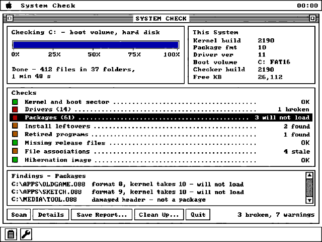
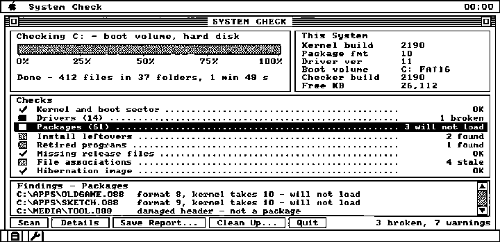
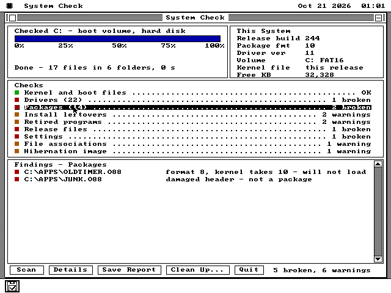
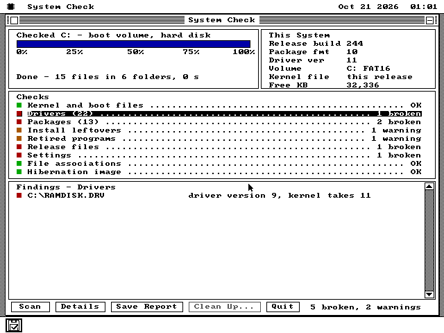
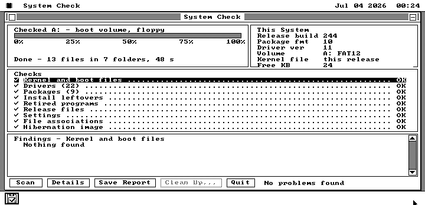
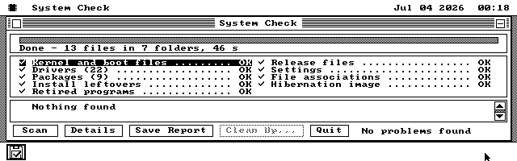
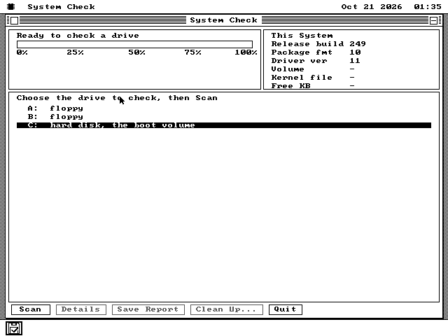

# How System Check was built

**Is the installed system all one release?**

This is the record of what was actually built and tested, written as the
work happened, so that it can later be reused on the website. Plans live in
[docs/plans/SYSCHECK-PLAN.md](plans/SYSCHECK-PLAN.md) and the contract in
SPEC.md 118; this file says what happened, and keeps what was measured apart
from what was intended.

## 2026-10-20 — The question came from an upgrade

It started as a question about upgrades: a machine has os8088 installed on
its hard disk, a new release comes out - how does it get onto the machine?
The answer turned out to be mostly built already. The hard disk tool's
Install, with *Erase the partition first* left clear, writes the new
kernel, drivers and programs over the old ones and keeps everything else
(SPEC.md 52.10.15): the user's files, their settings, their `APPDATA`.

What it does not do is tidy up. "Nothing else is touched" is exactly right
for a user's documents and exactly wrong for a program the new release
retired, a driver it renamed, a package built for the old API table that
will now answer *Wrong os8088 version*, or a `KPAD.TMP` left by an install
the power cut short. Those were the gaps, and the owner asked for a program
that finds them, with a progress display like REDLINE's.

## 2026-10-20 — A design before a line of code

The window was drawn first. Codex's image tool was given four real os8088
screenshots - REDLINE's summary and its running screen, the hard disk
Install dialog and the Task Manager - and a description of the program, and
asked for three screens: a scan half done, a scan finished, and the
finished screen again on a monochrome Hercules card. The prompt and what
Codex passed to its own image tool are both kept in
[docs/syscheck/design/](syscheck/design/).

The mockups got one thing wrong that only the operating system could
point out: the *This System* card reads "Kernel build 2190", and nothing a
program can ask will tell it the running kernel's build. The debug registry
that knows is forbidden to shipped software (SPEC.md 57.3), and adding a
slot would spend resident bytes on one program's question. The answer that
cost nothing was to make the question unnecessary: System Check lives in
`SYSTEM\` on the system disk, so the install writes it beside the kernel it
describes, and every upgrade replaces it. Its own build number *is* the
release's, and its manifest is that release's file list.

The monochrome mockup settled the other design question. On a 1bpp card,
red, amber and green all round to black, so the lamps had to become shapes:
a tick, a checkerboard, a solid square, a hollow one.

## 2026-10-20 — What the operating system already had

Three surveys of the tree came before the contract. REDLINE was the look to
copy and the scheduling not to: it runs a whole benchmark inside one key
handler with the screen locked, which is fine for a benchmark and wrong for
a disk scan that should leave the desktop usable. The scan instead runs in
slices on the UI task through the wake mechanism RunCPM and the Font Viewer
use, because a worker task may not touch a file.

The file system had a surprise in it that shaped the design: a package
**can read** a hidden system file by name and **cannot list** one. So
drivers cannot be discovered - they have to be asked for, by the names this
release ships and by the names earlier releases shipped. Those historical
names came out of the Makefile's git history: `DEBUG.DRV`, `CLONE.DRV`,
`DESKTOP.DRV`, and `VMMOUSE.DRV`, which only the browser kernel carries now.

## 2026-10-20 — Four bugs on the first boot, and one in the fixture

The first build assembled at 13,550 bytes and booted straight into a scan,
which was more than it deserved. The screenshot then showed four bugs at
once, and every one of them was the kind this machine makes easy:

- the percentage labels under the bar were drawn **in the menu bar** -
  a `mul` had overwritten the y coordinate in DX, the 8086's habit of
  using DX as the top half of every product;
- the findings card sat **on top of** the checks card, for the same reason
  one routine further up;
- the Packages row said **OK** on a disk planted with two broken packages.
  `OSAPI_FILE_FIND` types a file as a package only when the loader would
  accept it - so the packages the check exists to find were arriving as
  plain files. The test is now the `.O88` name;
- the Settings row warned about a settings file that was fine, because a
  helper clobbered the register holding the record's length.

The fixture had a lesson of its own. A hibernation pointer from another
build was planted, and the row stayed OK: the kernel had already **deleted
it at boot**, image and all, which is exactly what SPEC.md 87.3 says it
does. So the leftover a real machine can carry is an image with no pointer,
and that is what the fixture plants now.

## 2026-10-20 — Clean Up, and the report

Clean Up asks with the standard alert (Cancel is the default, so Enter
cannot delete anything), removes only the files whose finding says they are
debris, rebuilds `ASSOC.DAT`, and scans again. On the planted disk it
removed `KPAD.TMP`, the retired `MODPLUG.O88` and the orphaned hibernation
image, fixed the associations, and left everything SPEC.md 118.8 says it
must leave: the duplicated program, the broken packages, and the hidden
system files a program cannot touch.

The report came back off the image on the host naming all eleven planted
findings, with one cosmetic bug - the year read `2,026`, because the shared
number formatter puts a thousands separator in every number. That is now
the test's to catch: `tests/syscheck.py` builds the planted disk, boots it,
saves the report, checks every line, cleans up and checks again, in about
47 seconds.

## 2026-10-20 — On the 8088, and on black and white

MartyPC's 5150 ran it from a 360KB system floppy on Hercules and on CGA.
**Measured: 46-48 seconds** for a whole scan at 4.77 MHz, nearly all of it
reading the release's files off the floppy to sum them, with the screen
live the whole time. And on a disk fresh from the build every row was OK
and the status read *No problems found* - the negative control that matters
most, since a checker that cries wolf on a clean install is worse than none.

## 2026-10-20 — It asks which drive

The first version checked the boot volume and nothing else, and the owner
asked for a question instead: *which drive?*, with the hard disk already
chosen. That turned out to matter most on exactly the machine the program
is for. Install a release onto a fresh hard disk and you are still running
from the floppy, so "the boot volume" is the floppy, and the disk you want
checked is the other one.

So the window now opens on a chooser in the place of the checks: every drive
the machine has, the hard disk in inverse video. The rule for the default is
one line - the boot volume if it is a hard disk, else the first hard disk -
and "hard disk" had to mean *fixed and not a cable*, because a drive
redirected over the parallel link answers fixed too. A one-drive machine's
B: is left out, because the BIOS quietly maps it onto A:.

The planted-disk test now presses Scan once and gets the hard disk it was
offered; it passes as before.

## 2026-10-20 — Section 118, not 116

While this was in review, Lemmings merged as SPEC.md 116 and the INSTALL
wizard's open pull request had already claimed 117, so System Check's
contract moved to SPEC.md 118 when main was merged in. Nothing changed
but the number: every citation in the source, the tests and these
documents now says 118.
