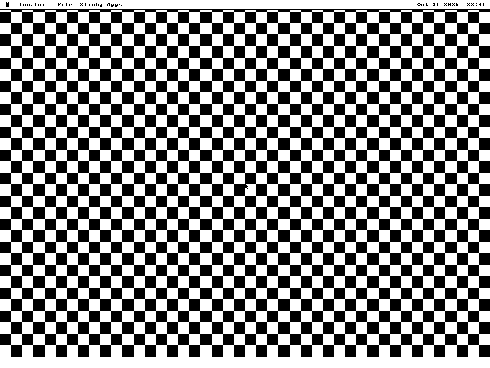
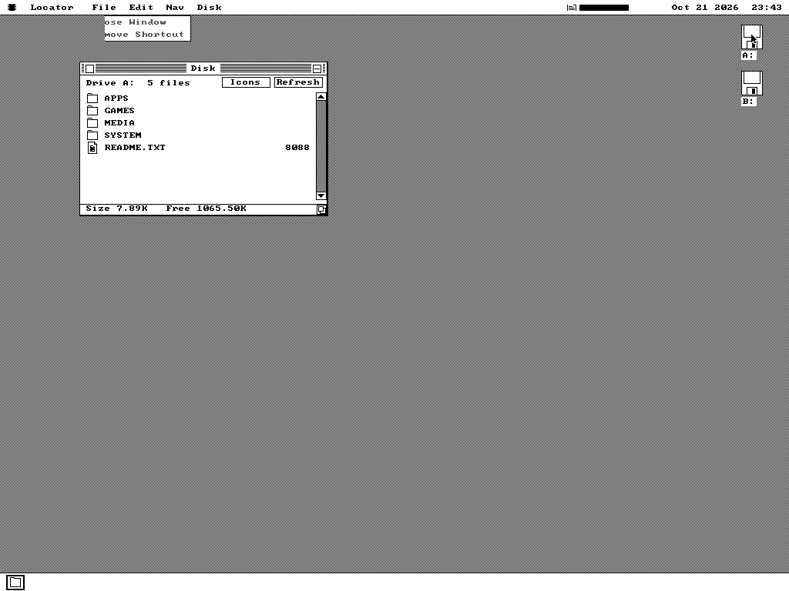
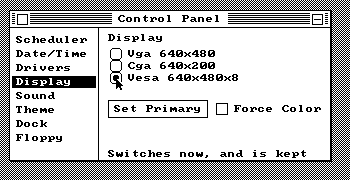
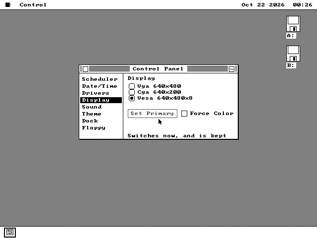
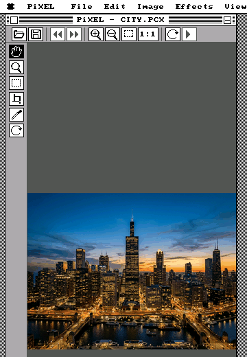
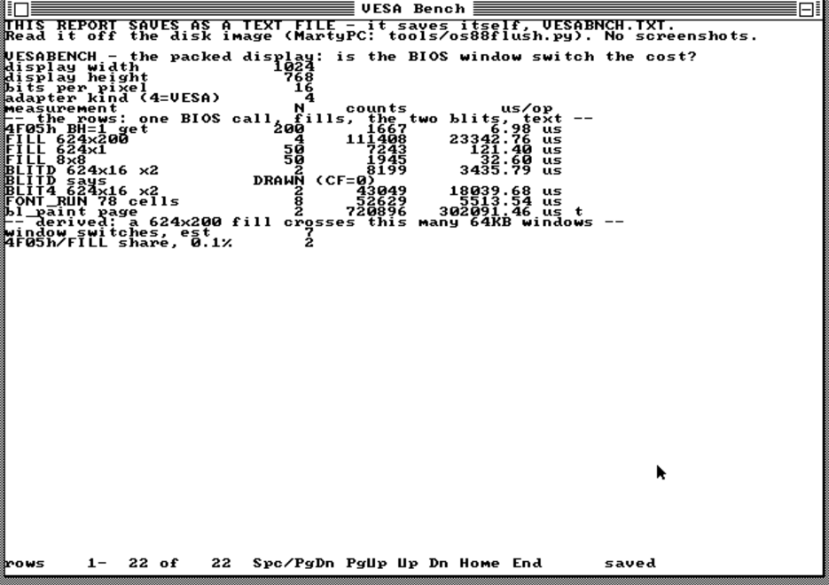

# How VESA was built

A diary, kept as the work happened, for the website later. Observations are
separated from intentions; a measurement names the machine it was taken on.
The plan is [plans/VESA-PLAN.md](plans/VESA-PLAN.md) and the contract is
SPEC.md §120.

## 2026-10-21 — S0, the shape

**The ask.** VESA modes at 800x600 and 1024x768, auto-detected, up to 16-bit
colour, as a video driver used when the card can do it; built in phases
behind one draft PR with a checked-in plan.

**What the OS already had.** Four adapter kinds driven by one kernel, chosen
by `[vid_kind]`; two renderers — the planar VGA/EGA bodies in `vga12.inc`
and the 1bpp software renderer `softgfx.inc` — dispatched by one byte,
`[vid_mono]`, at the top of every drawing body. A geometry table, `vid_tab`,
one 18-byte row per kind, copied over a live block by `vid_apply`. A driver
layer whose drivers are files the user ticks, each with a class, a service
table and a `SYSTEM.CFG` bit. A precedent for exactly this shape:
`VMMOUSE.DRV`, a feature that lives in a file because the machine the
project is calibrated against can never use it.

**The question that decided the design.** Where does a packed-pixel renderer
plug in without the XT paying for it? Three answers were priced:

1. A third renderer in the kernel. Thousands of resident bytes on a kernel
   with 3,072 spare and an image rung with 437 left. Refused.
2. A fourth kernel build (`kern_vesa`, as `kern_emu`). Zero bytes on the XT,
   but a fourth system disk for every gate that walks "every shipped image",
   and a VESA user who boots the standard disk gets nothing. Kept as the
   owner's alternative in the plan.
3. One compare per planar body, far-calling into a driver. ~11 bytes a site,
   about twenty sites, the same shape as the dual-display hook that already
   sits two lines above each of them. Taken.

**Three facts that shaped the contract.**

- Every register is a parameter to some primitive (`gfx_blit4` uses all
  eight), so a selector cannot travel in one. The stub is `call vx_go` with
  the selector as a data byte after the call; the driver reads it through
  the return address. Eleven bytes a site, no register, flags kept.
- The mouse ISR runs on a 128-byte private stack and draws the arrow. A VBE
  bank switch is an `int 10h`. So the driver owns the cursor cycle whole and
  switches banks on a 512-byte stack of its own.
- `[vid_planes]` is already multiplied into every save-under size as "bits
  per pixel over four planes". Publishing 8 or 16 there makes the three
  existing sizers compute packed byte counts without a change.

**Not taken.** The linear framebuffer: real mode cannot address it, unreal
mode is 386 code that any segment load undoes, and this kernel reloads
segments on every task switch.

**Build state at the start.** `kern_big` 97,792 of 100,864 (3,072 spare,
6 steps); image rung 437 left, cold rung 251 left. One fast-tier row,
`installabi`, fails on a clean checkout of `main` before this branch touched
anything (it wants `build/small*.img`, which a first `make` has not yet
built when the tier runs).

## 2026-10-21 — S1, the first desktop on the VBE

**Observed.** QEMU's standard VGA, `make vesatest && python3 tests/vesa.py
--png build/vesa-s1.png`: the desktop at 1024x768, 16 bits a pixel, mode
`0117h`. The menu bar with its logo, the three titles, the date and the clock;
the 50% dither over the whole desktop; the arrow; the dock's white strip. The
dock's tiles and the desktop's drive icons are absent — both are `gfx_blit1`
bands, which S1 refuses (the band body is S2's) — so the picture is the
desktop minus its icons. The gate reads `vid_kind` 4, `vid_ext` 1, 1024x768,
`vid_planes` 16 and a clean driver row, then the screendump.

**Three things the code taught the contract.**

- The boot blob was full: 6,142 of 6,144 bytes. The attach-and-switch body
  written for it, beside `vmm_boot_x`, went to `.cold` instead — 116 resident
  bytes — and is called by kmain between `kmain_o`'s return and the blob's
  release, which is the one window where the blob's `vid_switch` is still
  there to call. The overlay checker could not see a reference into a label a
  three-argument macro pastes (`VSW_SWITCH bvs, BSWK, bvw`); it can now, and
  the one other crossing that surfaced (`bdk_apply`, a macro body defined
  under `.modc` and expanded only in the blob) is registered with its reason.
- A private stack in the driver for the `int 10h` window switch was wrong:
  two tasks preempted inside one BIOS call would share it. The mouse ISR's
  own private stack doubled to 256 bytes instead, and every other call runs
  on the task that made it.
- `drv_attach`'s contract says PRESERVE BX, and the probe spent it. The
  symptom was a refused driver with `No hardware found` and a mode table of
  ten accepted modes sitting in the freed image: the init verb went to a
  garbage row and the range check refused the far call. Both ends now keep
  the row.

**Measured** (`tools/kernsize.py`, kern_big): `.text` +409, `.cold` +215,
`.lowbss` +128, `.bss` +4; no rung crossed; `KERN_SIZE` 97,792 unchanged.
Three gates tripped and were satisfied: the hot-routine parity gate (every
hook shape is now an even number of bytes), the stack-balance walker (the two
tail trampolines are exempt, with the reason on them) and the driver memory
gate (the row's term).

## 2026-10-21 — S2, every primitive

**Observed.** The Disk window at 1024x768x16: title band, folder icons,
captions, buttons, scrollbar; the drive icons and labels on the desktop; the
dock's tile; the File menu dropped with its greyed items stippled, and gone
again with the dither whole. `tests/vesa.py` now drives that - a press on
File (a menu is press, drag, release: a click opens and closes it on the
release, which is how a run passed and the next failed), a release away, a
double-click on A:.

**Three bugs the gate caught, all the same kind.** A body that read the
frame pointer where the caller's BP - the band's stride - was meant, and
drew noise where the icons go. A text run whose pixel loop spent CX, the
cell's x, so every row after the first went to the left edge. A restore
whose sub-rect arithmetic spent AX and put the pixels back at x = 0: the
menu's box came back half ghost, which the gate's dither check at one point
missed and now checks at both ends of a row the drop covered.

**The cold body.** `gfx_blit1_x` lives in `.cold`, where no data may go, so
its hook could not carry a selector byte. It got its own far entry,
`vx_callf1`, whose selector lives beside it in `.text`; the cold stub is a
far call and a jump. One such entry per cold body, and there is one.

**Measured** (kern_big against main): `.text` +508, `.cold` +226,
`.lowbss` +128, `.bss` +4. The image rung crossed once at S2: `KERN_SIZE`
98,304 against 97,792, 2,560 spare - which is the one rung the contract
bounded the hook at, spent.

## 2026-10-21 — S3, S4, S5: colour, choosing, the rest of the system

**S3 turned out to be already done, and the half that was not was moot.**
The RGB565 table and the 8bpp DAC load shipped with S1; the plan's "track
the DAC through theme changes" assumed a writer that does not exist - the
kernel never programs a palette after boot (SPEC.md §39.4), themes and
presets being pen choices inside the sixteen. One DAC load in the whole
kernel, Force Color's, and it runs before any driver is attached. Ticked on
the evidence the two existing rows already carried: white reads back white
at 16bpp and at 8bpp.

**S4 was shaped by two buffers that were full.** The `VE` key as written
was four bytes in a settings record; the boot blob had two bytes of 6,144
left, and the buffer the boot reads `SYSTEM.CFG` into is blob bytes with
one. So the class became ONE BYTE - bit 7 set, two bits of width, two of
height, one of depth, from the four of each the driver offers - carried as
the fourth byte of the `VM` record (ver 3), and the seven bytes of Force
Color's test at its call site moved into `vgcf_boot` to make even that
fit. The Mode button went the same way: with the VESA row the Display page
lists up to four adapters, so the rows went to a 12-pixel pitch and the
pane had no 40 pixels for a button beside Force Color. The row itself is
the control now - click it while it is already the choice and it walks the
driver's table, `Vesa 640x400x8`, `Vesa 640x480x8`, ... `Vesa auto`, the
label composed at paint from the class byte.

**Two bugs the new row caught, both in the second click.** The composed
label is written over the old one and `font_run` draws nothing past its
NUL, so `Vesa 640x400x8` left the `16` of `Vesa 1024x768x16` on the glass:
the label is padded with spaces to the longest now, and a space draws its
ground. And the second cycle wrote the right byte and drew its label off
the pane - the driver's table walk spent DI, which was the painter's pane
left, and the first cycle took the Auto path that does not. The verbs keep
every register but their outputs now, SPEC.md §1's rule; the page did not
have to learn to defend itself.

**S5 was a list of places that index by kind.** `fsx_capstab` had four rows
and `[vid_kind]` could be 4, which is the kind of defect that reads as a
random refusal on a game's start; VESA's row is VGA's, the same card. The
hibernate item greys itself as `Hibernate (VESA)`, the suspend sweep keeps
`vesa_row`, EXTD.DRV's Extend answers Single on a VESA primary. Each is a
compare and a branch; none is a design.

**Measured** (kern_big against main): `.text` +532, `.cold` +247,
`.lowbss` +128, `.bss` +5, `.boot2` −5. The cold rung has 98 bytes left -
the next cold byte of any size is a rung. kern_small assembles none of it.

## 2026-10-22 — S6, a package at depth

**The slot is small; the consumer was where the day went.** `OSAPI_GFX_BLITD`
is one appended cell, a kernel routine of fourteen bytes and a driver body
that is `vga_restore_vram`'s row copy with `gfx_blit4`'s clipping. PiXEL's
side is a 512-byte RGB565 table built beside the dither tables, a 16bpp arm
in the row composer, and one call a row - and the gate that boots the
machine straight into PiXEL through an autostart link found four things,
none of them in the new code.

**Four bugs, in the order the glass showed them.** The window-display query
answered a depth of 1 for kind 4 - its classifier knew VGA and EGA as the
four-plane kinds and called everything else mono - so PiXEL built 1bpp
tables and drew a dithered nothing. With that fixed the picture came out one
row tall: PiXEL's pixel-aspect and layout tables have a row per kind and a
kind of 4 read past them. Then the picture stayed grey: the autostart link
launched PiXEL *before* the boot switch - `as_boot` is the last thing in
`kmain_o` and `vx_boot_x` ran after `kmain_o` returned - so PiXEL built its
tables for the VGA and the switch took that display away under it. The call
moved into `kmain_o`, between the loading screen's last frame and the
autostart, which is where the contract now says it is (and where "before
the first paint" is finally true). And last, blues the palette did not hold:
the table lookup's index register kept the previous pixel's shift carry in
its high byte and read past the table every 128th pixel.

**What the gate asserts** is narrower than it first did. The first cut
compared the glass against the host simulator's palette for the file; the
guest's own palette is what the table is built from, so the row reads
`px_pal` out of PiXEL, holds the table to its quantisation, and holds every
non-desktop colour on the glass to that set - what the master *is* stays
tests/pxopen.py's question.

**Measured** (kern_big against main): `.text` +562, `.cold` +247, `.lowbss`
+128, `.bss` +5, `.boot2` +0 - the five bytes of the far call went from
`.text` into the blob, which had exactly that many. The ABI lock took the
cell without a `PKG_FMT` bump.

## 2026-10-22 — S7, where the time goes

**The question was the BIOS call, and the answer was no.** The plan held a
direct window register for the Bochs VBE in reserve, to be taken only if a
measurement said `int 10h 4F05h` was where a packed desktop spent its time.
The bench that answered is a benchlib package that runs itself on its first
paint and saves itself, opened at boot by an autostart link - because the
machine the numbers come off, 86Box's 486 with a Cirrus 5428, has no
automation socket and nobody to click. (Its first boot stopped in the AMI
BIOS at a fresh-CMOS prompt; an F1 through AppleScript got past it once and
the `nvr` file remembers.) On that 486 the BIOS call is seven microseconds
and a window-sized fill twenty-three milliseconds across seven windows:
0.2%. The register was not taken, and the decisions table says why.

**What the fill's number said instead.** 249,600 bytes in 23.3 ms is 10.7
MB/s, twelve cycles a word at 66 MHz: the VL bus, and the fill was already
one `rep stosw` to each window edge. The depth blit and the restore were
not - a word and an edge test a pixel, at half the fill's rate - and two
rounds of `vx_rowcopy` (first `rep movsb` to the edge, then the words under
`rep movsw`) took the depth blit from 7.9 to 3.4 ms, the fill's rate to
within ten percent. The restore is every menu's close, so that is the row a
user feels. And the sixteen-colour blit of the same rows is 5.3x the depth
blit, which is the number §120.7 was pinned on before anyone had it.

**Two bench bugs on the way.** Two rows lapped the PIT and came back
tick-timed in whole 55 ms (`w`), so the blocks shrank until no row did;
and `bl_mul48` is DX:AX times CX into the accumulator, not the accumulator
times CX, so two in a row kept only the second and the share row read 0 -
the switch count times a thousand is one word, so it is one multiply now.

## 2026-10-22 — S8, acceptance

**One soak pass, after the last batch.** Twenty-nine rows in one call - the
five VESA rows, every Display-page row that reads the adapter list
(`dispcalcx`, `dispcorner`, `dispfsx`, `dispsaver`, `disptext`, `dispsave`,
`dispprefer`), the hibernate pair, the fullscreen rows, `autostart`, and
every PiXEL row whose composer this branch touched (`pxopen` on three
machines, `pxpaint`, `pxdraw` twice, `pxfolder`, `pxfsx`, `pxparts`) - and
all twenty-nine passed, 1,078 s. Then `make test-full` once. CLAUDE.md's
rule was kept to the letter this time: no row ran between S3 and S8 except
the new rows while they were being written, which is what a row is for.

**What `NOVIDEXT=1` says.** A kernel without the hook, measured against
main, is `.text` +16 and `.cold` +101 - the class byte on the `VM` record,
Force Color's test in `vgcf_boot`, the fsx caps row - so the hook itself is
`.text` 546 and `.cold` 146, and the mouse ISR's stack 128. The image rung
crossed once, at S2, and stayed crossed; the cold rung has 98 bytes left,
which the next cold byte of any size will spend. kern_small assembles none
of it and is byte for byte the kernel it was.

**What has not been seen.** A real VBE card. The two fixtures are QEMU's
Bochs VBE (2.0+, 1024x768x16) and 86Box's Cirrus 5428 (1.2, the same mode),
and they agree about everything this branch asserts; a real card's bus is
what they cannot show. The plan's S8 names the rest.

## 2026-10-22 — a machine to look at

**`make 486-vesa-desk`.** The bench machine boots a disk that opens VESABENCH
and nothing else, which is right for a measurement and useless for a look.
This is `vm/486-vesa` again with `vesa.img` in A: - the shipped system disk
with VESA.DRV wanted and no autostart - and the shipped apps disk in B:, so
the 486 comes up on the 1024x768x16 desktop with both drives on the desk,
and Control Panel, PiXEL and the rest are a double-click away. The Cirrus
drives that mode interlaced (86Box's status bar reads 87i Hz), which the
bench never showed because nobody was looking. The Display page writes
`SYSTEM.CFG` back onto A:, a build product the next `make` puts back, so
the machine's own state is the `nvr/` 86Box keeps, and that is ignored.

**What the first look found.** Two Disk windows open and the desktop under
them turned into a band of vertical stripes, sixty-odd rows, edge to edge
(the owner's screenshots, on the 486). Every row of the suite had passed.
The stripes had an 8-pixel period, which is a pattern tile's and not the
dither's, and the band was 64 rows at 1,024 pixels: one 65,536-pixel loop.
A ring of entry rects in the driver, read back out of QEMU with
`pmemsave`, named it in one boot: `vxp_pat` entered with x 104..407 and
three rows, and a width of **65,433** - the tile copy's `rep movsw` had
left CX at 0 before the width was cut from it, and the width came out as
1 - 104. The Disk window's chevron band is the one pattern fill an idle
desktop draws, and it draws it only under a list that overflows, which
nothing in `tests/vesa.py` had opened. It opens B:\APPS now and reads the
left margin as a checkerboard; its first cut asked a 2x2 block for black
AND white and the stripes answered yes, so the A/B leg (the fix taken out)
is what made the row honest. Same band on QEMU's Bochs VBE once the right
folder was opened, so the card was never the suspect it looked like.

**Then the owner tried Gorillas.** It opened as a strip the width of the
screen, and the disk widget never left the bar. Instead of chasing each
report, a scratch script booted all thirty-six packages on the apps disk
once each, through an autostart link, on the VESA disk and again on the
plain one, and put the screenshots in two contact sheets. Nine windows were
the wrong size: `wm_pref_take` folded EGA onto VGA's row of a package's
`OS88_PREFER` table with a `jne`, and kind 4 walked sixteen bytes past the
table into whatever the package kept there. WireBall's title art was
palette-coloured noise: the driver's 4-bit blit loaded the caller's stride
into AX on top of the block's x, so the row began at x = 208, the stride,
the clip took its width to 320 and the source phase it implied was 16 KB
past the block - the ring that had found the pattern fill found this one
too, once it logged the row loop and not the entry. Gorillas asked
`OSAPI_FSX_CAPS` and read kind 4 as "neither VGA nor CGA", took the native
surface and drew planar into packed pixels; it answers `VID_VGA` now, the
kind that names the modes a bracket may set, and the same-mode surface is
refused on the packed desktop. The bar's composer caches sixty-two cells
and a 1024-wide bar puts the widget past them, so nothing repainted its
band rows at finish. Four rows, each red on the code as it was, and the
sweep script itself is scratch - a row asserts what its author thought of.

**Then the owner played Gorillas.** Past the setup the sky was white and
every building a comb of one-pixel columns, with the HUD band right above
them - a screen the sweep never reaches, since it presses nothing. The
comb said what it was before any code was read: 2-bit rows blitted as
4-bit. Gorillas keys every table on the depth it reads from
`OSAPI_WM_DISPLAY`, 1 / 2 / 4, and on this display DH is **16** - no table
matched, so the band composer took the CGA packing and handed the rows to
`OSAPI_GFX_BLIT4`. That is one package; the question was how many had the
same `cmp dh, 4 / je`. A script walked every `mov [x], dh` after
`OSAPI_WM_DISPLAY` and `OSAPI_VIDEO` in the tree and every `cmp` on what
it stored: seven. The worst were not the visible ones - `os88ui.inc`'s
drop-down and pop-up menu sizers, shared by five packages, and
ArtfulType's panel sizer, each folded DH to "4 planes or 1" and claimed a
sixteenth of what `OSAPI_GFX_SAVE` then wrote into the heap. `UI_ISMONO`
called the packed desktop mono. Frotz withheld its colours, Solitaire drew
its red pips black and its card back light blue, Weave's canvas dropped
its palette, and `os88.h` told C packages to test `== 4`. The kernel's
answer stays 8 or 16 - a save-under on this display IS DH bytes a column,
which is exactly §5.8's formula read as written - and every site now reads
colour as DH >= 4 and sizes with DH as it comes, DX:AX honoured because
sixteen times a 1024-wide list passes 64 KB. `vesagor` plays the setup
through and reads the field: 97 sky rows and a 68-pixel solid run on the
fix, the VGA desktop's own numbers (the skyline is seeded the same), 10
and 14 before. `vesasu` clicks PiXEL's format drop-down open and holds the
record's claim against DH x rows x byte columns, with `mem_tab` agreeing;
`vesapref` wants a card back's worth of CBLUE.
