# How WaveRack was built

A diary kept while the work happened, for later reuse. Observations and
intentions are kept apart: what was MEASURED or SEEN says so, and what was
planned says that. The plan is [WAVERACK-PLAN.md](plans/WAVERACK-PLAN.md)
and the contract SPEC.md §123.

## The ask

The owner handed over three mockups of a "digital sound recorder" - a colour
face, the same face in black and white, and a shallow version for a
640 x 200 screen - and a written brief of thirteen user stories: record,
play, see and edit sound on an IBM XT-class machine, save WAV files, and do
it in a face that looks like a piece of 80s studio hardware. The brief asked
for the plan in a draft pull request before any code, and for that pull
request to be kept current as each story landed.

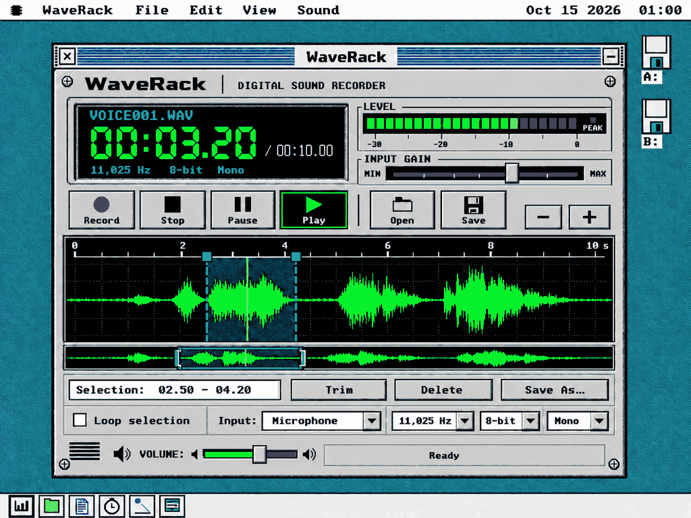

## Wave 0 - finding out what the machine can already do

The first question was not "how do I draw a waveform" but "can this system
record at all". It can - SOUND.DRV's Sound Blaster tier has a record stream,
and an old package, the Recorder (§35), uses it - but only into ONE buffer of
the driver's staging pool, 20 KB at most: 1.9 seconds at 11,025 Hz. Worse,
the bytes reach that buffer through a kernel task, and a disk transfer
freezes every task for up to ~400 ms on an XT while the card's own ring is
372 ms deep. A recorder that writes to disk while it records would lose
audio on every write.

So the one change outside the package is a small one in the driver: let the
record stream capture straight into a ring the APPLICATION owns, the way the
Video Player's playback already plays out of one (§34.5.3). The card then
writes a 32 KB ring by DMA with nobody's help, and a 400 ms disk write is 4 KB
of a ring that holds three seconds.

The emulators set the limits of what can be checked here: QEMU's Sound
Blaster never raises a capture interrupt, and MartyPC's records a flat
mid-scale value. Both are useful - one for "no input", the other for rates,
counts and files - and neither is a microphone.

## Wave 1 - the face (US-01, US-02, US-03)

**What was built.** A real package, `WAVERACK.O88`, with all three layouts
in both themes and every control drawn from real state - which, before the
document wave, is an empty document: `NO FILE`, `00:00.00 / 00:00.00`, the
next take's format on the LCD's bottom line, a dark meter, an empty
selection field, and the waveform area showing only its ruler, grid and
centre line. Everything a later wave builds - Open, Save, the edits, zoom,
play, record - is greyed through ONE predicate, `wr_cmdok`, which a key, its
menu item and its keystroke all ask; a press on a greyed control says why on
the status bar (`Needs a Sound Blaster`, `No capture device`, `Not in this
build yet`). What already has state works: Loop, the next take's rate (a
real os88ui drop-down), INPUT GAIN and VOLUME (own hit-test and drag, `<`
`>` and `[` `]`, the wheel), the theme and the layout.

**The layouts became data.** CDRack's three layouts are numbers written into
its asm, and it took three looks to get them right. WaveRack's are written
once, in Python (`tools/os88wrlay.py`): every key, slider, drop-down, field,
panel, label and picture, emitted as layout records and static-part op lists
that the asm interprets (`wf_deco`). That moved the "does it fit" question
to the host, where it is cheap: the generator's `--selfcheck`, in the make
rule, MEASURES the layouts - no two controls overlap, every label is clear of
every control, every caption and drop-down item fits at 8 px a system-font
character and 6 px a small-caps one, and each window fits the screen it was
cut for with the menu bar, the dock and the title bar counted. Its first run
caught three things before any asm existed: COMPACT's edit-row keys were one
row too shallow for a small-caps caption, a mitred 24-row digit set (MID's)
whose `1` inked 12 of 24 rows - CDRack's own lesson, caught by CDRack's own
check - and a logo letter whose rows were uneven. The previews (`--png`)
rendered each layout in each theme as a rough picture to LOOK at before the
asm was written; the real face matched them on the first boot.

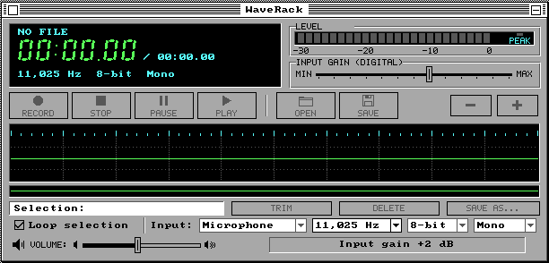

**The CGA's layout** is the mockup's shallow one at 624 x 132, the footer as
two rows. On 2.4:1 pixels the 7-row pictures sit beside small-caps captions,
the LCD's digits are 16-row block segments, and the drop-downs speak in short
forms (`Mic`, `11 kHz`). Every control was clicked with `tools/mouse.py
--screen 640x200`, and each answered: the greyed keys with their reasons,
Loop with `Loop on`, the sliders with their values, the Rate list sliding up
over its own box (os88ui's §13.14.2) and the pick reaching the LCD.

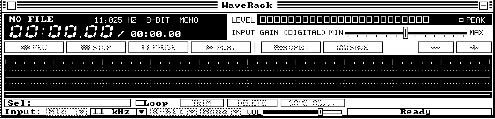

**Black and white** is the same face from the second role table: white
faceplate, black rules, the LCD still black with white segments, the meter's
dark cells outlined, greyed captions half their ink.

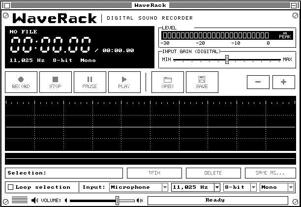

**What was discovered.**

- *The generated include has to be two halves.* The icon must follow the
  header, so its macro and every constant are needed before the first
  instruction, while the pictures and layouts are data that belong at the
  end. `build/wrart.inc` emits both under `%ifndef WRART_DATA` and is
  included twice.
- *Record's red dot without writing a pixel twice.* A key is one band and
  one blit, and a blit has one ink. The red dot is two bands that TILE the
  key's inside - rows (stacked) or columns (side by side) - the picture's
  part in red and the caption's in the key's ink.
- *A slider is one blit too*: groove, ticks and the thumb's outline in the
  slider ink with the faceplate as paper, so the thumb's face is simply
  paper and nothing under it is drawn twice.
- *The waveform band*, the heap claim §123.5 sizes for the document wave,
  is claimed at entry already (7 KB): the empty waveform's ruler and dotted
  grid are composed in it and put down in three blits around the centre
  line. Its x phase is composed in, because a 1bpp blit at an x off the byte
  grid starts at the byte column holding x (§5.4.2.8, CDRack's lesson).
- *A bug the boots found*: a View > Full Layout from the menu hung the UI
  task, because `wr_menu` reused SI as the window after the command - and a
  resize clobbers SI. The same shape was in the wheel handler. Both take the
  window off the stack now.
- *Disk space decided a disk.* Wave 1 alone took the 720 KB apps disk from
  701 to 713 of 713 clusters, so that disk leaves WaveRack off (a dated
  decision, §24.6.1); the media disk carries it at 360 KB.

**What was measured.** Image 16,310 bytes, packed file 11,646, bss 1,414,
the waveform band 7 KB. The identity check - change the face, force a full
repaint, PIL difference `None` - held on VGA colour, VGA black and white and
EGA, and across a COMPACT and back round trip on VGA. A relaunch after Close
drew a face identical to the first launch. Hercules was not looked at here
(QEMU cannot show it); that look is MartyPC's.

## Wave 2 - the document (US-04)

**The story.** Open a WAV and inspect it without loading it into RAM: a
real RIFF walk, the sample frame as the one unit of time, min/max envelopes
so a single-sample click is visible at full zoom out, both channels of a
stereo file, zoom down to the samples themselves, an overview, and a long
file that stays cancellable while it loads.

**The reference came first.** `tools/wrsim.py` is the package written in
Python: the same chunk walk with the same refusal codes, the same envelope
and the same view-cache columns, plus a generator for seventeen fixtures -
a tone, single-sample impulses, a stereo file whose right channel is
silence and one spike, an odd `LIST` chunk, unknown chunks, `data` before
`fmt `, the extensible format, a data size past the end, one that is not a
whole number of frames, an unfinished take, six files that must be refused,
and a 1.1 MB file that only a streaming scan can take. Its selfcheck reads
every file it can back through Python's own `wave` and is a fast suite row,
so the reference cannot drift under the soak row that holds the guest to it.

**What was built.** Three modules beside the face: `wrwav.inc` (the reader:
any 1..48 bytes of a file at any offset, read as the two clusters holding
them, so a header of any shape is one read), `wrdoc.inc` (sources, the
piece table, the 32-bit arithmetic, and `wo_read`, which reads document
frames for the UI task after restanding in the source's folder) and
`wrenv.inc` (the scan, the view, the view cache and its refinement, the
ruler, the lanes, the overview and the cursor). The scan and the refinement
run from the window's one-shot timer - a 16 KB gulp or an 8 KB read a tick -
so the desktop stays live and Stop, Escape or another Open cancels.

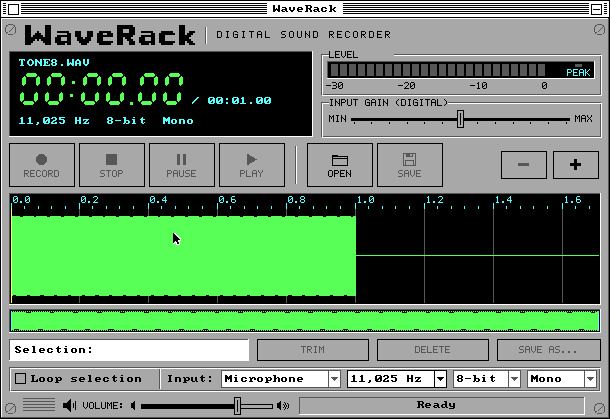

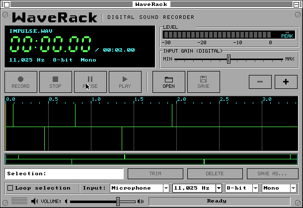

**The band holds everything at once.** The waveform band grew from the
lanes alone to the ruler, the lanes and the overview (10 KB), so the lanes
are still in RAM after they are drawn: moving the cursor puts the one
column it left back from the band with a 1-pixel blit and draws the line
again, which is exactly how wave 3's playhead will move.

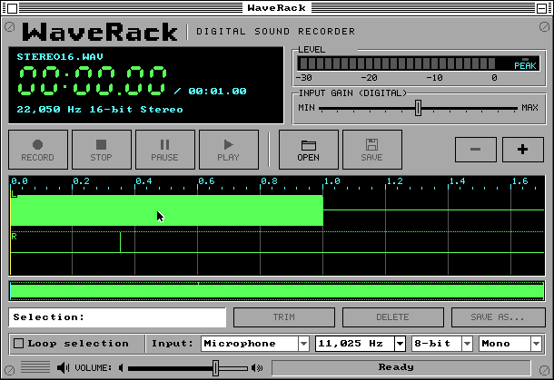

**Three colours in a 1bpp blit.** A blit has one ink and one paper. The
trace is green, the grid dark grey and the ground black, so in colour the
grid's columns are drawn as one-pixel blits whose PAPER is dark grey and
whose ink is the trace's - a trace crossing a grid line stays green - and
the runs between them one blit each. In black and white everything is
white and the whole lanes area is one blit. The colour face lost its dotted
quarter rows for it; the time grid on the ruler's majors stayed.

**Zoom to the samples.** Below the block size a column first shows its
block's range and is then refined from the samples, carrying a column
across reads when a column is bigger than one read, and including the
previous column's last sample so a sine at one frame a column is a line,
not a cloud of dots.

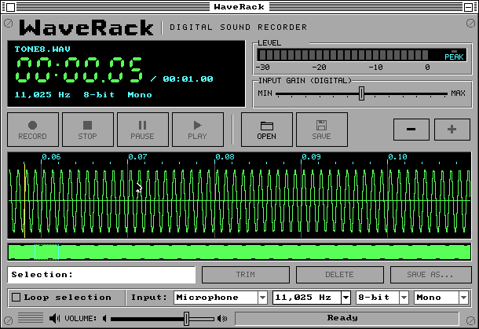

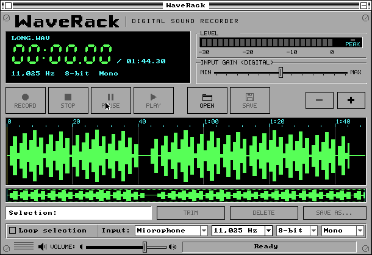

**Refusals say why.** Each refusal is its own code and its own sentence of
at most 22 characters, and the document is left empty with every claim
given back.

**The greyed keys on one bit, fixed.** Wave 1's review found the CGA's
greyed keys illegible: a checkerboard over a 5 x 7 caption with one-pixel
strokes leaves noise. A greyed key in black and white now keeps its caption
solid, dithers only its picture, and draws its frame dotted - one band, the
frame included, so it is one call rather than two.

**What was discovered.**

- *A stale floppy reads as a broken package.* The first look read the bss
  through the current map while the scratch floppy still carried the
  previous build - every variable four bytes off, `we_busy` reading 3. The
  soak row now checks that the running package's code is
  `build/waverack.bin`'s before it reads a byte of its state.
- *Two real bugs the first boots found:* the block store clobbered the
  scan's buffer pointer (every block after the first was garbage - the
  reference comparison named the column), and the scan re-armed its timer
  only from its first step, so a file longer than one gulp stopped at 74%.
- *The format line is longer than wave 1 measured*: `22,050 Hz 16-bit
  Stereo` is 23 characters. The layout's longest text moved to it and the
  layout selfcheck re-measured every layout before the asm was rebuilt.
- *A packed WAV is not a WAV.* READ_AT is raw, so a compressed file's bytes
  are the compressor's; the open finds the file with `OSAPI_FILE_FIND_RAW`
  and refuses one with the `CZ` bit (`File is compressed`).

**What was measured.** Image 25,010 bytes (packed 18,926), bss 2,525. Heap
with a document open and idle, read off the kernel's claim map by the soak
row: 31 KB for a small mono file, 33 KB for LONG.WAV, 36 KB for the
22,050 Hz stereo file (38 KB is the ceiling); a refused open leaves only the
10 KB band. The soak row opened all seventeen fixtures through File > Open
and found the parse, the status sentence and the view cache equal to the
reference for every one, the impulses refined at one frame a column with
their neighbours reaching them, and a forced full repaint pixel-identical to
the incremental picture after the zoom. The CGA's 360 KB media disk is now
full (354 of 354 clusters): the next wave needs a decision there. Not seen:
Hercules, EGA's MID with a document, the wheel (QEMU's serial mouse sends
none), 86Box, real hardware, and any XT timing.

### Hercules, looked at by hand

QEMU cannot show a Hercules card, so the MID and COMPACT faces were looked at
on MartyPC's cycle-exact 5150 with a Hercules card, captured straight out of
video memory. Both draw as on the other adapters; COMPACT leaves the Disk
window below it repainted correctly.

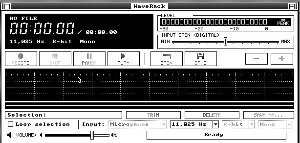
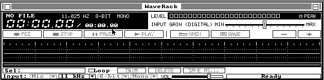

## Wave 3 - the transport (US-05, US-08, US-07's playback half)

**The story.** Play what is on the screen at the right pitch, pause and
resume without a stutter, stop and find yourself where you began, drag a
range and loop it until it is right - and see the level of what is playing
while it plays.

**The shape was Audio's, on purpose.** The Audio Player (§86) already
streams a WAV through the Sound Blaster's ring stream: the UI task reads
the disk into a look-ahead ring, a worker task converts out of it into the
driver's ring grant, and the worker wakes the UI when the look-ahead runs
low. WaveRack copies that shape, with one difference that matters: under it
is a *document*, not a file - a piece table that later waves will cut and
paste - so the fill reads document frames piece by piece through the reader
wave 2 wrote, and copies them into the ring. The worker never sees a file,
a piece or a loop; it sees a stream of frames.

**A loop is just a refill position.** When the fill reaches the end of the
region it carries on from the region's start in the same pass. The worker's
box filter runs straight across the seam, so a looped selection plays
seamlessly - and the soak row checks it by finding the selection's bytes
repeated, sample for sample, in what QEMU's card actually played.

**Pause closes the stream.** The obvious pause - stop feeding and let the
driver underrun - plays out whatever is in the ring first: up to 16 KB, most
of a second at 22 kHz. Instead Pause reads the exact played count (verb 9,
the DMA's own progress), closes the stream and keeps the position; Play
opens a new stream from it. Pause is immediate, nothing stale ever plays,
and resume and seek become the same operation.

**The output is what the card takes, and the status bar says so.** An
8-bit mono stream at `R / d`, `d` the smallest whole number that brings the
rate under the card's ceiling: a 44.1 kHz file on an old Sound Blaster
plays at 22,050 Hz through a two-frame box filter and the status bar reads
`Out 22,050 Hz mono /2`. A 16-bit sample gives its high byte, a stereo pair
its average, and VOLUME is a 256-byte table the worker passes every byte
through - the document never changes. `tools/wrsim.py` grew the same
conversion in Python, and the soak row holds the captured output to it.

**The playhead is a number first.** It is derived from the played count -
`n` output samples are `n x d` frames into the play, then round the loop -
and drawn the way wave 2 drew the cursor: the column it left put back from
the band, the line drawn again. The view pages when the playhead leaves it,
rather than scrolling every tick.

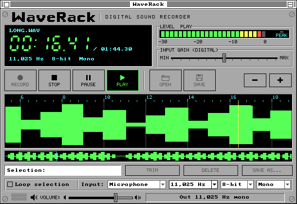

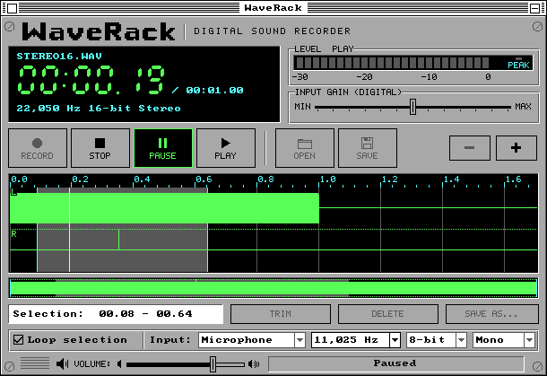

**Selecting without repainting.** A drag changes the selection on every
mouse move, and redrawing the waveform for each would be ~20 blits a move.
So the lanes and the overview are now put down as *runs of one class each*:
outside the selection, inside it, its edges, the grid's columns. A change
redraws only the columns between where the edges were and where they are -
measured with a counter build at five or six drawing calls a move. In
colour the selection is the trace on a dark grey ground with cyan edges; in
black and white a dither cannot be a blit's paper, so the span is the band
turned over for its one blit and turned back - an inverted span.

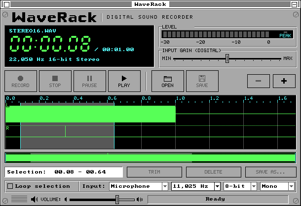

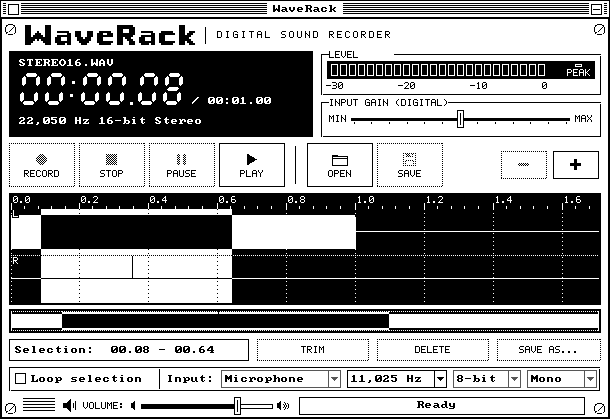

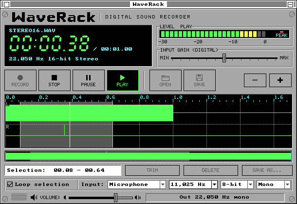

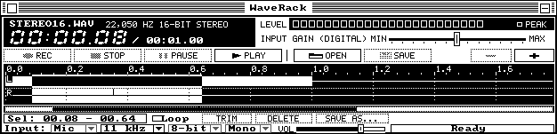

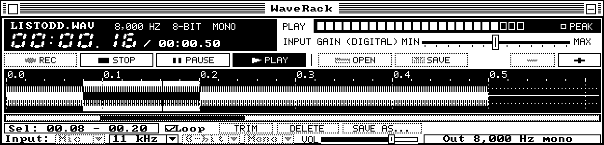

**The meter reads the half that is sounding.** The worker notes each
staged half's peak before the volume - and whether it touched a rail - in a
table indexed by the half's place in the stream; the UI looks up the half
the card is playing *now* from the played count, so the bar moves with the
sound and not with the staging, which runs ahead of it. The cells are two
24-bit masks, shown and wanted, and only the changed runs are drawn.

**What was discovered.**

- *SOUND.DRV is not wanted by default.* The first look said `Needs a Sound
  Blaster` with QEMU's SB16 in the machine: §51.3 makes every driver
  not-wanted until a `SYSTEM.CFG` asks, and the test's system disk now
  carries `build/mixercfg/SYSTEM.CFG`, as XTMP3's rows do.
- *A refinement talks over a pause.* Zooming while playing leaves the view
  coarse (the refinement waits, its reads would race the look-ahead's); on
  Pause it resumed and its `Ready` replaced `Paused`. It is silent now while
  a play is held.
- *The harness's absolute mouse is not a drag.* `tools/mouse.py to` pins the
  pointer against the bottom-right corner and walks back, so a "move" in a
  drag is dozens of moves across the screen; the first measurement read 88
  drawing calls a move. Relative moves (`mouse_move 8 0`) gave the real
  figure: five or six.
- *A selection is the cursor's too.* With a selection the cursor stands at
  its start, and a rightward drag moved the time display every move for
  nothing; it is redrawn only when `s` moves.

**Measured** (the `-DWR_CALLS` counter build): idle 0 drawing calls a tick;
playing 1.70 a tick at Fit and 3.08 at 256 frames a column; a selection
drag five or six a move; a full repaint 120. Image 30,179 bytes (packed
23,129), bss 5,016; heap while playing the idle document's plus the 32 KB
look-ahead; the 16 KB ring grant is the driver's.

**The 360 KB disk.** Wave 2 left `media360.img` with no cluster to spare,
and this wave's growth does not fit, so WaveRack is off it (a dated note in
the Makefile and §123.13). A 360 KB home for it is the owner's decision.

**Wave 2's review, folded in.** An independent read of wave 2 found no
memory fault and five things to fix, all done in this wave: a chunk size
that carried the walk's next position to just under 4 GB made the next
header wrap to offset 0 (the walk now tests that carry, and a new fixture,
`WRAPPOS.WAV`, holds it); the view's last first frame was rounded DOWN, so
below Fit the last few frames of a file could never be shown and a cursor
parked there vanished (now rounded up - the view may end a few empty columns
past the document); a frame over 2^31 read as negative; a short disk read
ended the scan silently over uninitialised blocks (now it refuses, and says
why); and §123.5 had a block count off by one.

**The soak row's first run caught the meter.** STEREO16.WAV's right channel
is silent but for one full-scale sample, and PEAK never lit: the meter read
the half sounding every three ticks, and a 93 ms half fell between two
looks. The hold and PEAK now take every half played since the last look.
The second run passed: STEREO16 and TONE44 at d = 2 sample for sample, the
loop's four laps byte-identical in the capture, the paused position equal
to the reference's arithmetic, and every claim back after Stop and after a
close.

## Wave 4 - editing and saving (US-09, US-10)

**The story.** Cut out the cough, paste the good take after the intro,
change your mind and undo it - and then save, without ever being able to
lose the file you started from.

**An edit moves no audio.** The document has been a piece table since wave
2 - a list of `{source, first frame, count}` over files that are never
written - so Trim, Delete, Cut, Copy and Paste are all one operation: build
a new list out of ranges of the old one (and of the clipboard), then swap it
in. A one-hour file cuts in the same time as a one-second one. The builder
COALESCES - a piece that carries on exactly where the last one stopped, in
the same file, just makes the last one longer - so cutting a range and
pasting it back where it came from leaves one piece, not three, and a long
editing session does not creep towards the 64-piece ceiling. Past it the
edit is refused before anything changes: `Too many edits; save`.

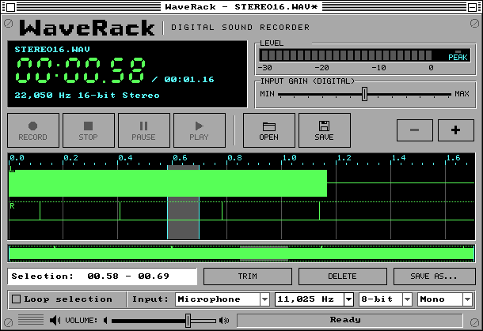

**Undo is a ring of whole states.** Nine slots of 662 bytes - the piece
list, the cursor, the selection - in one 6 KB claim made by the first edit.
An edit first writes the selection you have *now* into the current slot
(so Undo puts it back where you had it), drops anything that could have
been redone, and appends its result; the oldest falls off a full ring.
Eight steps back. Restoring a state is a copy, and because sources are
immutable every state stays replayable.

**Sources are swept, not counted.** The clipboard outlives New and Open, so
a file can stay "open" long after its document is gone - because the
clipboard holds a piece of it, or an undo state does. Rather than keep four
reference counts right through every edit, undo, paste and save, WaveRack
asks, whenever something could have let go: does the document, a history
state or the clipboard still name this source? Four records, a few hundred
compares, and the bookkeeping cannot drift. When the clipboard holds four
different files, Open greys and says why (`Clipboard uses 4 files`) instead
of quietly dropping one.

**The dirty mark is the title.** Wave 2 left an open question: the LCD's
name field holds exactly an 8.3 name, so there is no room for a `*`. The
answer was already in the tree - TexPad puts `TexPad - NAME*` in its title
bar through `OSAPI_WM_TITLE`, and that costs a caption strip, not a
repaint. WaveRack does the same, and only when the string actually changes.
New, Open and the close box ask about an edited document with os88ui's
standard alert, and a Save chosen there carries the New, Open or close out
only if the save succeeds.

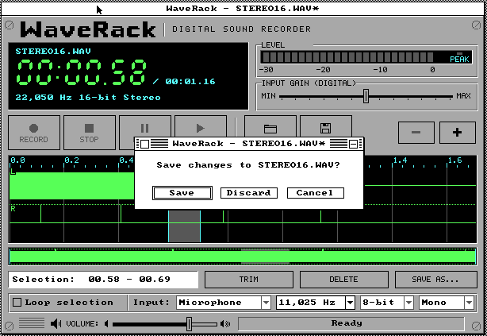

**Saving never risks the original.** The frames are written to
`WRSAVE.$$$` in the destination folder - a gulp a tick from the window's
timer, one disk call each, so the desktop stays live and the status bar
counts `Saving 45%` - and only when every byte is down is the target
deleted and the temp renamed over it. Escape stops it and deletes the temp;
a disk that cannot hold it is refused before a byte is written. The first
write creates the file, every later one appends through the streaming
append the kernel offers (`OSAPI_FILE_WRITE_SEQ`), carrying its token so an
append does not walk the file's chain from the front.

**Saving over the file you are editing changes what the pieces mean.**
Once the rename lands, `TONE8.WAV` is the new bytes, and every piece that
said "frames 4,512 onwards of TONE8.WAV" is now wrong. So the save
*rebases*: the document becomes one piece of the file just written, the
history and any clipboard pieces of the old file are dropped (they would
replay bytes that no longer exist), and the new file's envelope is scanned
again with the view, the cursor and the selection kept - the frames are the
same frames. The status bar says `Saved; undo cleared`. A Save Selection As
over the file the document is still reading is refused outright (`File is
in use`), and asked before the "replace?" question, not after it.

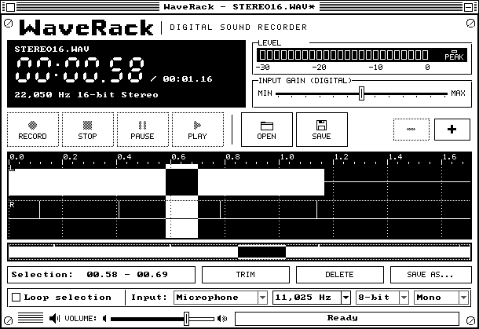

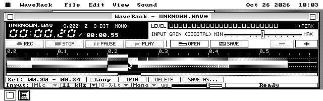

**What was discovered.**

- *The edits did not need a rescan, and must not have one.* A source's
  coarse envelope is its own and never changes, so the view after an edit
  is rebuilt from the pieces over the envelopes already in memory. The one
  subtlety: the "this column is exact" test used the block size of the file
  that was opened; with pieces from two files of different lengths it is
  now the largest block of any piece's source.
- *Two records can name one file.* Open a file whose piece is on the
  clipboard and there are two source records for it. Harmless while
  nothing writes - but a save over that file has to find both, so the save
  collects every matching record into a mask.
- *A save is a gulp a tick, so it needs the same care as the scan.* The
  refinement waits while a save writes, Stop cancels it, and the close box
  cancels it before asking about the document.
- *QEMU's `sendkey shift-right` does not reach WaveRack's Shift test* (the
  BIOS's flags), so the harness selects by dragging, as wave 3's did.

**Measured** (the `-DWR_CALLS` counter build on QEMU): an edit at Fit costs
34 to 37 drawing calls - the waveform band recomposed once, the time, the
length, the selection field, the status and the edit keys' grey - against
126 for a full repaint; at one frame a column it is 81 to 84, the
refinement redrawing the band as it finishes. The identity check after a
cut at a non-block boundary is clean at Fit and at one frame a column.
Image 35,953 bytes (packed 27,915), bss 5,997 (with wave 3's review fixes); the history is a 6 KB claim
from the first edit, a save adds a 16 KB output claim while it writes.

**The soak row's first run caught the test's floppy, not the editor.**
`waverackedit` builds its own B: with the fixtures in `MEDIA/`, and a folder
built to fit twelve files is ONE cluster - sixteen directory slots, two of
them `.` and `..`. The row's Save As and Save Selection As filled the last
two, and the save over STEREO16.WAV could not create `WRSAVE.$$$`: the
kernel never grows a directory (§18.5). WaveRack did what §123.10 says -
`Folder is full`, the original untouched, the document still edited - and
the row now builds `MEDIA/` with 64 slots (`os88disk.py --dir-slots`),
which is what a folder programs save into has to ship with.

**Wave 3's review, folded in.** One high finding: above 22,222 Hz the Sound
Blaster plays 4 KB blocks while the worker stages 2 KB halves, so a 44.1 kHz
file that converts to an odd number of halves underran on its last one, the
end was never seen, and WaveRack sat PLAYING with the final 46 ms unheard -
about half of all 44.1 kHz files on an SB16. The end is now padded with
silence to a whole card block and the end test waits for that final half;
`waverackplay` gained a leg that plays TONE44.WAV at 44,100 Hz (eleven
halves) to its end. Six low ones, also fixed: the conversion reads "the
document is done" before the look-ahead's counters (a refill landing between
them dropped the tail); a Loop region shorter than a half plays once (`Too
short to loop`) rather than letting the UI wake itself without end; a stale
answer's count is not folded in; a card that stops mid-play says `Sound card
stopped`; Resume from the tail of a non-looping play finishes it rather than
running on past the selection; the pre-roll's silence keeps what was already
converted.

## Wave 4b - playing through disk reads (US-05 hardening)

**The story.** The owner played a WAV on 86Box and it stopped - went silent
- every time the disk was read. QEMU had never shown it, because QEMU's
floppy answers instantly. And WaveRack, the owner said, will read from hard
disks far more than from floppies: design for the fixed disk first.

**The cause is the kernel's, and it stays.** `kernel/disk.inc` holds
`[sch_lock]` across every `int 13h`: while anything on the machine reads,
no task switches. WaveRack's worker - the task that converted and fed the
card - could not run during a read, and the card played on alone from a
16 KB grant: 0.74 s at 22 kHz. Meanwhile the refill made up to eight 16 KB
reads back to back, each one walking the file's FAT chain from the front,
and nothing made the ring full before the burst. A floppy burst outlasted
the ring every time.

**The Video Player had already solved it, behind a door WaveRack cannot
use.** Its sound ring is its own memory, opened as an *external* ring
(§34.5.3): the card plays it in place, the block interrupt reads the
player's total out of it and writes back what it has played, so feeding is
a memory write. Its feeder runs at interrupt time - alive during `int 13h` -
but only inside a full-screen FSX bracket, which freezes the desktop. A
desktop editor cannot live in a bracket, and there is no desktop-level
interrupt hook for packages. So WaveRack took the principles without the
hook:

- **its own ring** - 32 KB in a DMA-safe claim of its own, fed by a copy
  and one word store;
- **convert before you read** - the UI tops the ring up to full, THEN makes
  one read, then tops up again. At the instant any read of WaveRack's
  starts, the ring holds everything the look-ahead can give it;
- **reads bounded per medium** - 16 KB on a fixed disk, a cylinder's worth
  on a floppy. The plan had said a track; the arithmetic said otherwise. A
  disk call costs about 400 ms whatever it moves, so 4 KB reads off a 360 KB
  floppy would have delivered 10.8 KB a second against an 11 KB a second
  play;
- **every read a stream** - READ_SEQ with a cursor per source, so a read
  walks one FAT link instead of the whole chain. A small trick keeps it
  sequential: when the next frame lies inside the run already in memory -
  which happens every read when a WAV's data starts at byte 46, as any
  18-byte `fmt ` chunk makes it - the overlap is kept and only what follows
  is read, from where the cursor stands.

**Then the 8088 had its say.** With the disk out of the way, one
measurement on MartyPC's cycle-exact 5150 asked what each conversion loop
costs a frame - and the answer was the second finding of the wave: wave 3's
loop took **~227 cycles a sample for 8-bit mono**, so a 4.77 MHz 8088 could
not keep a 22 kHz play up *even from memory*. A loop with no box filter,
tracking only the sample's extremes and deriving the meter's peak from
them once a call, does it in **114** - 53% of the machine at 22 kHz. 16-bit
stereo costs **456** a frame: 2.1 seconds of an 8088's time for every second
of sound. No buffer fixes that.

**So the plan weighs both.** At every Play WaveRack adds up the disk's share
of a second (the play's byte rate over what *this source's own reads* have
sustained, timed as they happen) and, on an 8088, the conversion's share
(the measured cycles), and streams when the two stay under 80%. When they
do not, it **holds** the region in memory first - `Loading 45%`, Escape
cancels - storing one byte a frame, the 8-bit mono value the conversion
starts from, so a 16-bit stereo region takes a quarter of its size and plays
through the cheap loop. When it neither streams nor fits, it plays anyway
and says which part cannot keep up:

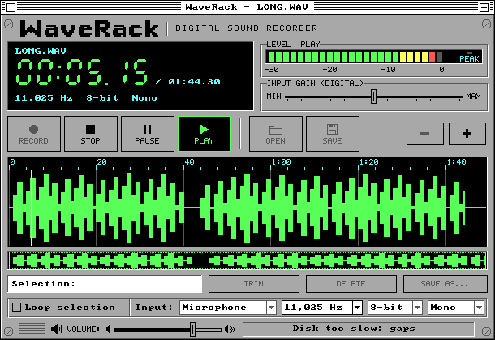

*QEMU, VGA colour: LONG.WAV with its source's timed read rate poked down to
18 bytes a second to drive the path - the status line's new sentence. On a
real 8088, 20 s of 16-bit stereo says `CPU too slow: gaps` instead.*

**The measurement.** One soak row, `waverackdisk`, on MartyPC's 5150 with an
XT-IDE disk and a Sound Blaster 2.0, every leg played on Wave 4's package and
then on this one. A play's *silence* is the guest seconds it has run less
the samples the card says it played:

| | Wave 4 | wave 4b |
|---|---|---|
| a 2 MB 8-bit mono 22 kHz WAV off the hard disk, 30 s | 17.7 s silent | **0.00 s**, no underrun |
| the same while a second WaveRack scans a 1.7 MB file off that disk, 40 s | 26.9 s silent | **0.00 s**, no underrun |
| a 1.1 MB 11 kHz WAV off a 1.44 MB floppy, 30 s | 18.7 s silent | **0.07 s**, no underrun |
| 4 s of 16-bit stereo 22 kHz | 2.6 s of 3.3 silent | held, **0.00 s**, no underrun |
| 20 s of it (past the heap) | 11.8 s of 15.1 silent | `CPU too slow: gaps`, 10.2 of 15.0 |
| a volume of 32 KB clusters | `Cluster too large` | opens, plays, saves |
| the 2 MB file's envelope scan | 93.8 s | **77.7 s** |

The scan's FAT reads did not change (18 either way - the kernel's FAT window
holds a 2 MB file's chain), so what the cursor saved there was CPU: the
SDK's 142 ms a megabyte of offset, paid on every one of 128 gulps.

**Then the hard disks themselves.** The orchestrator read the open path and
found the blocker hiding behind the whole wave: WaveRack refused any volume
whose cluster was over 8 KB, because two clusters had to fit its 16 KB read
buffer - and FAT16 uses 16 KB clusters past 512 MB and 32 KB past 1 GB. Most
real hard disks. The read buffer became a *window* on the file: any byte
range, sized from the largest cluster in use plus a kilobyte, reading whole
clusters - one at a time when a cluster is 32 KB. The header reader learned
to take one cluster at a time too, and the save writes 32 KB at a time on
such a disk. `tools/os88hdd.py` gained `--spc` to format the 321 MB test
volume of 32 KB clusters that MartyPC then booted, opened, played and saved
on - the saved file read back off the disk image on the host, byte for byte.

**And wave 4's review: data loss in the save.** Every save wrote a temp file
called `WRSAVE.$$$` - *created* over whatever already had that name, which
could be the very file the document was reading (a kept temp, opened by the
user; a second WaveRack saving into the same folder). Each save now takes
`WRSAVnn.$$$`, the first name not already there, and makes it empty
immediately so nothing else can take it. The other high finding was that
the save-changes question is a separate window and not modal: press SAVE
underneath it, answer Discard and Open, and the user's original file could
end up holding another document's audio. While a question is up the
document's commands now grey with `Answer the question` - and the refusal
brings the question back to the front, because a click into a full-screen
WaveRack buries the alert completely and an alert has no dock tile. That
last part was found by the test harness, which could not get back to the
alert either.

**A third bug fell out of a new fixture.** `ODD46.WAV` puts its sound data
at byte 46 (an 18-byte `fmt ` chunk, which many programs write), so a
4-byte frame straddles the end of every read. Its zoomed waveform came out
wrong at exactly those columns - in Wave 4's build too. The column's running
range lived in a variable the screen-drawing code also used, and a column
that spans two reads waits a tick in between, during which the screen gets
drawn.

**What the row got wrong, on the way.** Its runs died or lied four times for
reasons of its own: a stale "acting Disk window", a measured window that
began before a second program's minute-long launch, an open waited on in the
gap between emptying the old document and scanning the new one, and a poll
interval in host seconds on an emulator running six times faster than real
time. Each was fixed; the final run passes every leg.

**Still not heard.** No `vm/` machine here is an XT with both a hard disk and
a Sound Blaster. `vm/xt-mfm` - the ST-225 on a Xebec, the machine to install
on - needs one line, `sndcard = sb2.0`; `vm/286-video` has both today.

## Wave 5 - recording (US-06, US-07's capture half)

**The story.** Press Record and talk; press Stop and the take is there, a
file on the disk and the document in the window, already saved. Pause in
between and nothing is lost or doubled. If the disk fills, the machine
crashes or the window is killed, what was recorded is still a WAV file. And
the owner's word from the last wave stood: WaveRack will live on hard disks,
so design the take for a fixed disk first.

**The card was already free of the disk.** The driver half had shipped
before this wave: verb 4 records into an *external* ring, WaveRack's own 32
KB of DMA-safe memory, and each block interrupt writes a running count into
it. So the card captures on through every disk call the machine makes, with
no task of WaveRack's in the way. What was left was getting the bytes from
that ring into a file before the card came round again - 2.9 seconds at
11,025 Hz.

**Four questions, settled before the code.** How does a take work on a
volume of 32 KB clusters, when half the ring is 16 KB and every append must
be whole clusters? (The ring stops being the write's unit: bytes are copied
out of it into staging units of max(16 KB, a cluster), and a unit is the
write.) How long does a write take against the ring? (Measured once on
MartyPC: 0.23 s for 16 KB on its XT-IDE, 0.37 s for 32 KB on 32 KB clusters,
1.7 s for 16 KB on a 1.44 MB floppy - most of that the commit.) What does it
cost an 8088? (The copy, through the gain table and noting the meter's
extremes, is **92 cycles a byte** - 21% of the machine at 11,025 Hz.) And
what does the live picture cost? (One column a tick, 1.3 ms.)

**The take file** is `VOICE001.WAV` onwards, in the folder WaveRack stands
in. Its header is exactly one cluster long - a `JUNK` chunk pads it - so the
sound starts on a cluster boundary and every append is whole clusters. Until
Stop the header says "length 0", which WaveRack's own reader opens as an
unfinished take; at Stop the header cluster is written again with the real
sizes, in place. On a volume of 32 KB clusters that is a 32 KB header for
every take, and it stands: the alternative breaks the rule every append
depends on.

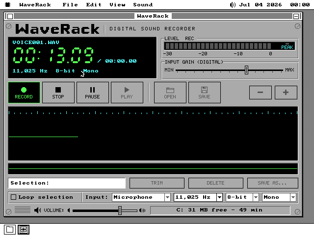

**The first version overran at thirteen seconds.** It did the copying in
the window's own timer tick and nothing else, which looked enough: the copy
takes milliseconds. Then the test opened a second WaveRack while the first
recorded, and the take stopped at 0:13 - `Overrun: kept to 0:13`. One trace
of every tick said why: the UI task, the one task that runs every window's
code, was simply *gone* for 3.4 seconds while the second window painted its
face on a 4.77 MHz machine, and for 4.7 seconds while a menu was held down,
because the menu code waits inside it. The ring holds 2.9.

**So the copy moved to a worker** - the same background task that feeds the
card during playback. A task keeps running through a menu, a paint or a
package loading; the only thing that stops it is a disk call, and the card's
DMA runs through those on its own. Every tick the worker copies what the
card captured into the staging units; when the window's tick comes round it
writes the full ones. The units are 64 KB in all, so a take survives about
8.8 seconds of the UI's absence at 11,025 Hz instead of 2.9. The rerun:
**203 seconds of take while a second WaveRack launched, opened and scanned a
2 MB file, and the ring never more than 8.7 KB full.**

**The floppy said no to 11,025 Hz.** On a floppy no task runs during a
write at all - its disk calls come back to back - and a 32 KB write took
2.4 to 2.9 seconds against a ring of 2.9: one run overran at the very first
write, which also pays for spinning the motor up. At 8,000 Hz the ring holds
4.0 seconds and a 32 KB write keeps up half again over, so that is a
floppy's rate: Record on a floppy at a higher rate says `Floppy: use 8,000
Hz` and makes nothing. A tidier idea - 24 KB writes, to stop the copy for
less time - was tried on a back-of-envelope model of the floppy and overran
at 24 seconds; the measured 32 KB came back.

**Pause and Stop take the copy back.** The window's code raises a flag, waits
for the worker to finish the pass it is in, stops the card, copies out every
byte the card counted and writes it. The test holds the file's length to the
sum of the card's own counts across a pause - exact, not approximate.

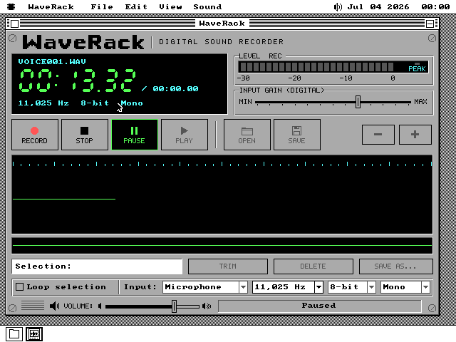

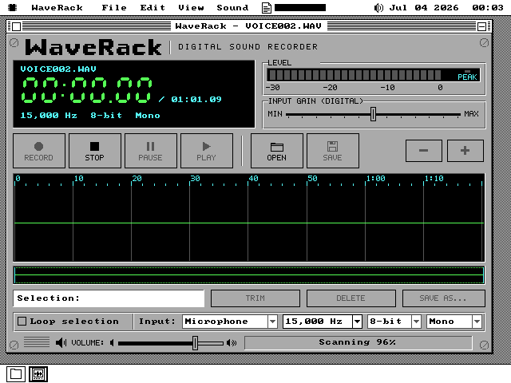

**Surviving a crash.** At Record a 24-byte marker, `WAVERACK.TAK`, goes into
the boot disk's `\SYSTEM\APPDATA`: a take is running, here, by this window.
At Stop it is marked done. The test killed the emulator in the middle of a
take, booted the same disk again and launched WaveRack: File > Recover Take
was live, and it opened the take with every frame that had reached the disk,
marked unsaved - `Recovered; save to fix`. The marker also carries the
recording window's memory segment, because a second WaveRack opened during
a take would otherwise have offered to "recover" a take that was still
being recorded next door.

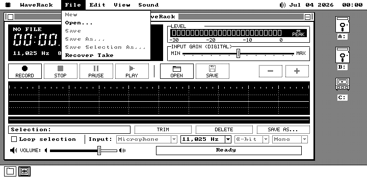

**Input gain is honest about being digital.** No card the sound driver
drives exposes a recording gain, so the slider is software: 13 steps of
2 dB, each a multiplier computed on the host and checked against
`20·log10`, applied through a 256-byte table that saturates instead of
wrapping. The test reads the table back out of the machine's memory at +4 dB
and compares it to the host's.

**What QEMU could say.** Its Sound Blaster records nothing - no block
interrupt ever comes - so Record there ends after a second with `No input
from the card` and leaves no file behind. That was the first look at the
whole thing, and it found two small bugs on the glass: the LCD kept the
dead take's name, and the waveform lanes the live strip had cleared stayed
black.

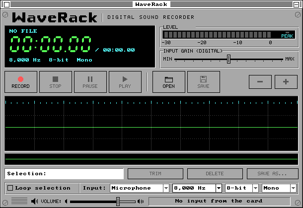

**What it cost.** 4,190 bytes of package (42,999 in all), 1,430 of bss, and
107 KB of heap while recording - the 33 KB ring and 64 KB of staging beside
WaveRack's 10 KB band. **What it does not show**: what a real microphone
sounds like through it (every emulator here records silence or nothing), the
gain heard, and a real disk's write speed - MartyPC's hard disk has no
mechanics, and its floppy, the one timed medium, is the reason the floppy
rate is 8,000 Hz until the 5150's own drive says otherwise.
