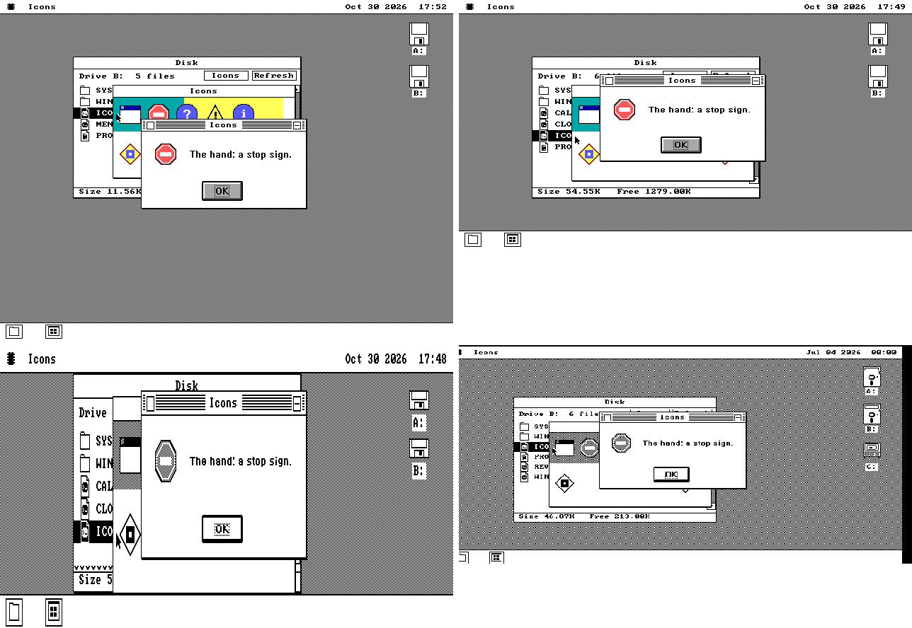
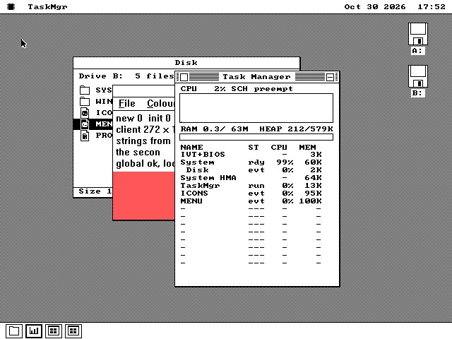

# How WIN16 was built

This is the development diary of WIN16, os8088's layer for running original
Windows 3.x programs (SPEC.md §124). It records what was actually found,
decided, built and checked, in the order it happened, for later reuse. The
delivery plan, [WIN16-PLAN.md](plans/WIN16-PLAN.md), keeps planned work
separate from completed work; nothing here is a promise.

## 2026-10-28 — the plan, and the three things that were already true

**The ask.** Run the original Windows 3.x Minesweeper and Calculator on
os8088, through a "Wine"-like layer that is loaded on demand. Use Wine and
winevdm as sources, and build it in user stories.

**What was read.** Three sources fed the plan:

- **os8088's own surface:** docs/INDEX.md, the package model (SPEC.md §20),
  parts (§20.12), workers (§20.6), the association table (§54) and DOS.O88
  (§96, `docs/plans/DOS-EXEC-PLAN.md`).
- **Wine** at `0738d528`: its NE loader `dlls/krnl386.exe16/ne_segment.c`
  and `ne_module.c`, its four `.spec` ordinal tables, and `tools/winedump/ne.c`.
- **winevdm** at `b88d7f87`: its architecture and its issues on these two
  programs.

**Three things were already true, and they set the design.**

1. **The kernel already runs a task safely on a foreign stack.** A Windows
   program runs with SS = its own data segment, and every os8088 task shares
   `SS = LOW_SEG`, with a switch that saves only SP. That looked like a kernel
   change until `kernel/sched.inc` was read: `sch_switch` already declines to
   switch when SS is not `LOW_SEG` (line 2389). It learned that for ROMs that
   hop stacks inside `int 16h`. The mouse ISR banks SS:SP for the same reason
   (`kernel/mouse.inc` line 396). So a Windows program on its own stack is
   simply not pre-empted, which is Windows 3.x's cooperative model, at zero
   kernel bytes.

2. **A worker task is the wrong home.** It may not touch a file, and a paint
   delivered to it would be drawn after `W_PAINT` had returned. A coroutine on
   the UI task, resumed from each callback and suspended in `GetMessage`, is
   both simpler and how Windows itself scheduled programs.

3. **DOS.O88 already owns `.EXE` and already reads the whole file.** The
   launch is a four-byte sniff at offset 3Ch and a forward, not a new
   association.

**Two things are not known, and the first story exists to measure them.**

- **The CPU.** Windows 3.1 had no real mode, and Microsoft advised its
  developers to build for the 286. So the 3.1 binaries very likely contain
  286 instructions, which an 8088 silently mis-executes.
- **Floating point.** Calculator very likely uses the MS C x87 emulator
  sequences.

Story S1's census of the owner's own copies decides both, and decisions D1
and D5 wait for its numbers.

**What was tested.** Nothing ran. This entry is the plan, the SPEC.md §124
skeleton, and a draft PR.

## 2026-10-28 — the owner's decisions, the samples, and the census

**Decisions.** The owner took these:

- **D1:** a V20 floor. No 8088 translation tier.
- **D2:** a coroutine on the UI task.
- **D4:** the font Windows showed on each display, so the programs look as
  they did on Windows.
- **D6:** `kern_big` and `kern_emu`; `kern_mega` refuses.
- **D7:** bring in whatever is needed from Wine and winevdm, licence
  notwithstanding. That makes `apps/win16/` GPL-2.0-or-later, as
  `apps/apple2` is.
- **D8:** delegated. It became the in-window bar `OS88UI_MENU`, which
  already draws a tick and is where Windows put its menu bar.
- **D9:** the name `WIN16`.

**The samples.** These were downloaded into `~/Repos/win16-samples`, outside
the tree, with provenance and SHA-256s in its `README.txt`:

- **Windows 3.0** from archive.org (`w-3_20231227`): an installed `WINDOWS`
  directory prepared for DOSBox, VGA only.
- **WinMine 2.6, 2.8 and 2.9** from minesweepergame.com. These are Duff
  Software's 1990 releases for Windows 3.0, which became Microsoft's
  Minesweeper. The site's links are relative to `/database/`; the obvious
  path answers 403.
- **Three CD-archive `WINMINE.ZIP`s** from textfiles.com. Two are
  byte-identical to 2.9.

**The census.** A scratch script parsed each NE: header, segments,
relocations, resources, dialogs and menus. It named every import from
Wine's `.spec` files, and swept each code segment with `ndisasm` for
186/286/386/x87 opcodes.

| program | CPU | imports |
|---|---|---|
| WinMine 2.9 | **80186**: 311 `push imm8`, 64 `push imm16`, 43 shifts by an immediate, 5 `imul r,imm`. No 286 or 386 | KERNEL 21, USER 48, GDI 8, SOUND 6 |
| WinMine 2.6, 2.8 | the same shape | — |
| CALC 3.00 | **8086**, plus 288 x87 instructions and 348 floating-point OS fixups | KERNEL 22, USER 57, GDI 13, WIN87EM 1 |
| CLOCK, REVERSI, NOTEPAD, SOL (3.00) | **8086** | — |

The CALC, CLOCK, REVERSI, NOTEPAD and SOL hits were a few isolated
"instructions" that decode as `movhps`, `cmovo` and `o32`. That is data, read
by a linear sweep. The shipped tool must sweep from the entry points.

The two programs import 130 distinct functions between them, 46 of them
shared. Neither imports a KERNEL constant (`__AHINCR`, `__WINFLAGS`) or
`GetWinFlags`.

- **WinMine 2.9:**
  - **KERNEL:** FatalExit 1, LocalAlloc 5, LocalReAlloc 6, LocalFree 7,
    GlobalAlloc 15, GlobalReAlloc 16, GlobalFree 17, GlobalUnlock 19,
    LockSegment 23, UnlockSegment 24, WaitEvent 30, MakeProcInstance 51,
    FreeProcInstance 52, FindResource 60, LoadResource 61, LockResource 62,
    InitTask 91, OutputDebugString 115, GetPrivateProfileInt 127,
    WritePrivateProfileString 129, FatalAppExit 137.
  - **USER:** MessageBox 1, InitApp 5, PostQuitMessage 6, SetTimer 10,
    KillTimer 12, GetCurrentTime 15, SetCapture 18, ReleaseCapture 19,
    ClientToScreen 28, SetWindowText 37, BeginPaint 39, EndPaint 40,
    CreateWindow 41, ShowWindow 42, MoveWindow 56, RegisterClass 57, GetDC 66,
    ReleaseDC 68, SetRect 72, PtInRect 76, DialogBox 87, EndDialog 88,
    SetDlgItemInt 94, GetDlgItemInt 95, CheckRadioButton 96,
    CheckDlgButton 97, IsDlgButtonChecked 98, DefWindowProc 107,
    GetMessage 108, PeekMessage 109, PostMessage 110, TranslateMessage 113,
    DispatchMessage 114, UpdateWindow 124, InvalidateRect 125,
    SetClassWord 130, LoadMenu 150, ChangeMenu 153, CheckMenuItem 154,
    GetSystemMenu 156, SetMenu 158, WinHelp 171, LoadCursor 173, LoadIcon 174,
    LoadAccelerators 177, TranslateAccelerator 178, GetSystemMetrics 179,
    _wsprintf 420.
  - **GDI:** SetROP2 4, LineTo 19, MoveTo 20, SelectObject 45, CreatePen 61,
    CreateSolidBrush 66, GetStockObject 87, SetDIBitsToDevice 443.
  - **SOUND:** OpenSound 1, CloseSound 2, SetVoiceNote 4, SetVoiceAccent 5,
    StartSound 9, StopSound 10.
- **CALC 3.00:**
  - **KERNEL:** LocalAlloc 5, LocalReAlloc 6, LocalFree 7, GlobalAlloc 15,
    GlobalReAlloc 16, GlobalFree 17, GlobalLock 18, GlobalUnlock 19,
    GlobalSize 20, LockSegment 23, UnlockSegment 24, GlobalCompact 25,
    WaitEvent 30, MakeProcInstance 51, FreeProcInstance 52, GetProfileInt 57,
    GetProfileString 58, WriteProfileString 59, lstrcpy 88, lstrcat 89,
    lstrlen 90, InitTask 91.
  - **USER:** MessageBox 1, InitApp 5, PostQuitMessage 6, GetTickCount 13,
    SetFocus 22, IsIconic 31, GetWindowRect 32, EnableWindow 34,
    GetWindowText 36, SetWindowText 37, BeginPaint 39, EndPaint 40,
    CreateWindow 41, ShowWindow 42, DestroyWindow 53, RegisterClass 57,
    GetDC 66, ReleaseDC 68, SetCursor 69, ShowCursor 71, SetRect 72,
    FillRect 81, DialogBox 87, EndDialog 88, CreateDialog 89,
    IsDialogMessage 90, GetDlgItem 91, SetDlgItemText 92,
    CheckRadioButton 96, CheckDlgButton 97, MapDialogRect 103,
    MessageBeep 104, DefWindowProc 107, GetMessage 108, SendMessage 111,
    TranslateMessage 113, DispatchMessage 114, UpdateWindow 124,
    InvalidateRect 125, OpenClipboard 137, CloseClipboard 138,
    GetClipboardData 142, CheckMenuItem 154, EnableMenuItem 155, GetMenu 157,
    GetSubMenu 159, WinHelp 171, LoadCursor 173, LoadIcon 174,
    LoadString 176, LoadAccelerators 177, TranslateAccelerator 178,
    GetSysColor 180, IsClipboardFormatAvailable 193, SetWindowPos 232,
    lstrcmp 430, AnsiUpper 431.
  - **GDI:** SetROP2 4, SetTextColor 9, Rectangle 27, RoundRect 28,
    TextOut 33, SelectObject 45, CreatePen 61, CreateSolidBrush 66,
    DeleteObject 69, GetDeviceCaps 80, GetStockObject 87, GetTextExtent 91,
    GetTextMetrics 93.
  - **WIN87EM:** `__FPMATH`.

**Fonts.** Windows 3.0's `VGASYS.FON` is "System", 10 pt at 96 dpi:
proportional, 16 px high, average width 7, maximum 14, ascent 13. Wine's
`fonts/system.sfd` has a 16 px strike, and an 18 px one, and nothing smaller.
So it covers VGA. EGA, CGA and Hercules need the sizes from Windows' own
`EGASYS`/`CGASYS`/`HERCSYS.FON`, which are on the setup disks and not in this
install.

**Booting Windows 3.0 did not work, yet.** The aim was reference screenshots.
The setup was QEMU (486, 4–8 MB), FreeDOS from a copy of os8088's DOS floppy,
and the Windows directory as a `fat:rw:` C: drive.

| attempt | result |
|---|---|
| `WIN /R` on os8088's 8088-tuned FreeDOS kernel (build 2046) | hangs silently after `WIN.COM` starts |
| `DEVICE=C:\HIMEM.SYS` (Windows 3.0's own) for standard mode | hangs at device load |
| the same two on FreeDOS 1.3's official `KERNL386.SYS` (build 2043) | the same hangs |

None of this blocks the layer: the binaries come straight out of the zip. The
archive's own target emulator is DOSBox, which is not installed here, and an
MS-DOS boot disk would be the other route. That is a question for the owner.

**What was tested.** Before this entry was committed, `make` passed
(checkdocs, the index, the fast tier). The first commit's direct `checkdocs`
run had passed only because the new plan was not yet tracked: `checkdocs`
reads tracked files. A citation split across a line break failed it once the
plan was tracked.

## 2026-10-28 — the real Windows 3.0 and 3.1, installed from floppies

**Asked:** "Use files from archive.org to get your Windows 3.0 reference
running", then "install Windows 3.0 from scratch… or Windows 3.1", then
"save the installed instance in a local .gitignored directory and create a
skill that explains how to recreate this installation".

**Why the first attempts hung.** Booting archive.org's pre-installed tree on
genuine MS-DOS 6.22 hung exactly as it had on FreeDOS. QEMU's monitor said why:
`VM status: paused`. QEMU's `fat:rw:` directory drive had hit a write error on
Windows' first write, and QEMU pauses a guest on a disk error. On a raw
FAT16 image the same tree reached the desktop at once. So the FreeDOS result
in the previous entry was never really FreeDOS's.

**From scratch, Windows 3.0.** The DOS disk was a blank 33.5 MB image
partitioned and formatted by mtools, then made bootable by `FDISK /MBR` and
`SYS C:` from a copy of DOS 6.22 disk 1. Setup ran off the seven 720K disks,
swapped through QEMU's monitor:

- the defaults (VGA, PS/2 mouse);
- printers, application search and on-line documents unchecked;
- Return to DOS.

Its CALC.EXE is byte-identical to archive.org's pre-installed one.

**From scratch, Windows 3.1** (3.10.103 retail, 1.44MB): Express Setup, the
name `os8088`, disks 2–6, "No Printer Attached", Skip Tutorial. Express never
asked for disk 7.

**What they showed.**

- **WinMine 2.9 under real-mode Windows 3.0** is titled "Win Mine", and its
  Game menu marks Beginner, Sound and Marks with a ✓ glyph. That glyph is not
  os88ui's square, which changes D8 from "if" to "S5 adds it".
- **Calculator** draws its keys itself as colour `RoundRect`s, as the census
  said. Scientific view's panel is the dialog template.
- **`2.01 - 2 = 0.00` on 3.0 and on 3.1.** The famous bug is on the glass,
  and it is S9's oracle.
- **Microsoft's Minesweeper 3.10 is 80186**, so the V20 floor covers it. It
  ships 1bpp twins of its three bitmaps, imports `SHELL.ShellAbout`, and adds
  Custom…, Color and Best Times… to the Game menu.
- **The adapters' system fonts** are on Windows 3.0's disk 2, SZDD-compressed:
  CGA 8 px, EGA 12 px and VGA 16 px. `SETUP.INF` gives Hercules EGA's
  resolution class, so EGA's font.

**Kept.** Everything is in `win16ref/` (git-ignored, 170 MB): the downloads,
both installs (each with a pristine copy), the samples and ten reference
screenshots. The skill `.claude/skills/win16-reference` holds the script that
recreates it end to end. Its first unattended run found a bug of its own (a
missing parent directory before `unzip -d`), which is fixed.

## 2026-10-28 — Open Watcom, for the test programs

**Asked:** "is there a C toolchain that would help us get what we need if
your C toolchain isn't enough?" Then: "Open Watcom works for me."

**Why it was needed.** SmallerC (SPEC.md §73) has no `long`, and the Win16
API is built on `LONG`. So it cannot build a Windows program, and S1's
fixtures would have been NE headers assembled by hand.

**What Open Watcom turned out to be.** Its release page offers installers
for Linux, Windows, DOS and OS/2 only. The CI snapshot tarball also carries
macOS builds: `armo64` for Apple Silicon and `bino64` for Intel. The
monthly dated release (`2026-10-01-Build`) has the same tarball as a fixed
asset, which makes a SHA-256 pin possible. `tools/setup-watcom.sh` fetches
it, unpacks only this host's binaries, the headers and the 16-bit libraries,
and proves the result with a canary: a MessageBox program that must link as
a Windows NE importing USER.

**First program.** `HELLO16.EXE` (1,906 bytes, `-0`, so 8086 code) registers
a class, creates a window and paints a line of text. Run on the Windows 3.0
reference machine in real mode:

- **The first build** showed its window and an hourglass, and painted
  nothing. Its `WndProc` was not `__export`ed, so Windows' loader never
  patched the prologue that loads the program's DS. The callback ran on the
  wrong data segment.
- **Rebuilt with `__export`**, it painted "Hello from Open Watcom".

That failure is exactly S2's prologue patching, seen from the other side.

## 2026-10-28 — S1: the census, and eight programs that run on Windows

**Asked:** "yes", to "Shall I start S1?"

**The tool.** `tools/os88ne.py` reads an NE file the way WIN16's loader
will: header, segments, relocations (chains and additive records), entry
table, resources and imports. It names every import from Wine's own
ordinal tables, which winevdm extends; those are vendored verbatim in
`tools/win16spec/`. Its centre is the instruction census, and that had to
be **recursive descent**. The scratch census of the planning stage swept
linearly, and on Open Watcom's 8086-only HELLO16 it counted 25 "186 and 386
instructions". Every one was in a string: lower-case ASCII *is* the 186
opcode range. Descent starts at what is known to be code and follows the
branches: CS:IP, the exports, internal relocations, switch tables, then
standard prologues in what is still dark.

**What it found that the plan did not have:**

- **Every Open Watcom program contains a 286 instruction.** Its start-up
  code probes `push sp / pop ax / cmp ax, sp / jnz`, and runs `smsw` on the
  286 side. Counting it would refuse every Watcom program on an 8088, so the
  census recognises the probe and reports the instruction as *guarded*.
- **The C runtime talks to DOS directly.** CALC 3.00 issues `int 21h` with
  AH = 25h, 30h, 35h, 3Eh, 40h, 44h and 4Ch from MS C's start-up and exit.
  So WIN16 must own `int 21h` while a program runs, which is now in S2 and
  SPEC.md §124.3.
- **SPEC.md §124.5 had floating point backwards.** The file carries native
  x87 code, with each OS fixup on a `wait` byte. Windows' loader rewrote
  those into the emulator interrupts only when no coprocessor was present.
  The section is corrected, and it now lists the subset: 35 kinds in CALC
  3.00 and 40 in CALC 3.10, all 8087.
- **The dark parts are data.** CALC's undecoded quarter of segment 4 holds
  real code, reached only through a pointer table, plus a table of powers of
  ten as doubles. The 11 "186" bytes there are all in that table, so the
  8086 verdict stands.

The verdicts match the plan's hand census:

| program | verdict |
|---|---|
| WinMine 2.6–2.9 | 186 |
| CALC 3.00 | 8086 + x87 |
| WINMINE 3.10 | 186 |
| CALC 3.10 | 186 + x87 |
| every Windows 3.0 accessory | 8086 |

The font census reads VGASYS.FON as D4 measured it: System 16 px, ascent 13,
average 7, maximum 14.

**The fixtures.**

- `tests/win16/tiny16.asm` is a Windows program written as NASM data: an
  MZ stub, the NE header, its tables, two segments and a relocation table,
  851 bytes. It is also a trap. Five bytes of `pusha`/`enter`/`pop cs`/...
  sit behind a jump, a switch dispatches through a table, and one procedure
  is reachable only by its prologue. Variants add a reached `push 0`, x87
  code with OS fixups, and Watcom's probe.
- Two NASM details cost a rebuild each:
  - `bin` will not shift a section's start address, so the two segments sit
    at fixed file offsets;
  - `follows=` pads a section to 4 bytes, which put the relocation table
    three bytes past the end of the code segment, and the census read it as
    "no relocations".
- Seven C programs cover the APIs of S2 to S9 one each: a message box; a
  window with paint, timer, mouse and keys; a menu with a check, a grey item
  and an accelerator; a dialog with every control class WinMine and
  Calculator use; profiles; bitmaps; doubles.
- `make win16fixtures` builds them. The bitmaps are generated by
  `tests/win16/mkbmp.py`, so nothing binary is committed.

**Run on Windows first.** All eight were copied onto the Windows 3.0 machine
(`win16ref.py copy`, new) and started with `win /r c:\fix\NAME`. All eight
ran in real mode, the NASM one included, and the screenshots are each
fixture's expected picture (`win16ref/ref/w30-fix-*.png`). The menu
fixture's open Colour menu is S5's reference: a ✓ beside Red, Unavailable
in grey, a full-width separator.

**The gate.** `win16ne` (fast) assembles the five variants and checks each
verdict, the imports by name, the switch table and the prologue find. Its
negative control is the base build: a linear sweep over its dark bytes must
still find 186 opcodes, so its 8086 verdict is a decision and not an
accident. Every prefix of the file and 80 corrupted copies must not raise.
When present, the Watcom fixtures and the reference programs must give the
verdicts above. Three sensitivity runs each broke the census once: no
prologue heuristic, no probe guard, and a linear sweep in place of descent.
They failed 2, 9 and 16 checks respectively.

## 2026-10-28 — S2: load or refuse

**Asked:** the same "yes", which covered S1, S2 and S3.

**The shape.** WIN16 is one package, `apps/win16/`, and it is a coroutine
on the UI task (D2):

- The program's code runs on its own stack, SS = DS = DGROUP.
- Every import is a six-byte stub, `mov ax, row / jmp near w16_gate`, so a
  relocated far call lands in the gate with the export's row in AX.
- The gate builds a frame on the program's stack, switches to the UI task's,
  and runs the handler there.
- A handler that has to wait for the user (MessageBox) sets one byte, and
  the gate returns to the os8088 callback that resumed the program instead.
- The program's frame is simply left where it is. That frame IS the waiting
  program, and the alert's completion resumes it.

**Wine was the logic, not the code.** The loader follows winevdm's
`ne_segment.c`:

- one claim for every segment;
- relocations in two passes (count what is missing, then apply), with
  winevdm's chain semantics: each site holds the next and is read before it
  is written, and 0xFFFF or a site outside the segment ends the chain
  silently;
- `NE_FixupSegmentPrologs` for the exported entry points;
- DGROUP = minalloc + stack + heap, as `NE_InitProcess` lays it out.

InitTask's register contract is `task.c`'s.

**The C runtime talks to DOS directly**, which S1's census had said. So
`int 21h` belongs to the program only while its code runs. It answers the
functions the census found and nothing else, and AH = 4Ch ends the program
the way a close box will.

**How a program gets there.** `.EXE` is DOS.O88's association, so DOS reads
the header and hands an NE on. The hand-off is the document arm of
`OSAPI_PKG_START` with the stem `WIN16`, a new built-in row in the kernel's
stem table that went into a row of padding: zero bytes.

**The forward is test-build only.** Until S12 decides where WIN16 ships, a
stock machine has no WIN16.O88. A forward there would rebuild the
association cache and toast *Needs WIN16.O88* with DOS's window already
closed, which is worse than the stub's own sentence. So the forward is
built only into the test disk's DOS.O88 (`-DDOS_WIN16`), and the shipped
one was checked byte for byte against HEAD's.

**On the glass,** in QEMU off `make win16test`'s disk:

- Double-clicking TINY16.EXE in a Disk window opened DOS.O88 for an
  instant, then WIN16's window and the program's MessageBox. That means
  InitTask, WaitEvent, InitApp and MessageBox, through the gate and back.
- MSGBOX, a C program whose runtime makes those `int 21h` calls, did the
  same.
- OK ended both, and WIN16's window closed behind them.
- The doctored TINYUNK refused with *Needs USER.287*.
- WINDOW.EXE, S3's fixture, refused with *Needs USER.10 and 31 more*: the
  size of S3, measured.

**Found on the way: os88ui's alert does not clip its message.** The SDK
says the message "is CLIPPED by the window". TINY16's 43-character line was
drawn straight across the alert's frame on both sides, and it left pixels on
the desktop after the alert closed. WIN16 now cuts the line to
`OS88UI_AMAX` (S6 brings a real MessageBox). The SDK's claim is not true,
and it is noted here rather than fixed in a wave about something else.

**The second wave: the census on the machine.**

**Why it was needed.** D1 sets the floor at a V20, but a plain 8088 must
still never be handed a 186 program: it would run something else silently.

**What it is.** `apps/win16/w16cens.inc` is `tools/os88ne.py`'s recursive
descent, decision for decision:

- the three seeds, the third being a third pass of the relocator;
- the switch tables, after the walk;
- the prologue sweep;
- the post-hoc guard for Open Watcom's `smsw` probe.

It runs after relocation, so a far call's segment is either one of the
program's or WIN16's own stub. The opcode table is the host's, written by
`os88ne.py --optab` and held to it by the fast row.

**What it costs.** About 2.5KB of the package, a transient claim of at most
17KB, and only on a CPU that cannot run 186 code.

**How it was tested without an 8088.** QEMU's CPU runs 186 code, so a test
build that runs the census on any CPU (`-DW16_CENSUS_ALWAYS`) was booted:

- TINY16 runs;
- TINY186 refuses with *Needs a V20, 80186 or better.*;
- MSGBOX runs.

The negative control matters most: with the guard call taken out, MSGBOX
refuses with *Needs an 80286 or better.* So the walk really does reach
Watcom's `smsw`, and the guard is what admits the program. The census on a
real 8088, and what it costs there, is S13's measurement.

## 2026-10-29 — S3: the message pump

**The story.** *As a user I see the program's window, I can move it, click in
it, and close it with the close box.* WINDOW.EXE, the S1 fixture with a
class, a timer, the mouse, the keyboard and a paint, was the bar: S2 had
measured it as *Needs USER.10 and 31 more*.

**The decision that shaped it: a call into the program lives on the
program's stack.** A Windows program is called back all the time:
CreateWindow sends WM_CREATE, DispatchMessage calls the window procedure,
DestroyWindow sends WM_DESTROY. The obvious shape is a nested call from
WIN16's code on the UI task's stack. But a window procedure can wait (a
MessageBox in WM_CLOSE is ordinary), and a wait in the middle of a host-stack
call has nowhere to go. So the handler pushes a small CONTINUATION record
below the frame of the import it is serving, then the callee's arguments and
a return address into WIN16, and lets the gate enter the callee as if the
import were finishing. The callee's return is itself an import, row
`W16_CBROW`, whose handler runs the continuation. Nothing is held on the host
stack between two resumes, which is the property S2's coroutine already
depended on (SPEC.md 124.2.2).

**The pump.** GetMessage with nothing to give WAITS, and the os8088 callback
that has something resumes it. A click, a key, the one-shot timer, the
close box and the window's own W_PAINT each queue their message and call
`w16_kick`. The W_PAINT case is the interesting one: the window is
`OSAPI_WM_OWNBG`, the kernel's damage joins the invalid rectangle, and the
program is resumed *inside the paint*, under the lock and the damage clip, so
its WM_PAINT lands in the same pass and nothing flashes white first.

**The bug that hid the first run.** The first boot showed *Running* and no
window. The machine was idle: the program was waiting in GetMessage with no
window, so CreateWindow had returned NULL. Reading WIN16's bss out of guest
memory (QMP `pmemsave`, located by searching for the image's bytes, then
the NASM map) showed the class registered and the window table empty. The
class lookup compared sixteen bytes and then tested ZF, which the `inc di`
after the last compare had already overwritten. A full match read as a
mismatch. RegisterClass had gone through only because the same bug made
"already registered" read as "not registered".

**What Windows 3.0 said that the contract had wrong.** WINDOW.EXE does not
reach MoveWindow, SetWindowPos or PeekMessage, so a second Watcom fixture,
`tests/win16/pump.c`, was written for them and run on the Windows 3.0
reference machine before it ran here. Two things changed because of it:

- **The caption costs 19 rows, not 20.** At 320 × 180, Windows 3.0 gives a
  312 × 153 client. SM_CYCAPTION is 20, but the caption shares a row with
  the frame.
- **A window created minimized keeps its created size.** PUMP creates its
  window `WS_MINIMIZE` at 200 × 100 and then calls MoveWindow to 300 × 160.
  On Windows 3.0 the window comes up 200 × 100, because MoveWindow on an
  icon moves the icon, and ShowWindow restores the window to the size it
  was created at. That is WinMine's start sequence too.

(The Windows 3.0 screenshots are not committed: they are taken on the
reference machine, `win16ref.py run w30 "win /r c:\fix\pump"`, into the
git-ignored `win16ref/ref/`.)

**PeekMessage yields.** An empty PeekMessage on Windows 3.x yields to the
other tasks; a program that never yielded would own this machine, because
the scheduler never switches away from the program's stack. Here an empty
PeekMessage waits for one UI pass (`OSAPI_WM_WAKE`) and is answered then.
PUMP's idle counter climbs, the Task Manager shows WIN16 at 99%, and the
clock, the menus and the Task Manager itself all keep working.

**What there is no way to do.** The story said "the close box and a Task
Manager kill". os8088's Task Manager cannot kill anything; it is a viewer
(SPEC.md 28). So the close box is the only end a package has, and here it is
negotiated: it posts WM_CLOSE, and a program that refuses keeps its window.
Whether WIN16 should have an "End Task" of its own is left for the owner.

**Tested, on the glass (QEMU):**

- WINDOW.EXE: the title, the size, two ticks a second, *clicks 1 at 170,62*,
  *key a*, a full repaint after the Disk window covered it, and the close
  box ending it;
- PUMP.EXE: every line matching Windows 3.0's screenshots, except the
  width after `m` (256 here, 252 there: os8088 keeps widths on 8 pixels);
- the claim map after each close is the one before the launch, byte for
  byte, twice;
- CGA: legible, the grey dithered, the red box white where Windows' mono
  driver would draw it black, and the window clamped to 200 lines. Those
  last two belong to S4, with the System font.

**Not measured:** how much a strip repaint costs, in primitive calls or on an
XT. That is S13's.

## 2026-10-29 — S4: GDI and the Windows look

**The story.** *As a user the program's window looks the way it did on
Windows on that display.* "The way it did" needed a reference before it
could be checked, so the first thing written was a test card,
`tests/win16/gdicard.c`. It prints the text metrics, an extent, the device
caps, all 36 system metrics and all 19 system colours, and draws one of
everything the two targets draw: CALC's round keys and its NOTXORPEN line,
WinMine's grey bevels, a FillRect, dots, three DIBs. It ran on the Windows 3.0
reference machine first. (Its first name was GDI.EXE, and Windows refused to
run it: a program's module name may not be GDI.)

**The font.** D4 says each display gets its Windows System font. Microsoft's
.FON files cannot be committed, so the faces are drawn from Wine's System
font (LGPL), whose 16 px strike already has Windows' VGA advances.
`tools/w16font.py draft` turns it into text art, and resamples it to 12 and
8 rows for EGA/Hercules and CGA. A naive resample loses thin strokes, so the
draft chooses the rows it keeps per zone (above the caps, the caps, the
x-height, the descenders) to keep the most ink. Then the art becomes the
source. Sixteen CGA glyphs and three EGA ones were redrawn by hand: quotes,
the caret, the tilde, descenders, `@` and `#`. `make` turns each file into a
part of `WIN16.O88`, 1.2 to 2.2 KB each, lz4-packed, so only the face the
display needs is read at launch.

**Text is one call.** The plan said `.F88` and `os88type.inc`. What shipped is
a composer of WIN16's own: a TextOut is composed into one band at the
screen's byte grid and put down by one `OSAPI_GFX_BLIT1`, coloured by
`BLIT1_PEN`. That is one primitive call a string, which is the price
PERFORMANCE.md asks for. The first version clipped the left of every word:
BLIT1's band starts at the byte column holding x and skips `x & 7` pixels,
so the origin has to be aligned down first (SPEC.md 5.4.2.8).

**What the kernel refused.** RoundRect was first written on
`OSAPI_GFX_SPANS`, and its frame did not appear. SPANS refuses under an
armed clip region, and a DC always has one. So shapes coalesce their rows:
consecutive rows with the same left and right become one rectangle, and a
round key is its corners plus four fills.

**The numbers are Windows'.** On VGA, every number GDICARD prints here is the
number it printed on Windows 3.0: `tm 16 13 3 3 0 7 14 700`, an extent of
94 x 16, `caps 640 480 1 4 16`, the 36 metrics and the 19 colours. For EGA,
CGA and Hercules the reference machine was not re-run through SETUP. The
answers come from the GDIINFO block in each Windows 3.0 display driver,
read with the same tool that reads the .FON files, so CGA answers 640 x 200,
2 colours, LOGPIXELSY 48. Laid over the Windows screenshot on the dark
pixels, every shape lands on the same pixels. What differs is the glyphs
(Wine's `4`, `7` and `1` are not Microsoft's) and two palette entries.
os8088's dark grey is 555555 and its light red FF5555; Windows' are 808080
and FF0000.

**Mono.** A 1bpp display gets a colour after WIN16 reduces it by luminance:
black, the desktop's grey dither, or white. Text is lit at 160 and above. On
CGA the test card's red text is black, the way Windows' own mono driver
drew it, which was the open question S3 left.

**Tested, on the glass (QEMU):**

- GDICARD on VGA, EGA (`VIDEO=ega`) and CGA (`VIDEO=cga`), each with its
  face and its numbers;
- WINDOW.EXE, MSGBOX.EXE and PUMP.EXE unchanged in behaviour (PUMP still
  matching Windows 3.0's screenshot line for line);
- the claim map after WINDOW and after PUMP is the one taken before,
  byte for byte. While a program runs, WIN16 holds 23 KB for the instance,
  16 KB for the program and 3 KB for the face.

**Not seen:** Hercules (QEMU has none); a call count on a whole Minesweeper
repaint, which needs S5's menus before WinMine will start; BitBlt and memory
DCs, which WinMine 3.1 uses and 2.9 does not.

## 2026-10-29 — S5: memory, resources and menus

**The story.** *As a user the program's menu bar sits in its window as it did
on Windows, its shortcuts work, and its check marks show.* Menus are
resources, resources need memory, and WinMine needs all three before its
first window, so they were one story in two commits.

**Memory first.** The global heap is WIN16's, sub-allocated in 16 KB arena
claims. A fixed block's handle is its segment, as on real-mode Windows. A
moveable one is a handle-table entry at 0100h and up, which no RAM segment
can be, so a protected-mode arm can put a selector behind the same handle
later. The local heap is the one in DGROUP, and every `Local*` call reads the
CALLER's DS off the gate's frame, as Windows did.

**Resources stay in the file.** Only the NE resource table is kept. A
`LoadResource` reads that one resource with `OSAPI_FILE_READ_AT` into a
moveable block, so a program's size is never limited by what fits at load,
which an installer will need.

**A missing import is not a refusal any more.** Programs import far more than
they call. Each unprovided import is bound to a stub, and the stub ends the
program when it is CALLED, naming the import. TINYUNK shows it: its
`MessageBox` comes up, then its call to USER.287 ends it with *Needs USER.287
/ which WIN16 does not provide yet.*

**The menu manager is WIN16's own.** The plan first said os8088's own menus
(`OS88UI_MENU`). They have no nested popup, a one-byte action and os8088's
8x8 cell, and the end goal is any Win16 program. So `w16menu.inc` follows
Wine's `menu.c`: menus live in a USER heap, an HMENU is a record's offset
there, IDs are 16 bits, and popups nest. The look was measured off Windows
3.0 screenshots of the fixture and matched pixel for pixel: the bar's height
and its line, the popup's box and one-pixel shadow, the separator, the 8 x 10
check, the 5 x 9 arrow, the underline row, and where a nested popup goes
(the parent's right border less 7, the item's top less 1).

**The loop is the import waiting.** Windows' menu loop runs inside
`DefWindowProc`. Here `DefWindowProc` starts it and then WAITS, as S3's
`GetMessage` waits, and os8088's mouse and key callbacks move the selection.
Two messages must be answered before a popup is drawn: `WM_INITMENU` and
`WM_INITMENUPOPUP`, because the program may check or grey items there. So the
callback SENDS them, through a new "host send", `w16_resumecb`: the program is
resumed into its window procedure and comes back to the loop when it
returns. A pick POSTS `WM_COMMAND`, as Windows does.

**A deadlock, found with two counters.** The first build hung on the first
click. The menu callbacks run with the gfx lock already held, but WIN16's
"do I hold it" byte said no, so the first draw asked for the lock again. Two
temporary counters at 0:4F0h, read over QMP, showed the call that went in
and never came out. The callbacks now mark the lock as held.

**A bank can go stale.** What a popup covers is banked with
`OSAPI_GFX_SAVE` and put back with `OSAPI_GFX_REST`. The lock is not held
between two clicks, so the desktop can repaint the window under an open menu.
Such a bank is never written back: the area is invalidated and the program
paints it.

**End Task needed a second design.** The first version offered End Task only
when the program had not taken `WM_CLOSE`. MENU.EXE's F3 puts up a
`MessageBox`, and os8088 has one alert at a time, so the second click raised
the message box and never asked. What shipped is simpler: the first click
posts `WM_CLOSE`; if the program is still running at the next click, it has
had its say, and the click asks *It has not closed. End it?* Proceed ends it
where it waits.

**Mono.** On CGA the popup's grey shadow dithered into a dotted line. It is
black on a 1bpp display now.

**Tested, on the glass (QEMU):**

- MENU.EXE on VGA against Windows 3.0's screenshots; on EGA and CGA, the
  bar, the popups, the nested popup and a pick;
- the `WM_INITMENU` and `WM_INITMENUPOPUP` counts for a mouse pick and for
  F2 and Ctrl+B, which match Windows';
- the keyboard: F10, the arrows, Enter, Alt+F, Esc;
- WinMine 2.9: its board, its menus, Intermediate (16 x 16, 40 mines), a
  click that reveals and starts the clock, F2, and the close box;
- TINYUNK ended at USER.287 with its name;
- End Task on MENU.EXE refusing `WM_CLOSE`;
- the claim map after MENU.EXE's exit is the one taken before its launch.

**Not seen:** Hercules (QEMU has none); WinMine's Marks toggle; its Custom
field, which needs S6's dialogs.

## 2026-10-29 — S6: dialogs and controls

**The story.** *As a user the program's dialog boxes open, I can type in
them, and OK/Cancel do what they say.* WinMine's About and Preferences are
dialogs, and every installer the end goal names is a stack of them.

**WIN16 draws its own controls.** os8088's own widgets are not Windows', and
a program talks to its controls in Windows messages (`BM_SETCHECK`,
`LB_ADDSTRING`, `EM_SETSEL`). So `w16dlg.inc` follows Wine's `dialog16.c`
and the four control files, and each control is a child window of a class
WIN16 registers. The look was laid over Windows 3.0's screenshots of a
fixture: the push button's two-pixel bevel, the default button's black
ring, the 12-pixel radio and check boxes, the group box's caption gap, the
list's highlight, the EDIT's selection.

**It is a part, not a bigger image.** WIN16's image and its bss share one
64 KB segment, and every later story grows them. The dialog code is part 3
of `WIN16.O88`, assembled in WIN16's own nasm run behind `vstart=0` and cut
off by `os88ovl.py`, so it addresses WIN16's variables by the same offsets
the image does. It is fetched when the first dialog, control or message box
is made and dropped after the last. It is 12,761 bytes.

**A modal dialog is the import waiting, again.** `DialogBox` builds the
dialog, sends `WM_INITDIALOG`, disables the owner and then WAITS, as
`GetMessage` and the menu loop already wait. os8088's callbacks run the
dialog's loop: `IsDialogMessage`, then dispatch. A dialog procedure can
open another dialog (WinMine's About opens Preferences), and each loop
keeps its state in its own dialog's record.

**Five bugs worth writing down.**

- **A `BOOL` is AX.** The first dialog repainted forever. A dialog
  procedure answers `BOOL`, a 16-bit value, but the code tested DX:AX, and
  DX held whatever the procedure left in it. Every `WM_PAINT` looked
  "handled" or "not handled" at random. Only AX is read now. The loop also
  takes at most 32 messages a turn and then gives the task back, so a
  procedure that posts itself a message every time cannot hold the machine.
- **`SetFocus` overwrote the message being handled.** Clicking a list row
  selected the wrong one. The click handler called `SetFocus`, which SENDS
  `WM_KILLFOCUS` to the old control, and that send reused the same
  variables as the click's `lParam`. `W16SMKEEP` now saves them around
  every call that can send.
- **The gfx lock deadlocked twice.** Both were "do I hold the lock" being
  wrong in a nested call. First, a resize painted a window synchronously in
  the middle of a callback and reset the flag to "not held". Second, a
  program that exited inside a key callback freed its windows, which took
  the lock it already held. The flag is now saved and restored around every
  nested use, and the end-of-callback work runs with the lock still held.
- **The close box froze the machine.** Found while taking the S6
  screenshots: GDICARD ends as soon as it gets `WM_CLOSE`, and it ended
  inside the close callback, which the kernel calls with the gfx lock held.
  WIN16's flag said "not held", so freeing the program's windows asked for
  the lock again and the UI task waited forever. The whole callback now runs
  with the flag set.
- **Message-box buttons sat off-centre** inside WIN16's own window,
  because the client width was read before the window had been resized.
  The width the layout computed is used instead.

**A dialog can be the whole program.** The DIALOG fixture has no main
window; its dialog is its first window. Rather than open an empty WIN16
window with the dialog beside it, the first window a program shows, dialog
or not, takes WIN16's own os8088 window.

**Mono.** On CGA the button face (`COLOR_BTNFACE`, light grey) became the
50% dither, and the captions on it were hard to read. Windows' monochrome
drivers drew buttons white, so the controls do too on a 1bpp display, with
a black shadow. `GetSysColor` still answers Windows' colours.

**CALC waits.** Windows 3.0's Calculator imports `WIN87EM.__FPMATH`, the
floating-point emulator, so it refuses before it opens anything. Its
Scientific panel, the one `WS_CHILD` dialog in the plan, moves to S10,
after S9 provides the emulator.

**Tested, on the glass (QEMU):**

- DIALOG.EXE on VGA against Windows 3.0's screenshot: radio buttons, check
  box, list, Tab order, EDIT select-all and typing, Enter and Esc; its
  values shown in a WIN16 `MessageBox`; a clean exit;
- WinMine 2.9: About, then Preferences; Expert (24 x 24, 99 mines); a
  custom 20 x 12 board with 30 mines typed into its EDITs;
- MODELESS.EXE: `CreateDialog`, `IsDialogMessage`, `SetDlgItemInt` and
  `GetDlgItemInt`;
- CGA and EGA: DIALOG.EXE and its message box, each on its own grid.

**Not seen:** Hercules (QEMU has none); CALC's Scientific panel (S10); the
icons (S12); a call count on a dialog's first paint (S13's final pass).

## 2026-10-29 — S7: profiles

**The story.** *As a user my chosen difficulty is still there tomorrow.*
WinMine keeps its settings in `WINMINE.INI`, and every installer the end
goal names writes `WIN.INI`. So this is the first story where a Windows
program leaves something on an os8088 disk.

**Where Windows' directory is.** A program's state goes in
`SYSTEM\APPDATA\` (SPEC.md §19.9), so the Windows directory is
`SYSTEM\APPDATA\WIN16\` on the disk WIN16 was launched from. The shared
walk to that folder, `os88data.inc`, only knew "the system disk" and "the
disk the package came from"; a third mode, `OD_TVOL`, names a byte holding
the drive. Every package that already included it assembles byte-identical.
A program that asks for `C:\WINDOWS\WINMINE.INI` gets `WINMINE.INI` there:
only the last part of the name counts until WIN16 has DOS paths (R5).

**One write a file, not one a key.** WinMine writes ten keys as it exits.
On a floppy each `OSAPI_FILE_WRITE` is a FAT update and a directory update,
so ten writes would be ten times the disk time. WIN16 holds each file in a
claim of its own and writes it once, when the program ends (however it
ends) or flushes with `WriteProfileString(NULL, NULL, NULL)`. A disk
without the folder keeps the profile for the session and says nothing.

**Windows 3.0 was asked rather than guessed.** The first draft of the SPEC
assumed four things, and the reference machine disagreed with all four:

- `GetProfileInt` is unsigned: `-42` reads as 0;
- a value in double quotes is answered without them;
- a `NULL` default leaves the buffer alone and answers 0, not `""`;
- a written value is trimmed of blanks at both ends.

The fixture `tests/win16/inifile.c` writes, updates, deletes a key and a
section, writes a quoted value, then reads them back seven ways and shows
the answers in a message box. On WIN16 the message box reads the same as
Windows 3.0's, and the `W16INI.INI` it leaves is byte-identical to the
reference's, including where a deleted section leaves its blank line.

**What WinMine called on its way out.** Expert, then Exit, and WinMine
stopped with *Needs USER.171*: `WinHelp(HELP_QUIT)`, which every program with
a Help menu sends as it closes. That answers `TRUE` now. Then *Needs
USER.420*: `wsprintf`, which WinMine uses to turn each number into the
string it writes. That is USER's own printf, cdecl and variadic, so its
export row says 0 argument bytes and the handler reads the format to know
how many there were. `w16fmt.inc` follows Wine's `wsprintf.c`. Neither
import was in S1's census of what WinMine needs at start-up, because both
are only called at the end.

**Two mistakes on the reference machine, both mine.**

- In Windows 3.0's Minesweeper menu, `e` is the mnemonic of both Expert and
  Exit, so it only moves the highlight; it needs Enter after it. The first
  runs "chose" nothing.
- With Expert really chosen and Windows exited, Windows 3.0 still left no
  `WINMINE.INI`. This is not explained yet. WIN16's file is checked against
  the format the fixture measured, not against a WinMine file from the
  reference.

**Tested, on the glass (QEMU, VGA):**

- INIFILE.EXE: message box and file identical to Windows 3.0's;
- PROFILE.EXE twice: run 1, then run 2;
- WinMine 2.9: Expert, Exit, relaunch opens as Expert; Intermediate, Exit,
  relaunch opens 16 x 16 with 40 mines; `WINMINE.INI` read back on the host;
- a disk without the folder: run 1 both times, no error, nothing written.

**Not seen:** a fifth held file pushing one out; a file over 32,000 bytes.
WinMine 2.9 keeps no best times, so the story's "record a time" waits for a
program that does.

## 2026-10-29 — S8: Minesweeper

**The story.** *As a user I can play the original Windows Minesweeper.* The
target moved up a version: Windows 3.1's Minesweeper (3.0a) has Custom,
Color, marks and best times, which WinMine 2.9 does not. It is 80186 code,
so on an 8088 §124.4's census refuses it with *Needs a V20, 80186 or
better.* before a byte of it runs.

**Three groups of calls.** What it imports that S1–S7 did not provide falls
into sound, bitmaps, and a dozen small USER, KERNEL and SHELL calls. The
small ones are each a row of SPEC.md §124.15.3. Two are not calls at all:
`DOS3Call` is bound at load straight to an `int 21h / retf` in WIN16's code,
and `__WINFLAGS` is a constant the loader writes where the fixup points.

**SOUND was read off Windows' own driver.** No document says exactly what
Windows 3.0's `SOUND.DRV` does with a note, so the driver was disassembled:

- its frequency table is the eighth octave's twelve semitones, shifted
  down by the octave and rounded;
- a note's length is 96,000 / (tempo x length) units of 2.5 ms; normal
  notes sound 7/8 of it, staccato 3/4, legato all;
- its error codes and their order of checking;
- and a bug: the dots argument is accepted and ignored. WIN16 ignores it
  too, because the programs were written against that driver.

The queue plays from WIN16's own tick, with each note's start rounded to the
18.2 Hz tick and the remainder carried in 1/2000 of a tick, so a tune does
not drift.

**Minesweeper is silent by default.** The first runs made no sound at all,
and the reason was in the program, not in WIN16: it only plays when
`WINMINE.INI` says `Sound=3`, and it only ticks with `Tick=1` as well.
With those set, `make test-snd` captured the win tune at 247, 277, 311, 330,
370, 415, 466 and 494 Hz, exactly the driver's table.

**A one-tick note can be two milliseconds long.** The clock tick is a 32nd
note at tempo 120, 62.5 ms, which rounds to one 55 ms tick. But
`StartSound` can be called anywhere inside a tick, and a one-tick tone that
starts near the end of a tick is cut off by the next one. The first capture
had ticks of about 20 ms. The first note after `StartSound` now rounds up
by half a tick, which gives about 74 ms on average.

**One memory DC, sixty-four blits.** Minesweeper keeps its cell pictures in
one 16 x 256 bitmap, selects it into a memory DC, and `BitBlt`s a 16 x 16
cell out of it for each square. So a bitmap here is converted once, when it
is made, into os8088's own sixteen colours in a heap claim of its own, and a
`SRCCOPY` from an even column is one `OSAPI_GFX_BLIT4` straight out of that
claim. An odd column, and `StretchBlt`, go through WIN16's band with a
nearest-pixel scaler. The LEDs and the face are `SetDIBitsToDevice`, which
S4 already had. The `BITMAP.EXE` fixture puts its copy, its 2x stretch and
its mono twin on exactly the pixels Windows 3.0 does.

**The first click is never a mine.** The scripted loss clicked a mine as its
first move and won a cell instead: Minesweeper moves a mine away from the
first click. The script, and later the row, open a safe cell first.

**What the adapters show.** On EGA the grey is darker. That is the program's
own choice: it picks a darker grey on a display under 351 lines. On CGA the
bitmaps go through the mono map, and with *Color* off on Windows 3.1 the
reference machine draws the same picture (`w31-mine-mono.png`). But CGA's
200 lines are fewer than Beginner's window, so its bottom rows are off the
screen. WIN16 does not move or shrink a program's window, so that is a
limit of the machine, written into §124.15.4.

**The row reads the board.** `tests/win16mines.py` does not click blind. It
reads the program's board out of its data segment (32 bytes a row at
0x440, a mine bit and a revealed bit per cell) and asks WIN16's hit test
where the client is. So every click is aimed at a cell whose contents the
row already knows: a flag and its removal, every safe cell for a win, a mine
after a safe cell for a loss, then the `WINMINE.INI` it leaves. Its MartyPC
leg holds an 8088 to the refusal and plays a game on a V20, printing what
each reveal costs.

**Sizes.** WIN16 is a 45,701-byte image, up 3,868 bytes, with 13,064 bytes
of bss: 6,259 bytes are left under the segment. The kernel is unchanged.

**Tested, on the glass (QEMU):**

- W31MINE on VGA: a game won, with the name dialog and Best Times reading
  *Beginner: 128 seconds Os8088*; a game lost; flags and marks; Expert,
  kept across a relaunch; Custom Field; Color off; About; the WinHelp
  refusal;
- the win and loss tunes and the clock tick, from the captured sound;
- EGA and CGA, as described above;
- WinMine 2.9, which ticks and plays its loss tune.

**Not seen:** Hercules (QEMU has none); the two rows, written but not run
until S13's final pass; the 8088 refusal on MartyPC; the V20's cost per
reveal.

## 2026-10-29 — S9: floating point

**The decision first.** D5 was the owner's to take: emulate only the x87
instructions the census found in Calculator, or something wider. The owner
said "go ahead", and the end goal - any Win16 program - decided the width:
the emulator is the whole 8087 except its five transcendentals and its two
BCD instructions. The rest shares Calculator's code, so `fxtract`, `fscale`,
`fsave` and the integer forms cost a table row each. An instruction it lacks
ends the program with its name - *Needs the x87's FPTAN, which WIN16's
emulator does not have.* - and the census tool says so before anything
runs. The plan's D5 row records it as taken and widened, so it can still be
overruled.

**The reference is Windows' own WIN87EM.** winevdm's `win87em` answers the
same calls, but Windows 3.0's `WIN87EM.DLL` 6.00.11 is the thing Calculator
was written against, so it was disassembled. `__FPMATH` is a far call with
the function in `BX`: 0 starts, 1 resets to control word `1332h`, 3 takes
the runtime's error handler, 7 is `fistp` into `DX:AX`, and so on to 12.
Exceptions reach the program as a far call to that handler with WIN87EM's
code in `AX` - `83h` for a zero divide - which is how the C runtime's
`signal(SIGFPE)` works. With a real coprocessor WIN87EM never calls the
program from an interrupt: its `int 2` handler keeps the code, and the
program's next `fwait` delivers it. WIN16 does the same.

**What the loader rewrites.** A Microsoft C program carries native x87 code
with an "OS fixup" on each `wait` byte, six kinds of them. Read off three
programs: kind 5 turns `9B D8` into `CD 34` (`int 34h`), kind 6 turns
`90 9B` into `CD 3D`, and kinds 1-4 turn a segment-overridden escape into
`int 3Ch` plus a byte whose top two bits are the segment. Windows patched
every site and put the native bytes back on first use if a coprocessor was
there. WIN16 decides at load instead: with a coprocessor, only the lone
`fwait`s become `int 3Dh`, where an exception is reported; without one,
every site becomes an interrupt and the emulator part is fetched.

**The emulator is a part, and self-contained.** `w16fp.inc` assembles at
`vstart 0` after the dialog part and is cut out of WIN16.O88 by the same
tool, as part 4 (7,860 bytes, 6.3 KB packed). Its registers, status and
control words live in its own segment and it calls nothing of WIN16's, so
the same bytes load into unicorn on the host. It keeps a value unpacked -
an 80-bit mantissa with sixteen guard bits, an exponent word, a sign - and
rounds every result once, to where it is going: a register at the control
word's precision with the extended exponent range, then an `m64` or `m32`
again on a store. That is the 8087's double rounding, reproduced.

**The oracle is exact arithmetic.** The plan said Python's doubles; doubles
cannot see a 64-bit register, a 24-bit precision mode or a round-toward-zero
store. So `tests/unit/t_w16fp.py` uses `fractions`: every operation exact,
then rounded by a model that does what the 8087 manual says. Unicorn runs
the emulator on PATCHED instruction sequences - the bytes the loader leaves -
and every result is compared bit for bit, with the status word's flags,
condition codes and stack top. Operands are chosen to hit ties, gradual
underflow, overflow on a store, signed zeros, infinities and NaNs. The
first run found fifteen bugs, among them the indefinite NaN's bytes (in the
oracle), an infinity stored with stale mantissa bits, `fistp` raising
precision beside invalid, and the edge case -2^15 being refused. Since then
it has passed 3,000-4,000 seeded cases per seed on several seeds. The same
row runs every instruction the census can name through the emulator and
checks that exactly the "lacks" list ends a program, so the census report
and the emulator cannot disagree.

**FPX, an exception fixture, and Windows' answer to it.** `fpx.c` installs
`signal(SIGFPE)`, unmasks zero-divide, divides 1 by 0 and longjmps out of
the handler; then prints 1/0 masked, 1/3 and sqrt(2) to fifteen places. On
the Windows 3.0 reference machine the first build died with *Not enough
memory to allocate file structures*: `signal()` pulls in stdio, and the
default 1 KB local heap was too small. Linked with a 16 KB heap it shows
`SIGFPE`, `infinity`, `0.333333333333333`, `1.414213562373095`. The
fixture rule now takes per-program `wlink` options from a `.wlk` file.

**FPX's "masked" line is the machine's answer.** On the XT the first FPX
never reached its message box: `caught` climbed by about a thousand a
second. Watcom's runtime looks for an 8087 with a bare `fninit` and
`fnstcw` that carry no OS fixup, and an 8086 has no way to trap an ESC, so
with no coprocessor those are no-ops and the runtime finds none. Its
`_fpreset` and `_control87` then do nothing. WIN87EM's own control word,
`1332h` (Microsoft C's default, which leaves zero divide unmasked), stands,
so the "masked" 1/0 raised SIGFPE again and the handler longjmped back into
the loop. Windows' WIN87EM cannot trap those bytes either, so on a Windows
3.0 machine with no coprocessor this Watcom program does the same; that is
inferred, not seen, as no reference machine here lacks an FPU. The fixture
now guards the masked division with its own `setjmp`, and on the XT it
prints `1/0 masked: SIGFPE (no 8087 to mask)`. QEMU cannot show this case
even with `-DW16_X87_EMU`: the probe meets QEMU's real FPU and the mask
takes. So the knob also clears `WF_80x87` from `GetWinFlags`, and only the
XT leg expects the second SIGFPE. Windows 3.0 still prints the original
four lines for the changed fixture.

**Seen on the glass.** On QEMU, which has a coprocessor, FPU.EXE and FPX.EXE
print exactly Windows 3.0's text - read off the program's stack, the text
pointer MessageBox was given - and the unmasked 1/0 travels QEMU's IRQ 13,
SeaBIOS's `int 75h`, WIN16's `int 2` and the next `int 3Dh` into the
program's own signal handler. A test build, `-DW16_X87_EMU`, takes the
emulator on QEMU too: the same four lines. On MartyPC's 4.77 MHz V20 5150,
with no coprocessor, FPU.EXE prints its three lines through the emulator
and FPX its four (the second being `SIGFPE (no 8087 to mask)`, below). From
the double-click to the message box, with WIN16, the program and the
emulator part all read off a 360 KB floppy first, FPU.EXE took 18.6 s and
FPX 15.4 s; that time was not split into loading and arithmetic.

**Calculator gets as far as its message loop.** It imports `__FPMATH` by
NAME, which WIN16's loader had never bound, so a small by-name table came
in. Then it exited at once: a gate trace showed `RegisterClass` refused its
class, because its main window is a dialog-class window asking for
Windows' `DLGWINDOWEXTRA`, 30 bytes of window extra, and WIN16 allowed 16.
Raising that to 32 costs 768 bytes of bss. Calculator then runs its whole
start-up - the floating point, its profile, its dialog items - into
`GetMessage`. Its window is a dialog with its own class, which is S10's
story, so KB Q72540 (2.01 - 2 showing 0.00) is read there.

**Found on the way, for S11.** The stock 8088's leg refused FPU.EXE as
*Needs an 80386 or better.* The host census says 8086 for the same bytes.
The in-guest census reaches offset 0x13 of the code segment - the immediate
byte of `sub sp, 60h` - as an instruction, reads `60` as a 186 `pusha`, and
goes on from there. It does this without S9's patches too, so it is S2's
walk, and no 8088 run had been taken before. S11 owns the CPU floor; this
leg runs on the V20 until then.

**Making the XT bearable.** Counting host instructions per emulated
instruction in unicorn showed `fdiv` at 3,034, most of it an 80-step
restoring division whose remainder lived in memory. With the remainder in
four registers and its 65th bit carried in CF from one step to the next it
is 1,702, and each of those is a register operation rather than a
read-modify-write of memory. Rounding was rewritten the same way: word
masks instead of shifting the mantissa down and back bit by bit.

## 2026-10-29 — S10: Calculator

**The story.** *As a user I can use the original Windows Calculator in
Standard and Scientific modes, copy and paste through the os8088
clipboard, and use its Statistics Box.* S9 had taken Calculator 3.00 as
far as `GetMessage` with no window on the screen.

**Its window is a dialog, named by a string the file does not hold.**
CALC's `WinMain` calls `CreateDialog(hInst, "SC", NULL, NULL)`, and that
failed. The file has no resource named `SC`: every resource is numbered,
and a resource of type 15, `RT_NAMETABLE`, maps the names to the numbers -
`SC` is dialog 1 (and icon group 1), `SM` menu 1, `SB` dialog 2, `ABOUT`
dialog 3, `SA` accelerator table 1. Windows 3.0's resource loader read that
table; WIN16's now does too, when a lookup by name finds nothing (§124.10).
Two missing imports came next, `SetCursor` and `ShowCursor`, then the
clipboard and string calls the plan expected.

**A pile of buttons in the corner, and no menu.** The dialog appeared as a
cluster of keys at the top left of WIN16's status window, with no menu bar.
The template has no menu: the class names one, `SM`. And nothing had sized
WIN16's window, because a dialog had never been a program's first window
before. CALC measures itself at start-up with `GetWindowRect`, and
switches faces by setting its size to 13/24 of that width and 4/5 of that
height, so the size it read then is the size of every face after. A dialog
that is the program's first window now gets the class's menu and the
template's size when it is made. Then View > Standard did nothing visible:
`ShowWindow` was fitting the window to its dialog again and undoing CALC's
`SetWindowPos`. That refit went.

**A black calculator.** With the size right, the ground was black. CALC
paints its own background: a solid brush from `[SciCalc] background=` (by
default `GetSysColor(12)`) and a `FillRect` over the update rectangle.
WIN16's `FillRect` handed its rectangle to the shared clipper with a DC
word read from scratch memory it never set, so it drew only when an earlier
call had happened to leave the screen DC there. Every program before CALC
had been lucky. One store fixed it.

**What Copy actually does.** CALC copies its display through a hidden
password EDIT, placed at x = -270 so it is never seen:
`SetWindowText` with the display string, `EM_SETSEL` from 0 to 21h, and
then `WM_CUT`, not `WM_COPY`. The EDIT control learned all four clipboard
messages and their keys. Paste is CALC's own: `OpenClipboard`,
`GetClipboardData(CF_TEXT)`, and each byte of the block fed in as a
keystroke. WIN16 has no clipboard of its own. The calls go to §55's, so a
number copied in Calculator pastes into Note Pad and back, with line ends
translated each way.

**Ctrl+Ins never arrives.** CALC's accelerator for Copy is Ctrl+Ins. os8088
reads keys through the BIOS's `int 16h` standard functions, and they have
no code for Ctrl+Ins: an AT BIOS gives it one only in the extended
functions, and an XT BIOS has none. Windows read the keyboard itself.
Edit > Copy works, and Shift+Ins pastes.

**The Statistics Box.** Ctrl+S opens it modeless, in an os8088 window of
its own. Its RET button calls `SetFocus` on the calculator, and in Windows
that activated the calculator's window. In WIN16 the focus moved but the
Statistics Box stayed in front, and os8088 sends keys to the front window,
so the next key went to the wrong window. `SetFocus` into another top-level
window now brings that window forward.

**KB Q72540, and Windows 3.1.** On the Windows 3.0 reference machine,
Standard's `2.01-2=` shows 0.00, as the knowledge-base article says, and so
does CALC 3.00 on WIN16. The row was first written expecting Windows 3.1's
Calculator to answer 0.01, on the belief that 3.1 fixed it. WIN16 showed
0.00, so the 3.1 reference machine was booted to check: its own Calculator
shows **0.00** too. The expectation was wrong, not the program.

**The sign column.** The first full run read every answer right, each with
a leading space: ` 15`, ` 0.00`, ` 1024`, ` 6`. CALC's display string keeps
a column for the sign (` 6.` in its data segment after Ave), and Copy
copies that string, dropping only a trailing decimal point. To see what
Windows does, the copy was pasted into Windows 3.1's Notepad and typed
around: `x 0.00y`. The space is Windows' answer, and the row expects it.

**Seen on the glass** (QEMU VGA). Calculator 3.00 and 3.10, each in Standard
and Scientific, beside Windows' own; the Statistics Box with 5 and 7
entered, n = 2, and Ave 6; Scientific's `2 y 10 =` at 1024; Note Pad's
`12+3=` copied and pasted into Calculator as 15. `tests/win16calc.py` does
all of that and reads every display through Calculator's own Copy off the
kernel's clipboard. It was run by hand, one program at a time, while it was
written. Its registered run - both programs in one boot - waits for S13's
final pass, with the CGA, EGA and Hercules faces and the About box, none of
which has been looked at yet.

**What it cost.** WIN16's image went from 47,055 bytes to 48,254, and its
bss to 13,964 bytes, leaving 3,318 bytes under the 64 KB segment. The
kernel is unchanged.

## 2026-10-30 — S11: the CPU floor

**The story.** *As an XT owner, the Windows programs my CPU can run, run,
and the rest tell me plainly what they need.* Every Windows 3.0 accessory
is 8086 code; Windows 3.1's are 80186. So a stock 8088 should run CALC,
CLOCK and REVERSI from 3.0, and refuse 3.1's Calculator with the sentence
S2 wrote for it.

**First, S9's finding.** S9 had seen the census running on the machine
refuse Open Watcom's FPU.EXE as *Needs an 80386 or better.*, where the host
census said 8086. The test that would have caught it did not exist, so it
was written first: `tests/unit/t_w16cens.py` assembles the whole of WIN16,
runs its own `w16_census` under unicorn on each program the way the loader
calls it - segments laid out and relocated, OS fixups patched - and
compares the bytes its walk reached, read out of its bitmap, with the bytes
`os88ne.py` reached, segment by segment. It failed on FPU.EXE straight
away, and the first differing byte named the bug: `83 EC 60`, `sub sp, 60h`,
an opcode with a modrm byte AND an immediate, was walked one byte short.
`w16c_mrlen` answers in AX, and AH was where the opcode's table byte was
kept, so the immediate's length was read off the displacement count. The
walk then decoded the `60` as `pusha`. One register move fixed it. All 43
programs under `win16ref/samples/` now walk byte-identically on both sides
(row `w16censall`), and `w16cens` runs on every `make`.

**The V20 test stayed WIN16's.** The plan said to share REDLINE's
`detect.inc` as source. That file tells six CPUs apart and times them in
382 lines; WIN16's question is only whether `push imm8` executes, and its
eight-byte probe answers it by executing one. With 3,318 bytes left in the
segment at the start of S11, the probe stayed and the plan and SPEC say
why (§124.4).

**CLOCK quit at once.** It calls `FindResource(h, "CLOCK", "DATA")` - a
string name AND a string type. S10's name-table lookup only ran for a
numbered type. CLOCK's table names its resource type F006h, number 1,
with the type name `DATA`, so the lookup now matches a string type against
the table's type names as well (§124.10).

**Then CLOCK drew its face once and froze.** Nothing on the screen was
wrong; it simply never moved. A `-DW16_TRACE` build - a ring of the last
128 calls, now kept as a knob with `tools/w16trace.py` to read it - showed
the last thing CLOCK asked for, over and over: `int 21h` AH = 2Ch, the time,
which WIN16 did not answer. Answering it from `OSAPI_CLK_GET` was not
enough, because the kernel's clock fields are written by the UI task, and a
WIN16 program runs as the UI task's coroutine: while CLOCK spins waiting for
the next second, the second never comes. WIN16 now anchors the time it
last read from the kernel to the BIOS tick count and adds the ticks since
(§124.17.3).

**What REVERSI and CLOCK draw with.** Twenty exports were missing between
them (§124.17.1). Most are short: `SetBkColor`, `SetBkMode` and
`SetTextAlign` for the DC; `ExtTextOut` with its opaque rectangle and clip;
`Ellipse` as `RoundRect` with half-box corners; `PatBlt` as a source-less
`BitBlt`, with `DSTINVERT` and `PATINVERT` as XOR fills. REVERSI's board is
a pattern brush made from a monochrome bitmap: a checker of two greys,
exactly half bright. That is the kernel's own 50% dither, so
`CreatePatternBrush` answers it with `OSAPI_GFX_FILL_GRAY`, which is the
same picture Windows draws on a 1bpp display. The font calls answer as a
machine with only the System font: CLOCK's digital face is the System font,
centred, where Windows 3.0 used `digital.fon`.

**The 8088 that ran everything.** The first XT run of the new row said the
three 8086 programs ran, then timed out waiting for 3.1's Calculator. Run
alone, 3.1's Calculator *also* ran on the 8088 - at which point the census
bss was read back and found untouched: the census had never run. The row
had stopped waiting too early. WIN16 sets its state to running *before*
the load, so that a second wake does nothing, and on QEMU the load is over
before anyone looks. On an 8088 it takes seconds, and the row was reading
a program still loading as one at its message loop. It now waits for the
`Running` line, written after the load, and `win16calc` got the same fix.
The timeout was most likely the disk window, which by the fourth launch
need not be in front of the row the double-click aims at; the row now
brings B: to the front first, and REVERSI followed by 3.1's Calculator then
passed. The four in one boot is the registered run, S13's.

**On the glass, measured on MartyPC** (`win16cpuxt`; double-click to the
program idle in its message loop, everything included):

| | stock 8088 | V20 |
|---|---|---|
| CALC 3.00 | runs, 35.1 s | |
| CLOCK 3.00 | runs, 20.2 s | |
| REVERSI 3.00 | runs, 19.9 s | |
| CALC 3.10 | *Needs a V20, 80186 or better.*, 27.0 s | runs, 28.1 s |

QEMU, as a 386, takes all four to their loops in under two seconds
(`win16cpu`). S9's no-coprocessor row `win16fpuxt` moved from the V20 to
the stock 8088, since the census now passes its programs; its run is S13's.
Both new rows were run by hand while they were written. On QEMU's VGA,
CLOCK's analog and digital faces and REVERSI's board were looked at beside
Windows 3.0's, and a game of REVERSI was started; the 8088 runs were
checked by the row (each window up, then closed), not looked at. CGA,
EGA and Hercules wait for S13.

**What is left undone, and said so** (§124.17.1): `TRANSPARENT` text is
still drawn on its paper; `SetCursorPos` does nothing; `ExtTextOut`'s
spacing array is not followed; every pen is one pixel wide.

**What it cost.** WIN16's image went from 48,254 bytes to 49,721, and its
bss from 13,964 to 13,975, leaving 1,840 bytes under the 64 KB segment.
63,244 bytes on disk. The kernel is unchanged.

## 2026-10-30 — S12: living with the desktop

*As a user, my Windows programs behave like any other os8088 program: on
the disk I already have, two at once, named after themselves, with their
icons, closed by the close box, and ended when they will not close.*

**Making room first.** S11 left 1,840 bytes under the 64 KB segment, and
icons, a profile merge and a name were all still to come. The loader and the
census only run while a program loads, so they became part 5 of
`WIN16.O88`: fetched for the load, far-called once, dropped after. Their data
and the few image routines they call stayed in the image, and the calls the
other way go through the same `ICALL` gate the dialog part uses. The image
fell from 49,721 to 46,552 bytes. `tools/os88ovl.py` learned to cut more than
one module off an image in order, each at its own mark.

**The name.** The kernel copies the name in a package's header into the
instance record after the entry proc returns. WIN16's entry writes the
program's stem there first, so the Task Manager, the dock's tip and the menu
bar all say ICONS rather than WIN16. The dock keys a tile by its icon, so the
program's own icon cannot go there; WIN16 got a small icon of its own, a
window with a flag.

**Icons.** The five system icons are Microsoft's art, so WIN16 has its own:
32 x 32 drawings in text files, one character a pixel, built into part 6 by
`tools/w16icon.py` as the same kind of image a program's own icons are. One
drawing routine serves both, row by row as runs of one colour, so the DC's
clip and a mono display's reduction are GDI's own. `LoadIcon` picks from a
program's icon group the 32 x 32 image with the most colours the display
shows. The reference machine was asked what a message box with an icon
looks like, and the answer was measured to the pixel: icon at (18, 16),
text at 68, buttons 22 below the taller of the two. Measuring it found that
S6's plain message box had been 10 pixels short all along; that is fixed.

**Two programs, one WIN.INI.** Each WIN16 instance keeps its own copy of a
profile file and writes it when the program ends. Two programs writing
`WIN.INI` would each write back what they read, and the second would undo the
first. Every write is now also logged; when a changed file is written, it is
read again from the disk and the log played onto it first. The `WRITER`
fixture writes a key named after its own file and waits in a message box, so
two copies under two names hold the file at once.

**Shipping it.** `WIN16\` is on the 1.44MB and 1.2MB apps disks, the second
720KB disk, the everything set and the live media, and at the root of the
360KB emulators disk. The shipped `DOS.O88` now hands a Windows program to
WIN16. Two gates disagreed with the first try, and both were right: the
package-freshness check compares every `README.TXT` on a disk with the
system's, and the emulators disk keeps its programs at the root, where a
second `README.TXT` or `COPYING` would collide. WIN16's two documents ship
as `WIN16.TXT` and `COPYING.W16`, the names The Wire already gives Apple
II's. `make win16disk WIN3X=<dir>` puts your own programs on a floppy in all
four sizes and writes `PROGRAMS.TXT` saying why each one left off was left
off, with the loader's own refusals checked on the host. Windows 3.0's own
directory gives 14 programs on the larger disks and 8 on the 360KB one; the
rest are over 64 KB, or are SETUP, which is a DOS program.

**Seen.** One boot to look, with B: as `make win16disk` writes it and no
`DOS.O88` on it. ICONS and MENU both started through the system disk's DOS
and found `WIN16.O88` in its folder, and ran together. The Task Manager
listed them as ICONS (95 KB) and MENU (100 KB). Told to refuse `WM_CLOSE`,
MENU stayed open after its close box, asked *It has not closed. End it?* on
the second click, and was gone after Proceed while ICONS ran on. The hand
message box's icon was found on the glass where the measurement says.

**Not seen yet.** The two new rows, `win16desk` and `win16hiber`, are
written and registered but have not run; their first run is S13's final
pass, with every other row. They are what will say that the heap goes back
to its pre-launch claims, that both `WIN.INI` keys survive, that
Minesweeper runs beside Paint and that a program comes back from a
hibernate and keeps working. The icons on CGA, EGA and Hercules are S13's
too.

**What it cost.** WIN16's image is 46,552 bytes with 14,038 of bss, about
4.9 KB under the 64 KB segment; 66,236 bytes on disk. The windowed DOS grew
326 bytes for the forward. The kernel is unchanged.

## 2026-10-30 — S13: acceptance

*As the owner, I can see that WIN16 does what the stories said, on the
machines it claims, at the cost it claims, with what it cannot do yet written
down.*

**The final pass.** Every row the stories named ran as one soak union, with
the DOS rows beside them because the shipped DOS.O88 changed in S12:
`win16mines`, `win16minesxt`, `win16fpu`, `win16fpuxt`, `win16calc`,
`win16cpu`, `win16cpuxt`, `win16desk`, `win16hiber`, and the `dos*`
family. The first pass failed six rows, and every failure was a row, not
WIN16:

- **The shipped DOS moved under the DOS rows.** `dosmap.py` assembled
  DOS.O88's symbol map from the shipped define set, which S12 had grown by
  `-DDOS_WIN16`. Everything after `dosw16.inc` moved, so `doslnk` read its
  path box and `dosopen` its prompt at the wrong addresses. `dosmap`, the two
  button rows and `t_dosbss` now assemble what ships.
- **Two windows open, and the row took DOS's.** `win16mines` waited for the
  first new window with a segment, which is DOS's while DOS hands the program
  on. It now waits for the window whose segment holds the program's name, as
  `win16fpu` already did.
- **The row was wrong about Minesweeper.** It expected a 9 x 9 Beginner
  board. Windows 3.1's is 8 x 8; the reference machine's fresh install shows
  it (`win16ref/ref/w31-vga-winmine.png`), and 9 x 9 arrived with Windows
  2000. This was the row's first registered run, so nothing had checked it.
- **A clock never stops.** On the XT, the row waited for the screen to stop
  changing, and once a game is under way Minesweeper's timer repaints every
  second. It now waits for the UI task to finish with the input.
- **A Disk window five rows high.** `win16cpuxt` double-clicked Windows
  3.1's Calculator where a CGA Disk window had no row for it. It scrolls to
  each program first.
- **A stale rectangle.** `win16desk` aimed at the window Prog.launch saw
  first, before the program sized it. It refreshes the window, and parks the
  pointer before reading icons off the glass.
- `doscable` failed once on a socket timeout and passed on the re-run.

The second pass re-ran what had failed beside the DOS family: 56 of 59
passed. The third re-ran the five that were left, and all passed. `make
test-full` ran alone after that, and failed two of its 80 rows for a reason
that had arrived with `main`: #318 had added two registry gates and WIN16 was
in neither. `pins` wants every heap claim declared movable or registered
with a reason, and `megahigh` wants every package to opt into extended
memory under kern_mega or say why it cannot. WIN16 refuses under protected
mode, so the second is a sentence. The first is eleven lines: three claims
freed inside one call, three that a real-mode Windows program holds by its
paragraph (its segments, its global heap, the 8087 emulator in its
interrupt vectors), and five that **could** move and do not yet (bitmaps,
profiles, the font, dialog and icon parts). Those five are `N` lines, the
registry's word for a finding owed to the owner; each says which proc would
retire it.

**On the glass, measured** (MartyPC, a 4.77 MHz 5150; double-click to the
program idle in its message loop):

| | stock 8088 | V20 |
|---|---|---|
| CALC 3.00 | 37.0 s | |
| CLOCK 3.00 | 22.2 s | |
| REVERSI 3.00 | 20.0 s | |
| CALC 3.10 | *Needs a V20, 80186 or better.*, 26.9 s | 28.0 s |
| Minesweeper 3.10 | *Needs a V20, 80186 or better.* | 25.8 s; a game won in 13 reveals, median 1.26 s a reveal, worst 4.17 s |

On QEMU (a 386) the rows pass and were not timed. On 86Box's 12.5 MHz 286
(`vm/286`, 1 MB), ICONS, Reversi and Minesweeper ran side by side, started
from `\AUTOSTRT` links because 86Box cannot be clicked from here, so nothing
was timed there. Calculator, the fourth link, did not appear, and why was
not run down.

**The four adapters.** ICONS, Calculator, Clock, Reversi and WinMine were
looked at on VGA, EGA and CGA (QEMU, the `VIDEO=` knob in private build
trees) and on Hercules (MartyPC, a V20 5150). EGA is VGA's picture at 350
lines. On CGA and Hercules every colour is reduced as GDI reduces it, so the
icons keep their shapes in black, white and grey; Minesweeper's red LED
digits become hard to read there, which was not compared against Windows 3.0
on those cards.





**Against the reference machine.** The Windows 3.0 machine's shots
(`win16ref/ref/`, never committed) were put beside these.

- **ICONS' hand box** (`w30-mb-hand.png`) matches in its text, its
  placement, the icon left of the text and the OK button centred under it.
  What differs is ours on purpose: the frame and title bar are os8088's, and
  the icons are WIN16's own drawings. Windows draws the hand as an octagon
  lettered STOP; WIN16 draws a red octagon with a white bar, because the
  icons are not Microsoft's.
- **Reversi** (`w30-reversi.png`) has the same board, grid, shadow, menu bar
  and opening four pieces. Its colours are lighter here: Windows' VGA driver
  loads a palette with pure red, green and blue, and os8088's desktop keeps
  the standard 16 colours, whose nearest are light red, light green and light
  blue (FF5555 and its kin). It is the same reduction GDI makes to any colour
  outside the 16, so it is right for this palette, not a defect. Changing it
  would mean a WIN16 palette, which no other package on the desktop would
  share.
- **Minesweeper and Calculator** were compared in S9 and S10 and have not
  changed since; the Beginner board is Windows 3.1's 8 x 8 above.

**What it costs.**

- **The kernel:** nothing. `tools/kernsize.py` reads *unchanged* on both
  kernels.
- **The package:** a 46,552-byte image with 14,038 bytes of bss, about
  4.9 KB under the 64 KB segment, and 66,236 bytes on disk. Its six parts
  (three fonts, the dialogs, the 8087 emulator, the loader and the icons) are
  read when needed and dropped after.
- **A running program**, read off the kernel's claim table on QEMU with four
  running at once: WIN16's region is 60 KB, and with the program's segments,
  its global heap and its stack the whole is ICONS 95 KB, CLOCK 93 KB,
  Windows 3.1's Minesweeper 125 KB and Calculator 3.00 133 KB.

**What it does not do yet** (the plan's *Beyond S13* is the road for most of
it):

- Programs over 64 KB, Windows 3.1's protected-mode-only programs, a
  program's own DLLs, installers, and programs that talk to each other
  (R1-R9).
- `TRANSPARENT` text is drawn on its paper, `SetCursorPos` does nothing,
  `ExtTextOut`'s spacing array is not followed, and every pen is one pixel
  wide.
- **About four programs at once.** Each takes five to seven of the kernel's
  32 heap-claim records; four programs and the Disk window held 27.
- **Found in S13: several Windows programs in `\AUTOSTRT` leave DOS windows
  open.** DOS closes its own window after a hand-off with `OSAPI_WM_CLOSE`,
  which is deferred in one word (§75.2). Autostart launches every link in one
  pass, so each DOS overwrites the request before it is spent and only the
  last one closes. A double-click is a pass of its own and is not affected.
  The fix is a kernel change (a queue, or a refusal the caller can retry), and
  WIN16 takes no kernel bytes, so it is the owner's decision.
- `emu360.img` under `EMUFULL=1`, with WIN16 beside C64, APPLE2 and RunCPM,
  was not built here (estimated ~330 of 354 clusters).

## 2026-10-30 — After S13: how far is "any Win16 program"?

PR #320 merged with S0–S13, and the owner asked for the R1–R9 rows as a plan
of their own. Before ordering them, we measured how far the layer reaches.
`tools/w16reach.py` runs the census over a directory and compares each
program's imports with WIN16's 235 export rows. We ran it over Windows 3.0's
and 3.1's own installed `\WINDOWS`, which come from the reference machines
and never enter the tree.

- **Windows 3.0: 11 of its 21 programs have nothing in the way.** Seven are
  over 64 KB, and five import a module WIN16 lacks.
- **Windows 3.1: 11 of its 32 programs have nothing in the way.** Ten are
  over 64 KB, three are marked protected-mode only, and seventeen import a
  module WIN16 lacks, COMMDLG in eighteen files.
- **605 distinct imports are missing.** The file calls lead (`OpenFile` in
  49 files), then the library calls (`GetProcAddress` in 46) and scroll bars
  (30).

Two numbers shaped the plan. First, WIN16's segment has 4,946 bytes left,
which cannot hold six hundred functions, so the first story makes each
Windows module a part of its own. Second, Solitaire is 180 KB on disk but
only 28 KB of code, so "over 64 KB" is mostly a loader change. Write and
Windows Help are 160–200 KB of code each, and they are the real memory
problem. The plan is `docs/plans/WIN16-ANY-PLAN.md`.

## 2026-10-30 — S14: the layer becomes an image and a library part

The plan asked for one part per Windows module. Two numbers argued against
it before any code was written. A program holds at most 8 heap claims, and
Minesweeper already took seven. Every part that stays loaded is a claim
the program can no longer spend on its own bitmaps. So there is one
**library part**, the dialog part grown up, and a second one only when the
first reaches 64 KB.

The second change matters more for the long run. The image used to carry
a 12-byte row and stub for every function WIN16 exports. With 605 imports
still missing, that alone would have filled the segment. The rows moved to
the loader part. Each program now gets a **bind table** of 384 four-byte
slots, filled at load, and stub *k* serves slot *k* whatever function it
binds. The image's size no longer depends on how many functions WIN16
knows.

**The trap nasm sets.** In a flat binary each section's addresses start at
0, so a near call from the image to a label in a part assembles without a
word and calls whatever image code sits at that offset. A part that reads
its own table without `cs:` reads the image instead. Moving eight files by
hand would have planted dozens of these. `tests/unit/t_w16xsec.py` reads
the listing and the map, refuses each kind, and runs in every `make`. It
found a real one while the files moved: Ellipse jumping into the middle
of RoundRect, which had gone to the part. A second fault was ordering,
which no gate sees. The icon cleanup was called after the part was
dropped, so its guard would always have skipped it.

**What moved, and what it bought.** The segment's room, step by step:

| step | room |
|---|---|
| S13 | 4,946 |
| the bind table | 4,226 |
| profiles | 6,912 |
| wsprintf, clipboard, accelerators, icons | 10,198 |
| bitmaps, SOUND | 12,711 |
| menus | **19,368** |

**What it costs.** The library part now stays loaded for the whole
program. Under S6 the dialog part was dropped between dialogs, but a part
that holds menus and bitmaps would be fetched again on the next call,
about 400 ms on an XT. Measured off the claim table with four programs
running, each program is **16 KB larger** than at S13: Clock 109 KB,
ICONS 111, Reversi 112, Minesweeper 3.1 141. Four programs and the Disk
window hold 30 of the 32 claim records. A fifth is refused, as it was at
S13. An earlier reading put Clock at 139 KB, but it counted every claim
made during the launch, including ones that were not the program's.
Reading the table by owner corrected it.

**Checked.** `make`'s 69 fast rows; `w16reach.py` over both Windows
directories, byte-identical to S13's table. Looked at on QEMU: Calculator,
Minesweeper, ICONS and MENU at once, ICONS' hand box, INIFILE, GDICARD, and
Minesweeper's Game menu with its checks, separators and accelerators. The
emulator rows, and the MartyPC price of a call through the library gate,
run in the final pass (S25).


## 2026-10-30 — S15: Solitaire, and the first program over 64 KB

*As a user, I double-click Solitaire and play it.*

Solitaire 3.0 is 180 KB. Only 28 KB of it is code; the rest is the cards,
which are resources and were always read one at a time. So the loader's
change was small: it now reads the file in pieces through an 8 KB cluster
cache, never the whole file at once. Most of the story was what Solitaire
asks of GDI that nothing before it had.

**Bugs that looked like missing features.** Each of these first looked
like a whole subsystem to build, and turned out to be one bug:

| on the glass | what it was |
|---|---|
| no face cards, only backs | `LoadBitmap` kept the resource entry in SI across a call that answers in SI. Its release then decremented words of the resource table's own header, one of them a type's entry count, so faces 1-52 were never found |
| hearts and diamonds black | a 1-bit bitmap was forced to black and white; Solitaire's cards are 1-bit with a red palette |
| white corners on every card | `GetPixel` on the screen answered `CLR_INVALID`; Solitaire reads the felt's colour to paint the corners |
| a green block over the status line | a timer's DC closed the DC the drag was drawing with; DCs nest now |
| the spot a lifted card left was white | a memory DC had no brush of its own, so `PATCOPY` in it used the window's |
| 3.1 dealt nothing | os8088 snaps a window's width DOWN to 8 pixels: Solitaire 3.1 asked for 585, got 584, and computed its piles from the difference. The client now rounds UP |
| 3.1 hung at start | its window got `WM_SIZE` inside `CreateWindow`, before it had allocated the piles. A hidden overlapped window now gets its first `WM_SIZE` at `ShowWindow`, as Wine sends it |

**Drawing into a bitmap.** Solitaire's drag is five `SRCCOPY`s a step
through three bitmaps of its own, so `BitBlt` and `PatBlt` now draw into a
memory DC as well as from one. The screen-to-bitmap copy reads the screen
back with `OSAPI_GFX_SAVE`, a band at a time.

**ROPs are truth tables.** An empty pile is a monochrome outline put down
with `SRCAND`. Rather than special-case it, every ROP whose answer ignores
the pattern goes through one path. Its index byte is a truth table over
(source bit, screen bit), applied to each of a colour's four bits as the
VGA driver applied it per plane. A 256-byte table is built per call, and
each row is read back, combined and put down with one `BLIT4`.

**Control Panel 3.0** is 161 KB in 21 code segments, and it is the first
program here that is more than its resources. Seven calls were enough to
reach its window: the Windows directory, `OpenFile` answering *not found*
until S16, `LoadLibrary` answering 2 until S18, no network, `OemToAnsi`,
`AdjustWindowRectEx` and `CreateFont`. Two lessons came with it:

- **A row in the wrong place became a constant.** I added
  `GetWindowsDirectory` just below the rows the loader binds by position.
  `__AHINCR` moved down one, and Control Panel's call was fixed up as the
  constant 1000h: a far call to 0000:0000. A comment now marks where new
  rows go.
- **`TRANSPARENT` text is not optional.** The selected icon's label is
  white text on a caption-blue `FillRect`, and WIN16 always drew text on
  its paper, so the label vanished. It now goes down as ink alone, 16
  columns at a time through `OSAPI_ICON_DRAW`'s masked pass. That pass
  draws nothing when a clip edge cuts it, so a cut chunk is read back and
  put down a row at a time. Dragging the Disk window across the labels
  exercised both arms.

**BIG.EXE checks what Solitaire does not.** It is an Open Watcom fixture
in medium model: sixteen functions of straight-line arithmetic, each in a
code segment of its own (17 segments, about 155 KB of code), and a 128 KB
block walked once through a `__huge` pointer and once by adding
`__AHINCR` to the segment by hand. Watcom's own huge arithmetic never
imports `__AHINCR`, which is why the program imports it itself. The first
checksum came out 0000: the byte pattern sums to a multiple of 65,536, and
so did the next two mixes I tried. The step the code functions use is the
one that does not cancel. The MessageBox reads `code 47D5`, `sum A9A1`,
`0 wrong`, `__AHINCR 1000`, exactly what Python computes.

**Seen on all four adapters.** Each Solitaire dealt on VGA, EGA, CGA and
Hercules (Hercules read out of RAM, since QEMU has no Hercules card). Two
things looked like bugs and were not:

- With both Solitaires open, 3.1 said *"Not enough memory to display card
  faces when cards move"* on EGA, and on CGA a pile went missing. Two
  programs genuinely run short of memory. Run alone, each deals.
- On CGA, Solitaire 3.1 draws no outline on an empty pile. No source ROP
  reaches the screen there, so it is drawing them some other way; that
  waits for S17.

**Measured.** WIN16's segment has **15,915 bytes** of room, down from
19,368: the ROP table, the transparent-text state and the DC stack are
bss. The library part is 34,759 bytes. `win16sol` (four adapters, deal and
deck click) and `win16big` are registered and run in the final pass, with
the XT's load time on MartyPC.

## 2026-10-30 — S16: files, through DOS.O88's own DOS

*As a user, Notepad opens my text file and saves it back.*

**Notepad did not start at all.** It ended before its window opened. The
trace showed `LocalAlloc` and then the C runtime's exit. Notepad asks its
local heap for 2 KB at once, and its NE gives the heap exactly 2 KB, less
the heap's own headers. Windows grew DGROUP with `GlobalReAlloc` when that
happened. Real-mode Windows could, because it moved segments and patched
every saved `DS`; WIN16 never moves a segment. So DGROUP is now laid out at
the whole 64 KB when the arena has room, and at the NE's size when not.
Notepad's window and menus came up at the next boot.

**One DOS, and not a new one.** The plan said the file calls would come
from DOS.O88's source, shared rather than copied. An agent mapped DOS.O88's
file layer first: some 5.5 KB of code, tied to its gate's frame, its arena
and its PSP. Lifting that out would have meant cutting `dos.asm` into a
dozen pieces. But DOS.O88's **core** is already assembled once, as
`build/doscore.bin`, and joined to two hosts, DOS.O88 and `kern_dos`
(SPEC.md §96.44). WIN16 became the third host. It ships the same binary as
a part and supplies what a host owes:

- **The back end** is DOS.O88's own `dos_k_*` doors. They moved into
  `apps/dos/dosbe.inc`, which both hosts include. DOS.O88 assembles
  byte-identical.
- **The hooks** are none. A zero hook is how the core spells "this host
  does not want it".
- **The segment** is one claim: the core at `CORE_ORG`, its bss above it,
  and a 426-byte host part above that.

Including `dos.asm` with both `DOS_EXTCORE` and `KD_BACKEND` emits no bytes
at all. It gives a host every constant and every cell's address, which is
what made a third host a short file.

**The slot that cost a kilobyte.** WIN16 needs the core's `int 21h` gate by
address, and it is not on the core's jump table. Appending a slot is
allowed, but three bytes of table moved `dos_cpm`'s `align 16` by thirteen.
That needed `CORE_MAX` raised by 16, and those 16 bytes took `kern_dos`
over a kilobyte rung: a kilobyte off every DOS program it runs. So
`tools/w16dcmap.py` assembles the core again with a symbol map, refuses
unless the bytes are the shipped core's, and writes one equate. The core
did not change by a byte.

**It is fetched on first use.** A program that never opens a file never
pays the ~20 KB DOS or its 8 KB window. The first fetch crashed to
0000:0003: `op_fetch` spends DI, the copy's destination, so both parts
landed in the wrong place in the claim.

**FILES.EXE reaches both doors.** It is an Open Watcom fixture: KERNEL's
`_lopen` family, `OpenFile` and `GetTempFileName`, and the C runtime's own
`int 21h` for `mkdir`, `chdir`, `getcwd`, `rename`, `remove`,
`_dos_findfirst` and stdio. Its first run said `2 failed lwrite2 lread`. It
had created a file, written 300 bytes, sought back to 100 and written
`MARK`. DOS.O88's core refuses that, and says so in §96.11.2: a handle that
has grown its file writes only at its end, because `OSAPI_FILE_APPEND`
cannot do anything else. Reopening read/write first did not help either,
since the first write that grows the file turns any handle into an append
stream. Lifting the rule is a change to the core, so to DOS.O88 and
`kern_dos`, whose budget is 10 bytes from a kilobyte rung. That decision is
the owner's. The fixture now patches through `_lopen`'s read/write handle,
which the core does support (§96.11.6), and says why. The message box
reads `files: 0 failed`. The 10,000-byte `W16FILE.TXT` it leaves, read off
the floppy image on the host, is every byte it wrote.

**File Open.** All three targets' File Open dialogs are `DlgDirList` and
`DlgDirSelect`. The plan had them in S17, but they are file calls, so they
came here. Notepad's dialog lists `programs.txt` under Files, `[-a-] [-b-]
[system] [win16]` under Directories, and `b:\` beside Directory. OK opens
the file, and `OpenFile` names it. Then Notepad says *"File PROGRAMS.TXT is
too large for Notepad"*. Its document lives in the multi-line EDIT's
buffer, which is S17's, and that is where opening and saving a document
finishes. Cardfile is refused at load for `CreateIC`, and Calendar ends at
start-up when its Windows 2.x bitmap does not load. Both are GDI, which is
also S17.

**Measured.** WIN16's segment has about **14,885 bytes** of room (image
31,521, bss about 19,130). The library part is 36,523 bytes. `win16file`
is registered and runs in the final pass.

## 2026-10-30 — S17, batch 1: Notepad

*As a user, Notepad, Cardfile, Calendar, Character Map, Clipboard and PIF
Editor run.* S17 lands one program family at a time, and Notepad came
first because the multi-line EDIT is most of it.

**Reading Notepad before writing its control.** The EDIT was written
against what Notepad 3.0 actually does, read out of its disassembly rather
than guessed. Its main window has both scroll bars, and its EDIT has none.
The main window passes `WM_VSCROLL` and `WM_HSCROLL` on to the EDIT. When
the EDIT says it scrolled (`EN_VSCROLL`), Notepad asks it `EM_GETTHUMB`, an
undocumented Windows 3.x message, and puts the answer on its own bar as a
share of 100. To open a file, it grows the EDIT's own text block in its
local heap with `LocalReAlloc`, reads the file into it with `_lread`, and
hands it back with `EM_SETHANDLE`. So the text had to live in the
program's DGROUP heap, where Windows kept it. That is why S16 laid out
DGROUP at the whole 64 KB.

**Scroll bars on any window, and ScrollWindow.** A window's bar sits
outside its client, as Windows' frame drew it. Every reader of a client's
size takes the bar off in one place, so `GetClientRect`, a DC's clip and a
mouse point agree. A bar is drawn when its frame is exposed, not on every
paint. A press is tracked until the release: an arrow or the track held
down repeats, and the thumb drags. `ScrollWindow` moves the pixels with
`OSAPI_GFX_SCROLL` and invalidates only the rows it uncovered.

**Four bugs between "it draws" and "it edits".** Each one looked like a
broken EDIT and was not.

- **The text vanished after File Open.** A trace of paints showed the EDIT
  painted whole, and then its parent's erase wiped it. Notepad calls
  `UpdateWindow` on the EDIT before its main window has painted the area
  the dialog uncovered. The parent's later erase drew over the child. The
  first fix put "a parent invalidates its children under its paint" in
  `BeginPaint`, but Notepad's main window paints through `DefWindowProc`.
  The rule now lives where both paths meet. The cost is that one EDIT paint
  happens twice on an open.
- **Keys went nowhere.** WIN16 never sent `WM_ACTIVATE`, and Notepad sets
  its focus to the EDIT there and nowhere else.
- **One keystroke opened File Open twice.** A control passed Alt keys up to
  its top-level window by posting the key itself. The program's own
  `TranslateMessage` then made a second `WM_SYSCHAR` of it, and a second
  menu loop opened under the first. The `o` that chose Open in the inner
  loop was still waiting for the outer one. Now the control posts the
  `WM_SYSCOMMAND` that `DefWindowProc` makes of the key, and nothing else.
- **Every key said "Insufficient memory".** That was not the heap: 53 KB
  of it was free. Notepad sets `EM_LIMITTEXT` to 65,535, and the room left
  under the limit was computed with a signed compare, so it read as
  negative and every character was refused with `EN_MAXTEXT`.

**Ctrl+End did nothing, anywhere.** The BIOS reports Ctrl+End as scan
code `75h`, not End's `4Fh`. The same goes for every Ctrl, Alt and Shift
variant of the cursor and function keys, and for Alt with the digits.
WIN16's table stopped at F12, so all of them were dropped. They are now
folded back to the key's own code, and the modifier comes from the shift
state, as it always did.

**What was seen.** On QEMU, on VGA and on CGA, Notepad 3.0 opens a 61-line
file through its own File Open. It scrolls by its bar's arrow and by Page
Down, with its own thumb following. It takes Ctrl+End, Ctrl+Home and typing
at both ends of the text. File Save then wrote the file, and the bytes read
off the floppy image on the host were the edited text exactly.
`TabbedTextOut` is written but not yet seen drawing: Notepad imports it only
to print, and Cardfile, the next batch, draws its list with it.
`win16file`'s new Notepad leg is written and runs in the final pass.

## 2026-10-30 — S17, batch 2: Calendar and Cardfile

**Calendar needed a scroll bar that is a window of its own.** Its two day
arrows are one SCROLLBAR control, and the arrows on it are Windows 2's
bitmaps, which a program asks for with `LoadBitmap(NULL, OBM_OLD_*)`. Those
are Microsoft's drawings, so WIN16 draws its own: four 15 x 15 text files
beside the system icons, built into the same part. The control is the
window's bar of batch 1 standing alone, its presses posted to the parent
with the control's handle, which is how Calendar tells it from the hour
list's bar. Calendar also wanted a caret (it is a box, inverted, and it
does not blink), `GetUpdateRect` and a handful of answers.

**A white box on the desktop.** Before its first `ShowWindow`, Calendar fills
its client. WIN16 drew that fill, on the desktop, where the window was going
to be. On Windows a hidden window has no pixels, and now WIN16's DC on a
window that is not visible, or whose parent is not, draws nothing.

**The appointment that vanished.** Typed "lunch" at 7:00, pressed Enter: the
caret went to 8:00 and "lunch" was gone. Calendar's disassembly showed where
it saves a line: on `EN_KILLFOCUS` from its edit, which WIN16's one-line EDIT
never sent. Adding it was not enough, because WIN16 POSTS notifications
(§124.13) and Windows sends them. Calendar's Enter calls `SetFocus` away
from the edit, expecting the save to happen inside that call. It then moves
the edit to the next line and gives it the next line's text. A posted
`EN_KILLFOCUS` arrived after all that, and saved the empty next line. Now the
notifications a program's own `SetFocus` raises are SENT, one after the
other, before `SetFocus` returns. The import handler does the sending as a
chain of continuations (§124.2.2), so the controls still never call the
program themselves.

**The crash that moved.** With that fixed, Calendar froze before its first
paint - but only in the plain build. The trace build ran it; adding a few
bytes of bss made the plain build run it too, and the next change broke it
again. The CPU sat on an invalid opcode inside WIN16's window table. Five
instruments in, the answer:

1. QEMU's GDB stub, a breakpoint on every byte of the bss it landed in:
   it arrived by an `iret`, from a frame that looked like one but was not.
2. Breakpoints on every `iret` and `retf` in WIN16: so many stops that the
   guest clock stood still for minutes.
3. QEMU's `log exec` into a FIFO, with Python keeping a ring of the last
   3,000 blocks. The block before the jump was `w16_cbenter` - calling
   `w16_i21_on` at the wrong address. **WIN16's own code had been
   changed**: the call's displacement byte read 00, not 07.
4. Comparing the live image with the built one: a handful of single bytes
   overwritten across WIN16's code, values like 00, `e`, `(`.
5. The same ring, polling just those bytes and stopping the machine the
   moment one changed: the last blocks were a one-line EDIT's `WM_CREATE`.

`w16d_ecreate` asks `w16_textptr` for the text the window was made with,
and that call answers the TEXT's segment in ES - and the copy and its NUL
then went out through that ES rather than the USER heap's. A window made
with no text has WIN16's own empty string, so the NUL landed in WIN16's
code at the heap block's offset. That bug has been there since S6; every
earlier program made its one-line edits from a dialog template with text in
them. Calendar makes its edits empty. The multi-line EDIT had the same call
written correctly.

**Cardfile.** It refused at load until `CreateIC`, `IntersectClipRect`,
`SaveDC`/`RestoreDC`, `GetBitmapBits`, `Catch`/`Throw` and the Comm calls
were there. Then its first keys went nowhere. Windows' `DefWindowProc`
gives a window activated the focus, and the window is told `WM_SETFOCUS`;
Cardfile moves the focus into its card there. WIN16 did neither. With both,
Cardfile runs: the card takes typing, F6 names it, F7 adds a second card in
sorted order, and List view draws the index lines with `TabbedTextOut` -
the first time that call was seen drawing.

**One click, two days.** Calendar's day arrow stepped twice. The test's
click holds the button for a fifth of a second, which is four ticks, and a
held arrow repeated after four ticks. It repeats after six now.

**What the gate caught.** The fast tier's stack-balance row found a path in
the hidden-window change that popped one word too many: a paint of a window
in another os8088 window had fallen through into the new label. No look
would have shown it.

**What was seen.** On QEMU, on VGA and CGA: Calendar 3.0's day view, a day
a click on its arrows, an appointment kept; Cardfile 3.0's card and list
views, its Index dialog, two cards. Not yet: a card with a picture, which is
where `SaveDC`, `IntersectClipRect`, `GetBitmapBits` and `Catch`/`Throw` are
reached, and word wrap, which both programs' text wants. Two WIN16 programs
at once on CGA ran short of memory: each instance carries its own copy of
WIN16, and one instance for several programs is S21.

## 2026-10-31 — S17, batch 3: word wrap, and a lookup that lied

**Word wrap.** Windows wraps an EDIT's lines when it has neither
`ES_AUTOHSCROLL` nor `WS_HSCROLL`, and three programs here want it: Notepad's
Word Wrap command re-makes its EDIT that way, and Cardfile's card and
Calendar's notes are made that way. The multi-line EDIT had no line table to
change. A line is found by scanning from the first line shown, so wrap went
into the scan: a line ends at CR LF, or after the last space before the word
that would pass the right edge, or mid-word when one word is wider than the
line. A line's start is found from its paragraph's start, walking wrapped
lines forward. The cost of a wrapped line is the length of its paragraph, not
of the text.

**Then the card drew nothing.** The typed text was in the buffer and the
lines were counted right, but the card stayed white. The view's left edge
held 43,520 pixels. The EDIT never sets it after creation. Without wrap that
had not mattered: the view follows the caret across and fixes any value. With
wrap nothing moves across, so the garbage stayed. The value came from
somewhere: a watch on the record's bytes, with QEMU's execution log in a
ring, caught `SetWindowLong` writing a far pointer into the middle of the
EDIT's state. Cardfile subclasses its card's EDIT with `GWL_WNDPROC` (-4),
and the index arrived as 3. The routine that turns an HWND into a record
also handed back the window's slot in CX. `GetWindowWord`, `SetWindowWord`,
`GetWindowLong`, `SetWindowLong` and `SetClassWord` had already put the
index in CX, and `GetWindowText` its count. Every one of them has been wrong
since it was written, and **no subclass in any program had ever taken**. The
lookup keeps CX now. Nothing read the slot.

**Then the card still drew nothing**, for a better reason. With the
subclass in place, Cardfile's own procedure calls `BeginPaint` on the EDIT
and passes `WM_PAINT` on with the DC in `wParam`. Windows' controls paint
into a DC handed to them that way. Ours opened their own, found the update
region already taken by the program's `BeginPaint`, and drew nothing at all.
A control now paints inside the program's DC, cut to its clip.

**What was seen.** On QEMU (VGA): the card wrapping, a word pushed down by
typing into the line above it and pulled back by a deletion; Calendar's
notes wrapping; Notepad's Word Wrap command re-making its EDIT and the text
following the window's edge, and Notepad without it still scrolling across.

**The PIF Editor asks for a function by name.** It refused to start until
`GetModuleHandle("KEYBOARD")` and `GetProcAddress(…, "MapVirtualKey")` both
answered something. The export rows that would answer `GetProcAddress` live
in the loader part, which is dropped once a program runs. So the names a
program asks for at run time are a short list of their own, assembled into
the library part with each one's binding copied from its export row. The
first ask gives it a bind slot, exactly as an import's fixup would have.

**Its Advanced button did nothing**, three times over, for three reasons. The
dialog has 53 controls and WIN16 held 48 windows at most. With 80, the
dialog still refused, because one of its controls is of a class the PIF
Editor registered itself (`PifHKy`, the shortcut-key field), and a dialog
template could only name WIN16's own classes. Such a control is now made as
`CreateWindow` makes one, and its `WM_CREATE` (which is a call into the
program, so it cannot be made inside the template's loop) is sent after the
loop, before `WM_INITDIALOG`, control by control.

**Grey behind every message box.** A modal dialog disables the window under
it, and WIN16 drew that window's controls grey, because the same walk up
the ancestors that decides input was deciding the colour. Windows draws a
control grey only when the control itself is disabled.

**The Task Manager** needed `GetWindow` and seven small calls. One of them,
ordinal 117, is `WindowFromDC` in Windows 3.1, but the 3.0 Task Manager
calls it with a window handle and treats the answer as a task. It answers
both readings. Its list is empty here, and should be: the only top-level
window in a WIN16 instance is the Task Manager's own.

**What was seen.** On QEMU (VGA): the PIF Editor in Standard and 386
Enhanced modes, its Advanced Options dialog, and Save As writing a 545-byte
`.PIF`, which is the size Windows 3.0 writes; the Task Manager's Task List,
and Cancel closing it.

**The Clipboard viewer.** os8088's clipboard carries text, so most of what
the viewer imports (metafiles, palettes, bitmap formats) answers as a display
without them would. Two things mattered. Its window class has no background
brush, and Windows' answer to that is to erase nothing and set `fErase`, so
the program fills the window itself. WIN16 said it had erased, and the
viewer's window kept whatever had been on the screen under it. The other is
being told the clipboard changed. os8088's clipboard has no notification,
because no native application ever needed one. A viewer is looked at when its
window is brought to the front, and a window brought to the front is painted.
So the viewer's paint compares the clipboard's length and first 16 bytes with
the last ones it saw, and posts `WM_DRAWCLIPBOARD` when they differ. On QEMU
the viewer showed text copied in Notepad, running beside it, and Delete
emptied both the clipboard and the view.


## 2026-10-31 — S17, batch 4: the combo box, Character Map and the screen savers

**A combo box is a list box with a field on top.** That is how Windows
built it, and WIN16 builds it the same way. The list is a real WIN16 list
box window holding the items, so every list path already written (the keys,
the scroll bar, sorting, item data) serves the combo box without a second
copy. A `CB_` message that has an `LB_` twin is passed straight on. What
the combo box owns is the field, the button and the dropping. A dropped
list is a child of the combo box's top-level window, hidden until it drops,
shown on top of its siblings with the pointer captured, and cut to that
window: Windows' list was a popup and could hang past it. Its look was
measured off Windows 3.0's Control Panel, the Desktop dialog's wallpaper
list dropped.

**Owner-drawn items could not be drawn the way Windows drew them.** Windows
sends `WM_DRAWITEM` to the parent from *inside* the control's paint, and
the program draws the item with the DC it is handed. WIN16's controls answer
at once (SPEC.md §124.13): a control's paint cannot stop half way and wait
for a call into the program. So a paint now writes down what it owes — a
window, an action, a range of items — and the message is sent at the next
place the program asks for one: `GetMessage`, `PeekMessage` and the modal
dialog loop each send what is queued before handing over the next message.
Each send is a real one, with a DC on the control clipped to the item. Seen
from the program, it is the same message with the same DC, a little later.

**Character Map's font list showed *System*, and then the dialog was too
wide.** Its template asks for `MS Sans Serif` 8 with `DS_SETFONT`, and
Windows 3.1 lays such a dialog out in that font's units. Measured off the
reference screenshot, the 348 × 118 dialog has a 609 × 192 client on VGA,
which is 7 × 13 per unit. WIN16 lays every dialog out in the System font's
8 × 16, so the same template is 696 pixels across and the Close and Select
buttons are past the screen's edge. Using the right units with the System
font's text would only trade the overflow for clipped labels. The answer is
a second face: Wine has an MS Sans Serif under the same licence as the
System font WIN16 already draws from it, and it becomes batch 5.

**The screen savers.** Starfield, Marquee, Mystify and Flying Windows each
show their setup dialog when started without arguments. They needed
`CreateWindowEx` (whose arguments are `CreateWindow`'s with one more in
front), `SetWindowOrg`, `Polygon` (edges only; os8088 has no polygon fill),
and a hook chain. Each saver hooks `WH_MSGFILTER` to catch F1 in its
dialog, so the modal loop now hands each message to that hook first and
skips it on a TRUE answer. Other hook types are kept and answered but not
called, until a program needs one called.

**A disabled button had no caption.** The *Set Password* button is
disabled until Password Protected is checked, and it drew as a blank grey
button. Windows 3.0's `COLOR_GRAYTEXT` is the same grey as a button's face,
so the caption was being drawn into the face. Windows' own test for this
case falls back to a grey that shows, and WIN16 now uses the shadow's grey
there. The first version of the fix compared the two colours after a call
that zeroes AH, so it compared one of them with 0, and the button stayed
blank until that was caught on the next look.

**What was seen.** On QEMU (VGA): Character Map's grid and its owner-drawn
font list dropped and picked; Starfield's and Flying Windows' dialogs;
Marquee's owner-drawn colour list, which has no strings; Mystify's shape
list dropped and picked, its colour lists greyed; and Password Protected
enabling *Set Password* and greying it again.

**Found and left open.** With Clock and Calculator running, a third Windows
program did not start, and nothing said so: no window, no refusal. Two at
once is the case SPEC.md §124.18.2 designs for. The third needs measuring,
and a refusal the user can read.

**What it cost.** The image grew by 377 bytes to 32,831, its bss by 191 to
23,989 (the owner-draw queue, the combo boxes' saved create arguments, the
hooks), leaving 8,716 bytes of the 64 KB, down from 9,284. The library part
grew by 6,594 bytes to 55,137.

**WIN16 got a disk of its own.** At 104 KB the package no longer fit the
disks it shipped on: the 1.44MB apps disk was 3 clusters short and
`more720.img` 4. Each story to S25 makes it larger, so making room by
evicting something would have had to be repeated every batch. The owner
chose to move it: `WIN16\` and its profile folder are now on
`win16.img`, `win16-120.img`, `win16-720.img` and `win16-360.img`, with the
rest of each floppy free for the Windows programs a user copies onto it.
They are 252 clusters used of 2,847 at 1.44MB and 129 of 354 at 360KB. The
apps disks and `more720.img` no longer carry it; `emu360.img`, the
everything set and the live media still do.

## 2026-10-31 — S17, batch 5: the dialog face

*As a user, Character Map fits on my screen.*

**Nearly every dialog names a font.** Character Map's template asks for
`MS Sans Serif` 8 with `DS_SETFONT`, and so do the 3.1 screen savers'.
Windows 3.0's own programs ask for `Helv` 8, the same face under its older
name. Windows laid such a dialog out in that font's units, not the System
font's, and drew its controls' text in it. WIN16 had used the System font
for both, so Character Map came out 696 pixels across and its buttons were
past the screen's edge.

**The units were measured, not looked up.** Windows 3.1 on the reference
machine gave Character Map's 348 × 118 template a 609 × 192 client, which is
7 × 13 dialog units. Control Panel 3.0's Desktop dialog, 200 × 158 units,
measured about 350 × 257 on Windows 3.0: the same 7 × 13. The 7 needed an
explanation, because `SSERIFE.FON`'s alphabet is 323 pixels and gives 6.
Windows drew these dialogs **bold**: one more pixel per character makes the
alphabet 375, and ((375 / 26) + 1) / 2 = 7, the same formula that gives the
System font 8.

**The face is Wine's.** Wine ships an MS Sans Serif as a FontForge source
under the same licence and by the same authors as the System font WIN16
already draws from, and its advances match `SSERIFE.FON`'s. `tools/w16font.py
dlgdraft` reads its 13-pixel strike, emboldens each row (OR-ed with itself
shifted one pixel right, the advance one wider), and writes art files in the
format the System font uses. Then it plans rows for the smaller adapters the
way the System font's were planned: 10 for EGA and Hercules, 8 for CGA. As
with the System font, the drafted files are the source from then on. The
first CGA draft had a 4-row x-height, and in bold the strokes ran into each
other; 5 rows reads.

**One part carries both faces.** The dialog face goes into each display's
System font part, at the paragraph after the System face's last glyph.
WIN16 finds it by reading the first face's own glyph table, so no new part,
claim or header field was needed. The three parts grew by 1,721, 1,390 and
1,168 bytes.

**Choosing the face per control.** A dialog whose template names one of the
two faces at 8 points has its controls flagged as they are made. Every
message a flagged control handles (measuring, placing the caret, painting)
switches WIN16's current face to the dialog face and back again. A combo box
flags the list and the field it creates, and an owner-drawn control's
`WM_DRAWITEM` DC is set to the dialog face as well, which is why Character
Map's font list draws in it. Text a program draws itself is not affected: it
would need `WM_SETFONT` and `SelectObject` of a real font, and those wait for
`CreateFont` in S19.

**Grey on a 1bpp display.** The last batch drew a disabled caption in the
button shadow's grey. On CGA and Hercules that grey is black, so *Set
Password* looked enabled. A disabled caption on a 1bpp display is now drawn
through a checkerboard, half its pixels, which is how a mono screen shows
grey everywhere else in os8088.

**What was seen.** On QEMU's VGA, Character Map is 618 pixels across with
every button on the screen and its font list drops in the dialog face; the
Starfield setup dialog uses it too. On CGA, Character Map and Mystify use
the 8-row face, and *Set Password*'s caption is half-drawn while it is
disabled.

**What is left.** The EGA, Hercules and CGA faces are derived, not measured:
the reference machine has Windows on VGA only. The PIF Editor's Advanced
Options names `Helv` 8, so it should now be shorter than the desktop; nobody
has looked yet.

**A row for the story.** `win16fam` opens each of S17's eleven targets on VGA
and CGA, checks its title and that its client has something drawn in it,
checks that Character Map's window is inside the screen, and closes it. It
is registered and runs in the final pass with the rest.

**What it cost.** The image grew by 159 bytes to 32,990, its bss by 8 to
23,997, leaving 8,549 bytes of the 64 KB. The library part grew by 505 bytes
to 55,642.

## 2026-10-31 — S18: a program's own libraries

*As a user, Recorder runs with its RECORDER.DLL.*

**A library is a module like a program, loaded beside it.** Windows 3.0's
Recorder imports from `RECORDER.DLL` and Paintbrush from `PBRUSH.DLL`. Until
now WIN16 knew one module, the program. An NE library is read by the same
loader, into three global-heap blocks: its DGROUP, its code, and a small
module block that keeps its entry table and names tables for
`GetProcAddress`. An import naming it is bound to the address straight away
at load, by ordinal or by name. Real-mode Windows had **one** DGROUP for a
library, shared by every program using it, and so does WIN16. A library
that imports another is loaded the same way, up to four deep and eight in
all (SPEC.md §124.23).

**LibMain runs before the program does.** A library's entry point expects
DS = its DGROUP, DI = its instance handle and CX = its heap size. The
program's start frame is shifted down four bytes, and its first "call" is a
fixed slot that calls each library's entry in turn and then starts the
program with its own start registers. A LibMain answering 0 refuses the
program with "A library it needs did not start." `FreeLibrary` calls `WEP`.

**A fixture first.** Two Watcom DLLs and a program, built by `make
win16fixtures`, exercise every path before a Microsoft binary is involved:
an export by name and by ordinal, `GetProcAddress` both ways, a counter in
the library's DGROUP raised through two users, a library importing another,
and `LoadLibrary` of a file that is not there answering 2. The program
reports **DLLUSE OK** on QEMU. The `win16dll` row will run it in the final
pass.

**Recorder.** Its LibMain ran at once. Then the program ended before
opening a window. Its second `RegisterClass` names `RecorderKeyXlate`,
sixteen characters, and WIN16 refused class names over fifteen. Names are
now kept to sixteen, the length Windows 3.0 compared.

With that fixed, Recorder's window opened with no menu bar. The first
top-level window a program makes becomes WIN16's own os8088 window, and
Recorder's first is a hidden 1 × 1 helper, style 0, with no menu. Its real
window became a second os8088 window, and a second window draws no menu bar.
Now a top-level window made with a menu takes WIN16's window from the first
one, if that one was never shown and has none. With that, Recorder shows
File, Macro, Options and Help. Its Macro menu greys Run, Delete and
Properties as Windows does with no macros, and Record… opens its dialog
with the combo boxes, check boxes and group boxes drawn. Recording itself
needs the journal hooks, which are kept and not called (§124.22.16).

**Paintbrush, and a bug four stories old.** Paintbrush 3.0 lacked 35
imports. The 23 that keep or report state were added: rectangles,
`GetTempDrive`, `GetFreeSpace`, the DC getters, `Polyline`, `EnumFonts`,
and `EnumObjects`, which calls the program back with a solid pen or brush
in each of the sixteen colours. Paintbrush then got as far as its bitmap
manager. On the first run the screen went wrong: its MessageBox never
painted, the DOS window that launched it stayed open, and a keystroke
**rebooted the machine**.

The call trace ended in `GetMenuString`. That handler moved into the library
part in S14 and still put DS back with `push cs` / `pop ds`. In the
library part CS is the part's own segment, so after any `GetMenuString`
every DS access WIN16 made went into its code. It saves DS and restores it
now. `t_w16xsec`, the row that keeps the parts apart, has a sixth rule
refusing that pair in a part unless the line says why. It fails on the old
code.

With that fixed, Paintbrush opens its window with all nine menus and draws
its toolbox. Its bitmap manager then asks for the picture as a bitmap the
size of the screen. That is 153,600 bytes at four planes, and WIN16 makes
none over 64,000. Paintbrush reports *Insufficient memory for this
operation* and ends, as it would on Windows, and the machine carries on.

**What Paintbrush still needs is not a library.** It draws every tool into
memory bitmaps and copies them to the screen. WIN16 draws into a memory DC
only with `BitBlt` and `PatBlt` (§124.15.2), and it has no regions, no DIBs
and no flood fill. That half of GDI is its own story now, S19b in the plan,
and Paintbrush moved there with it.

**What it cost.** The image grew by 820 bytes to 33,810 and its bss by 689
to 24,686, leaving 6,528 bytes of the 64 KB. The library part grew by 2,072
bytes to 57,714, and the loader part by 2,257 to 11,260.

## 2026-10-31 — S19, batch 1: File › Open is os8088's dialog

*As a user, File › Open in a Windows 3.1 program shows os8088's Standard
File dialog.*

**The system libraries are WIN16's own modules.** Windows 3.1's
accessories import from libraries that shipped with Windows: COMMDLG for
the file dialogs, SHELL for the About box and drag-and-drop, and the OLE
pair. A census of the 3.1 accessories set the order. Every one calls
`ShellAbout`, which WIN16 already had; most call `GetOpenFileName` and
`GetSaveFileName`; Clock, Marquee and Write call `ChooseFont`. WIN16
provides these as it provides USER: an import naming COMMDLG binds to
WIN16's rows, and no `COMMDLG.DLL` is read.

**A second library part.** The library part was 57,714 bytes of its 64 KB.
S14 had written down when a second one would come, "only when the first
reaches 64 KB", and this was that moment. Part 9 holds the system
libraries. It has the first part's shape: a two-instruction gate at a
fixed offset, a part byte in each export row, a fetch at the first call and
a drop when the program ends. A program that never calls COMMDLG never pays
for it. The row that keeps the parts apart learned the new section in five
lines.

**The dialog was already there.** os8088 has one file dialog, §38's
Standard File dialog, and every package that opens a file uses it.
`GetOpenFileName` opens it over the program's window and the program waits
in the call, as it waits in `GetMessage`. When a file is chosen, the
dialog's completion builds the full path, drive and folder included, from
where the dialog left the instance. That path goes into the program's
`OPENFILENAME` with the offsets Windows filled in, and the program goes on.
Notepad 3.1 then opens the file with `OpenFile` and reads it with `_lread`,
calls S16 had already made work.

**Cancel had no answer.** The dialog calls its completion only for a file.
Cancel, Escape and the close box call nothing, and every package already
using the dialog depends on that. A Windows program, though, has to get
FALSE back. Changing the kernel's contract would have cost resident bytes
on two kernels and an SDK change. Instead WIN16 notes the dialog's window
the moment it opens, and its own tick looks every half second for that
window no longer being frontmost. The dialog is modal, so nothing else can
come in front of it. When a file is chosen, the dialog closes and its
completion runs in the same pass, so the tick can never see it gone before
the answer arrives. Gone without an answer is a Cancel.

**What was seen.** On QEMU's VGA, Notepad 3.1's File › Open shows the
chooser in its Open form. Choosing PROGRAMS.TXT puts its text in the window
and its name in the title. Cancel leaves Notepad as it was, after
Notepad asked `CommDlgExtendedError` and got 0. Save As offers the current
name; typing `COPY` saved `COPY.TXT`, because Notepad names `TXT` as its
default extension, and the file read back off the disk image matched the
original byte for byte. Print is greyed because `PrintDlg` answers "no
default printer", which is what Notepad does on a Windows with no printer
installed. Calendar, the Clipboard viewer, the PIF Editor and Recorder 3.1
all start.

**What it cost.** The image grew by 198 bytes to 34,008 and its bss by 12,
leaving 6,318 bytes of the 64 KB. Part 9 is 642 bytes, and the library part
is unchanged.

## 2026-10-31 — S19, batch 2: the font dialog, and a font a program makes

*As a user, Clock's Set Font and Marquee's Format Text open a font dialog,
and the text is drawn in the face I chose.*

**Two faces, so a short list.** WIN16 has the display's System font and,
since S17, the dialog face, Wine's MS Sans Serif drawn bold. `ChooseFont`
is a WIN16 dialog listing those two with OK and Cancel. It is built in part
9 from the same pieces MessageBox is built from: a dialog window, a static
label, a list box and two push buttons, run in the dialog manager's modal
loop. One new dialog flag, `WDF_CHOOSE`, makes the loop end on OK or Cancel
instead of on the list box's first notification. On OK, the list's
selection is written into the program's `CHOOSEFONT` and `LOGFONT` before
the dialog closes. `ChooseColor` is the same dialog with the sixteen colours
listed by name. Names rather than swatches let it work unchanged on CGA and
Hercules.

**A font a program makes.** `CreateFont` used to answer the System font
whatever was asked. It now maps the request the way Windows' mapper would:
`MS Sans Serif` or `Helv` by name, or any Swiss-family request, gets the
dialog face, and everything else gets System. The dialog face is a single
handle shared like a stock object. The harder part was making a selected
font matter without letting it leak into WIN16's own drawing, because
WIN16's menus, controls and message boxes all read the same "current face"
word. So nine text calls carry a flag in their export row: `TextOut`,
`ExtTextOut`, `DrawText`, `TabbedTextOut`, `GetTabbedTextExtent`,
`GetTextExtent`, `GetTextMetrics`, `GetTextFace` and `GetCharWidth`. For a
flagged call only, the gate swaps the face in and back out again. A new
check in `t_w16xsec` holds the flag and the list in step.

**A bug the new caller found.** The first look had CDLG.EXE ask to begin
at "Helv" and be shown System. The mapper was right when `CreateFont`
called it and wrong when part 9 called it. Attaching QEMU's gdb stub to the
running machine and breaking in the mapper showed the library part's
segment was 0. Nothing in that program had called into the library part
yet, so part 9's call was the one that fetched it. `w16_pfetch` promised to
keep every register but AX; it kept BX and DX, and the disk read under it
clobbered ES, SI, CX and DI. An SLCALL that happened to be the first one
lost its ES:SI. `w16_pfetch` keeps all of them now, which also mends every
other caller that relied on its promise.

**What was seen**, on QEMU's VGA:

- **Clock 3.1:** Settings › Set Font opens *Font* with MS Sans Serif
  selected, mapped from Clock's own font. Choosing System and OK redraws the
  digital time in System's taller cells.
- **Marquee 3.1:** Format Text opens *Font* with System selected, mapped
  from its Times New Roman. A double-click on MS Sans Serif closes it, and
  the setup dialog is frontmost again.
- **CDLG.EXE, the new fixture:** both dialogs answer TRUE with Enter. The
  message box reads `font 1 MS Sans Serif 80; colour 1 0000FF; face MS Sans
  Serif 13`. With Cancel, it reads `font 0` and the "Helv" the program put
  in, and the colour dialog preselects Red for `RGB(255, 0, 0)`.
- **CGA:** the font dialog fits the 200-line screen.

**What it cost.** The image grew by 79 bytes to 34,087 and its bss by 5,
leaving 6,234 bytes. The library part grew by 354 bytes to 58,068, and part
9 grew by 1,141 to 1,783.

## 2026-10-31 — S19, batch 3: the registration database, and OLE that says no

*As a user, a Windows 3.1 program that registers its documents keeps them
registered, and one that offers OLE runs with OLE greyed.*

**The registry is a profile file.** Windows 3.1 keeps its registration
database in a binary `REG.DAT`. Its API is seven calls, and every one
treats the database as a tree of named keys with one string each. WIN16
already had a careful store for text keys: the profile code from S7, which
holds `WIN.INI` and a program's own `.INI` in memory, writes them when the
program ends, and merges two programs' writes so neither is lost. So
`REG.DAT` here is a profile file, in the same Windows directory, with one
section and one line a key:

```
[HKEY_CLASSES_ROOT]
.w16=w16file
w16file=W16 Document
```

A key exists when it has a line, so creating `a\b\c` writes three lines,
and listing the keys below one is a walk over the lines that start with its
name. The open keys are a small table in part 9, which goes away with the
program as Windows' handles do. The new code is all in part 9; the profile
code it calls was already in the library part.

**OLE says no the way Windows says no.** Cardfile and Write import about
forty OLECLI functions, and Paintbrush eight of OLESVR's. Until now each
was a missing import that would close the program the moment it was
called. Real object linking cannot happen here, because there is no second
program to be the server. So the answers are the ones Windows 3.1 gives
when no OLE server is registered and the clipboard holds no object.
Registering a document works. Asking whether the clipboard can be pasted
as an object answers "no such format". Making an object answers "no such
class", and anything done to an object answers "no such object". Cardfile
3.1 then shows its Edit menu with Paste Link, Paste Special and Insert
Object greyed, which is what it does on a Windows with nothing installed
that serves OLE. The rows were generated from winevdm's `.spec` tables,
which also name eight functions only as stubs. Two of those, Cardfile and
Write import, so their argument sizes came from the Windows 3.1 SDK's
`ole.h`.

**What was seen.** REGDB.EXE, a new fixture, registers a class the way an
installer does and reads it back every way the API allows. It said
`REGDB OK` on its first run, and the `REG.DAT` read off the floppy afterwards
held exactly the two keys its delete left behind.

**What it cost.** The image grew 14 bytes (the two module names), leaving
6,220. The loader part grew by 657 bytes for 73 export rows. Part 9 grew by
2,431, of which 1,024 is the table of open keys.

## 2026-10-31 — S19, batch 4: packed files, and where a file goes

**An installer's two libraries.** A Windows 3.1 setup disk is mostly files
whose names end in `_`: `CTL3D.DL_`, `README.TX_`. Microsoft's
`COMPRESS.EXE` packed them, and the setup program unpacks each one with
LZEXPAND as it copies it. It asks VER where the file belongs and to put it
there. Both libraries are now WIN16's own modules, in part 9 beside COMMDLG
and SHELL, so the batch spent nothing of the image but the two names.

**SZDD is small enough to expand as it is read.** The format is a 14-byte
header and LZSS over a 4 KB window that starts full of spaces. A control
byte says, for each of the next eight items, whether it is one literal byte
or a two-byte reference back into the window. `tools/w16font.py` already
expanded it on the host for Windows' packed fonts, so the machine's version
is a port of that loop. Each LZ handle gets a fixed block in the program's
own global heap: the window, a kilobyte of read buffer and a few words.
Ending the program frees it along with everything else the program owned.
A program can seek in the expanded file. Going forward expands and drops
bytes. Going back starts again from the top, because nothing in the format
lets a reader start in the middle.

**VER reads through LZEXPAND.** The version calls open their file the way
`LZOpenFile` does, so asking a packed `.DL_` for its version reads the
expansion. That is what Windows does too. An installer can then compare
versions before it copies anything. The resource table walk is the NE one
WIN16's loader already does, done again through file reads, because the
file being asked about is not loaded. `VerLanguageName`'s names came from the
real thing: Windows 3.1's `VER.DLL`, expanded off disk 2 of the reference
install, holds a table of 45 names and `Unknown Language`. Only the names
were taken. The DLL stays where it was, outside the tree.

**A bug only one kind of file could show.** The new fixture asked for its
own version twice, once from a packed copy of itself and once from the
plain `.EXE`. The packed copy answered 220 bytes and the plain file answered
0. DOS's seek returns the new position in DX:AX, and the resource walk kept
its place in the file in DX. A packed file's seek is the expander's own,
which leaves DX alone, so only a plain file lost its place. The seek keeps
DX now.

**What was seen.** LZT.EXE says `LZT OK 24000`. It read, seeked, copied,
named and installed three files the host had packed. The two files it
wrote, read back off the guest's floppy, matched the host's expansion byte
for byte. A file packed by Microsoft's own `COMPRESS.EXE` was the stronger
test. With Windows 3.1's `VER.DL_` put in place of one of the host's files,
`VerInstallFile` wrote the same 9,008 bytes `w16font.py` expands it to. That
was a look rather than part of the row, because no Microsoft file goes in
this tree.

**What it cost.** The image grew 13 bytes, leaving 6,207. The loader part
grew by 162 bytes for 18 export rows. Part 9 grew by 5,121, of which 624 is
the language table.

## 2026-10-31 — S19, batch 5: opening a document, os8088's way

**A Windows program asks the shell to open a file.** `ShellExecute` is how
a Windows 3.1 program opens a document it did not make: a setup program's
`README.TXT` at the end, a help file, a picture. On Windows the registration
database decides which program opens it. Here there is already an answer to
that question, the one a double-click in the Disk window uses, so
`ShellExecute` asks os8088's associations instead. A `.TXT` opens in Note
Pad, an `.EXE` in DOS.O88, and DOS.O88 hands a Windows program to a WIN16 of
its own.

**The launch has to wait for a quiet moment.** The kernel's launch call
wants the desktop's drawing lock free, and a Windows program calling
`ShellExecute` is usually in the middle of something. DOS.O88 met the same
problem when `CALC.O88` typed at its prompt became a launch, and solved it
by posting: write down what to open, wake the window, and launch from the
wake handler, which runs with the lock free. WIN16 does the same. The call
checks that the file is there, writes its name, its folder and its volume
into WIN16's image, and answers 33, which is above 32 and so means
"done" to a Windows program.

**Asking where a folder is.** The kernel names a document by its folder's
first cluster, not by a path. WIN16's DOS already knows how to stand in a
folder, so the call steps its DOS into the document's folder, asks the
kernel where the instance is, and steps back. On a second look, a document
on another drive moved that drive's folder and left the DOS where it was,
so the kernel would have answered the wrong folder. The DOS now changes
drive around the question as well.

**What was seen.** SHX.EXE checks the refusals first: a verb other than
`open`, a file that is not there, a folder that is not there, a second call
while the first launch waits. Then it opens `SHX.TXT` in a folder called
`DOCS`, with a different `ROOT.TXT` at the root as a decoy. It says
`SHX OK`, and Note Pad opens with *SHX.TXT, in DOCS.*

**What did not work.** A test program whose very first act was
`ShellExecute` on another Windows program got a second DOS.O88, and that
DOS.O88 handed the program on. But no second WIN16 appeared, and both DOS
windows stayed on the screen. The same program, showing a message box
first, got the second WIN16 running and no DOS window left. The likeliest
explanation is that two windows asked to close in the same pass of the
desktop's loop, and the kernel keeps only one such request. That is not
proven yet. It is written into the spec as a known limit, and S24's
installer, which launches what it installs, is where it has to be settled.

**What it cost.** The image grew 16 bytes and its data 17, leaving 6,174
bytes of room. Part 9 grew by 998 bytes, and the loader part by 18 for the
two export rows. S19 is complete. Its four rows run in S25's final pass.

## 2026-10-31 — S19b, batch 1: Paintbrush opens, and S18 was wrong about why it didn't

**The story was planned on a wrong diagnosis.** S18 ended with Paintbrush
3.0 saying *Insufficient memory for this operation*, and the diary put that
down to its picture: a bitmap the size of the screen, 153,600 bytes, when
WIN16 makes none over 64,000. S19b was written around that, with "bitmaps
over 64,000 bytes" as one of its parts. Nobody had measured it.

**Measuring it took four instruments.** A temporary probe in the bitmap
allocator logged all 65 bitmaps Paintbrush asked for: none over 8,960
bytes, none refused. Its `PBRUSH.DLL` is a virtual bitmap manager that keeps
the picture in bands of at most 32 KB and pages them to a temporary file,
so it never wants the whole picture at once. A trace of its calls then
showed the failure: it made a temporary file name, `OpenFile` failed to
create it, and the DLL deleted the file and gave up. A second probe caught
`OpenFile`'s error: DOS error 8, not enough memory. The screen also had a
toast, *Not enough memory*, from WIN16 failing to fetch its DOS. Freezing
the machine at that moment and mapping the heap showed 145 KB free.

**The heap was not full. WIN16 had used up its claims.** os8088 lets one
owner hold eight claims, so that one greedy program cannot fill the
kernel's table for everyone. WIN16 is one owner for itself and the program
it runs, and nearly everything it kept was a claim of its own: the program,
the library part, every global-heap arena, the System font, the icons, the
system libraries, the floating-point emulator, the DOS and its read window,
and each profile file. Paintbrush held seven. The DOS took the eighth, and
fetching the DOS's code into it needed a ninth.

**The fix keeps three kinds of claim.** The program, the library part and
at most three arenas stay claims. Everything else WIN16 keeps is now a
block in the arenas, beside the program's own memory. That is the move S15
made for bitmaps and S18 for a program's libraries, made for the rest at
once. A part is still fetched into a claim of its own, but only long enough
to copy it into its block. Because profiles are read straight from disk into
their blocks, each block starts on 512 bytes, as a claim does. A transfer
across a 64 KB boundary is a disk error, and alignment is what prevents it.

**Then the next thing ran out.** With its temporary file made, the DLL
asked its own local heap for a table of its bands and got nothing. The DLL
declares a 1 KB heap, and on Windows that did not matter: a full local
heap grew. WIN16 cannot move a library's data segment while its code holds
it in DS, so a library is now given 4 KB of heap more than it asks for.

**What was seen.** Paintbrush 3.0 opens with its toolbox, line widths,
palette, scroll bars and a white canvas, and waits for input. WIN16 holds
four claims where it held eight. A stroke on the canvas draws nothing yet,
because Paintbrush draws into memory bitmaps and that is the next batch.
REGDB and LZT, the two programs that lean hardest on profiles and the DOS,
still pass.

**What it cost.** The image grew 223 bytes, leaving 5,963. The library part
grew 61 bytes and the loader 13.

## 2026-10-31 — S19b, batch 2: Paintbrush draws, and needed three things that are not drawing

**The drawing half went in as one mechanism.** Paintbrush draws every
stroke into a memory bitmap and copies it to the screen. Rather than a
second copy of every GDI call for memory DCs, a memory DC's state is kept
as a record in the same layout as the window DC's. A call whose last
argument is a memory DC has that record swapped in, runs the handler it
always ran, and has the record swapped back out. Underneath, the few
primitives that touch pixels (a fill, a text band, a row of a DIB) write
the bitmap instead of the screen. Text colours, origins and current points
then work for memory DCs without code of their own. A fixture, MEMDC.EXE,
draws with every call Paintbrush draws with and reads each pixel back the
way Windows defines it.

**Then Paintbrush hung on its first stroke.** It takes the canvas's DC when
a stroke starts and keeps it through a `PeekMessage` loop. WIN16's window
DC holds os8088's drawing lock, so the pass that would deliver the mouse's
next move never ran. A DC held across a wait is now *parked*: the lock goes
back while the program waits and is taken again, with the window's clip as
it is then, when it runs.

**Strokes vanished on a repaint.** Paintbrush reads its picture back from
band bitmaps, moving each band's DC with `SetWindowOrg`. A blit from a
memory DC ignored that origin, so every repaint copied the first band's
rows over the whole canvas. The source's origin is applied now.

**After a stroke, nothing could be picked.** Every click on the toolbox or
the palette became another dab of the brush. The disassembly showed why.
The canvas takes the mouse capture on a press, and lets it go only when a
`WM_MOUSEMOVE` arrives from off the canvas with no button down. Windows
sends those all the time. os8088 reports movement only during a drag, so
WIN16 never sent one, and the canvas kept the capture forever. WIN16's tick
now reads the pointer whenever a move could be the program's, and posts the
moves Windows would have. A press checks first, so a click that arrives
before the tick has noticed the move still sees the capture released.

**The roller fills on the screen, not in a bitmap.** It calls
`ExtFloodFill` on the window's DC, where WIN16 had answered FALSE. The fill
now reads the screen back first, but as a one-bit mask of where it may go,
not a 4-bit copy. A copy of the canvas is 50 KB, and that much memory was
not free. Painting a row clears it in the mask, so the fill never has to
know what the brush's colour looks like on a black-and-white adapter.

**The second fill failed, and the fix for that broke the machine.**
Paintbrush keeps its picture in *discardable* memory strips, which Windows
throws away under pressure, and WIN16 never did, so the heap filled up.
The first cut discarded them, and the next fill wrote green over the
interrupt vectors: the first 64 bytes of memory read `aaaa…`, the green of
the pixels. Paintbrush had locked a discarded strip, got NULL, and copied a
strip of picture through it. Its strips are allocated `GMEM_NOTIFY` as
well, which on Windows meant Paintbrush's own procedure was told before
any strip went, and it relies on that. WIN16 cannot call into the program
in the middle of an allocation. So a strip marked notify is never
discarded, which a Windows notify procedure was also allowed to choose.
Paintbrush already copes when an allocation fails: it pages a strip out to
its temporary file. Other discardable blocks go least recently used first,
as Windows ordered them.

**What was seen.** Strokes stay through a repaint. A tool and a colour can
be picked after a stroke. A box, red rolled inside it, green rolled across
the canvas around it, and yellow inside again, all on QEMU's VGA, with the
interrupt vectors intact. MEMDC.EXE says `MEMDC OK`. Two rows run all this
in S25's final pass: `win16memdc` and `win16pbrush`. Still to come: wide
pens, the text tool, saving, and 3.1's Paintbrush.

**What it cost.** The image grew 1,212 bytes and its bss 772, leaving
3,979 bytes of room. The library part grew 1,158 bytes, and the system
part, with the bitmap, region and fill calls, now stands at 12,725.

## 2026-10-31 — S19b, batch 3: Paintbrush saves and opens, and four things were in the way of Open

**Wide pens came first because they were simple.** A line under a wide pen
paints the pen's width across its major axis at each step, so no pixel is
painted twice. A closed figure's frame goes outside the box by half the
width each way, because Windows centres a pen on the edge, unless the pen
is `PS_INSIDEFRAME`.

**The text tool showed nothing, for three separate reasons.** Paintbrush
only makes its caret when a canvas-sized `CreateCompatibleBitmap` succeeds,
and WIN16 refused that bitmap. Then it holds five memory DCs while it sets
up text, and WIN16 had four. Then it draws each character with source ROPs
whose pattern half matters, under a brush it makes from a one-colour bitmap.
A brush like that is now that colour's solid brush. A ROP under a solid
brush is a lookup table built once per call: the brush's bit in each plane
picks a half of the ROP's index byte. Typed text appeared in green.

**Saving was a DOS problem, not a Windows one.** Paintbrush writes the
bitmap's body, seeks back to 0, and writes the header over the space it
left. DOS.O88 refused a write behind the end of a file the handle had
created, because its append path could not make one. Batch 3 makes that
write: it flushes what is pending, which creates the file, then overwrites
in place, as an opened handle already did. WRGAP.COM, which runs under real
DOS too, has a step H for this shape.

**Opening a picture said `Insufficient memory`, and it was four things in a
row.** Each fix uncovered the next.

1. *The handle table.* PBRUSH.DLL keeps the picture as bands in
   discardable memory, and it keeps the handle of every band it has given
   up. The 64 moveable handles ran out on the first picture opened. There
   are 256 now.
2. *The notify procedure.* Batch 2 had found that Paintbrush locks a band
   only its `GlobalNotify` procedure would have told it was gone, and had
   made WIN16 never discard such a band. Batch 2 said WIN16 could not call
   into the program in the middle of an allocation. It can: the allocation
   becomes a callback with a continuation, the same path a window procedure
   takes. When `GlobalAlloc` is short, WIN16 asks the procedure about the
   least recently used band; Paintbrush's `DISCARDBAND` writes the band to
   its swap file and answers 1; the band is freed and the allocation tried
   again. The first cut overwrote the interrupt table: the callback setup
   returns its block in DI, and the handle had been computed from DI after
   it.
3. *Palettes.* Paintbrush then passed `DIB_PAL_COLORS` to `SetDIBits`,
   naming each colour by an index into a palette it had made. WIN16 had no
   palettes beyond the stock one, so it refused, and Paintbrush called that
   refusal `Insufficient memory` too. WIN16 now keeps up to four logical
   palettes, and a DIB's colour table can be read through one.
4. *Odd handles.* The picture now opened onto a blank canvas, and saving it
   wrote a black one. PBRUSH.DLL has its own virtual DCs and bitmaps and
   marks them by setting bit 0 of the handle. WIN16 numbered its memory DCs
   and bitmaps by slot, so slot 1, `3011h` and `3305h`, looked like
   Paintbrush's. Paintbrush drew the picture into its own empty bitmap.
   Every DC, bitmap and palette handle is even now. Brushes and pens still
   count by slot, and nothing yet tests their bit 0.

With those four fixes, a 640 x 442 16-colour BMP opened with none of the
100,864 visible canvas pixels differing from the file. Saved again under
another name, it matched pixel for pixel.

**A test helper had been wrong since S14.** `waiting_msgbox` compared a
bind slot, which counts imports in the order they are first bound, with an
export row, which counts the table. They agreed only by luck. It now
compares the handler the slot points at.

**What it cost, and what is left.** The image grew 421 bytes, but its bss
grew 1,727, mostly the 192 extra handles and the extra memory DCs. That
leaves 1,831 bytes of room, and S20's segment cache will need some.
`win16pbrush` now ends with File > Save As and reads `NEW.BMP` back off the
B: image on the host. It runs in S25's final pass with `win16memdc`,
`dosgap` and the rows that wait for a MessageBox. 3.1's Paintbrush is not
tried yet.

## 2026-10-31 — S19b, batch 4: Windows 3.1's Paintbrush, and two things it showed about 3.0's

**3.1's Paintbrush needed eight calls, and none of them was hard.** Atoms
went into the table `RegisterClipboardFormat` already kept, because on
Windows a clipboard format is a global atom. The metafile calls answer
NULL, `GetCharABCWidths` answers FALSE as Windows 3.1 did for any font that
is not TrueType, and `StretchDIBits` draws nothing, since nothing was seen
calling it. With those it opened, drew, filled and typed.

**The text tool failed after a fill, and that was a gap in batch 3's fix.**
Batch 3 taught `GlobalAlloc` to ask Paintbrush's notify procedure for a band
when the heap was full. But a GDI bitmap comes out of the same heap, and
the text tool asks for a canvas-sized one. After a fill the bands had taken
the room, the bitmap failed, and Paintbrush gave up without a caret. Now
bitmap creation asks too. The continuation no longer assumes the caller was
`GlobalAlloc`: it re-dispatches whichever call was being served, which the
callback machinery had been restoring all along.

**File > Open opened in the wrong folder.** It started in WIN16's temp
folder, next to Paintbrush's swap file. The os8088 dialog opens where the
machine is standing, and a write to the swap file had left it standing
there: DOS keeps the program's own current folder separately, and only
walks back for a call that asks where it is. So WIN16 now asks, with
`AH=47h`, just before it opens the dialog.

**A full-screen save is a memory problem this story cannot fix.** 3.1's
Paintbrush saves through one block the size of the whole picture: 141,440
bytes. Its 150 KB of code is all resident, and the largest free run left on
a 640 KB machine is about 98 KB. Windows 3.1 had dropped real mode, so it
never had to fit. At 320 x 200 the same save works and the file reads back.
The full-screen case moves to S20, whose discardable code segments are what
would free the room.

**S19b is done.** Paintbrush 3.0 opens, draws, fills, types, saves and
opens; 3.1's does the same at a picture size this machine can hold.

## 2026-11-01 — S20, batch 1: code that comes and goes

*As a user, Write opens a document on a 640 KB machine.* Write 3.0 has
163 KB of code in 78 segments, and every one of them is marked
DISCARDABLE. Until now WIN16 loaded all of a program's code at launch and
kept it, which is why 3.1's Paintbrush could not find 141 KB for a
full-screen save. Real-mode Windows loaded a discardable segment when it was
first called and threw it away when memory ran short. This batch does that.

**First we measured what the programs actually do.** Before designing, a
small script walked every relocation in Write, Windows Help, Terminal, File
Manager, Control Panel, Program Manager and both Paintbrushes. None of them
ever names a discardable segment by its number. Every far reference goes
through the entry table. So a segment can be reached only through its
entries, and each entry can get a **thunk**: eight bytes that jump to the
code while it is loaded, and call WIN16 while it is not. Windows 3.0 used
the same trick, patching `INT 3Fh` into its own thunks.

**The plan said to walk the stack, as Windows did. We scan it instead.**
Windows found return addresses into a segment it wanted to discard by
following the `INC BP` mark its compilers put on every far frame, and
rewrote each one to reload the segment on return. Counting showed 9 of
Write's 409 entries have no such mark: the C runtime's assembly. WIN16 also
puts frames of its own on the program's stack: the gate's, and the return
of a thunk whose segment is still loading. So before a segment goes, WIN16
reads every word of the program's live stack. A segment whose paragraph
appears there is in use and stays. Nothing on the stack is ever written. A
word that only *looks* like a paragraph costs a little memory, never a
crash.

**Testing it needed a smaller machine than QEMU's.** With 640 KB, Notepad
never runs short. A build-time budget (`make W16DEFS=-DW16_CODEKB=16`) caps
the loaded code instead. At 16 KB, then 4 KB, Notepad typed text and opened
its Save prompt, File Open, Find and About. Segments came and went, a
segment found in use was skipped, and segments 5 and 6 were loaded,
discarded and loaded again. Every dialog drew correctly.

Two bugs appeared on the way, both from routines that clobbered a register
the new code had assumed was safe. `w16_prologs` overwrote BX and
`w16_reloc1` overwrote BP, so loaded segments' thunks kept pointing at the
"not loaded" path. Notepad still worked, but loaded nothing it did not
already have.

**Then Paintbrush 3.0 said "Insufficient memory to edit image".** It had
worked the day before. Its bitmap manager sizes its bands from
`GetFreeSpace`, which WIN16 answers with the largest free run. Paintbrush's
start-up now loads 57 KB of its code into the global heap's three arenas,
next to the kept loader. That left a free run of 9 KB. Windows counted
discardable memory as free, because `GlobalAlloc` would discard it to make
room. WIN16 now does the same for code. Paintbrush opens and draws again. A
stroke drawn with its brush matched the previous build's.

**A tool broke quietly.** The trace build (`-DW16_TRACE`) no longer fit in
64 KB, and it was the tool needed to find the Paintbrush problem. Its ring
size is a define now. 256 entries were too few to reach Paintbrush's
decision, so the arenas were read directly instead.

**What it cost.** The image grew 207 bytes and bss 31, leaving 1,593 bytes
of room. The plan had assumed S20 would first need to move tables out of
the image's bss, and it did not. The loader part grew 2 KB, to 14.4 KB, and
a program with discardable code now keeps it in memory, so a segment loaded
later binds its imports the same way the launch did. Write still stops at
*Needs GDI.10*. Its five missing calls are batch 2.

## 2026-11-01 — S20, batch 2: Write opens a document

**Five calls stood between Write and its window.** None was hard.
`SetTextJustification` accepts and applies nothing. `GetBitmapDimension`
answers 0, `InSendMessage` FALSE, and `GetMessageTime` reads the time
already stamped on the last message. `EnumChildWindows` reuses
`EnumWindows`' callback walk. One bit of the word that resumes the walk
after each callback says which of the two is running.

**Alt+C did nothing, and the trace said why.** Write's keystrokes go to its
document window, which is a child of the window with the menu bar.
`DefWindowProc` correctly made Alt+C into `SC_KEYMENU`, and then started the
menu loop on the child, which has no menu. Windows looked upward for the
nearest window that has one. WIN16 now starts the loop on the top-level
window, a one-instruction fix.

**Then it opened Windows 3.1's `PRINTERS.WRI`.** Write 3.0 reads the 3.1
file format unchanged. Write's own Open dialog listed the file, and the
document came up with its headings and paragraph spacing. Page Down paged
through it. We then rebuilt WIN16 with a 40 KB code budget, a quarter of
Write's code, and did it again. The document opened and paged while
segments were thrown away and read back behind it. That is the story's
sentence, seen on the glass. The `win16write` row that will check it
automatically is still to come.

**What it showed next is not about memory.** Paging a short document wiped
the page number and the horizontal scroll bar. The same happened on the
build without a budget, so discarding was not the cause. The windows did
not overlap either: the document child was 298 pixels high and the page
number sat below it. Reading WIN16's state showed the real cause. Write had
three device contexts open at once, and the one on top was the main
window's. All four of Write's window classes are `CS_OWNDC`, so each window
keeps a private DC that the program takes once and never gives back. WIN16
has one window-DC handle, so every drawing call went to the DC opened last.
The document's text and Page Down's erase were drawn through the main
window's DC, which the document's rectangle does not clip. That is the
next batch: own DCs, each with its own state, swapped in per call the way
memory DCs already are.

## 2026-11-01 — S20, batch 3: a DC of its own

**Windows gave some windows a DC that never goes away.** A class registered
with `CS_OWNDC` gets one per window: `GetDC` hands back the same handle
every time, and whatever the program selected into it stays there. Write
takes its four DCs once, at the start, and draws through whichever window
it is updating. WIN16 had a single window DC, so all four of Write's
handles were the same number. The fix gives each such window a DC of its
own, with its own handle and a saved copy of its state. A drawing call that
names one swaps it in first: the open DC's state goes back where it came
from, and the named one comes in with its window's clip as the window is
now.

There was already a model for that swap. Memory DCs, added for Paintbrush,
copy their state in for the length of one call. Own DCs reuse the same
copy, at the same place in the dispatcher, plus a handful of calls that
look at their DC themselves: the blits, SaveDC, RestoreDC, GetPixel,
DrawIcon, SelectObject and WindowFromDC. The records live in the global
heap, so the feature costs WIN16's segment 6 bytes of bss. Room there is
down to 1,393 bytes, and S21 will need it.

**The result is visible in one corner of the window.** Write's page number
used to be drawn black on white. With its own DC it remembers the colours
it set once, and comes out white on black. To check which was right, we
booted the real Windows 3.0 reference machine and started Write: white on
black. That reference screenshot did not exist before this batch.

**We almost claimed a second improvement that was not one.** Windows 3.0's
Clock showed a red frame around its face on the new build, matching the
reference. It would have been easy to credit the own DCs. A run of the
previous build showed the frame was already there, so the claim came out
of the spec before the commit.

**Two keyboard bugs came out of the same afternoon.** Batch 2 had made
Alt+F open Write's menu, but the menu's messages still went to the child
window that received the keystroke. So the menu opened, and choosing Open
from it did nothing. Then, after typing, Alt+F stopped working altogether.
A trace showed why. After every keystroke, Write spins in a loop of
`PeekMessage` and DOS time calls. WIN16 only took the next key from os8088
on one of those peeks, by which time Alt had been let go, and it read the
shift state at that moment. Alt+F became a plain F. The ROM gives no
character for Alt plus a letter, and every other combination does, so a
letter that arrives without one must have had Alt held. That one test fixed
it.

## 2026-11-01 — S20, batch 4: the bug that moved

**Windows Help stopped dead, and never in the same place twice.** The
first runs showed its global heap broken: a free-block header in the middle
of one of its code segments, and bitmap rows across another block's header.
A checker that walked every heap header at each import found the break a
little later each time, and in a different block. A build with a trace in
it ran Windows Help to its window. A build with a heap check in it stopped
somewhere else again. Each build moved the bug.

**It ended in WIN16's own code.** We dumped WIN16 out of the stopped
machine and compared it with the file on disk. Two bytes differed: the
`jae` in the routine that cuts a heap block had become `pop ds`. From there
the next cut ran with the wrong data segment and wrote a header into the
program's code. That was the heap damage seen in the first runs.

**Finding who wrote two bytes took a debugger and patience.** QEMU's gdb
stub can single-step, but it holds back interrupts while it does, so the
first attempt sat forever in the BIOS waiting for a disk. With interrupts
allowed through, we ran free from one Windows call to the next, reading the
two bytes at each, until the call where they changed. Then we restarted
and stepped that one call, reading the bytes after every instruction. Step
994 wrote them: `GlobalAlloc` stamping a block's last use, in a table of
moveable handles, for a block that was not moveable. A fixed block's handle
is its segment, and the test let any number above 100h through, so the
table index was the segment less 100h, which lands inside WIN16. Which
bytes it hit depended on where the block went. That is why every build
moved it.

**The fix is one comparison**, the same range test the handle lookup
already made. Windows Help now opens its window with its menus, button bar
and logo. It still says it cannot make its bookmark file, and its buttons
have no captions, so it is not done.

**The same batch gave Terminal `AccessResource`.** A program uses it to read
a resource itself, from its own `.EXE`, by a file handle. WIN16's DOS now
writes down the program's full path the first time it starts, by asking
itself `47h` while it still stands in the program's folder. Terminal then
turned out to be stopped by something else: it asks for its emulation
tables by the type name `CCTL`, and its file holds that type as a number.
What Windows does with that is a question for the reference machine.

**What this cost in hours is worth saying.** Each of four attempts started
from a picture that turned out to be a symptom: heap damage, a stack that
looked overflowed (404 of 512 bytes; it was not), a jump into the bind
table, a jump into WIN16's header. The one thing that settled it was the
memory compare, which took a minute to write and was done last. The next
crash that moves with the build should start there.


## 2026-11-01 — S20, batch 5: what the Control Panel asks the system

**Control Panel 3.0 ran, and its Desktop applet said the icons were 3,146
pixels apart.** Border Width read 1,036. Neither number came from anywhere:
the applet asks `ControlPanelInfo` for each setting into a buffer on its own
stack, WIN16 answered "nothing" and left the buffer alone, and the applet
showed whatever its stack held there.

**Windows 3.1 calls the same thing `SystemParametersInfo`**, and both are one
table here: thirteen questions a program can ask, each with the answer a
fresh Windows 3.1 install gives on VGA. A border three pixels wide, icons 75
apart across and 72 down, the mouse's thresholds 6 and 10 at acceleration 1,
the screen saver off after two minutes. Asking anything else, or asking to
CHANGE a setting, answers yes and changes nothing, because on this machine
those settings belong to os8088's own Control Panel.

**Now the applet reads Icon Spacing 75 and Border Width 3.** Its pattern list
is still empty: the patterns live in `CONTROL.INI`, and no Windows install has
written one here.

The build caught one thing on the way. The table sits in WIN16's system
library, a part with its own code segment, and the check that guards those
parts flagged the line that took the table's address, because a part's data
read through the package's DS is the bug that check exists for. Every read
already went through CS, so the line got the marker the other parts' tables
carry.

## 2026-11-01 — S20, batch 6: three answers the reference machine gave

**The open questions from batch 4 went to the real Windows 3.0 first.** On
the reference machine Windows Help opened with no bookmark error, and its
five buttons were there: disabled, with grey icons and grey captions.
Terminal opened its main window. So all three of our faults were ours, and
the disassembly said where.

**Windows Help's buttons are named, and the name is how they find their
pictures.** The button's own window procedure loads two bitmaps when it is
sent `WM_SETTEXT`. It builds the names from its text and the screen size,
`INDEX640x480x1` and `INDEX640x480x2`, and keeps the handles in its window
words. Windows sends `WM_SETTEXT` from `SetWindowText`. WIN16 stored the
text and never told the window, so the words stayed 0, and the paint
routine checked them, found nothing and drew nothing. Now `SetWindowText`
sends the message, and `DefWindowProc` keeps the text, as on Windows.

**Then the buttons were green.** Each picture is drawn on a green ground,
and Windows Help swaps the green for the button face by a classic trick.
It copies the picture into a black-and-white bitmap with green set as the
background colour, so the copy is white wherever the picture was green.
Then it paints the face colour through that mask. On Windows a colour to
black-and-white copy works exactly that way; WIN16 copied the colours
across. One table, filled for the copy, fixed it.

**Terminal's "emulation not available" was a lookup we already had.**
Windows 3.0 programs name some resources by string, and the linker turned
every name into a number and wrote a table of the pairs into the program.
WIN16 read that table for a string name since S10. Terminal asks with a
string TYPE, `"CCTL"`, and a numbered name, and WIN16 never asked the table
when the name was a number. Batch 4 thought Wine would not match this
either. Wine does; we had read it wrong.

**The bookmark file needed DOS to say "not found" properly.** Windows Help
tries to open `WINHELP.BMK`. When that fails it asks DOS for the extended
error, and it creates the file only if the error is "file not found". WIN16
answered that question with "invalid function". The DOS core WIN16 shares
with DOS.O88 has no answer for it either, and the core has one byte of room
left. So WIN16 now remembers the last error from both of its ways into the
core and answers the question itself. DOS.O88 is unchanged.

**What is still different is colour.** Behind the logo, Windows Help shades
from blue to black; Terminal's background is a pale yellow. Neither colour
is one of the sixteen. Windows' display driver mixes such a colour from a
pattern of two, and WIN16 picks the nearest of the sixteen. That is its own
piece of work.

## 2026-11-01 — S20, batch 7: running out of memory politely

**The plan said Paintbrush 3.1 should save a full-screen picture.** That
takes one block of 141,440 bytes. Asked for it on a 640 KB machine, WIN16
did not answer "no". It ended Paintbrush with *Not enough memory for its
code*, which is WIN16 saying it could not load a piece of the program back.

**A knob build that froze at that message let us look at the heap.** There
were 36 KB free, the largest piece 17 KB, and the code that had to load was
at most 10 KB. It should have fitted. What took the 17 KB was the loader's
own reading buffer, 8 KB, which it claimed before the code's block. Every
other free piece was under 5 KB, and the code around them could not be let
go because Paintbrush was in the middle of using it.

**Now the code's block comes first, and the buffer makes do with one
cluster**, 512 bytes on a floppy, when 8 KB is not there. One detail took a
second look. Claiming the buffer may push old code out of memory, and the
block just made for the new code is code too. On a heap this full it could
be the one pushed out, so it is marked "keep" until the buffer is in hand.
Paintbrush now says *Not enough memory for this operation* in its own words
and keeps running.

**The save itself cannot fit on 640 KB, and that is arithmetic, not a bug.**
A block has to sit inside one of WIN16's three memory areas, and the largest
one a 640 KB machine can give is 88 KB. Windows 3.1 never ran without
memory above 1 MB, so this target moves to the story that gives WIN16 that
memory (S22).

**File Manager moves too.** Its missing pieces turned out to be MDI, the
windows-inside-a-window that File Manager and Program Manager are built
from. WIN16 has none of it, and it is a story of its own, S20b, before
Program Manager's.

## 2026-11-01 — S20, batch 8: the row that says Write works in small memory

**S20's promise was that Write opens a document on a 640 KB machine**, and
a promise needs a test. The test machine has more memory than Write needs,
so the row builds WIN16 with a rule for testing: Write's code may hold only
40 KB at once, a quarter of it. Then every menu and dialog sends code out
and brings other code back.

**The row does what a user would.** It types a sentence, saves it as
`ROW.WRI` through Write's own dialog, starts a new document, and opens
`ROW.WRI` again, checking the window's title after each step. Then it reads
the file off the floppy on the host: a real Write file, with the sentence
in it.

**Two counters say the rule bit.** WIN16 now counts the pieces of code it
loads and throws away while a program runs. Driven by hand once, to write
the row, Write loaded 265 pieces and threw away 261 doing those four
things. The row only asks that both numbers moved.

**S20 is done, as far as this machine can show.** What is left is what the
final pass runs: the row itself, and how long one reload takes on a real
4.77 MHz XT, which MartyPC measures.

## 2026-11-01 — S20b: windows inside a window

**File Manager and Program Manager are built the same way.** Each has one
big window with a menu, and inside it smaller windows: File Manager's
directory trees, Program Manager's groups. Microsoft called it the Multiple
Document Interface, MDI. The small windows have their own title bars,
frames and buttons, and you drag, size, maximize and minimize them inside
the big one. WIN16 had never drawn a title bar inside a window. os8088
draws every title bar, and WIN16's child windows had been plain
rectangles.

**There was no room in the main image, so MDI went in a part.** The image
had 1,279 bytes left. Everything MDI does lives in part 9, the piece of
WIN16 fetched from the package only when it is first needed. The image
kept only a few bytes in the places every window goes through.

**The look was measured, not remembered.** The frame is a black line, two
lines of the border colour, and a black line. The buttons are bevelled
squares with their arrows. All of it was read off Windows 3.0's Program
Manager running in the reference machine, pixel by pixel. Dragging draws
Windows 3.0's inverted outline, and nothing else is redrawn until the
button comes up, which matters on an XT.

**WIN16 can only clip to one rectangle, and overlapping windows need
more.** Windows hides the part of a window that another window covers.
WIN16 cannot leave a hole, so it paints in the old painter's order
instead: when a window is drawn, every sibling above it that it overlaps
is told to draw again afterwards, and the top one ends up on top.

**File Manager found a bug that was not about MDI.** It loops over a
picture looking for blue, recolours it, and gives it back. It then loads
the picture again and expects the blue to be there. WIN16 had kept the
recoloured copy, so the blue never came back and File Manager searched
forever. Now a picture the program gives back is really thrown away, and
the next load reads the file.

**Program Manager's icons were the last piece.** Each item in a group is a
tiny window that Program Manager draws itself. It builds the icon from the
group file each time it draws, then throws it away. WIN16 had answered
that call with "here is the mouse pointer". Now it turns the group file's
picture into an icon WIN16 can draw. Two bugs hid the result. A loop
counter shared a register with the bit it was testing, so every pixel came
out black. And a block's number happened to fall where WIN16 numbers its
own built-in icons, so WIN16 read each icon as one of its own and drew
nothing. With both fixed, the Main group showed its six icons beside
Windows 3.0's screenshot. The titles are cut shorter than Windows' because
WIN16 has one font, wider than the small one Windows used for icon titles.

**A test program found five more bugs in an afternoon.** `MDI.EXE` is
written for this story. It makes three windows inside a frame, then tiles
them, cascades them, minimizes one, maximizes one, moves to the next and
closes them, and after each step checks what a program can read back. Its
first run named six failures. `IsIconic` and `IsZoomed` had always
answered "no", from before WIN16 could minimize anything. A tile with an
icon in the window placed the icon, because measuring the icon row reused
the list of windows being tiled. "Next window" found the next one and then
lost it. Maximizing did not make the window the active one, which Windows
always does. And asking which window is active never said whether it was
maximized. Neither Microsoft program had shown any of these.

**What a person sees is honest; what a row asserts waits for the final
pass.** File Manager and Program Manager are Microsoft's, so no row can
carry them. They were looked at, step by step, under QEMU. `MDI.EXE` is
ours, and its `win16mdi` row runs once, with the other rows, at the end of
phase A.

## 2026-11-01 — S21, batches 1 and 2: a second program in the same window

**Windows 3.x ran every program inside one system, and WIN16 ran one.**
Until now each Windows program was its own WIN16, sharing nothing with any
other. A Windows program could not start another one, and Program Manager's
whole job is starting others. S21 lets one WIN16 hold several programs,
which Windows called tasks.

**WIN16 refers to its program as hundreds of plain variables.** The
program's name, its memory, its message queue, the import it is waiting in:
each is a variable at a fixed address, used directly all over WIN16. Giving
each one a per-task table would cost bytes at every use, and the image had
898 bytes left. So the current task's state stays where it always was. A
task that is not running has its state parked in a block of memory. A
switch swaps the two, word for word, and the block then holds the task that
left. The list of what is swapped is about a hundred lines. The rule for
what goes on it is the one that settles everything else: whatever lives
while the program waits belongs to the task.

**A switch only happens when no program is running.** WIN16 runs only when
os8088 calls back, and then every program is waiting. Before a callback for
a window does anything, it switches to that window's task. After it, the
other tasks that have work take a turn: a message in their queue, a paint
or a timer of their own. Whether a task has work is read straight out of
its parked block, so looking costs no switch.

**Starting a program borrows the caller's wait.** `WinExec` runs while the
calling program waits in the call. It parks the caller, gives the new
program a fresh, empty state, runs the same loader the first program came
through, then swaps the caller back. The new program runs for the first
time at the next turn. Its memory comes from WIN16's shared heap, because a
package can hold only eight claims of its own.

**The first try failed one check out of eleven.** The new program got the
command line `" ping"` with its length byte in front. Wine's source showed
the answer: the program's command line points past that byte and past any
leading spaces, and ends at a zero. With that fixed, the test pair passed.
TASKS starts TASKB. TASKB opens its own window on the desktop and posts to
TASKS. TASKS posts to TASKB's task with no window at all, and TASKB
answers.

**Batch 1 had broken something no test had looked at yet.** Its three new
entries in the export table went in between two markers that must be one
row apart. That moved every one of the ten special segment values
(`__0040H` and friends) along by three. A guard compared the wrong pair of
numbers and passed. Batch 2 moved the rows and made the two markers one
number, so it cannot happen again.

## 2026-11-01 — O3: a CD-ROM title and two installers to aim at

**The owner asked for a CD-ROM title off archive.org to try**, and for the
two installers the plan had promised: one built with Microsoft's Setup
Toolkit and one with InstallShield. Phase B and C are now aimed at three
real things rather than at a description of them (the plan's section 3.1).

**The title is *Microsoft Multimedia Mozart* (1993).** It is a mixed-mode
disc: a data track with the program, its pictures and its spoken clips, and
six audio tracks of the quartet itself, which the program plays as CD audio.
Its program runs from the disc; its setup copies only shared libraries and
makes a group. It carries its pictures twice, once in 16 colours and once
in 256, and the setup picks by the display, so os8088's 16-colour desktop is
a display it was made for.

**The installers are *Microsoft Arcade* 1.0 (1993) and *Sir Hangman* 1.0
(1995).** Arcade is the Setup Toolkit in its textbook form on one floppy.
Sir Hangman is InstallShield 3.0, and it is ASP shareware whose README
grants redistribution, which made it the one of the three with a plainly
clean licence. All three are pinned by SHA-256 and fetched by
`win16ref.py titles`; none of them enters the tree.

**Reading them took two decoders.** The Setup Toolkit compresses with the
same `COMPRESS` as Windows' own disks, which WIN16's tools already read.
InstallShield 3 uses PKWARE's "implode", in a single-file wrapper for its
engine and an archive of its own for the program. A port of Mark Adler's
`blast.c` reads both, and the census could then see inside.

**The census found that the three rest on one thing.** Mozart's program is
one import long: `VBRUN300.100`. It is a **Visual Basic 3.0** program, and
so is Sir Hangman. The same `VBRUN300.DLL`, byte for byte, rides with both.
That runtime is 398 KB in 101 segments and runs only in protected mode, and
so does every Setup Toolkit bootstrap. Arcade's five games are 386 code
playing their sounds through `WAVEMIX` over MMSYSTEM. InstallShield's engine
is the exception: it runs in real mode, and needs `DDEML` for its
conversation with Program Manager.

**What was turned down.** *Multimedia Beethoven* (1992) was the first
candidate, but its disc is High Sierra, the format before ISO 9660, which
os8088's CD-ROM driver does not read, and its program is the ToolBook
runtime. The later composer discs are Mozart's engine on bigger discs.
*Living Books* draws in 256 colours. Netscape and Acrobat Reader have
InstallShield 3 installers too, but they are multi-megabyte programs.

## 2026-11-01 — S22: the first Windows program in protected mode

**Story.** *As a user on a 286, a Windows program runs in an os8088 window on
kern_mega.* The real-mode WIN16 computes in paragraphs everywhere: a heap
block's header is the paragraph below its data, an arena is walked by adding
sizes, a program's segments are its claim plus offsets. Under kern_mega none
of those numbers can go into a segment register.

**The decision: keep the arithmetic, change what the numbers mean.** The arm
gives every claim WIN16 sub-allocates a *virtual* base, first fit from 1000h,
and keeps a map of them. A virtual paragraph becomes a selector only where it
is loaded. `W16SEG es, ax` is `mov es, ax` in real mode, and in the arm it
asks `OSAPI_SEG`'s `SEG_SUB` for a selector at that paragraph of the claim,
with an eight-row cache in front. The program is handed selectors and gives
selectors back, converted at the edge (`w16_psel`, `w16_pvirt`). The real-mode
build is byte-identical after every change. Rejected:
- Rewriting WIN16 to keep selectors everywhere. Every heap walk, every
  comparison of two blocks and every split would have changed.
- Trapping the segment-register load in the kernel. A virtual paragraph and
  an LDT selector are numbers in the same range, so the load would succeed
  silently with the wrong base.

**Discoveries, in the order they were met.**
- `__?SECT?__` keeps a section's attributes (`[section .w16ld follows=.w16fp
  vstart=0 align=1]`). The macro that picks a part's own thunks compares the
  name alone.
- A variable must hold one kind of value. The first run had a selector,
  11CCh, inside the range of the virtual paragraphs, so `W16SEG` on a
  selector would have read the wrong memory without faulting. The USER
  heap's segment and a dialog template's are kept as selectors, made once.
- The program's ES at its start, the PSP, was handed over as a virtual
  paragraph. The first fault said so: error code 2008h, a GDT index nobody
  has.
- The census is the 8088's alone. Taking it out of the arm paid for the
  arm's own code: 1,656 bytes of room against the real-mode build's 1,279.

**Seen.** TINY16 under QEMU's 486 on kern_mega: InitTask, InitApp, and its
MessageBox drawn in the os8088 window. Clicking OK resumes it into its exit,
`int 21h` 4Ch, and nothing happens.

**Why.** kern_mega moves the master 8259 to 20h in protected mode, because
08h-0Fh are CPU exceptions there. So IDT 21h is the keyboard's gate. A
program's `int 21h` runs the keyboard ISR and returns as if the call were
done. Routing it is a kernel change, and the owner's to make (SPEC.md
124.31.2).

## 2026-11-01 — S22: Minesweeper, Solitaire and a library in protected mode

**What it is.** Batch 3 of S22: the rest of the loader. These were left after
TINY16: code segments that are discarded and loaded again, libraries, and
WIN16's own habit of reaching its data through CS. The test machine is a dev
build of kern_mega carrying the owner-pending vector fix (SPEC.md 124.31.2,
(d1)). That kernel is not committed.

**Seen, QEMU 486, kern_mega, protected mode.**
- Minesweeper 3.1 plays: two clicks open cells and the timer runs.
- Clock draws its face and keeps time.
- Solitaire deals. Its code is in eleven discardable segments, most loaded
  on first call.
- Notepad opens empty.
- DLLUSE loads its two test libraries and says `DLLUSE OK`.

Calculator and the FPU fixture stop at the x87 emulator's interrupt vectors,
which are batch 4's. Paintbrush stops where WIN16's DOS host is far-called,
which is batch 6's.

**Discoveries, in the order they were met.**
- *A flag cleared by a shift.* The loader's segment-selector helper tested a
  segment's DATA flag, then shifted BX back before the jump. The shift
  rewrote ZF, so every segment came out as a data selector. Solitaire's first
  return into its own code faulted on a descriptor the LDT dump showed as
  type 92h: data, with the segment's exact length as its limit.
- *Every way of naming a code segment has to agree.* A discardable segment
  is named by its thunks, by the frame `w16_segld` returns through, and by
  the stack scan that decides whether it may be discarded. The scan compares
  numbers. If it builds a different selector from the one the program is
  running on, it discards a segment in use, and the fault comes later, on a
  far return. The segment's length cannot be what makes them agree:
  `w16_slen` holds it only while that module is being laid out. So a code
  segment's selector reaches the end of its claim. kern_mega already
  answers the same pair for the same base and limit (`mega_dfind`).
- *`push cs / pop ds` is a write through a code selector.* There are 27 such
  sites, and kern_mega completes each store by trap. `W16CSEG` gives the
  pair's data half instead, and in real mode it is the same two
  instructions.
- *The machine's interrupt vectors are real-mode addresses.* AH=35h for a
  vector the program never set read the IVT through selector 0. kern_mega
  fixed that read up, but then loaded the BIOS's F000h into ES, and that
  load faulted. The program now gets an `iret` of WIN16's instead.
- *Two of WIN16's own far addresses used `ds`.* LibMain's trampoline and
  `GetProcAddress`'s stub both did, so both were data selectors. A far call
  through a data selector is a fault.
- *A library's hInstance is the program's value.* It is now the block's
  selector, as `GlobalLock` answers it. The free path converts it back
  first.

The shipped `build/win16.bin`, `win16.o88` and `kdos/DOS.O88` are
byte-identical after every change. The arm has 1,495 bytes of room (65,024
less image and bss), the real-mode build still 1,279.

## 2026-11-01 — S22: Paintbrush, Write and Cardfile in protected mode

**What it is.** S22's batch 6: the DOS that WIN16 hosts for a program's file
calls (SPEC.md 124.31.7). The S22 survey had flagged it as the risky part.
The core lays out its read window by paragraph arithmetic, keeps its state
through CS, and has one byte of `CORE_MAX` to spare.

**Decision.** The core is left alone. kern_mega's build of it
(`-DDOS_MEGA`) is already the arm's. Of its paragraph arithmetic, only one
result is ever loaded into a segment register: the read window,
`dos_wseg`, which is loaded in eight places. So the host part's table gains
one word in the arm, the address of that cell. After the core's init
returns, WIN16 rewrites the cell with a selector for the same paragraph.

The core's far entry is the block's code half, and the PSP is passed as the
program's selector. The forward runs on the program's stack, where DS is
the program's and `W16SEG` cannot run, so WIN16 keeps the block's data
selector in its own variable.

**Seen, QEMU 486, kern_mega with (d1), protected mode.**
- Paintbrush starts with its library, and a line drawn with the line tool
  is there.
- Write, Cardfile and Calendar open.
- Windows 3.1's Solitaire deals.

The real-mode build is byte-identical.

## 2026-11-01 — S22: what a protected-mode program is told

**What it is.** Batch 5 of S22 (SPEC.md 124.31.6) covers what a program
learns about the machine and what it may build for itself:
- `GetWinFlags` answers standard mode (`WF_PMODE | WF_STANDARD`).
- A block over 64 KB is reached by huge pointers that step `__AHINCR` = 8.
- The KERNEL selector functions are there.
- A DPMI 0.9 subset answers on `int 31h`.

The targets need all of it. Mozart's `VBRUN300.DLL`, InstallShield's
`_INST16.EXE` and the Setup Toolkit's bootstrap import the selector calls,
and between them they issue `int 31h` eleven times (`tools/os88ne.py`'s
census).

**Decisions.**
- *The kernel lends consecutive selectors, and nothing else new.*
  `SEG_TILE` (the owner's O2(b)) is 195 bytes of `.mega`. Everything else is
  built from verbs kern_mega already had. A selector the program makes is a
  window of WIN16's, which can be re-aimed but not rewritten, so its base
  must sit on a paragraph below 1 MB and its reach is 64 KB at most. An
  alias of a selector in a claim is that claim's own SUB or pair.
- *The selector functions live in the system-library part*, so the image
  pays only for the DPMI handler. An `int` cannot wait for a part to be
  fetched, so that handler has to be resident.

**Discoveries.**
- *Freeing a selector is the program's business, and so is its ES.* BIG
  frees its 128 KB block while ES still holds the block's selector. The
  gate's return reloaded that ES and faulted. Standard mode's KERNEL gave
  such a register back as 0, and so does the arm now: one `VERR` on the way
  out.
- *kern_mega reads its tables through SS.* The first DPMI test passed the
  version, increment and base calls and failed allocate and alias with
  CF = 1. The handler had made `OSAPI_SEG` calls on the program's stack,
  where `[ss:mega_wtab]` is somewhere in the program's DGROUP. The handler
  now moves to the UI task's stack, as the DOS forward always had.
- *A package's IVT write never reaches `mega_ivt_sync`.* Owner-pending
  prototype (d1) rebuilt gates 31h and 34h-3Dh from the IVT at each sync,
  but WIN16's writes through segment 0 are completed without one. So
  Calculator's x87 vectors and SELTEST's `int 31h` landed on "a software
  interrupt nobody handles". The prototype now reads those vectors at the
  int, as its 21h already did. This is recorded beside the owner's
  question (SPEC.md 124.31.2), because either kernel shape needs it.

**Seen, QEMU 486, the dev kern_mega with (d1), protected mode.**
- `BIG.EXE`: 131,072 bytes through a huge pointer, 0 wrong, `__AHINCR`
  0008.
- `SELTEST.EXE`: 0 wrong, flags 0415.
- Calculator 3.1: 9 x 9 = 81, then sqrt gives 9.
- `FPU.EXE`'s three answers.

The arm has 769 bytes of room. The real-mode build is byte-identical.

## 2026-11-01: S22 batch 7, WIN16 above 1 MB

kern_mega lets a package's image go above 1 MB (`OS88_HIGH`), and its claims
of 64 KB or less too (`OS88_HIGHMEM`). Every package either declares both
bits or carries a line in `tests/megahigh.txt` saying what in its code
breaks. WIN16 carried two lines, written when it refused protected mode
outright.

**Decision: the image goes up, the program's memory does not.**
- In the arm, nothing does a sum on WIN16's own CS or DS except the pair's
  `- 8`. Its plain claims (the cluster cache, the loader's tables) are only
  ever loaded into a segment register. So both bits are honest for them.
- A Windows program is another matter, though WIN16's own sums are not the
  reason. The program can ask for a selector at a linear address of its
  own: `AllocSelector`, then `SetSelectorBase`. The only window kern_mega
  can aim on demand, `SEG_WIN`, takes a physical paragraph.
  `GlobalDOSAlloc` likewise answers a real-mode paragraph.
- So the claims the arm's map holds come through the DMA door, which is
  conventional whatever the class byte says. Those are the program's
  image, PSP and resources, and the global heap's arenas.
- Lifting them too would need a window verb with a 32-bit base. That is a
  kernel decision with no target asking for it yet.

**What it buys.** 37,877 bytes of code and 26,382 of bss no longer come out
of the memory a program loads into. That is about 63 KB of the 640.

**A gate found the one sum.** `t_megagrid` flags a segment built off
kern_mega's 8-paragraph grid in any `OS88_HIGH` package. It found
`w16e_paste`'s `inc ax`, a header-skipping step. That sum is on a VIRTUAL
paragraph, which `W16TOSEL` turns into a selector through the map. It is
registered in `tests/megagrid.txt` with that reason.

**Seen.** SELTEST now prints where WIN16 runs: an import's far pointer
points into WIN16's image, so `GetSelectorBase` of it is the image's base.
Run on the dev kern_mega, it reads `00F9D000`, near the top of a 16 MB
machine, with 0 wrong. BIG, Minesweeper 3.1 and Paintbrush run as before.

## 2026-11-01: S23 batch 1, MMSYSTEM's clock, devices and mmio

**What the targets ask for.** `tools/os88ne.py` over the three titles names
MMSYSTEM's users:
- Arcade's `WAVEMIX.DLL`: `waveOut*`, `mmio*`, `sndPlaySound`,
  `timeGetTime`.
- Mozart's setup DLLs: the clock and `*GetNumDevs`.
- Its `RTFCC.VBX`: buffered mmio, `mmioGetInfo` and `mmioAdvance`.
- Both titles' `MCI.VBX`: `mciSendCommand`.

**Decision: arm-only, in part 9.** Every importer is a protected-mode
program, so the real-mode build has no MMSYSTEM at all and its image is
unchanged. In the arm the module costs its name (9 bytes) and 32 bytes of
bss for mmio's working words; the handlers are in the system-library part.

**mmio's shape.** An HMMIO is a fixed block of the program's heap whose
first 66 bytes ARE the MMIOINFO. `mmioGetInfo` is a copy, and the four
buffer pointers are the program's own far pointers. A DOS file reads
through an 8 KB buffer only when the program has used `mmioAdvance`;
`mmioRead` and `mmioWrite` go straight to WIN16's DOS in pieces that never
cross the program's 64 KB, stepping the selector by `__AHINCR`. A memory
file is the program's buffer.

**A discovery.** timeGetTime first used `apps/os88pit.inc`'s rule:
IRQ0 pending with the count under half a tick in means the tick is owed.
In MMTEST's eight steps it went backwards once. Under kern_mega the tick's
IRQ can wait longer than half a tick, so the rule now owes the tick unless
the count is in the period's last 3 ms, and the answer never falls below
the last one.

**Seen**, dev kern_mega, QEMU 486, no card: "mmtest: 0 wrong, waveOut 0,
step 1 ms". The fixture wrote a RIFF WAVE with an odd data chunk (so a pad
byte) and read it back three ways:
- Descend, then Read;
- GetInfo and Advance through the buffer;
- as a memory file.
Then it ran EXIST and DELETE.

## 2026-11-01: S23 batch 2, waveOut and sndPlaySound

**The shape.** One output device over `SOUND.DRV`'s ring stream, the way
WaveRack plays: a grant of 8 KB (16 or 32 KB for a faster stream), the
program's bytes staged into it with verb 6, the new total fed with verb 1,
the card's place read exactly with verb 9.
- An `HWAVEOUT` is a fixed block of the program's heap, as an `HMMIO` is.
- **The queue is the program's own `WAVEHDR`s**, linked through `lpNext`,
  the field Windows keeps for the driver. `reserved` holds where the block
  ends in the stream. So there is no queue table and no count to run out of.
- The copy happens on WIN16's turns: a write, a position asked, and the
  tick while a block is queued. That needed two arm-only lines in WIN16's
  timer (keep it at one tick, and call the copy) and one at the program's
  end (close the stream). They cost 42 bytes of the arm's image; 31 are
  left.
- When the queue has all been copied, the ring is padded with silence to
  the card's next half. Without it the last block's tail would sit in a
  half the card never finishes, and that block would never be done.
- `sndPlaySound` reads the WAV whole into a block, finds `fmt ` and `data`,
  and plays it through the same path with its own `WAVEHDR` inside the
  device's block. Without `SND_ASYNC` it sleeps a tick between copies until
  the sound is done.

**A discovery: the third arena.** With this batch the system-library part
went from 33 to 34 KB, and MMTEST stopped at its closing `MessageBox` with
*WIN16's library part could not be read*. Bisection:
- HEAD's arm with a fixture free of waveOut: fine.
- The new arm without the export rows: fine, but only because the program
  never ran (a missing import is reported at load).
- HEAD's arm with part 9 padded by 2,600 bytes (33 KB): fine; by 3,600
  (34 KB): the same failure.

So it was the size alone. Part 9 no longer fitted the second arena beside
the program's blocks, WIN16 made its third, and the third takes the largest
free run less 32 KB. On kern_mega a part's fetch is a conventional claim
whatever the class byte says, and the library part's fetch is 62 KB, so
after that third arena it could never be fetched. The arm now keeps 96 KB
(`W16_ARKEEP`). It is a constant, so neither image changes. Real mode has
the same rule and the same exposure for a program that allocates heavily
before its first library call; that is noted for the lead.

**Seen**, dev kern_mega, QEMU 486:
- With an SB16 (SOUND.DRV wanted in SYSTEM.CFG): "mmtest: 0 wrong, waveOut
  1, step 1 ms, played 486 ms".
  - Three 3,000-byte blocks were queued with `CALLBACK_TASK`. Each was done
    in order with its `MM_WOM_DONE`, after `MM_WOM_OPEN`. Close while
    queued answered `WAVERR_STILLPLAYING`, and the position at the end was
    between 810 and 1,300 ms.
  - The capture holds the 919 Hz square.
  - QEMU's card took the 816 ms of sound in about 490 ms of guest time. So
    the fixture asks only that a block is not done as it is written.
- With no card: "0 wrong, waveOut 0": `waveOutOpen` answered
  `MMSYSERR_BADDEVICEID` and `sndPlaySound` answered FALSE.

## 2026-11-01 — S21, batch 3: talking across, and leaving

**A message sent to another program has to run on that program's own
stack.** Windows programs assume their stack and their data are the same
segment, so calling TASKB's window procedure on TASKS's stack would hand it
pointers into the wrong memory. Instead TASKS's call parks TASKS, makes
TASKB current, and runs TASKB until its window procedure returns. Then it
swaps TASKS back with the answer, all inside TASKS's one call. TASKB's
procedure can send back to TASKS in the middle of that, and it does in the
test: the answer is 7 × 6 + 100.

**Ending one program means knowing what was its.** Windows, classes and
timers already had their owner byte from batch 1. Memory was harder. Many
parts of WIN16 allocate from the shared heap: menus, the clipboard,
libraries, the program's code segments. Marking all of it with the program
that happened to be running would free a library another program still
uses. So ownership is opt-in: only what the program itself asked for
(`GlobalAlloc`) carries its mark. The worst a missed mark can do is leak a
block until WIN16 closes.

**The test found a bug from two weeks earlier, and not in the new code.**
After TASKB ended, TASKS waited for its timer and never heard it. A
debugger breakpoint on `DispatchMessage` showed it called every time but
never calling the window. The timer check had loaded the message's lParam
into the register that names the window, and with no TimerProc that was
zero. Since S15, a timer on a window had reached nobody, Clock's second
hand included. It is one instruction.

**The last surprise was a program nobody had started yet.** TASKS's
final act is to start TASKB again and then quit. When TASKS ended, the
only task left was one that had never run, and the turns only ever looked
at the others. So the end of a task now runs the turns itself, and a task
that has never run is the one current task they will start. That second
TASKB takes over WIN16's own window: the title bar now says *Task B*.

## 2026-11-01: merging S21 batch 3 into the protected-mode arm

The lead's batch 3 came into Phase B/C as a merge, and the arm came out of
it 86 bytes over `APP_MAX_SIZE`. Room is 65,024 bytes less the image and
its bss. Before the merge the arm had 77 left, not the 589 I had written
down: I had measured against 65,536.

The bytes came back by moving the `int 31h` functions (`w16_i31b`) into the
system-library part. The image keeps only the stub that changes stacks and
sets CF, which leaves 330 bytes of room.

**A discovery: a part's first byte is its header.** After that move, SELTEST
and MMTEST both stopped with *kern_mega FAULT 0D* in `RegQueryValue`, which
neither program calls.
- `w16i31.inc` was included before `w16syslib.inc`. So its
  `section .w16sys` came before the line that declares the part
  (`follows=.w16ld vstart=0`), and its 426 bytes landed ahead of the part's
  header.
- `os88ovl.py` cuts the part at the header, so in memory every handler sat
  426 bytes away from the offset the image called. SELTEST's first int 31h
  call landed in the middle of `RegQueryValue`.
- `w16syslib.inc` now refuses to assemble when anything comes before its
  header, and the include sits beside `w16sel.inc`. The old order fails with
  *part 9 does not start with its header*.

Three of batch 3's new segment loads needed the arm's conversions:
- `w16t_gfree` walks the arenas: `W16SEG es, bx`.
- `w16t_codefree` reads the code list: `W16SEG es, [w16_clive]`.
- `w16t_end` frees a context block by handle: `W16VOF ax, es`.

The new GH_TASK byte took offset 10. The arm's tile fields (`GH_TN`,
`GH_TSEL`, `GH_TVP`) moved to 11 through 15 of the 16-byte header.

**Seen**, dev kern_mega, QEMU 486:
- SELTEST: "seltest: 0 wrong, flags 0415, WIN16 at 00F9CC00".
- MMTEST with an SB16: "0 wrong, waveOut 1, step 1 ms, played 491 ms".
- TASKS with TASKB: "TASKS OK".

The real-mode `win16.bin` is byte-identical to the lead's tip.

## 2026-11-01: S23 batch 3, MCI

Windows programs mostly reach sound and CD audio through MCI rather than
`waveOut`. Media Player is an MCI program, and so is many a title's "play
the narration" button. Batch 3 adds `mciSendCommand` and `mciSendString`
for two device types (SPEC.md 124.32.4):
- `waveaudio` streams a WAV file through batch 2's `waveOut` device, in two
  half-second buffers that WIN16's tick reads again and writes again.
- `cdaudio` drives `CDROM.DRV` through its package door (§119.4).

Both are handlers in the system-library part, and a string becomes the same
parameter block a command fills, so the two share one path. `mciGetErrorString`
gives Windows' own sentences.

**A discovery: the first slice ran 274 bytes deep.** The first look at
MCITEST stopped on *STACK OVERFLOW TASK 00* with an SB16 playing. Task 0's
stack is 512 bytes, and its canary was gone. To find out where the bytes
went, a scratch build recorded the deepest SP at four places in WIN16's bss,
behind a marker. QEMU's `pmemsave` then wrote the guest's memory out, and
the marker was found in it:

| place | SP | below the top |
|---|---|---|
| `w16_hsp`, where the program was resumed | 1EEB | 274 |
| an MCI handler's entry | 1EE3 | 282 |
| the file read in `w16mm_wvfill` | 1ECD | 304 |
| WIN16's tick, `w16_ontimer` | 1FCB | 50 |

MCI itself costs about 30 bytes. The rest was where the program had been
resumed from: the wake that started it. A dump of the dead stack showed what
spent the last 200 bytes under the file read. An IRQ0 had taken
`SOUND.DRV`'s tick (`snd_tick`, then `drv_svc_call`, then the driver's
protected-mode far call) on top of the DOS core's read.

**The fix is WIN16's, and is the arm's alone.** The wake loads the program
and sets `w16_go1`, and the next tick runs its first instruction (SPEC.md
124.31.8). `w16_hsp` measured 66 bytes below the top after the change. Real
mode is byte-identical.

The same looks also turned up a kernel defect, which is the owner's to
decide. kern_mega's `.cold` arm of `MEGA_CSELTOP` decides real or protected
mode by reading `[ss:mega_pm]`. When an IRQ0 arrives while a Windows program
runs on its own stack, SS is the program's selector, and that byte is
whatever the program keeps at that offset. When it read 0, `drv_svc_call_x`'s
`retf` went to a data selector: *kern_mega FAULT 0D*. A local prototype reads
the machine status word instead (`smsw`, its PE bit), and MCITEST runs on it.
That prototype is not committed.

Three answers that were wrong on the first pass:
- `mciSendString` answered 768 and 6656 with the right text, because
  the routine that writes the answer left AX holding its scratch. It now
  answers 0.
- `status position` after a play to 500 ms said 499: 500 ms is 5,512.5
  samples, kept as 5,512. Milliseconds are now rounded as Windows' `MulDiv`
  rounds them, and `waveOutGetPosition`'s `TIME_MS` is rounded the same way.
- `cdaudio`'s mode said *not ready* on QEMU, whose drive has a disc but no
  audio commands. That drive is now *stopped*.

**Seen**, dev kern_mega, QEMU 486, SB16 and the gate's `CDROM.DRV` (three
fake audio tracks):
- MCITEST: "mcitest: 0 wrong, wave 1, cd 2, waited 328 ms".
- The capture held 0.8 s of tone.
- MMTEST: "0 wrong, waveOut 1, step 1 ms, played 463 ms".
- MSGBOX: its box, as before.

**Open:** SELTEST computes "0 wrong", read out of its own memory, but its
MessageBox draws with no title and no text. The menus outside it still draw.
At the batch's base it never got that far, because it overran the stack.

**Chasing it.** I compiled truncated copies of SELTEST, each ending in a
MessageBox at a different point:
- Every section through the selector functions, the aliases, GlobalDOSAlloc
  and DPMI `0400h`/`0003h`/`0006h`/`0000h` left the box readable.
- After DPMI `0000h` then `0007h`, the box had no text, whatever base was
  given and whether or not the selector was freed afterwards.
- `AllocSelector(0)` then `SetSelectorBase` to the same base was fine.
- A DPMI-allocated selector re-aimed by `SetSelectorBase` lost the text
  too.

A dump of WIN16's bss shows the dialog part's USER heap selector
(`w16_mseg`) at 0 even though its block handle exists. So the conversion
that names the block failed, or something cleared the selector afterwards.
I have not found which.

The chase did find a real hazard on the way. `SEG_WIN`, asked for a new
window, answers any window the caller already has with the same base and
reach: two `AllocSelector(0)` calls got one selector back, and the program's
selector could be one of WIN16's own. Program selectors are now made by
`SEG_AT`, which never matches, and recorded in a 16-row table. Only a
recorded selector is re-aimed or freed (SPEC.md 124.31.6). BIG still reads
its 128 KB huge block back with 0 wrong.

## 2026-11-01: S23 batch 4, waveIn

Sound Recorder is the target. Of the eleven imports the census says it
lacks, eight are `waveIn`'s. They are 504 to 512; 513 and 514 come with
them.

**The ring.** `SOUND.DRV` offers two ways to record:
- Verb 4 into a grant of its pool is linear and holds 20 KB at most, under
  two seconds. Sound Recorder records for up to a minute.
- Verb 4 with `SND_OPENF_EXT` captures into a ring of the caller's own, in
  place, and writes a free-running count after it. WaveRack records that
  way.

WIN16 takes the second: 16 KB and the two control words, in one
`OSAPI_MEM_CLAIM_DMA_HI` claim made at `waveInOpen`. On WIN16's tick, the
copy moves whatever the count says is new into the program's `WAVEHDR`s,
one after another. A full block is returned with `MM_WIM_DATA`. With no
block queued, what the card captured is lost, as on Windows. A copy that
falls more than the ring less one block behind skips to what the card has
not yet overwritten. The card is half-duplex: each side refuses while the
other is open.

QEMU's SB16 never sends a capture interrupt, so the driver's watchdog ends
the stream and nothing is recorded. The fixture is written to that:
- both blocks must come back exactly once, from the stop or the reset;
- neither may hold more than its length;
- the second is begun only once the first is full;
- the position is 0 after the reset.

The box says how much was recorded, so the same fixture means something on a
card that records.

**What the look found instead.** WITEST died at its MessageBox every time,
as a FAULT 0D at a nonsense address inside the dialog part, or as STACK
OVERFLOW TASK 00. Cutting the fixture short sent the failure back and forth
without settling on any one call. Under a debugger or an execution trace it
passed, so it was about timing. The pattern was this:
- a truncated copy passed when it reached its MessageBox quickly;
- a copy that spent a few seconds first failed.

A probe with no MMSYSTEM call at all shows it. It waits, then calls
MessageBox:

| wait | SOUND.DRV loaded | without it | kern_big, with it |
|---|---|---|---|
| 500 ms | passes | passes | - |
| 2,000 ms | STACK OVERFLOW | passes | - |
| 4,000 ms | STACK OVERFLOW | passes | passes |

The MessageBox fetches the dialog part from the floppy. Two seconds after the
last read, the BIOS has stopped the motor. On QEMU, kern_mega's native floppy
code falls back to the BIOS, and the BIOS's spin-up wait takes IRQ0s with
interrupts on. On kern_mega, `SOUND.DRV`'s IRQ0 tick then runs on top of all
of that, on the UI task's 512-byte stack.

A dump at the overflow shows nested kernel reflection frames below WIN16's
own. A prototype kern_mega with a 1 KB `STK0_SIZE` passes all four probes:
DL2000, DL4000, the truncated WITEST, and WITEST whole. Its stack's
high-water mark read 499 bytes. So on that kernel, a 512-byte stack has no
margin left.

This is a kernel decision, so it is not committed. The waveIn look ran on
that prototype: "witest: 0 wrong, waveIn 1, start 0, captured 0, recorded
0". MMTEST and MCITEST still read 0 wrong.

One mistake of my own also turned up. The half-duplex test went into
`w16mm_wmake` ahead of the line that saves its format. That clobbered AL and
AH and failed twelve of MMTEST's checks. Looking at the neighbouring
fixtures, not only the new one, is what caught it.

## 2026-11-01: S23 batch 4, timeSetEvent and CALLBACK_FUNCTION

Windows 3.x calls a `timeSetEvent` procedure, and a wave device's
`CALLBACK_FUNCTION`, at interrupt time, whatever the program is doing. WIN16
enters a program only where it waits in an import (§124.2.2). An
interrupt-time callback could do almost nothing but `PostMessage`, so the
place a Windows 3.x program can rely on is where it waits for messages. That
is where WIN16 makes these calls.

**The shape.** One block in the program's heap holds:
- eight event rows;
- a queue of eight owed calls;
- a flag that says a call is running.

A row and a queued call are the same sixteen bytes: the procedure and its
first four arguments. The fifth argument is always 0. Each waits for one of
three moments:
- `GetMessage` before it looks for a message;
- the tick while `GetMessage` waits;
- `PeekMessage`'s answer, which is already a wait for one UI pass.

Each moment makes one call through the continuation machinery. The owner-drawn
items already use that path from the same three places (`w16_odgo`). When the
procedure returns, the import asks again, so every owed call comes before the
next message. Three short hooks in USER's message code reach part 9, and
nothing else in the image changed.

**Seen** on the dev kern_mega with an SB16: "tmtest: 0 wrong, periodic 15,
waited 198 ms, wave 1/1/1, in 1/2/1":
- a 50 ms periodic event and a 150 ms one-shot, met in a PeekMessage loop;
- the periodic one again while `GetMessage` waits, its third call posting
  the message that ends the wait;
- a killed event that calls no more;
- waveOut's open, done and close notices, and waveIn's open, two data and
  close notices, each delivered to a procedure with the open's
  `dwInstance`.

The first look counted the GetMessage leg too strictly. A call that is
already due when the third one returns is made before the posted message, by
design, so the fixture now allows one or two more.

## 2026-11-01: S23 batch 4, midiOut

MIDIRack already drives the MPU-401 through `SOUND.DRV` (§105.8.5), so
`midiOut` is a thin layer over the same five verbs. Two things shaped it.

**The bytes have to be WIN16's.** `SNDV_MIDW` sends from the *caller's*
segment, which `OSAPI_DRV_CALL` stamps into ES from DS, and in part 9 DS is
WIN16's image. A message the program hands over is in the program's memory.
So a short message is unpacked into WIN16's 16-byte scratch, and a long one
goes through it 16 bytes a call. A long message is sent before
`midiOutLongMsg` returns, so a header is never queued: prepare and unprepare
are waveOut's own routines, since a `MIDIHDR`'s flags sit where a
`WAVEHDR`'s do.

**The notices needed no new code.** The `HMIDIOUT` block keeps its handle,
callback kind, callback and `dwInstance` at the offsets an `HWAVEOUT` uses,
so the existing notice routine posts `MM_MOM_*` to a window or a task, or
queues it for a procedure.

**Seen** on the dev kern_mega:
- under QEMU, which has no MPU-401: "motest: 0 wrong, midiOut 0", with
  caps and open refused as `MMSYSERR_BADDEVICEID`;
- on 86Box's 386 with an SB16 and its MPU-401: "motest: 0 wrong, midiOut 1,
  1/1/1". The run covered caps, an open with a procedure, a refused second
  open, a note under running status, a long General MIDI reset (refused
  unprepared, then sent), reset and close, and one each of the open, done
  and close notices.

The fixture also caught an older defect. The error-text table scan ended
with `lodsb` reading the table's terminator into AL, so
`waveOutGetErrorText` answered 255 for a number it did not know rather than
`MMSYSERR_BADERRNUM`.


### The stack overflow that was a QEMU jump (2026-11-01)

On kern_mega's stock 512-byte task-0 stack, four of the arm's fixtures
(SELTEST, TMTEST, MOTEST, WITEST) died on `STACK OVERFLOW TASK 00`. BIG
did not. The dev kernel with a 1 KB stack passed them all, so the first
reading was that the arm's frames were too deep, and the owner asked for
them to be cut rather than for the kernel to grow.

**Measured, they were not too deep.** With a 1 KB stack filled with CCh,
all four peak at 498 bytes, at the same place: the face fetch when
`\AUTOSTRT` launches the program. That fits in 512.

Two more instrumented kernels found the real failure:
- one whose overflow panel halts instead of drawing (the panel draws
  through the wrong segment in protected mode and paints over the
  evidence);
- one that halts when IRQ0 finds `SS = LOW_SEG` with SP above the stack's
  top.

Together they show task 0 running at `SS = LOW_SEG` with SP near 8D80h. It
had pushed the program's ES some 37,000 times, wrapping all 64 KB of
`LOW_SEG`. It was executing in the library part at 131C:FFE9, past the
part's limit.

**The decisive A/B moved one thing.** A 512-byte stack with the heap moved
up 512 bytes, and nothing else changed, passed all four. The 1 KB kernel
had only hidden the fault by moving the heap. The library part's claim was
3FE00h-4F200h in the failing layout and started at 40000h in the passing
one.

It disappeared under `-d exec`, under a gdb stub, with TB chaining off and
with one instruction a TB. It reproduced every time under `-icount
shift=4,sleep=off`. `-d in_asm` in that mode showed the step:
`w16_mheap`, at offset B7h of the library part, did `call w16vd_sdx`, the
arm's thunk at F36Fh.

That is displacement F292h, so IP goes from DDh to F36Fh. QEMU took it to
the part's base **minus** 0C91h:
- its `gen_jmp_rel` skips the 16-bit mask when the jump stays on the
  current 4 KB page and the block can be chained;
- with a base of 3FE00h, the unwrapped target 3F16Fh is on that page.

Below the part were zeros. The zeros fell through into the part's first
bytes, and the loop pushed ES from there.

**The fix is the arm's own.** In `.w16dlg`, the only section over 60 KB,
`W16V_CALL` calls a thunk through a word beside it. That is 79 sites and
164 bytes of the arm's library part. Real mode is byte-identical. A new
fast row, `w16wrap`, disassembles both builds and refuses any near call or
jmp whose IP wraps within 4 KB of its target. Today the real-mode build has
119 wraps in the library part, all more than 4 KB from their targets.

On the stock stack, SELTEST says 0 wrong, MOTEST 0 wrong, TMTEST, WITEST
and BIG run, and Calculator computes 9 x 9 and its reciprocal.

### What a period BIOS said that QEMU did not (2026-11-01)

Phase B's targets are Windows 3.1's own protected-mode programs, and the
plan asks for them to be looked at on 86Box as well as QEMU, because QEMU
runs code a real 286 or 386 faults on. Under QEMU, REGEDIT 3.1 opened its
Registration Info Editor and SOL 3.1 dealt on the stock kern_mega.

86Box cannot be keyed from this host, and `vm/286-mega` has never had its
CMOS saved, so its BIOS stops at *Fixed Disk Configuration Change, Press
Any Key*. A copy of `vm/386dx` with that machine's saved CMOS boots
untouched, and an `\AUTOSTRT` link opens the program. There, SOL 3.1
stopped twice.

**First, a store through a code selector.** With a 1 KB task stack SOL got
further and died on `FAULT 0D err 0000`. The faulting offset was
`w16_i21clk.anchor`: int 21h's time of day loaded DS with `mov si, cs /
mov ds, si` and wrote its anchor through it. In protected mode CS is the
pair's execute/read half, so the store is #GP. QEMU does not check a
segment's type on a store, so it had run every time. The 27 `push cs /
pop ds` sites had been converted in batch 3 (`W16CSEG`); this one had the
other spelling. It is `W16CSDS si` now, the data half, and SOL dealt on
86Box's 386 with the 1 KB stack.

**Second, one word too deep.** On the stock 512-byte stack SOL still hit
`STACK OVERFLOW TASK 00`, so this time it was depth. A 1 KB-stack kern_mega
that fills task 0 with CCh at its first switch and, 160 seconds in, shows
the lowest word touched as the panel's SP read **514 bytes**, on 86Box and
on QEMU alike. That is 16 bytes deeper than BIG's 498, and it puts the
deepest frame one word below the canary. Whether a tick lands in that frame
decides whether the canary dies, which is why QEMU happened to run it.

The owner had already answered how: cut the arm's stack, no kernel change.
The arm's own frames down to the read are 84 bytes, and cutting a few of
them would have bought a few bytes. The 246 bytes the kernel holds at the
call are a better target, and they are not the kernel's to keep: a
document's launch calls the package's `W_ONWAKE` handler *itself*, from
inside the launch (SPEC.md 54.10). Under `\AUTOSTRT` that is inside
`lnk_open`, with its record on the stack. The entry proc's own wake is
still queued in the ring behind that call. So the arm's first wake in the
loading state now kicks once more and returns, and the load runs from the
ring's wake, which the UI task pops at the top of its loop. The same
measurement reads **336 bytes**, 174 under the canary. SOL deals on 86Box's
386 on the stock kern_mega.

WRITE 3.1 is the one target left. It is not WRITE 3.0, which runs. On
GetVersion 3.10 it asks `GetProcAddress` for KERNEL.310 by ordinal and
calls the answer without checking it, so a NULL is a far call to 0000:0000.
A trial row for `LocalHandleDelta` got it past that, to *Needs KERNEL.107*,
and a census of its imports names three more. All four are in the lead's
files, so they went to the lead rather than into this branch.

### What the trap census counted (2026-11-01)

kern_mega completes some of what a real-mode program does that protected
mode refuses: a store through a code segment, an access through segment 0.
It does that by trapping each one, and a site left to the trap is correct
and slow. So the plan names Bochs with `MEGATRAP=1` as the instrument. That
kernel writes a line to port E9 for every `#GP` it completes, and
`tools/megatraps.py` ranks the lines by site.

Write 3.0 ran under it for eight minutes, an idle window and a few
keystrokes. The census read **114,952** traps from 45 sites, and twelve of
those sites had **9,388 each**. All twelve were in WIN16's own image, in
`w16_i21_on` and `w16_i21_off`. Every time WIN16 hands the CPU to the
program, they swap the IVT's int 21h and int 31h, and they put them back
when the program calls out. They reached the IVT with `xor ax, ax / mov es,
ax`. In real mode that is the IVT. In protected mode 0 is the NULL
selector, and each of the six accesses per swap was a fault, a single step
and a second trap. The next two sites were `GetTickCount` reading the BIOS
tick the same way.

The kernel already had the answer in the API: `SEG_WIN` makes a data
selector over any paragraph below 1 MB, and the segment equates' `__0000H`
was bound to one already. The arm now asks for that window once per load
and keeps it in `w16_seg0`. A macro, `W16SEG0`, loads it where real mode
zeroes a register into the segment. `mov es, [w16_seg0]` is four bytes, the
same as the two instructions it replaces, and that matters: the arm had 3
bytes of room. Real mode assembles exactly what it did.

### Windows 3.1's own programs, and what they found (2026-11-01)

Write 3.1, Sound Recorder and Media Player each import a few calls Windows
3.0's programs did not. With the setup bootstrap's list beside them, that
is twenty-two export rows, all in part 9, so the image pays nothing. Five of
them are another call's arguments with a head of their own. `ScrollDC`'s
last five arguments are `ScrollWindow`'s in the same order, so it runs
`ScrollWindow` on them where they stand. It moves the saved program stack
pointer by six bytes for the length of the call.

Once they loaded, the two multimedia programs found three things:

- **A dialog at `CW_USEDEFAULT`.** Both have a dialog for a main window,
  placed at 8000h. Scaling 8000h dialog units by 7/4 is an `idiv` whose
  answer does not fit in 16 bits, which is a divide fault, and kern_mega
  restarts the machine on one. Wine's dialog code leaves 8000h alone, and
  so does WIN16 now.
- **`CreateBitmap` with bits** wrote through a virtual paragraph on the
  arm. It is one of the few places that loaded one into ES by hand.
- **Media Player reads `SYSTEM.INI`'s `[mci]` section** to list its
  devices, and said none were installed. The arm now starts a `SYSTEM.INI`
  that is not there with the two lines Windows 3.1's Setup would have
  written. After that, its Device menu lists Waveform Audio and CD Audio,
  and CD Audio opens with its tracks along the scale.

Their buttons were blank grey faces. A trace build (`-DW16_TRACE`, its
ring found by scanning the arm's memory, which is above 1 MB) showed Media
Player's button painting its TEXT, not its bitmap. The bitmap is loaded
when the button's `WM_SETTEXT` sees `#Play`, and the button sends itself
that from `WM_CREATE`, out of the CREATESTRUCT's name. For a control in a
dialog, WIN16 had passed that name as NULL. With the name in place, three
more things came into view one after another:

- `EnableWindow` sent a program's own window nothing, so a button enabled
  when a CD opened kept its disabled face;
- `StretchBlt` into a memory DC answered FALSE;
- a monochrome glyph copied into a colour memory DC ignored the DC's text
  and background colours.

After all four fixes, Media Player's Play and Eject show their glyphs once
CD Audio is open, and Sound Recorder's Record button shows its microphone.

## 2026-11-01 — S21, batch 4: Windows Help, and a launch that ate itself

**Windows Help is a separate program, and WIN16 now starts it.** When a
Windows 3.x program asked for help, USER looked for a window of class
`MS_WINHELP`. If there was none, it started `WINHELP.EXE -x`, then sent the
window a registered message with a small block naming the file and the
topic. WIN16 does the same now. The awkward part is timing. A program
started by `WinExec` first runs when its starter next waits, but the
window `WinHelp` has to send to is created by Help's own start-up. So
`WinHelp` runs the new task at once, inside the caller's call, until Help
waits for its first message: a directed yield, built the way batch 3's
cross-program send already parks one program and runs another.

**The first try crashed, and the cause was in the loader, not in Help.**
Help died at its first instruction, a different way each run: once with
CS = 0005, once looping forever on a heap block of size zero. A debugger
on the launch found the cause. A program's code may be discarded when
memory runs short, but only if no return address on its stack points
into it. A brand-new task's context is zeroed, so during its launch it
had no stack top, the scan found nothing in use, and the launch discarded
segments it had loaded a moment earlier. The next segment was then read
into one of those freed blocks, which broke the heap, and the program's
entry pointed into the wrong segment. Now a program with no stack yet
discards none of its code. A program started by another also leaves its
PRELOAD segments until they are first called, since it cannot make room
by discarding the first program's code.

**Then there was not enough memory, and the fix had to respect the
eight-claim limit.** One os8088 program holds at most eight claims, and
WIN16's heap is made of them. Calculator plus Help needed a fourth arena.
Six arenas worked as well, but once all six were held there was no claim
left for fetching a part. A large program would then fail opening a file,
which is the failure the limit's section was written about. Moving the
loader's temporary buffers into the heap, to save claims, was tried and
undone: the small buffer created the arena first and sized it too small
for Help's code. Four arenas it is, with the arithmetic in SPEC.md.

**What works, and what doesn't yet:**

- Calculator 3.0's *Help > Index* starts Windows Help in the same window
  group, and Help answers.
- Program Manager's *File > Run* `clock` starts Clock, and its second hand
  moves.
- `ShellExecute` on a Windows program now starts it in the same instance,
  and the TASKS fixture uses it for its last TASKB.

Help itself then says it cannot find `CALC.HLP`. The first look at that
was wrong: the test disk had never been given the file. With the file
really there, Help still cannot find it, and its own File > Open lists no
help files, so it is a real gap, in `DlgDirList` or `OpenFile`, and the
next thing to trace. Notepad and Help together need more than 640 KB.

## 2026-11-02 — S21, batch 5: two programs hold a conversation

**DDE is mostly messages that already worked.** Windows' Dynamic Data
Exchange is a protocol built on ordinary window messages. A client
broadcasts `WM_DDE_INITIATE` naming an application and a topic, and any
program that serves them answers `WM_DDE_ACK`. After that the two post
`WM_DDE_REQUEST`, `WM_DDE_DATA` and the rest straight to each other's
windows. The names are global atoms, and the data travels in a shared
global memory block. Batches 2 and 3 had already made posts and sends
cross between programs, and the shared heap meant a block made by one
program can be read by the other. What was missing was the broadcast.

**A broadcast to your own window cannot be answered on the spot.** Sending
to another program's window runs that program and comes back with its
answer, all inside the call. Sending to the caller's own window is
different: WIN16 cannot call the program's code from inside the program's
own call. It sets up the call and lets the program run it, and a
"continuation" picks up afterwards. So a broadcast becomes a chain: send
to each window in turn, and when one of them is the caller's own, the rest
of the broadcast waits in that call's continuation. The message rides
along in the call's own stack space, because the window procedure may
send messages of its own before it returns, and WIN16's scratch copy of
"the message" would not survive that.

**The image had no room to spare, and the first answer to that was
wrong.** The protected-mode build of WIN16, being written alongside,
shares the main image and had one byte left. So `SendMessage` and
`PostMessage` were first answered in part 9, a part loaded on demand,
which passed anything that was not a broadcast on to the old handlers.
The final pass showed what that cost: every program sends messages, so
every program now loaded part 9's 27 KB into its own heap at its first
send. Paintbrush ran out of room for its code, BIG's 128 KB allocation
failed, and a second Windows program could not start. The image's own
handlers now test for a broadcast, 30 bytes, and only a broadcast loads
part 9.

**The test.** TASKS asks TASKB for an item called *Answer* and gets "42"
back. That needs the broadcast post to have reached TASKB first, and the
shared block must still read "42" after TASKB has ended. The new
`win16tasks` row reads the verdict and also watches the memory claims:
both programs together stay within the eight one os8088 program may hold,
and everything is handed back when the instance closes.

**A limit found on the way:** WIN16's atom table is the clipboard format
table, and it holds four names. That is enough for this conversation and
too few for Program Manager's DDE server, so moving it out of the image is
on the list.

## 2026-11-01: merging S21 batches 4 and 5 into the protected-mode arm

Batches 4 and 5 (Windows Help, `ShellExecute`, `HWND_BROADCAST` and DDE
between tasks) came into Phase B/C as a merge. The arm came out of it 30
bytes over `APP_MAX_SIZE`: the image grew 31 bytes, and the arm had one
byte left before.

The bytes came from the atom table, which the merge had just made
important. It was four names of 32 bytes in the image's bss. It is
sixteen names in the system-library part now (SPEC.md 124.28.6), which
the instance fetches once and keeps, so every task shares it. Part 9's
code reaches it through a data segment for the part (`W16SEG` of
`[w16_sseg]`), not through CS, which the kern_mega arm cannot write
through without a trap. The four routines that named an atom became
two: `w16i_atom` adds or finds, and `w16i_atomname` reads a name back.
They moved out of the library part as well, which is the one closest
to its 64 KB.

The arm has 98 bytes of room again. It keeps three arenas, where real
mode now has four (SPEC.md 124.31.1): a fourth is four more bytes of bss.

**Seen**, by looking: TASKS and TASKB say *TASKS OK* on the kern_mega arm
and in real mode, a DDE conversation over the moved atoms included.

## 2026-11-01: Program Manager, answered from inside WIN16

A Windows setup program's last step is a conversation with Program
Manager. It broadcasts `WM_DDE_INITIATE` for `PROGMAN`, then posts
`[CreateGroup(...)][AddItem(...)]` and waits for the acknowledgement.
Without an answer, Visual Basic's `SETUP1` waits out its link timeout
and reports an error, and an installer that copied every file still
looks as if it failed.

**Where the answer lives.** S21's routing already sent a broadcast to
every top-level window. The server joins at the end of that broadcast,
which is part 9's (`w16t_bsend`), so it costs the image nothing. The
reply has to be *sent*, inside the client's `SendMessage`, because the
client checks for a server the moment the call returns. The routing
already had the shape for that: a send to the caller's own window is a
call into the program with a continuation.

**A window that needs no message loop.** DDE wants the server to be a
window: the client posts to it, and may ask `IsWindow`. WIN16's server
window is a hidden child of the client's, of a kind of its own
(`W16Q_DDE`). A post to it never reaches a queue. `w16t_postmsg` sees
the kind and runs the commands right there, inside the client's
`PostMessage`, then posts the acknowledgement back. By the time the
client's loop looks, the answer is waiting in its queue.

**What a group becomes.** os8088 already had both halves. A link
(§26.10) is a 50-byte file that opens what it names, and
`OSAPI_DESK_ITEM` puts a shortcut on the desktop. So a group is a folder
in the Windows directory's `GROUPS`, and an item is a link in it. A new
group's folder gets a desktop shortcut with the Disk window's folder for
its picture. `AddItem(NOTEPAD.EXE C:\APP\README.TXT)` becomes a link to
the text file, which os8088 opens itself: Windows' Notepad is not on the
machine.

**Seen**, by looking, in real mode and on the kern_mega arm: `PMDDE.EXE`
runs all four command blocks and says *PMDDE OK*. A *PMDDE Test*
shortcut appears on the desktop, and the deleted group's does not.
Opening the shortcut shows `PMTEST.LNK` alone, because `DeleteItem` took
the other link. Opening that link starts `PMDDE.EXE` again, through
`DOS.O88` and WIN16. The second run finds the folder already there and
adds no second shortcut.

## 2026-11-01: the rest of the installer's list, and one item left out

Three more items from S24's list:
- **A setup that asks Windows to restart** (`ExitWindows` with
  `EW_RESTARTWINDOWS`) now ends with a toast, *No restart is needed*.
  The first wording ran past the toast's room on VGA and was cut off at
  the menu bar's right end, so it was shortened.
- **`GetDriveType` of a CD** needed no code. A CD volume is one of the
  kernel's file-serving volumes, which reports a redirected transport,
  and WIN16 already answers that as `DRIVE_REMOTE`. Windows 3.1 under
  MSCDEX answered the same.
- **MSCDEX's `int 2Fh` is left out**, on purpose and written down.
  Hooking it would be a third interrupt vector, swapped at every way into
  and out of a program, plus an entry that changes stacks. That is about
  100 bytes of the image, and the kern_mega arm has 98. No installer
  among the targets has been seen to ask, so the real installs in S25
  will decide.

## 2026-11-01: the disabled buttons, and a fault the arm had been hiding

Media Player starts with every button disabled, and those buttons were
blank. A disabled glyph is drawn with the ROP `DPSoa` under a checkered
brush: the brush's black pixels cut half the glyph's ink away, which
leaves a grey glyph. WIN16 built one table per call, for a solid brush,
and refused a checker. A memory DC now takes it pixel by pixel. Each
pixel uses the brush's black or white at that spot, which alternates
with x + y.

**The first look faulted.** Media Player stopped with *kern_mega FAULT 0D*
at an offset that the map put in `w16_nibrop`, the routine every
pattern ROP into a memory DC goes through. It loaded its source bitmap's
segment straight into DS. In real mode that is a paragraph, but on the
kern_mega arm it is a virtual paragraph and has to be converted. No
pattern ROP had reached that routine on the arm before the checker let
one through. One `W16SEG` fixed it.

**Seen on the arm:** Media Player's four buttons and Sound Recorder's four
disabled ones show checkered grey glyphs. Sound Recorder's Record, which
is enabled, stays black.

## 2026-11-02: why Media Player's Play was "out of range"

A temporary build that wrote MCI's play arguments to port E9 showed the
cause on the first press of Play:
- Media Player sends a play with no `from` and no `to`.
- WIN16 played from where the opened disc stood, track 1.
- On the test disc, track 1 is the data track; the three audio tracks
  come after it. The drive refuses `PLAY AUDIO` on data, and that
  refusal surfaced as `MCIERR_OUTOFRANGE`.

A play that starts on a data track now starts at the next audio track.
The first version of the fix still picked track 1. The CD helper it
called restores SI, and SI is where the drive's door answers a track's
control nibble, so the data bit read as clear. The fix now calls the
door's raw entry, which leaves SI as the drive set it.

QEMU's drive refuses `PLAY AUDIO` on any track, so under QEMU the play
now does nothing and shows no error. Hearing it needs 86Box's
`386-mega-cdrom`, whose disc is audio. That is S25's.

## 2026-11-02: a setup from a floppy, one failure at a time

Microsoft Arcade's `SETUP.EXE` was run the way its box says: from the floppy
in A:, with WIN16 installed on the hard disk. The test machine was kern_mega
booted off a 32 MB FAT16 IDE disk, with an `\AUTOSTRT` link to
`A:\SETUP.EXE`. Each failure was traced, fixed, and the setup run again.

1. **Nothing started, and the stack overflowed.** DOS.O88 hands an NE to
   WIN16. The association lookup could not find WIN16.O88 from A:, so it
   retried by the document's extension, which handed the program back to
   DOS.O88, which handed it to WIN16 again. The retry now stops when the
   extension's slot is the one that just failed. This defect is on main too.
2. *"Initialization list file has been corrupted."* The setup reads its own
   `A:\SETUP.LST` with `GetPrivateProfileString`. WIN16's profile cache knew
   only the Windows directory, so that file read as empty. A profile named
   with a drive or a folder is now read through WIN16's DOS.
3. *"Insufficient memory or disk space."* The setup asked AH=36h about C:
   while it stood on A:, and was told about A:. Since 96.48 the drive select
   no longer mounts, so the call now stands the machine on the drive it
   names.
4. **A fault in LZCopy on the arm.** A raw load of a virtual paragraph into
   ES; it is now `W16SEG`.
5. **"Access denied" on every file larger than a kilobyte.** The DOS core's
   file window works in clusters, and it used the floppy's 512-byte cluster
   for the hard disk's files too. An in-place write then landed at offsets
   that were not on C:'s 2 KB clusters, and the kernel's `WRITE_AT` refused
   them. The window now asks each file's own volume once. `XVOL.EXE` is the
   reduction: a program on A: copying itself to C: a kilobyte at a time.
6. *"Insufficient memory or disk space"* again, this time from WinExec. The
   setup changes into `C:\~MSSTFQF.T` and starts `_mstest arcade.mst` by
   bare name. Windows looks in the current folder first; WIN16 did not, and
   answered 2 ("file not found"). It now opens the name through its DOS
   first.
7. **The setup deleted its own second stage.** After WinExec, the bootstrap
   waits while `GetModuleHandle("DSHELL")` answers. DSHELL is `_MSTEST.EXE`'s
   module name, which is not its file name, and WIN16 knew only the current
   program's file name. The loader now keeps each program's module name, and
   GetModuleHandle searches the other tasks too.

After step 7, all eighteen files are copied and expanded, and `_MSTEST`
runs. It then faults inside its own string helper, on a far pointer
`03E1:0000` read out of a table in one of its global blocks.

8. **The table was WIN16's own memory.** `_MSTEST` keeps its keyword table
   in a discardable code segment, and reaches it with segment relocations.
   WIN16 had sent every relocation to such a segment through a thunk in its
   module block, so the program read the module block as its table. A
   `pmemsave` dump showed it. Segment and offset relocations now take the
   segment itself, and the segment stays loaded.

The next stop is *Parser out of memory*: `_MSTEST` grows a block that it
holds locked. Real-mode Windows refused that too; the protected modes moved
the block and kept its selector. That is a design question for the arm.

### Sir Hangman: an error box with nothing in it

Sir Hangman's setup is InstallShield 3's. It showed *Setup Initialization
Error* over an empty box. The launcher's string table holds the text for
only one of its eight errors, so the box said nothing whichever one it was.
To find out which, a scratch copy of `SETUP.EXE` was patched (never
committed): every error number was given a string naming itself, and the
WinExec error was made to show WinExec's answer. Each run then named its
own failure:

1. *7068*, too little memory. The launcher wants 700,000 bytes from
   `GetFreeSpace`, which answered the largest free run in an arena, 388 KB.
   On kern_mega it now adds the heap's free memory outside the arenas.
   A 640 KB machine never has 700,000 bytes, so this installer has no
   real-mode leg.
2. *7067* with answer 11, "not a Windows program". The launcher expands its
   engine to `C:\SYSTEM\APPDATA\WIN16\_INS0433._MP` and starts it by that
   full name. WIN16's DOS opened it, and then walked back to the program's
   folder, `A:\`, where WIN16 looked for the file. A one-byte read now
   stands the machine on the file first.
3. The same answer, for a new reason: *Imports more than WIN16 can bind*.
   The launcher's 135 imports and the engine's 247 needed 386 of the 384
   slots, because the engine's loader did not know which handlers already
   had one. It looks for a slot bound to the same handler now.
4. *Not enough memory to load it.* The engine refers to all 64 of its code
   segments by number, 607 times, so WIN16 must keep all 404 KB of them
   loaded. Beside the launcher, they do not fit in three arenas. That is
   where this entry stops.

## 2026-11-02 — S21, batch 6: the second program joins the first

**The final pass found the memory wall.** One WIN16 instance now costs
about 290 KB: the program's DGROUP, the 61 KB library part, two arenas and
the 64 KB image. Double-clicking a second Windows program started a second
instance, and on a 640 KB machine the second one ran out of memory before
its program was loaded. The owner chose the Windows answer: a second
program launched from the desktop joins the instance that is already
running, as a task, the way a program started by `WinExec` already does.

**Every desktop launch already passes through one door.** `.EXE` belongs
to DOS.O88, which reads the header and hands a Windows program on to
WIN16. So DOS is where the join happens. It asks the kernel for its
instance snapshot and looks in each running package for a small signed
record, the "join box", 24 bytes pinned right after WIN16's icon. A box
that says a program is running and has no request waiting gets the new
program's name and folder. DOS then wakes WIN16's window and closes its
own. WIN16 takes the request first thing in its wake handler and starts
the program as a task. Both packages include the box's layout from one
file, so they cannot disagree about it, and a WIN16 built with another
layout is simply not joined.

**Why not let the second WIN16 hand over and quit?** It could, but a
package that refuses at its entry costs a full-screen repaint on the way
out, which on an XT is the most expensive thing the desktop does. DOS
closing its own window costs only what was under it.

**Three old defects surfaced while checking it:**

- *End Task ended the wrong program.* The "It has not closed. End it?"
  alert is asked about WIN16's own window, which belongs to the first
  program, but the answer ended whichever task had run last. The answer
  now switches to the first program before ending it. The program left
  then takes WIN16's window over, as the S21 design says it should.
- *Calculator 3.1 pasted π.* Its Paste keys in every byte of the
  clipboard block, the full rounded-up size and not just the text before
  the NUL, and the leftover arena bytes after the NUL included an `h` and
  a `p`. The block is now zero-filled.
- *Notepad lost the first keys after Ctrl+End.* Two things were wrong. DOS
  armed the kernel's key-state map as soon as it opened, even when it
  only forwarded a Windows program, and an armed map makes the keyboard
  interrupt read the 8042's port before the ROM does, which on QEMU loses
  a byte. DOS now arms the map only when it keeps its window. The test
  also sent Ctrl+End with a hold time, which bypasses the harness's
  confirmed-keystroke path, so Ctrl's release could overtake the press.

**What was checked:** `win16desk` now runs WRITERB and Minesweeper as
second tasks of a running instance, ends MENU with End Task while
Minesweeper goes on in WIN16's window, and finds the heap as it was.
`win16calc` runs both Calculators, `win16file` saves Notepad's typed line,
and the fast tier passes.

## 2026-11-02 — S21, batch 7: Paintbrush gets its code back, and the XT boots its 8087 emulator

**Paintbrush stopped working, and the first cause was part 9.** The
on-demand part for the system libraries had collected MDI and tasks
(S20b, S21) and grown to 28 KB. A program pays for the whole part the
first time it calls anything in it, and Paintbrush calls region and DIB
functions there. Those 28 KB came out of the room its code segments load
into. MDI and tasks now live in a part of their own, part 10, built the
same way, and every path in the image that reaches them first checks
that it needs them: a second task, an MDI client, a pending join. Part 9
is 14.6 KB again. The image paid 35 bytes, because both parts share one
fetch routine and their bookkeeping has the same layout.

**That was not enough. The second cause was Paintbrush's own picture.**
A dump of WIN16's arenas during the test shows it. Paintbrush keeps the
picture as dozens of 2.6 KB bands, each one a block it lets the heap
take back through its GlobalNotify procedure, after writing the band to
its swap file. But a band allocation that ran short discarded the least
recently used CODE first, because the procedure was only asked once
nothing else could go. Nothing in WIN16's heap moves, so each discarded
segment left a hole, and the next band filled it. Paintbrush's code
went from 69 KB to 27 KB in pieces no 10 KB segment fitted, and the fill
died with "Not enough memory for its code". Now, when a program has a
GlobalNotify procedure, its allocations never discard code and are
placed only below the code in each arena. A shortage asks the procedure
instead. Its code then held at about 69 KB through the fills and the
save. 34 image bytes, and nothing changes for a program without a
procedure.

**The XT had been frozen at "Loading..." since S19b, and only the final
pass ran it.** The two 5150 rows run once, at the end, so nothing ran them
between batches. The rows are slow, so `git bisect run` drove a short
MartyPC probe from S19 to S20 and named c33dd0bdc, the commit that moved
WIN16's parts into its own heap.
MartyPC breakpoints on the fetch path narrowed it to one line. The 8087
emulator part is fetched only on a machine without a coprocessor, which
QEMU never is. Its fetch now returned the part's segment in AX, but the
caller restored the user's folder before saving AX, and that call
clobbers AX. The emulator's vector table was then read from the interrupt
table, and its end stub was written into it. The fetch routine already
changes folder itself, so the caller's own change was removed, and that
gave back 29 bytes.

**What was checked:** `win16pbrush` draws, fills and saves NEW.BMP with
the right colours. FPU.EXE reaches its MessageBox on MartyPC's 5150. The
cross-section gate (`t_w16xsec`) now knows part 10 and passes, and so
does the fast tier.


## 2026-11-02: batches 6 and 7 into the protected-mode arm

Batches 6 and 7 (a desktop launch joining a running instance, part 10, the
8087 emulator's fetch) came into Phase B/C as a merge. Three things had to
be made to fit.

**Part 10 needed the arm's pieces.** A part has a thunk suffix, a word that
holds WIN16's data selector, and a code half for its vector. The first
suffix tried was `k`, which turned out to be a loop counter that an
`%assign` had left at 8, so the word was named `w16v8_myds`. It is `q` now.
The two part-fetch tails that the lead's `w16_sysin` and `w16_tskin` share
had to be renamed as well. Their names collided with the arm's own
`w16_pin` and `w16_pout`.

**Program Manager's DDE server moved to part 10.** It answers through the
atom table and is reached from the broadcast, and both of those had gone
to part 10 with `w16mdi.inc` and `w16task.inc`. Left in part 9, its calls
into them would have been near calls between two parts, which
`t_w16xsec` refused. The atom table also still addressed its part through
part 9's segment, and that was corrected. The lead had put SendMessage and
PostMessage back in the image, so a post to the server's window needed a
new route. It costs one bss byte and no code. Making the server window
sets `w16_ddeup`, the byte after `w16_ntk`, and `w16_post` compares the
two as one word. From then on every post goes to part 10's `w16t_post`,
which runs a post to the server in the call.

**The arm was 33 bytes over.** The join box, part 10's fetch and the
dispatch's third part cost the image about 180 bytes on both arms. The
fix is a tail call. Wherever the image did `LCALL`, `SCALL` or `TCALL` and
then `ret`, it now stores the routine and jumps (`LJMP`, `SJMP`, `TJMP`).
That covers 14 sites and the 21 continuation trampolines, and it saved 35
bytes on each arm. The arm now has **one byte** of room. The real-mode
arm has 626.

Two arm-only changes then bought back 33 more bytes, which left **34 bytes
of room** on the arm. First, parts 9 and 10 now keep their data-selector
word in the header, at the same offset in both, so the shared fetch writes
it with one instruction instead of choosing between two. Second, the
code-half request was written out four times, and it is now one routine,
`w16_pcode`.

## 2026-11-02: the room cut before Mozart

The lead asked for at least 300 bytes of room on the arm before Mozart's
work, since the fixes it needs would spend the 34 that were left. Two
changes gave 1,072 bytes (1,106 of room on the arm, 1,698 in real mode):

- **The import stubs are four bytes, not six.** There are 384 of them, one
  per bind slot. Each was `mov ax, k / jmp near w16_gate`. Each is now
  `call w16_gstub` and a pad byte, and `w16_gstub` pops the return address
  and works out the slot from it: `(ret - w16_stubs - 3) / 4`, two shifts.
  That is 768 bytes on both arms, for one pop and three ALU instructions a
  call. Every place that turned a slot into a stub address (the loader's
  two, GetProcAddress's, the fixed rows the image names, the x87 end stub
  and the census's division) reads `W16_STUBSZ` now, and so does the
  census gate on the host.
- **SetDIBitsToDevice moved to part 9**, beside SetDIBits. It costs nothing
  in fetches: its first instruction after the arguments was already an
  `SCALL` into part 9 (`w16_dibuse`), so every program that called it had
  the part. That was 312 bytes.

**Seen:** Arcade 1.0's setup to *Congratulations!* on kern_mega, and the
TASKS fixture's *TASKS OK* on kern_big (QEMU, looks).

## 2026-11-02: Mozart's selectors, a rule and a stopgap

Mozart's setup ran kern_mega's LDT out. Its interpreter grows blocks a
paragraph at a time. Every new length was a new selector for the program,
and every new place a new one for WIN16. The selectors went from 615 to
the LDT's 2,016 in eight seconds. The lead approved two changes:

- **GlobalReAlloc's grow in place keeps a quarter more than asked**, when
  the free neighbour has it. This is a rule rather than a bend, because
  Windows promises at least the size asked for.
- **A program's block selector reaches its claim's end, not the block's.**
  This is a stopgap, marked so in SPEC.md 124.31.3. It gives up an overrun
  faulting. It is to be replaced before the merge by one descriptor per
  handle that GlobalReAlloc retargets in place, as Windows' standard mode
  did, plus a walk window for WIN16's own header touches.

With both, the LDT levels off at 1,646 entries.

## 2026-11-02: a stack for the BIOS

The next thing that stopped Mozart's setup was a reboot. Its user-interface
library calls `int 10h` straight from its own code. On kern_mega a software
int goes down to real mode for the BIOS, on the stack it was made on, and a
WIN16 program's stack is a claim above 1MB. Real mode took the stack's
selector for a segment, and the BIOS pushed its frame somewhere under 1MB
that belonged to someone else.

The lead decided against a stack in the kernel's own low memory, which
would have cost every kern_mega machine a rung for one package. WIN16
lends one instead: a 1 KB claim below 1MB, handed over with a new
`OSAPI_SEG` subfunction, `SEG_LEND` (SPEC.md 50.6.11). When a BIOS int
arrives on a stack that is not the kernel's, `mega_svc` moves the caller's
frame onto the lent stack, and a return stub puts the caller's stack back
afterwards. A software int made with no stack lent is the caller's stack
fault.

The first try faulted at once, `GP 0D err 1180` inside `mega_svc`. The
plan had assumed a claim's paragraph below 1MB is also a usable selector.
It is not: kern_mega's GDT is an identity map only up to `.cold`, and every
claim has an LDT selector. A lent stack has two names, then: its selector
in protected mode and its paragraph in real mode. `SEG_LEND` takes the
paragraph and finds the claim's selector. `mega_svc` writes both before the
drop to real mode, and each side of the switch loads its own. kern_big is
byte-identical. kern_mega's `.text` and `.bss` are two bytes smaller together, `.mega` grew
272 bytes (one rung, paid at boot), and `.lowbss` grew 7 bytes with no
paragraph crossed.

**Seen (QEMU, kern_mega, a look):** Mozart's setup from the Welcome screen
through the copy. `MOZART\` holds its 11 files and `ILLUS256\HD\`, and
VBRUN300.DLL went into WIN16's folder. Its group MICROSOF was made with two
links. The final dialog still does not show, because the heap is short of
room for its bitmap; that is the next piece of work.

## 2026-11-03: a library's code comes and goes

With its stack lent, Mozart's setup reached its last dialog and stopped
there. The dialog wants a 42 KB bitmap, and the heap had nowhere to put it.
Four arenas held 810 KB with 68 KB free, but the largest run was 20 KB.
Most of the rest was library code: the Setup Toolkit's nine libraries, about
160 KB, kept fixed for the whole setup because WIN16 had never discarded a
library's code. Real-mode Windows did. The lead approved doing the same
(M1) and refused a second step that would have grown the number of arenas.

The machinery was already there for a program's own segments: thunks, a
module block, and a stack scan that pins a segment someone will return
into. A library added three surprises, and each one was a fault.

- **`FAULT 05`, then `FAULT 04`.** A library exports some entries from a
  FIXED bundle in its entry table, which names a segment that may now be
  discardable. Those entries got no thunk, so a call through one jumped
  into an empty one. Every exported entry into a discardable segment now
  gets a thunk, whatever bundle it is in.
- **A far return into selector C000h.** MSCUISTF's segment 4 names itself
  by number, at offset 2287. Its exported ordinal 12 begins that segment.
  The value escapes as a dialog procedure's address and outlives a
  discard. A program's self-reference is applied again at each load, so it
  is safe. A library's can leak, so a library's segment that names itself
  is now kept. Three of the Toolkit's modules have one: MSCUISTF, ENCCDPRF
  and MMUTIL, five small segments in all.
- **Pins that were not there.** The stack scan matched any word on the
  stack that looked like a code selector. On kern_mega selectors and stack
  offsets are numbers in the same range, so a saved BP or a local pinned
  segments nobody would return into. The scan now pins only a far return
  address: a selector of a loaded segment with an offset inside its length.

No binding is left pointing into code that has gone. A far pointer to a
library's entry in a discardable segment is bound to that library's thunk,
from a program, another library or WIN16. A thunk is what changes when the
segment is loaded or discarded, so none of the bound pointers ever names a
block that has gone (SPEC.md 124.26.11).

**Seen (QEMU, kern_mega, looks):** Mozart's setup runs to its last dialog
with nothing faulting. At that dialog 50 of MSCOMSTF's segments have gone,
and the bitmap's 42.8 KB resource loads. Arcade still reaches
*Congratulations!*.

**The dialog is still not seen.** `LoadBitmap` needs a second block of the
same size for the bitmap's bits, and the largest run left is 33.8 KB. The
dialog runs, invisible: its window record has a size made of whatever
`GetObject` left. Three ways out went to the lead: give a big bitmap a claim
of its own, stream a big DIB a row at a time, or compact the arenas. The
first was taken, below.

## 2026-11-03: a selector for every handle

The stopgap selector from 2026-11-02 kept the LDT alive. It did so by
reaching to the end of the claim, so a write past a block landed in its
neighbour. The lead wanted the real thing before the merge: what Windows'
standard mode did. One selector per handle, and `GlobalReAlloc` changes its
base and limit in place.

Nothing in `OSAPI_SEG` could re-aim a descriptor that way.
- A SUB is shared by anyone asking for the same base and limit, so
  re-aiming one moves somebody else's.
- A bound window can be re-aimed, but kern_mega has only 32 window rows,
  and Mozart's setup alone holds a dozen handles at once.

So kern_mega got a thirteenth verb, `SEG_HND`. It makes a fresh descriptor
based in a block and re-aims or frees it on request. It is marked with the
one bit of a descriptor that software may use: the 386's AVL bit, in a byte
a 286 never reads. The kernel's SUB lookup passes a marked entry by, and the
entry needs no window row. It cost `.mega` 208 bytes in the same rung, and
kern_big and kern_small not a byte.

On WIN16's side:
- Each global block under 64 KB gets its handle descriptor the first time
  the program is given its selector.
- A grow, a shrink or a move re-aims it.
- Freeing the block frees it.

That alone took the LDT's peak across Mozart's setup to 1,859 entries.
WIN16's own touches of block headers were the rest. A fit, a merge or a
discard walks an arena a header at a time, and every header was a new SUB
that lived until its arena went. Two more handle descriptors, which WIN16
keeps for itself and re-aims at each step, replaced them. A trace build
that logged where SUBs were made showed four more sites worth moving: a
new block's header, a split's remainder (twice), and a freed block's
header.

The numbers, all looks on QEMU:

| | LDT entries at the peak, of 1,992 |
|---|---:|
| before the stopgap | ran out |
| the stopgap (a selector to the claim's end), at the last dialog | 1,825 |
| handle descriptors alone | 1,859 |
| plus the first walk sites | 1,740 |
| plus the four traced sites, to the copy's end | 1,635 |
| ...and through the last dialog's bitmap | **1,658** |

(The 2026-11-02 entry says the LDT has 2,016 entries. Read off the
descriptor table, it has 1,992.)

**QEMU cannot see the point of it.** The fixture written for the overrun,
`OVRTEST.EXE`, reported its selector unchanged across a `GlobalReAlloc`,
with the new limit and the old bytes. Then it wrote one byte past the block
and said it had survived. QEMU's TCG checks no data segment's limit. Bochs
does, so the row `win16ovr` boots kern_mega under Bochs, and it runs in the
final pass with everything else.

## 2026-11-03: Mozart's setup is complete

The lead's plan for the bitmap was route D: when the global heap refuses
a bitmap's bits, give them a claim of their own. That takes one row of
WIN16's memory map, and only a bitmap may use it, so it is not a fifth
arena by another name. `DeleteObject` gives the claim back, and so does the
program's end. Telling a claim from an arena's block needs no new state:
a claim's map row starts at the bits, while an arena's block never starts
at its row, because a header comes first. The code is all in the library
part, and the arm's image did not grow.

The first look after it failed much earlier, which was useful. `_MSTEST`
said *Parsetime error: Syntax error* at `SETUP.MST(45)`, before the first
dialog. The cause was a change made to `w16_pblk` that same morning,
AFTER the morning's looks: a block holding a handle descriptor was answered
that descriptor even once it had grown past 64 KB. Mozart's script engine
grows such a block and walks it with huge pointers, `__AHINCR` = 8, so the
selector 8 above the handle descriptor was somebody else's. Such a block
is now tiled at its next ask, as it was before the handle descriptors. Its
old descriptor stays with the arena, reaching the first 64 KB, in case the
program still holds it.

**Seen (QEMU, kern_mega, looks):**
- Mozart's last dialog shows, the registration card with its picture.
- *Continue* brings *Microsoft Mozart Setup is complete*.
- *Return to Windows* says the new configuration needs a restart, then
  ends the setup on the desktop with the group's shortcut.
- Across the whole run the LDT peaks at 1,658 of 1,992.
- Arcade still reaches *Congratulations!*.

The lesson is the old one: a change made after the look is a change
nobody looked at.

## Phase B/C: where it stands (2026-11-03)

**Works, seen:**
- Protected mode on kern_mega:
  - Registry Editor, Solitaire, Minesweeper, Write, Paintbrush, Cardfile
    and Calendar, Write's document above 1 MB;
  - on 86Box's 286 and 386 as well as QEMU.
- MMSYSTEM: the clock, mmio, `waveOut`, `waveIn`, MCI, `timeSetEvent` and
  `midiOut`, each against a fixture that says 0 wrong.
- The Program Manager DDE server: a group is a desktop shortcut to a
  folder of links.
- Microsoft Arcade's setup from its floppy, to *Congratulations!*.
- Mozart's setup from its CD, through its copy and its group to *Setup
  is complete*.

**Decided, by the lead, with the owner's standing rules:**
- A grow in place keeps a quarter more than asked (D1(b)).
- One descriptor per handle replaced the stopgap (D1(a)).
- A BIOS call on a program's stack runs on a stack WIN16 lends, not on a
  low rung every kern_mega machine would pay for (D2).
- A library's code is discardable (M1), and the number of arenas stays
  four (no M2).
- Sir Hangman is a known limit: its installer keeps 404 KB of code.

**Not done:**
- Mozart itself, started from its link. It is Visual Basic 3.0 over
  VBRUN300, about 520 KB of code that cannot be discarded
  (WIN16-NEXT-PLAN L1).
- Sound Recorder playing, and Media Player playing an audio CD, have not
  been heard. QEMU's drive refuses `PLAY AUDIO`, and 86Box's
  `386-mega-cdrom` has not been listened to.
- MSCDEX's `int 2Fh`.
- A `win16setup` row.
- Phase A's rows have no kern_mega leg.
- The final pass (S25) is still to run.

## 2026-11-04: MSCDEX answers (WIN16-NEXT-PLAN Q3)

**What it is.** A CD-ROM title's installer asks DOS, through `int 2Fh`
`15xxh`, whether MSCDEX is there and which letter the CD is. WIN16 already
owned `int 2Fh` (124.2.1) and answered nothing, so no third vector was
needed: `w16_i2f` now answers `1500h`, `150Bh`, `150Ch` and `150Dh` from
one byte, the CD's volume, which `w16_entry` asks `CDROM.DRV` for once.
Every other `15xxh` is refused rather than faked (SPEC.md 124.33.3).

**Who asks.** A byte scan of the titles found Sir Hangman's `_INST16.EXE`
asking `1500h` and `150Bh`, and Windows' own `MCICDA.DRV` asking
`1500h`, `150Ch`, `150Dh` and `1510h`. Mozart's and Arcade's setups ask
only APPEND.

**A wrong answer caught in review.** The first version wrote the drive's
unit, 0, into `150Dh`'s buffer. MSCDEX writes the drive's NUMBER there
(0 = A:); the unit is `1501h`'s. The fixture had been written to the same
misreading, so it passed. Both now say 3 for D:, and the fixture also checks
that only one byte was written and that with no drive `150Bh`-`1510h`
change nothing.

**Why D: is 3.** The kernel keeps C: for a hard disk (SPEC.md 18.7.4), so
a CD driver's volume is the first free row from D:. The row's first draft
expected 2; the reason it is 3 is that reservation, not the run.

**What it cost.** No kernel byte. Image + bss, against 65,024: real mode
63,626 -> 63,736, the kern_mega arm 64,491 -> 64,601 (423 left). The old
note's "the arm has 92" was stale; the arm had 533.

**Tested.** Built; the row `win16mscdex` (three QEMU legs: a disc, an empty
drive, no drive) was seen green on the first version and is to be re-run in
the final pass with the corrected `150Dh`. The kern_mega arm's handler is
not yet run in protected mode.

## 2026-11-04: what Mozart and the Arcade games do when started

This was a measurement and changed no code. Every boot was QEMU, a look at
the screen, on `kern_mega` with a 486 and 16 MB unless it says `kern_big`.
The rig was a hard disk built from `mega.img`'s files plus WIN16 and its
DOS in `C:\WIN16`, an `\AUTOSTRT` link to the setup, and the installer's
files on A: or in `C:\SRC`.

**Three traps in the rig, each worth one line.**
- `win16ref/titles/mozart/x` is only the setup's own files. The copy stops
  at *Could not open the file named C:\SRC\MOZART\GLOSSARY.IDX*, and then at
  the picture folders. The CD's data track has to be extracted for the files
  the INF names.
- `os88disk.py` marks `*.DRV` files hidden or system. A setup that copies
  `MSACM.DRV` from the hard disk then says it cannot open it. The files were
  put on the volume with `mcopy` instead.
- The first double-click after another window had the focus often only
  selects. Launching a link needed a second one, three seconds on.

**Mozart's setup** went through to *Microsoft Mozart Setup is complete* on
the merged tree, with its 42 KB picture. It left the group's desktop icon.

**Mozart itself did not start.**
1. From the group's link: *Needs VBRUN300.100 which WIN16 does not provide
   yet.* The setup had put `VBRUN300.DLL` in the Windows directory and the
   loader looks only in the program's folder. WIN16-ANY-PLAN's O5 had
   chosen Windows' order and this part of it was never built.
2. With `VBRUN300.DLL` and the VBXs copied beside `MOZART.EXE`: *Loading...*,
   then WIN16's *Running* box, then, a second or two later, nothing. No
   window of Mozart's, no dialog, no toast, no *Needs* line.
3. `HANGMAN.EXE` does exactly the same from its own folder. Two Visual
   Basic 3.0 programs ending the same way, silently, say the cause is in
   VBRUN300's start and not in either program.

What was ruled out by looking: a fault (kern_mega's *closed* toast never
showed, in screenshots taken faster than the toast lasts), a missing import
(the *Needs* window), and a memory refusal (its own sentence). What was not
possible: the `-DW16_TRACE` arm does not assemble any more (word
displacements, and `APP_MAX_SIZE`), and the `make megadiag` kernel did not
start this tree's WIN16 arms at all. A trace that fits is the next tool.

**The arithmetic stayed an arithmetic.** VBRUN300 and Mozart's fixed code is
513 KB against about 810 KB of arenas, and the load finished, so it fit. How
much free space was left was not read, because the arena table sits behind
the virtual map and nothing reads it from outside. The case for the `#NP`
reload (owner decision O8) is therefore not made: the program did not get
far enough to allocate anything we could measure.

**Arcade's five games all stop at the same call.** The setup completes, and
each game refuses a few seconds after its link with *Needs USER.26 which
WIN16 does not provide yet.* That is `SetProp`; `GetProp` and `RemoveProp`
are missing too. It is the cheapest wall in the way of the games and it is
USER's, not memory.

**Real mode** (`kern_big`): Arcade's and Mozart's `SETUP.EXE` say *It needs
protected mode.* Sir Hangman's `SETUP.EXE` says InstallShield's *Insufficient
memory available to run Setup. Error 111*, on both kernels.

**`tools/w16reach.py`**: WIN16 exports 720 functions where it was 560. The
imports VBRUN300 wants that WIN16 lacks went from 48 to 23. The games miss 9
each, `_INST16` misses 10 and still needs `DDEML`.

All of it, with the boots and the shots' places, is in
`docs/plans/WIN16-NEXT-PLAN.md` (L1, L2, Q4) and the lead's measure report.
The screenshots of Microsoft programs are kept outside the repository.
