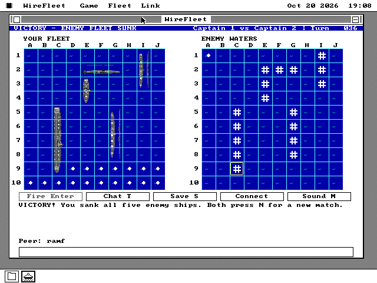
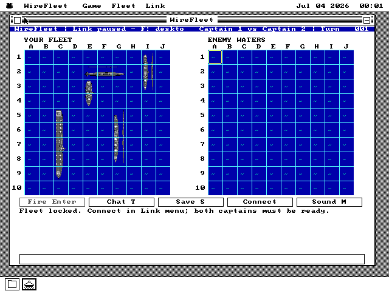
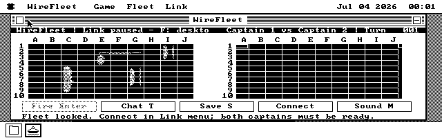
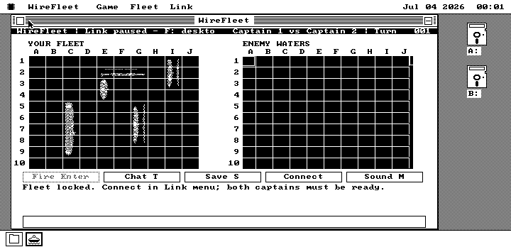
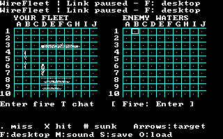
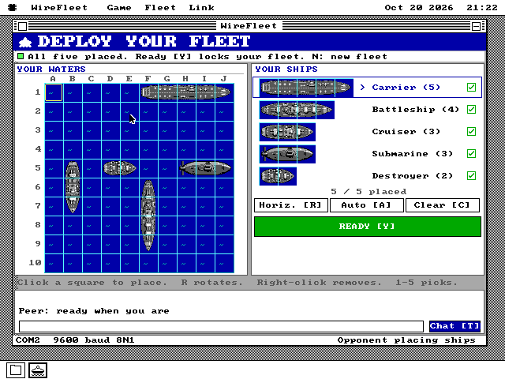
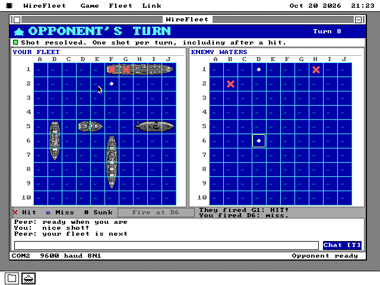
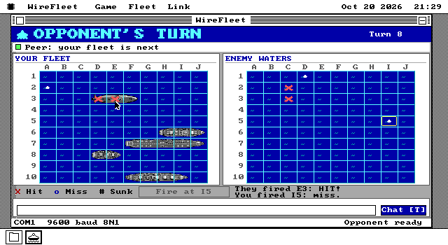
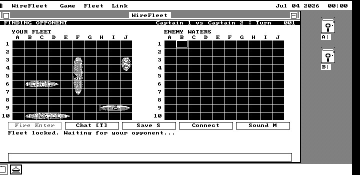
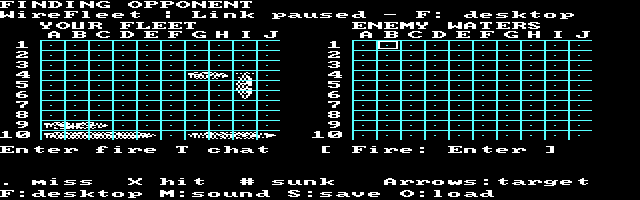

# How WireFleet was built

WireFleet — Two PCs. Two fleets. One winner.

This is the development diary for a native os8088 naval game. It records
what was actually built and checked, including the decisions that changed
the implementation. It can later be adapted for the website. Planned work
is kept separate from completed work in the delivery plan.

## 2026-10-20 — A screenshot, five ships, and an 8250

The brief started with two views: placing a fleet, and continuing a battle
after a connection returned. Both belong in ordinary overlapping windows.
The target includes VGA in color, CGA on the desktop and in four-color
fullscreen, and Hercules. A ship must remain identifiable without color,
and a hit cannot be distinguished from a miss by color alone.

We started in `feat/wirefleet`, in a separate worktree based on the freshly
fetched main branch. The original checkout's VM settings were left alone.
Before designing the game, we read the generated OS API index and WireBall's
contracts and implementation. Window creation, About, controls, clipping,
sound routing and fullscreen mode changes already have conventions.

One convention exposed the first engineering problem. WireBall temporarily
borrows both serial ports while the desktop is frozen. WireFleet must keep
the desktop mouse alive during play. The mouse interrupt handler examines
both ports, so merely disabling interrupts on the game's port would still
lose game bytes whenever the mouse moved. A coordinated serial lease is
needed before windowed multiplayer can be called reliable.

The ship source was generated with the built-in imagegen tool: an aircraft
carrier, battleship, cruiser, submarine and destroyer, all viewed directly
from above. The original source and exact prompt are retained under
`apps/wirefleet/art/`. Build-time conversion will produce bounded palette
assets, including explicit monochrome forms. There is no generation service
in the build or on the old computer.

The first delivery is a contract and reviewable work plan. The game,
reconnection, saved matches and sound are still implementation stories at
this point; this entry does not claim they have been tested.

## 2026-10-20 — Deployment on three desktops

The first executable wave puts all five ships on a native desktop grid.
Placement checks the entire proposed ship before removing its old position:
an invalid move cannot make a carrier disappear. Auto-placement tries a
bounded number of candidates, then has a simple legal fallback. Ready locks
the fleet until the captain explicitly starts a new one.

The runtime uses 38 opaque tiles: water, three shot shapes, and 17 ship
squares in each orientation. The selected generated source becomes packed
4bpp color plus explicit 1bpp tiles. A full board is assembled into ten row
spans. On a change, cached tile identities find the affected range first;
only that range is composed and blitted. There is no timer-driven repaint
of an idle sea.

The layouts are based on the actual content height. VGA cells are 24 by 24;
Hercules cells are 24 by 18; CGA desktop cells are 24 by 8. The last sounds
flat until the 640 by 200 display's pixel aspect is taken into account.
The compact layout keeps buttons and its status line above the dock.

We booted the package on MartyPC's VGA, CGA and Hercules XTs, inspected the
empty and auto-placed fleets, and read 17 occupied cells with the expected
five ship lengths. All four standalone disk sizes build. The package's
early image was 18.3 KB before compression, about 8.6 KB on disk, plus
3.5 KB of zeroed working storage. These are build observations, not timing
measurements or final acceptance. The registered `wirefleetdeploy` and
`wirefleetart` rows are deferred to the final test pass.

The repository's host checks caught a naming detail: the product name is
nine letters, while FAT's stem allows eight. The explicit `WIREFLET.O88`
name now follows through the build, live-media inventory and symbol checks.
The standard button registry also required its painter to declare its own
record. Both checks prevented apparently correct UI code from becoming an
inconsistent shipping package.

At the owner's request, this approach is now a shared repository rule in
both AGENTS.md and CLAUDE.md: isolated worktree, contract first, reviewable
story waves through one draft PR, retained art sources and a continuing
diary. The existing final-pass-only regression rule stays in force.

## 2026-10-20 — Keeping the mouse alive beside the cable

The serial boundary became a reusable OS facility rather than a private
WireFleet interrupt handler. The mouse owns its detected UART; a desktop
program can lease the other one at 9600 baud, 8N1. The existing interrupt
handler routes that port to bounded byte queues before examining mouse
packets. Both queues live in the pinned application region. The OS releases
the lease before freeing an instance, even on forced close.

Most of this service lives in an on-demand `SERIAL.DRV`, available to both
kernels. Its measured resident cost crosses one 512-byte allocation rung:
the big kernel occupies 97,792 of its fixed 100,864-byte budget, leaving
3,072 bytes; the small kernel occupies 61,440 of 64,000, leaving 2,560.
The active module itself needs a 1KB heap claim. These are build and budget
measurements; the adapter, IRQ and forced-close assertions belong to the
final integration pass. Hibernate refuses an active serial lease rather
than restoring a half-old hardware connection from a memory image.

## 2026-10-20 — Battles and a recoverable unanswered shot

Each captain keeps the private fleet locally. Fixed-size escaped frames
carry identities, a turn, a command and a CRC. The defending PC judges a
shot. Only a sunk ship reveals its extent. A turn history hash detects
disagreement without transmitting either private board.

The awkward reconnect case is a defender that has recorded a hit while
the shooter never received its answer. The defender caches that answer;
the shooter retains the unanswered command. Reconnection repairs that one
turn through replay and acknowledgment. Duplicate commands must not add
shots or sound twice. Chat has its own sequence and acknowledgment so a
lost message cannot starve turn synchronization.

Both captains can save their own 512-byte `.WFL` record. It includes the
pending shot and cached answer, rather than only the visible grids. Loading
checks the checksum, fleet geometry, shot counts, turn parity and sunk
markers before replacing live state. The final fault fixture deliberately
loses a result, saves and closes both apps, loads each PC's own file and
reconnects the same peers. At this entry that fixture is written, with its
result still to be established.

## 2026-10-20 — A fourth visual form and routed sound

The original art now produces 72 tiles, including hits over visible ships,
plus a 12-pixel-wide, packed two-bit form for CGA's 320-by-200 color mode.
Monochrome hits have a white halo around a dark cross so they survive a
gray hull. Hercules rows were shortened to 16 pixels to leave space for
chat. The desktop and color fullscreen paths share model and tile selection;
only the output backend differs. Headers, buttons and chat rows are cached
as well as the sea, so an idle timer does not redraw the whole interface.

Sound cues are finite note sequences through the existing sound router.
That gives PC Speaker, AdLib and Sound Blaster effects while respecting the
user's system setting. The game does not take over the timer or program a
sound card itself. Fullscreen returns through FSX and stops its sequence.
These paths compile; the final machine checks will distinguish that from
observed display, input and sound behavior.

## 2026-10-20 — Playing the whole match, including its broken cable

The two-PC test runs the actual game on two OS instances, with one using
COM1 and the other COM2. The host bridge forwards UART bytes. It does not
decide shots or substitute a host implementation of the game. An independent
frame reader checks CRCs and confirms that unhit ship coordinates never
cross the wire.

The match begins with a wrong-turn shot that must be refused. The fixture
then drops a result after the defender commits it, cuts the cable, saves
both private files, closes both applications and opens them again. Loading
and reconnecting completes that same shot once. It then replays shot,
result and chat frames, injects malformed frames, types game shortcuts as
chat text, and plays through all five enemy ships to victory. The final
history hashes agree and shots after the ending are refused. This complete
session passed; the final run took 94 seconds of host time, not an XT speed
measurement.

Deployment passed on VGA, CGA and Hercules XTs: legal placement, overlap and
edge refusal, moving a ship without losing it, rotation, removal, bounded
auto-placement, Ready locking, button drag-cancel, About and close. CGA's
separate color path preserves the fleet, lease and input through fullscreen
entry and return. Chat text does not activate game shortcuts.

The early acceptance failures were useful. The About item belongs to the
application's own menu. A closed menu has only posted its command; a test
must wait for the resulting state. A snapshot fixture needed the full CPU
register context and current movable package segment. The cached MartyPC
binary lacked the repository's Hercules page-mapping patch: rebuilding the
pinned instrument brought WireBall's missing sprites back without changing
the renderer. These are reasons to test what the machine actually does,
including the test instrument itself.

The serial review added explicit interrupt acknowledgment and a bounded
foreground service call beside the IRQ path. Read and Write use the same
queues and byte-service routine; a missed edge cannot leave a transmission
waiting for another mouse movement. The final original-8250 fixture masks
both serial IRQs and uses hardware loopback to check this path. It passed,
along with mouse-port refusal, competing-instance refusal, closing a
non-owner, complete UART restoration and forced-close release. CRC-valid
saved files with invalid versions, flags, placement, shot counts or pending
commands are rejected without changing the live board. Speaker, AdLib and
Sound Blaster checks observed the Ready cue's actual note grants, speaker
gate or FM key-on, finite expiry, mute and cleanup.

Finite durations also settle sound ownership. Mute cancels future notes
and lets the current note expire within three ticks. Closing the instance
releases its own grant immediately. This avoids a blanket tone-off after
another application has won the sound router.

The final package is 21,962 bytes compressed. Its 46,227-byte image and
7,021 bytes of zeroed working storage occupy exactly 52KB, with a further
1KB module claim while connected.
All four disk sizes build. The big,
small and emulator kernels remain inside their fixed memory budgets.

The clean build passed 52 host checks; the final host pass covered 54 with
the additional built artifacts present. All nine selected soak rows passed
after repairing failures and rerunning only those rows. All 60 full-suite
checks passed too. One earlier PS/2 attempt hit a shared-image write lock when
two test runs overlapped; it passed when rerun alone. The big and emulator
kernels each retain 3,072 bytes of budget, the small kernel 2,560. No budget
was raised.

Comparing the two captains' screenshots exposed another practical issue:
fresh PCs began with the same OS random seed and could auto-place identical
fleets. Auto now seeds the existing OS generator from fresh private local
timing. It does not use the discovery identity, which the opponent receives.
The two-PC check requires different complete fleets before play. All three
affected game rows passed after the seed change. The branch also absorbed
the intervening main changes: its sole conflict was the generated memory
ledger, which was regenerated from the combined source. Adapter/system
acceptance and all 60 full-suite rows passed against that merged base.

These are emulator results. A physical null modem, cable quality, real
8250 interrupt margin and the sound of actual cards still need a field run.
The two 86Box profiles were prepared and checked without starting an
interactive session or changing the owner's existing VM settings.

## 2026-10-20 — Part two: "they could not find each other"

The owner tried the merged game on two 86Box XTs and the captains never
met. The second brief asked for two things: link by itself, the way
WireBall's Serial Match does, and look the part on a colour screen — a
mock-up came with it, navy title bar and all.

Reading the link code again before touching it found two ways to get
stuck that a scripted test never meets, because a script always does the
right thing in the right order. Nothing linked until Link → Connect was
chosen, and the first port that menu offers, COM1, is the serial mouse on
most machines. Worse, Game → New fleet after linking gives that captain a
fresh identity: the other PC, still bound to the old one, refuses every
new frame, and the new one refuses every frame addressed to the old one.
Neither can recover until the other also presses N. Turn 0 has nothing to
protect, so the contract (SPEC.md §114.9) now lets a peer rebind there.

This host cannot drive an 86Box window (no accessibility grant), so the
86Box pair is not reproduced here; the QEMU two-PC harness is the
instrument, and the PR says which is which. The plan is
docs/plans/WIREFLEET-FACE-PLAN.md.

## 2026-10-20 — Linking without a menu

WireBall's Serial Match scans both ports; WireFleet waited for Link →
Connect. Now the window's first tick starts a search (SPEC.md §114.9): the
saved or chosen port first, else COM2, and a port the serial lease refuses
as the mouse's or absent simply leaves the list. On a machine with the
mouse on one port that leaves exactly one candidate, which is the common
case and the 86Box pair's. With no serial mouse both ports are candidates,
and the search moves its lease between them on a jittered 40–71 tick dwell
until a WireFleet frame that is not its own echo arrives.

Moving a lease used to mean Close then Open, and Close unloads SERIAL.DRV —
so every move would have read the system disk. The lease's holder may now
Open again to move it (§115.1); the module stays, and the kernel's resident
size did not move a byte. The other stuck state from the diagnosis is gone
too: before any result is committed, a HELLO from a new identity rebinds
the match, so New fleet after linking no longer strands the other PC.

The QEMU two-PC row grew two legs: both PCs with a PS/2 pointer and two free
UARTs, finding the cable's port by themselves; and New fleet after linking.

## 2026-10-20 — A colour face, flat

The mock-up asked for a navy title bar, cards, a ships list with check
boxes and a big Ready. MIDIRack's face was bevelled hardware; a naval game
reads better flat, so the elements went into a shared include,
`apps/os88flat.inc` (§20.5.3) — a card, a lamp, a check box in one blit, a
button painter and a double-size caption in one blit — and the `vga-face`
skill now teaches both looks.

EGA gets the same face at 16-pixel cells; with no room for a chat log there,
an incoming line is news in the notice strip.

Looking at the ships zoomed in found a grey line above every hull. The
atlas is not five equal strips — the carrier overhangs the second fifth — so
each ship after it carried its predecessor's keel. The converter now finds
each ship's own rows. And 34 of the 72 tiles turned out to be a ship
segment with the same red X: they are stamped at draw time now, which the
converter proves exact for all 34, and the art shrank from 31 KB to 17 KB.
That is what paid for the face on a 360 KB disk with no cluster to spare.

## 2026-10-20 — The board was the paint

Timed on MartyPC's 4.77 MHz VGA XT, a battle repaint took 3.9 seconds, 3.46
of them the two boards. The blit was not the cost: OSAPI_GFX_BLITP puts a
240×24 row up in 0.7 ms. Composing that row a pixel row at a time took 150.
So the tiles are spread to VGA's four planes once per instance, and a row
becomes four three-byte copies a scanline. The repaint is 1.39 seconds now,
deployment 1.1.

Driving the face found three bugs that were already on `main`: F hung a
VGA or Hercules desktop (the window handle had been replaced by the screen
height), typed chat was never drawn, and every cursor move on the Hercules
enemy board left 22 stray pixels — the board sat two pixels off the byte
grid, and the blit lit pixels past its own width. Hercules keeps its face,
with the board two pixels right and a header that says what it is doing.

`tests/wfdraw.py` holds the face to it: five seconds of searching draws
nothing, every gesture stays under a ceiling, and the picture the caches
drew is identical to a full repaint — on VGA and on Hercules.

## 2026-10-20 — Why Pong linked and WireFleet did not

The owner tried the face on two 86Box XTs and both sat in FINDING
OPPONENT. A logging relay spliced into the cable showed valid HELLO frames
crossing in both directions, CRCs good, identities distinct — so the frames
were arriving and being thrown away. A new Link > Statistics line read
`RX 7139, err 628 (bits 82)`: 9% of received bytes carried a UART overrun
or a ring overflow, and since one bad byte spoils a 66-byte frame, not one
frame had survived.

The mouse interrupt was not the culprit (0.28 ms a byte, measured). The
rate was: at 9600 baud an XT's one-byte 8250 has 1.04 ms to be read before
the next byte overwrites it, and QEMU — a thousand times faster — never
came close to that edge. WireBall had always run at 2400. The owner's
suggestion was to do the same, since a naval game sends far less than a
ball does. The serial lease now takes the divisor (BH), WireFleet asks for
2400, and its heartbeat slows from every three ticks to every nine so a
66-byte frame (275 ms on the wire) leaves the line half idle. On the same
two 86Box XTs the captains found each other within seconds.
