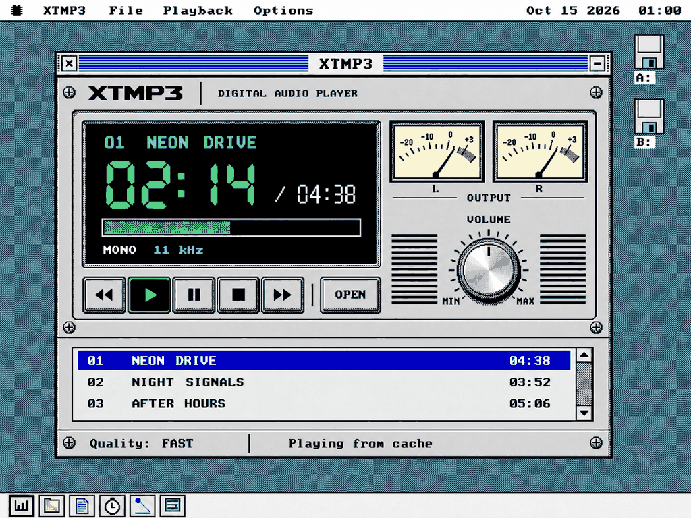
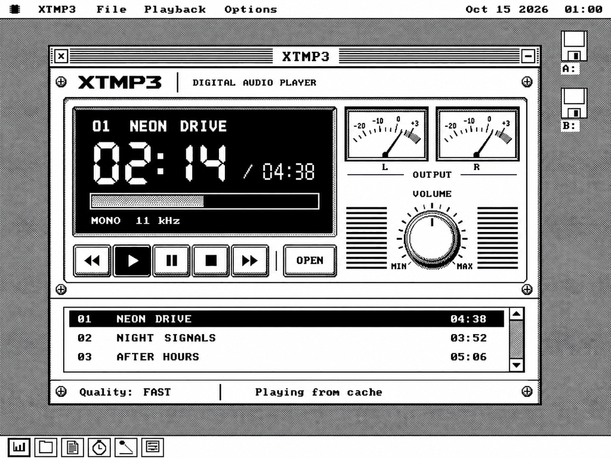
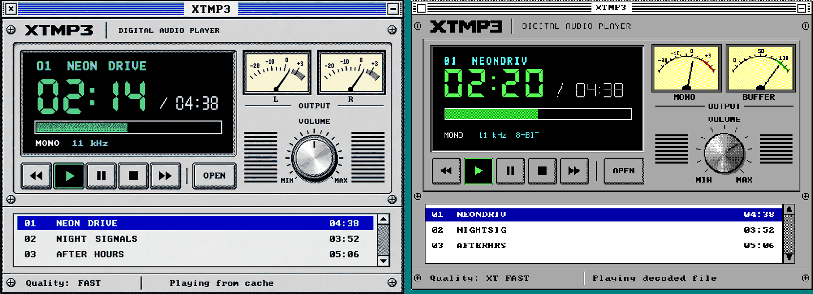
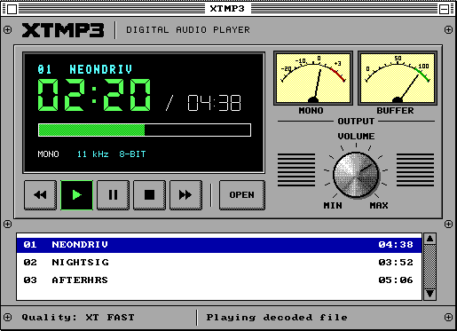
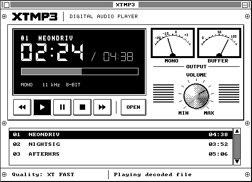
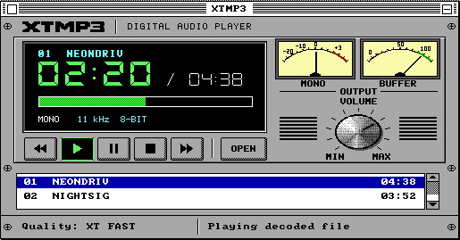
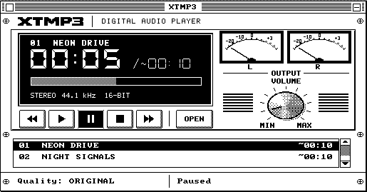
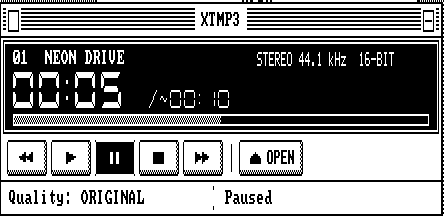
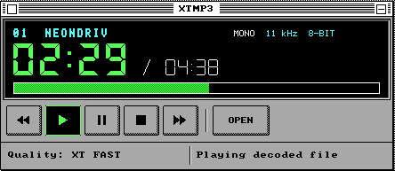
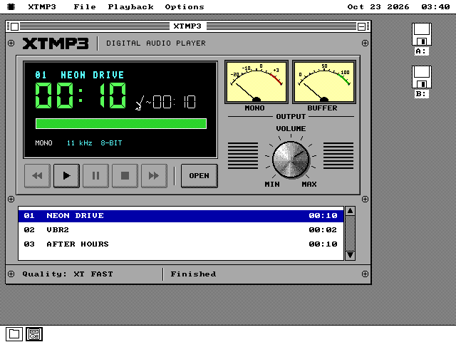

# How XTMP3 was built

A diary, written as the work happened, for later reuse on the website. It
separates what was observed from what was intended, and names what was
actually tested. The plan is [plans/XTMP3-PLAN.md](plans/XTMP3-PLAN.md) and the
contract is SPEC.md §121.

## 2026-10-22 — the brief and the two pictures

The owner handed over a development package: a long coding brief and two
concept images. The brief asks for an MP3 player that is a proper integer
decoder on machines that can afford one and an honest, table-driven
approximation on a 4.77 MHz 8088. When even that cannot keep up, the player
decodes the whole track to a hard drive first and only then plays it. The
owner attached a second colour picture to the request. Its layout is the
monochrome picture's, on a teal desktop, and that one is the colour design.
The package's own colour concept is kept beside it for reference.

| colour (the design) | black and white |
|---|---|
|  |  |

**What the pictures ask for, in the owner's words, split into look and
behaviour.**

- *Look*: an 80s stereo component. A logo strip with cross-head screws, a
  recessed black LCD with a cyan title line, large green seven-segment
  minutes and seconds, a thin `/ 04:38`, a green dithered progress bar and
  `MONO 11 kHz`. Two cream VU meters with a red overload zone over an OUTPUT
  rule. A machined VOLUME knob with a tick ring, MIN and MAX, between two
  grilles. Bevelled transport keys with Play latched green, and an OPEN key.
  A queue with a blue selection, and a status bar.
- *Behaviour behind them*: the transport, the queue, Open, the volume, the
  quality shown in the status bar (`Quality: FAST`) and the state
  (`Playing from cache`). The brief says these must be TRUE: "Playing from
  cache" appears only once a conversion has finished, and two meters must
  not claim stereo on a mono output.

**How the OS answers what the pictures invent.** There is no check mark in an
app menu, so the quality item names its state. There is no Help menu, so
About is `OSAPI_ABOUT_SET`'s card. The window chrome, the desktop and the
menu bar are the OS's. The second meter becomes the buffer gauge when the
output is mono.

**The decision that shaped everything else** is that an 8088 cannot decode
MP3 in real time. The arithmetic below is a model to be replaced by
measurement. Synthesis alone is 16 multiply-adds per output sample. An
8088 `imul` is about 130 cycles, and a product-table lookup with its
addressing is about 50. At 11,025 Hz mono that is 8.8 M cycles a second for
synthesis by table, against 4.77 M available. So the XT path is designed
around Decode First from the start, and the tables are there to make that
conversion shorter, not to pretend.

## 2026-10-22 — the work fanned out

At the owner's request the stories were cut into tracks that touch disjoint
files, each in its own worktree: the host reference decoder, the sound
driver's 16-bit/stereo streams, the XT approximation study, and the face.
They ran at once. The table in the plan says which track waits for which.

## 2026-10-22 — the face

*The face track (S4), on `xtmp3/face`. What was built and looked at; the
contract notes are [docs/xtmp3/FACE.md](xtmp3/FACE.md).*

**Observed, in this order.** The art came first, as the retro-face skill
says, and was looked at zoomed before a line of assembly. The three codex
masters turned out to be exactly on their block grids in exactly the
sixteen colours (not one non-uniform block in 10,720), so deriving them is
reading block centres, not resampling. The first previews were honest
about what needed a hand: the master's knob carries its indicator as a
white groove, which had to come out so the volume could turn it; the
first black-and-white knob dithered the master's own dither and came out
as a comb, until its greys were averaged first; and the seven-segment
digits in CDRack's mitred style looked like pills next to the mockup's
long lit bars, so a third segment style was written, trapezoids whose
45-degree ends meet along the corner's diagonal.

Then the package, CDRack's three-file shape. **It assembled and opened on
its first boot**, launched by double-clicking an `.MP3` on a scratch
floppy, which proved the association and `OSAPI_ARG_FILE` before any menu
was touched. The rest of that first look was a list: OUTPUT and VOLUME
crowded on MID, the empty total showing the estimate's tilde (its
"nothing" key has the estimate's bit set), an empty queue drawing a full
thumb, and removing the entry on show leaving the LCD saying NO TRACK
over a queue that still had tracks.

**The identity check** - change things through the face, capture, force a
full repaint, capture, difference - came back `None` on every layout and
adapter it was run on: FULL in colour and in black and white, C2, a FULL
to C2 to FULL round trip, MID on EGA in both themes, MID on Hercules and C1
on the CGA.

| | |
|---|---|
|  |  |
|  |  |
|  |  |

**What differs from the mockup, on purpose.** The tracks are named by their
files (`NEONDRIV`) because nothing reads a tag until the parser (S5). The
right dial reads BUFFER and its zone is green while the output is mono -
the brief's rule that the meters never claim stereo the output does not
have, so with the demo's XT FAST rung the face cannot show the mockup's
L and R. The panel is the palette's light grey where the mockup's is a
lighter grey no single colour gives. The status line says "Playing
decoded file", the state the SPEC names, where the mockup says "Playing
from cache".

**Intentions, not yet observations.** No cycle has been counted: the
needle box and the knob's canvas are the two paths an XT with a VGA will
feel, and that measurement belongs to S10 on MartyPC. The engine behind
the face is a demo that plays nothing; S8 replaces it behind the same
names. Looked at on QEMU only - Hercules through its software renderer -
and never on 86Box or a real card.

## 2026-10-22 — the front end and the STANDARD decoder on the target

*The STANDARD track (S5 and the bit-exact half of S6), on `xtmp3/std`. The
contract notes and every number are [docs/xtmp3/STD.md](xtmp3/STD.md).*

**The contract went first.** Within the first hour `apps/xtmp3/x3gran.inc`
was pushed - the granule record, a backend's six far verbs and their
register contracts, the front end's API - because two other tracks were
writing against it at the same time: the XT backend reads the record and
the engine calls the verbs. One correction followed it, in a comment
(x3pars.inc reaches the FRONT part through ES, not DS); the ABI did not
move.

**Observed, in this order.** The front end matched x3sim on its first full
run: every granule record of 32 fixtures - each `ix`, each requantisation
exponent, each stereo plan byte - and only the five titles were wrong (the
title copy wrote its NUL at the start of the field). The bench that showed
it is a bare-metal harness on QEMU that %includes the shipping parser and
loads the package's own parts, far-called on a 384-byte stack; QEMU is
exact about the work, which is all bit-exactness needs.

Then the STANDARD part, 1,700 lines of assembly, came out **bit-exact on
all 141 golden cases on its first run**. That was not luck so much as a
decision: the two stages whose order of operations is the hardest to
transcribe - the recursive DCT-II and the 16-tap window - were never
transcribed. `tools/x3stdgen.py` runs x3sim's own `dct2_i` on symbolic
values and writes down the operations it is asked for, in order.

S5's outcome was looked at on QEMU: the queue shows NEON DRIVE from its
ID3v2 tag, AFTER HOURS from an ID3v1 tag, and a tagless VBR file under its
name with its exact length from the Xing count; an estimated length carries
its `~`.

**The 8088 said what the model could not.** On MartyPC's 5150 the first
measurement was 6.81 M cycles a granule for an 11 kHz mono stream - twice
NUMERICS.md's model, and 27 times too slow for real time. The breakpoint
timer showed where: the window was exactly where the model put it, but a
32 x 16 multiply with its 48-bit accumulation costs ~460 cycles, not 330,
and the band scale, Huffman and requantisation ran 4 to 10 times their
model figures. Six rounds of exact optimisation, each re-measured, took
it to 5.57 M (and 44.1 kHz stereo from 12.86 M to 9.31 M); the window and
the DCT are now within about a fifth of the multiply floor. The 8088's PCM
was checked against x3sim's by CRC-32 on every case timed.

**What the clean fixtures could not show.** No golden fixture saturates, so
every clamp in the decoder was correct only by reading - including the
ones that had just been moved out of line. Six fixtures with their global
gain raised by 24 were added to the gate; they saturate in five stages, and
on their first run they found a real defect: the requantiser tested SF
after `RCL`, which sets no SF. A normal stream never reaches that line.

**Intentions, not yet observations.** No 286, 386 or 486 has run it (S8's
ladder measures those on 86Box), the engine behind the face is still the
demo, and seeking is written but unexercised.

## 2026-10-22 — the XT backend on the target

*The XT track (S7), on `xtmp3/xt`. The contract notes and every table are
[docs/xtmp3/XT.md](xtmp3/XT.md). The emulators were Unicorn on the host,
QEMU for the exactness row, and MartyPC's IBM 5150 for every cycle. Nothing
here ran on 86Box or on iron.*

**Observed, in this order.**

- **The model came first.** `tools/x3simxt.py` runs x3sim's front end into
  the study's integer chain. It settles what the study had left open:
  - requantisation through RQL;
  - the per-subband IMDCT switch;
  - a mono downmix that mixes spectra when both channels' blocks agree and
    windowed outputs when they do not;
  - V codes taken from the DCT's outputs, the sign going into the add or
    sub.

  Its first quality run reproduced the study's figures within a few tenths
  of a dB on every XT fixture, before a line of the part existed.
- **Then the part, and a generator beside it.** `tools/x3xtgen.py` writes
  every address the 8088 does not need to compute: the layout of the
  claim, Lee's DCT as straight-line code, each profile's window pass as
  unrolled rows.
- **OPEN's expansion matched on the first run.** In Unicorn, every table
  OPEN built was byte-identical to the generator's on all four profiles.
- **The first granules were bit-exact too**, on the two XT fixtures for
  every profile. Because that seemed too easy, a deliberately damaged
  constant went in; the first damage was too small to reach 8-bit output,
  and a larger one was caught at granule 1.
- **The STANDARD track then pinned the record and the ABI**, and the part
  was moved onto them. That meant the header vector table, CAPS and OPEN
  records, separate claims per segment, and STATS' layout. One decision
  came out of it: the OPEN record has no slot for an asset, so the part
  carries XTGEN.BIN inside itself.
- **The exactness row reuses the STANDARD track's bench mechanism.** It
  runs QEMU booting the shipping front end into the XT part. All 51 cases
  were exact.
- **MartyPC agreed bit for bit as well.** Its 8088 core gave the same PCM
  on every granule it timed.

**What the measurements changed.**

- **The model priced the kernels well and the code between them less
  well.** The first build took 1,662,211 cycles a granule for XT Standard
  on the song, where the model expected 1.37 M.
- **The IMDCT crossover is 12.5 lines.** The study had modelled 9.6, and
  the factored form costs 17,900 cycles, not 11,300.
- **Nine changes followed, each re-checked bit-exact and re-measured
  only where it moved.** The largest:
  - the bottom of Lee's recursion kept in registers;
  - the IMDCT window fused with the overlap;
  - butterflies with two zero lines skipped.

  Together they brought XT Standard to 1,505,847 (−9.4%). The window
  pass, the largest stage, was already within 11% of the 1,277 cycles a
  pair measured alone in the study.
- **Memory was the surprise.** Summed honestly with the engine's
  primary, the XT Standard path came to about 413 KB against SPEC.md
  121.10's 400,000 bytes.
- **The answer was the OS's own shrink-to-fit.** Everything only OPEN
  reads now sits behind a resident 29 KB, checked by a Fletcher sum
  before it runs. OPEN copies the chosen profile's kernels into a slot,
  and the claim can then shrink, with no change to the ABI.
- **The harness proves the shrink is safe.** It overwrites the tail with
  `int3` after every OPEN and decodes anyway.

**Intentions, not yet observations.**

- **Fitting 400,000 bytes for XT Standard also needs the engine** to
  claim its ring after OPEN and the shrink. The numbers went to the engine
  track; the decision is theirs and the integrator's.
- **No figure here includes the front end's Huffman decode or the disk.**
- **The 286, 386 and 486 numbers are 86Box's to take.**
- **Nobody has listened to the target's own output yet.** Its PCM is the
  model's to the byte, so the study's listening WAVs stand in for it.

**Later the same day: the merge, and OPEN.**

- **The integration branch now has one parts table.** FRONT and ART are
  eager and STD is lazy; the XT part became row 3.
- **OPEN dropped from 4.25 s to 2.96 s on XT Standard**, still on
  MartyPC, with every expanded byte unchanged:
  - the Fletcher loop is unrolled;
  - the encoder walks hold the midpoint they are waiting for in a
    register;
  - the expansion loops keep their constants in registers.
- **The Fletcher stays a read-back**, not a sum folded into the stores. A
  read-back is what catches a bad RAM cell on a 1981 machine, and a
  store-order sum cannot.

## 2026-10-22 — the engine, over a backend that only pretends

*The engine track (S9 Decode first, with the plumbing of S6's live path and
S8's ladder), on `xtmp3/eng`. The contract notes are
[docs/xtmp3/ENGINE.md](xtmp3/ENGINE.md).*

**The premise.** The real decoders were being written beside it at the same
moment, so the engine was built against a **stub backend**: an `OP_SEG` part
that speaks the decoder ABI exactly, makes a square wave instead of music,
and takes as long per granule as a test tells it to. A rung configured at
0.80x calibrates under 1.25 on any host, QEMU included. That one hook made
the ladder's every transition (stay, step, step twice, give up and decode
first) something a row can assert rather than something a person has to
hear.

**Shared source, not a copy.** The look-ahead ring and the speaker and Covox
bracket are the Audio Player's own code, included as it is. The look-ahead
had to be split out of `apengine.inc` into `aplook.inc` first, and the test
of that split was that AUDIO.O88 assembles byte for byte as before on all
five of its arms. It does.

**Observed, in roughly the order it was found.**

- The Save dialog's callbacks run unbound, billed to no instance, so the
  first Save dialog opened wherever the *machine* was standing, which was
  B:, and not on the volume just chosen. Every dialog action is now posted
  to the main window's wake.
- `pit_now` steps back one tick under QEMU when the 8253 has reloaded and
  its IRQ0 is still pending, and a negative span read as a huge positive
  one. The engine treats a span that goes back as zero, and the stub's own
  clock adds the pending tick.
- At 44.1 kHz 16-bit stereo the card wants 176 KB a second, and the
  driver's 16 KB grant is 93 ms of it. Fast streams now play from a 32 KB
  external ring of the engine's own.
- MPEG-1's second granule was being dropped: one `jb` that should have been
  a `ja`.
- The first probe of a session measured slow. Part of that was the stub's
  spin ending early across the same IRQ0, and part was every cold cache's
  first use. A warm-up granule, untimed, now goes first.
- The last one: a rung slowing to 1.05x underran **before** its slow windows
  could step it down. The trace showed the lead falling from 24 KB to 8 KB
  across a single sleep. The worker slept one tick whenever the ring was
  half full, and one tick is up to two. On 176 KB/s's 32 KB ring, that left
  less than the two blocks the SB's interrupt needs fed. The worker now
  sleeps only on a lead that a sleep cannot drain. At 176 KB/s that means
  never.

**What was tested, and where.** All of it on QEMU, with an SB16 whose output
was captured to a WAV on the host, over hard disk images built for each
case. The `xtmp3eng` row's ten legs passed on the branch's final build:
the ladder on five machines, the slowdown at 1.05x and 0.60x, Decode first
end to end with the WAV's every field checked on the host, cancel (0.22 s
from Esc to READY), a disk filled mid-write, stale and incomplete caches,
no fixed disk, two volumes, a finished WAV on the card with no decoder
resident, and pause.

**Intentions, not yet observations.** No real MP3 granule has gone through
this engine. The STANDARD track's front end does not yet fit beside it in
the primary segment, about 2.3 KB short. No timing here is an 8088's: the
stub's costs are set by hand, and MartyPC's turn is S10. The speaker path
was checked by its state only, because QEMU runs an 11 kHz IRQ0 too slowly
to listen to. A volume label cannot be shown, because no slot gives one to
a package.

### Later the same day: onto the real front end, and under 400,000 bytes

The face's art moved into a part of its own, which freed the primary. The
engine then merged `feature/xtmp3`, dropped its stand-in front end, and ran
on STANDARD's `x3pars.inc`. Every leg of the row passed on the first run
over the real front end. The stub backend became the parts table's row 4.

**Observed.** The XT ceiling was where the work went. The first XT Standard
conversion, run on the shipped package with the real XT part, measured
**421 KB** and then stopped with "Out of memory". There were two causes:

- The ring was claimed before OPEN, and the probe's unshrunk part stayed
  resident into the job.
- The stage was a separate claim. With the XT backend's five work segments
  it was the ninth claim of an owner the heap allows eight.

The order is now OPEN, shrink, then the ring. The ring is 16 KB under the XT
backend, and the stage rides inside the ring's claim with 4 KB halves. The
fingerprint, which had read its 16 KB in one go, now reads in pieces. On the
first run after that, the conversion finished at **386 KB = 395,264 bytes**.
`X3S_PEAK` is now the heap's own measurement, not a sum of estimates.

**Tested where.** QEMU, every leg; the ceiling on the real XT part, on QEMU.
No XT has run it.
