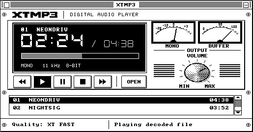
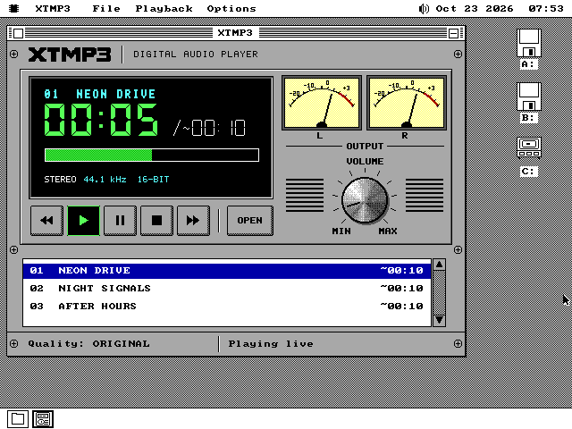
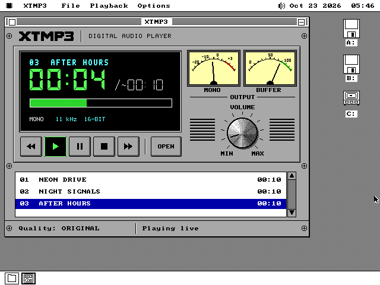
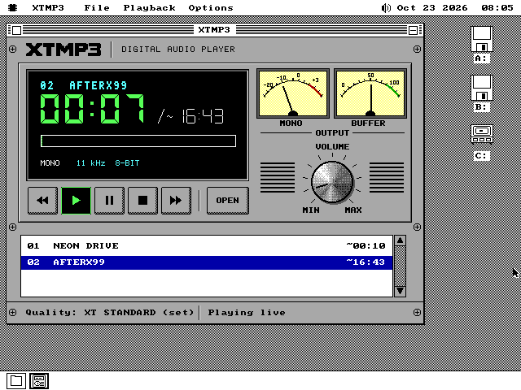
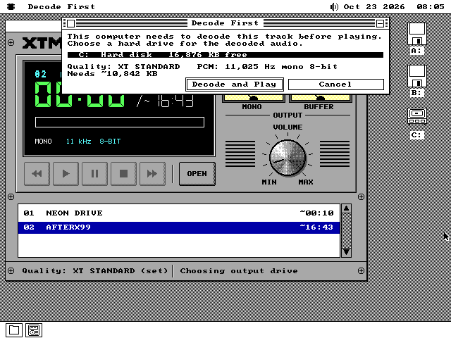
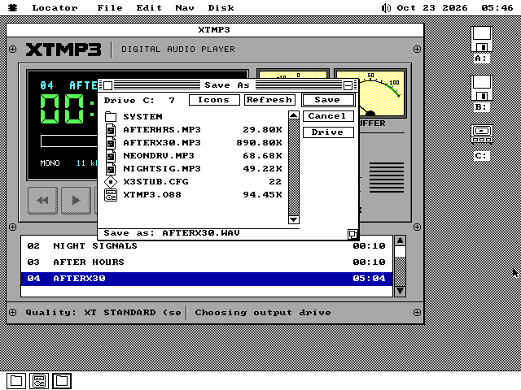
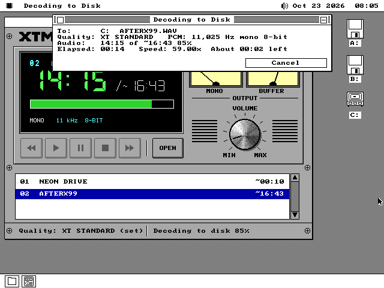
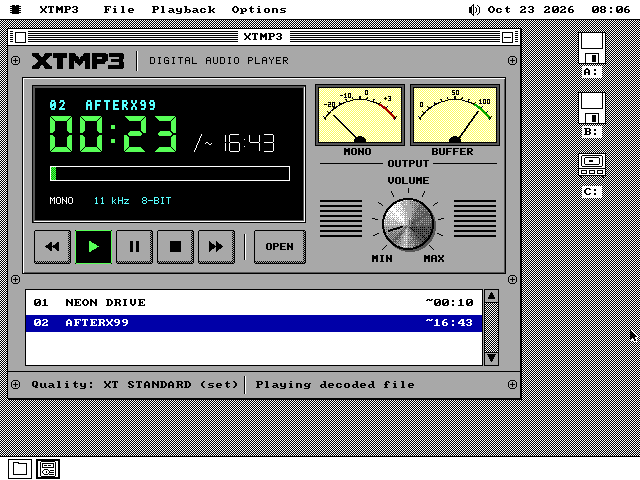
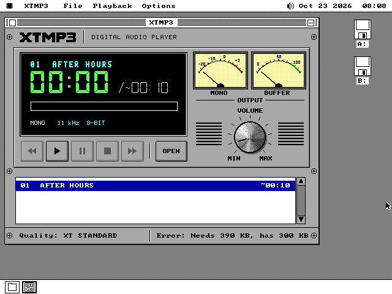
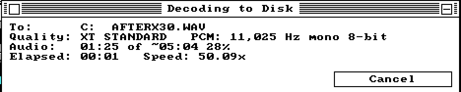

# How XTMP3 was built

A diary, written as the work happened, for later reuse on the website. It
separates what was observed from what was intended, and names what was
actually tested. The plan is [plans/XTMP3-PLAN.md](plans/XTMP3-PLAN.md) and the
contract is SPEC.md §121.

## 2026-10-22 — the brief and the two pictures

The owner handed over a development package: a long coding brief and two
concept images. The brief asks for an MP3 player that is a proper integer
decoder on machines that can afford one and an honest, table-driven
approximation on a 4.77 MHz 8088. When even that cannot keep up, the player
decodes the whole track to a hard drive first and only then plays it. The
owner attached a second colour picture to the request. Its layout is the
monochrome picture's, on a teal desktop, and that one is the colour design.
The package's own colour concept is kept beside it for reference.

| colour (the design) | black and white |
|---|---|
|  |  |

**What the pictures ask for, in the owner's words, split into look and
behaviour.**

- *Look*: an 80s stereo component. A logo strip with cross-head screws, a
  recessed black LCD with a cyan title line, large green seven-segment
  minutes and seconds, a thin `/ 04:38`, a green dithered progress bar and
  `MONO 11 kHz`. Two cream VU meters with a red overload zone over an OUTPUT
  rule. A machined VOLUME knob with a tick ring, MIN and MAX, between two
  grilles. Bevelled transport keys with Play latched green, and an OPEN key.
  A queue with a blue selection, and a status bar.
- *Behaviour behind them*: the transport, the queue, Open, the volume, the
  quality shown in the status bar (`Quality: FAST`) and the state
  (`Playing from cache`). The brief says these must be TRUE: "Playing from
  cache" appears only once a conversion has finished, and two meters must
  not claim stereo on a mono output.

**How the OS answers what the pictures invent.** There is no check mark in an
app menu, so the quality item names its state. There is no Help menu, so
About is `OSAPI_ABOUT_SET`'s card. The window chrome, the desktop and the
menu bar are the OS's. The second meter becomes the buffer gauge when the
output is mono.

**The decision that shaped everything else** is that an 8088 cannot decode
MP3 in real time. The arithmetic below is a model to be replaced by
measurement. Synthesis alone is 16 multiply-adds per output sample. An
8088 `imul` is about 130 cycles, and a product-table lookup with its
addressing is about 50. At 11,025 Hz mono that is 8.8 M cycles a second for
synthesis by table, against 4.77 M available. So the XT path is designed
around Decode First from the start, and the tables are there to make that
conversion shorter, not to pretend.

## 2026-10-22 — the work fanned out

At the owner's request the stories were cut into tracks that touch disjoint
files, each in its own worktree: the host reference decoder, the sound
driver's 16-bit/stereo streams, the XT approximation study, and the face.
They ran at once. The table in the plan says which track waits for which.

## 2026-10-22 — the face

*The face track (S4), on `xtmp3/face`. What was built and looked at; the
contract notes are [docs/xtmp3/FACE.md](xtmp3/FACE.md).*

**Observed, in this order.** The art came first, as the retro-face skill
says, and was looked at zoomed before a line of assembly. The three codex
masters turned out to be exactly on their block grids in exactly the
sixteen colours (not one non-uniform block in 10,720), so deriving them is
reading block centres, not resampling. The first previews were honest
about what needed a hand: the master's knob carries its indicator as a
white groove, which had to come out so the volume could turn it; the
first black-and-white knob dithered the master's own dither and came out
as a comb, until its greys were averaged first; and the seven-segment
digits in CDRack's mitred style looked like pills next to the mockup's
long lit bars, so a third segment style was written, trapezoids whose
45-degree ends meet along the corner's diagonal.

Then the package, CDRack's three-file shape. **It assembled and opened on
its first boot**, launched by double-clicking an `.MP3` on a scratch
floppy, which proved the association and `OSAPI_ARG_FILE` before any menu
was touched. The rest of that first look was a list: OUTPUT and VOLUME
crowded on MID, the empty total showing the estimate's tilde (its
"nothing" key has the estimate's bit set), an empty queue drawing a full
thumb, and removing the entry on show leaving the LCD saying NO TRACK
over a queue that still had tracks.

**The identity check** - change things through the face, capture, force a
full repaint, capture, difference - came back `None` on every layout and
adapter it was run on: FULL in colour and in black and white, C2, a FULL
to C2 to FULL round trip, MID on EGA in both themes, MID on Hercules and C1
on the CGA.

| | |
|---|---|
|  |  |
|  |  |
|  |  |

**What differs from the mockup, on purpose.** The tracks are named by their
files (`NEONDRIV`) because nothing reads a tag until the parser (S5). The
right dial reads BUFFER and its zone is green while the output is mono -
the brief's rule that the meters never claim stereo the output does not
have, so with the demo's XT FAST rung the face cannot show the mockup's
L and R. The panel is the palette's light grey where the mockup's is a
lighter grey no single colour gives. The status line says "Playing
decoded file", the state the SPEC names, where the mockup says "Playing
from cache".

**Intentions, not yet observations.** No cycle has been counted: the
needle box and the knob's canvas are the two paths an XT with a VGA will
feel, and that measurement belongs to S10 on MartyPC. The engine behind
the face is a demo that plays nothing; S8 replaces it behind the same
names. Looked at on QEMU only - Hercules through its software renderer -
and never on 86Box or a real card.

## 2026-10-22 — the front end and the STANDARD decoder on the target

*The STANDARD track (S5 and the bit-exact half of S6), on `xtmp3/std`. The
contract notes and every number are [docs/xtmp3/STD.md](xtmp3/STD.md).*

**The contract went first.** Within the first hour `apps/xtmp3/x3gran.inc`
was pushed - the granule record, a backend's six far verbs and their
register contracts, the front end's API - because two other tracks were
writing against it at the same time: the XT backend reads the record and
the engine calls the verbs. One correction followed it, in a comment
(x3pars.inc reaches the FRONT part through ES, not DS); the ABI did not
move.

**Observed, in this order.** The front end matched x3sim on its first full
run: every granule record of 32 fixtures - each `ix`, each requantisation
exponent, each stereo plan byte - and only the five titles were wrong (the
title copy wrote its NUL at the start of the field). The bench that showed
it is a bare-metal harness on QEMU that %includes the shipping parser and
loads the package's own parts, far-called on a 384-byte stack; QEMU is
exact about the work, which is all bit-exactness needs.

Then the STANDARD part, 1,700 lines of assembly, came out **bit-exact on
all 141 golden cases on its first run**. That was not luck so much as a
decision: the two stages whose order of operations is the hardest to
transcribe - the recursive DCT-II and the 16-tap window - were never
transcribed. `tools/x3stdgen.py` runs x3sim's own `dct2_i` on symbolic
values and writes down the operations it is asked for, in order.

S5's outcome was looked at on QEMU: the queue shows NEON DRIVE from its
ID3v2 tag, AFTER HOURS from an ID3v1 tag, and a tagless VBR file under its
name with its exact length from the Xing count; an estimated length carries
its `~`.

**The 8088 said what the model could not.** On MartyPC's 5150 the first
measurement was 6.81 M cycles a granule for an 11 kHz mono stream - twice
NUMERICS.md's model, and 27 times too slow for real time. The breakpoint
timer showed where: the window was exactly where the model put it, but a
32 x 16 multiply with its 48-bit accumulation costs ~460 cycles, not 330,
and the band scale, Huffman and requantisation ran 4 to 10 times their
model figures. Six rounds of exact optimisation, each re-measured, took
it to 5.57 M (and 44.1 kHz stereo from 12.86 M to 9.31 M); the window and
the DCT are now within about a fifth of the multiply floor. The 8088's PCM
was checked against x3sim's by CRC-32 on every case timed.

**What the clean fixtures could not show.** No golden fixture saturates, so
every clamp in the decoder was correct only by reading - including the
ones that had just been moved out of line. Six fixtures with their global
gain raised by 24 were added to the gate; they saturate in five stages, and
on their first run they found a real defect: the requantiser tested SF
after `RCL`, which sets no SF. A normal stream never reaches that line.

**Intentions, not yet observations.** No 286, 386 or 486 has run it (S8's
ladder measures those on 86Box), the engine behind the face is still the
demo, and seeking is written but unexercised.

## 2026-10-22 — the XT backend on the target

*The XT track (S7), on `xtmp3/xt`. The contract notes and every table are
[docs/xtmp3/XT.md](xtmp3/XT.md). The emulators were Unicorn on the host,
QEMU for the exactness row, and MartyPC's IBM 5150 for every cycle. Nothing
here ran on 86Box or on iron.*

**Observed, in this order.**

- **The model came first.** `tools/x3simxt.py` runs x3sim's front end into
  the study's integer chain. It settles what the study had left open:
  - requantisation through RQL;
  - the per-subband IMDCT switch;
  - a mono downmix that mixes spectra when both channels' blocks agree and
    windowed outputs when they do not;
  - V codes taken from the DCT's outputs, the sign going into the add or
    sub.

  Its first quality run reproduced the study's figures within a few tenths
  of a dB on every XT fixture, before a line of the part existed.
- **Then the part, and a generator beside it.** `tools/x3xtgen.py` writes
  every address the 8088 does not need to compute: the layout of the
  claim, Lee's DCT as straight-line code, each profile's window pass as
  unrolled rows.
- **OPEN's expansion matched on the first run.** In Unicorn, every table
  OPEN built was byte-identical to the generator's on all four profiles.
- **The first granules were bit-exact too**, on the two XT fixtures for
  every profile. Because that seemed too easy, a deliberately damaged
  constant went in; the first damage was too small to reach 8-bit output,
  and a larger one was caught at granule 1.
- **The STANDARD track then pinned the record and the ABI**, and the part
  was moved onto them. That meant the header vector table, CAPS and OPEN
  records, separate claims per segment, and STATS' layout. One decision
  came out of it: the OPEN record has no slot for an asset, so the part
  carries XTGEN.BIN inside itself.
- **The exactness row reuses the STANDARD track's bench mechanism.** It
  runs QEMU booting the shipping front end into the XT part. All 51 cases
  were exact.
- **MartyPC agreed bit for bit as well.** Its 8088 core gave the same PCM
  on every granule it timed.

**What the measurements changed.**

- **The model priced the kernels well and the code between them less
  well.** The first build took 1,662,211 cycles a granule for XT Standard
  on the song, where the model expected 1.37 M.
- **The IMDCT crossover is 12.5 lines.** The study had modelled 9.6, and
  the factored form costs 17,900 cycles, not 11,300.
- **Nine changes followed, each re-checked bit-exact and re-measured
  only where it moved.** The largest:
  - the bottom of Lee's recursion kept in registers;
  - the IMDCT window fused with the overlap;
  - butterflies with two zero lines skipped.

  Together they brought XT Standard to 1,505,847 (−9.4%). The window
  pass, the largest stage, was already within 11% of the 1,277 cycles a
  pair measured alone in the study.
- **Memory was the surprise.** Summed honestly with the engine's
  primary, the XT Standard path came to about 413 KB against SPEC.md
  121.10's 400,000 bytes.
- **The answer was the OS's own shrink-to-fit.** Everything only OPEN
  reads now sits behind a resident 29 KB, checked by a Fletcher sum
  before it runs. OPEN copies the chosen profile's kernels into a slot,
  and the claim can then shrink, with no change to the ABI.
- **The harness proves the shrink is safe.** It overwrites the tail with
  `int3` after every OPEN and decodes anyway.

**Intentions, not yet observations.**

- **Fitting 400,000 bytes for XT Standard also needs the engine** to
  claim its ring after OPEN and the shrink. The numbers went to the engine
  track; the decision is theirs and the integrator's.
- **No figure here includes the front end's Huffman decode or the disk.**
- **The 286, 386 and 486 numbers are 86Box's to take.**
- **Nobody has listened to the target's own output yet.** Its PCM is the
  model's to the byte, so the study's listening WAVs stand in for it.

**Later the same day: the merge, and OPEN.**

- **The integration branch now has one parts table.** FRONT and ART are
  eager and STD is lazy; the XT part became row 3.
- **OPEN dropped from 4.25 s to 2.96 s on XT Standard**, still on
  MartyPC, with every expanded byte unchanged:
  - the Fletcher loop is unrolled;
  - the encoder walks hold the midpoint they are waiting for in a
    register;
  - the expansion loops keep their constants in registers.
- **The Fletcher stays a read-back**, not a sum folded into the stores. A
  read-back is what catches a bad RAM cell on a 1981 machine, and a
  store-order sum cannot.

## 2026-10-22 — the engine, over a backend that only pretends

*The engine track (S9 Decode first, with the plumbing of S6's live path and
S8's ladder), on `xtmp3/eng`. The contract notes are
[docs/xtmp3/ENGINE.md](xtmp3/ENGINE.md).*

**The premise.** The real decoders were being written beside it at the same
moment, so the engine was built against a **stub backend**: an `OP_SEG` part
that speaks the decoder ABI exactly, makes a square wave instead of music,
and takes as long per granule as a test tells it to. A rung configured at
0.80x calibrates under 1.25 on any host, QEMU included. That one hook made
the ladder's every transition (stay, step, step twice, give up and decode
first) something a row can assert rather than something a person has to
hear.

**Shared source, not a copy.** The look-ahead ring and the speaker and Covox
bracket are the Audio Player's own code, included as it is. The look-ahead
had to be split out of `apengine.inc` into `aplook.inc` first, and the test
of that split was that AUDIO.O88 assembles byte for byte as before on all
five of its arms. It does.

**Observed, in roughly the order it was found.**

- The Save dialog's callbacks run unbound, billed to no instance, so the
  first Save dialog opened wherever the *machine* was standing, which was
  B:, and not on the volume just chosen. Every dialog action is now posted
  to the main window's wake.
- `pit_now` steps back one tick under QEMU when the 8253 has reloaded and
  its IRQ0 is still pending, and a negative span read as a huge positive
  one. The engine treats a span that goes back as zero, and the stub's own
  clock adds the pending tick.
- At 44.1 kHz 16-bit stereo the card wants 176 KB a second, and the
  driver's 16 KB grant is 93 ms of it. Fast streams now play from a 32 KB
  external ring of the engine's own.
- MPEG-1's second granule was being dropped: one `jb` that should have been
  a `ja`.
- The first probe of a session measured slow. Part of that was the stub's
  spin ending early across the same IRQ0, and part was every cold cache's
  first use. A warm-up granule, untimed, now goes first.
- The last one: a rung slowing to 1.05x underran **before** its slow windows
  could step it down. The trace showed the lead falling from 24 KB to 8 KB
  across a single sleep. The worker slept one tick whenever the ring was
  half full, and one tick is up to two. On 176 KB/s's 32 KB ring, that left
  less than the two blocks the SB's interrupt needs fed. The worker now
  sleeps only on a lead that a sleep cannot drain. At 176 KB/s that means
  never.

**What was tested, and where.** All of it on QEMU, with an SB16 whose output
was captured to a WAV on the host, over hard disk images built for each
case. The `xtmp3eng` row's ten legs passed on the branch's final build:
the ladder on five machines, the slowdown at 1.05x and 0.60x, Decode first
end to end with the WAV's every field checked on the host, cancel (0.22 s
from Esc to READY), a disk filled mid-write, stale and incomplete caches,
no fixed disk, two volumes, a finished WAV on the card with no decoder
resident, and pause.

**Intentions, not yet observations.** No real MP3 granule has gone through
this engine. The STANDARD track's front end does not yet fit beside it in
the primary segment, about 2.3 KB short. No timing here is an 8088's: the
stub's costs are set by hand, and MartyPC's turn is S10. The speaker path
was checked by its state only, because QEMU runs an 11 kHz IRQ0 too slowly
to listen to. A volume label cannot be shown, because no slot gives one to
a package.

### Later the same day: onto the real front end, and under 400,000 bytes

The face's art moved into a part of its own, which freed the primary. The
engine then merged `feature/xtmp3`, dropped its stand-in front end, and ran
on STANDARD's `x3pars.inc`. Every leg of the row passed on the first run
over the real front end. The stub backend became the parts table's row 4.

**Observed.** The XT ceiling was where the work went. The first XT Standard
conversion, run on the shipped package with the real XT part, measured
**421 KB** and then stopped with "Out of memory". There were two causes:

- The ring was claimed before OPEN, and the probe's unshrunk part stayed
  resident into the job.
- The stage was a separate claim. With the XT backend's five work segments
  it was the ninth claim of an owner the heap allows eight.

The order is now OPEN, shrink, then the ring. The ring is 16 KB under the XT
backend, and the stage rides inside the ring's claim with 4 KB halves. The
fingerprint, which had read its 16 KB in one go, now reads in pieces. On the
first run after that, the conversion finished at **386 KB = 395,264 bytes**.
`X3S_PEAK` is now the heap's own measurement, not a sum of estimates.

**Tested where.** QEMU, every leg; the ceiling on the real XT part, on QEMU.
No XT has run it.

## 2026-10-22 — the documents, the guide and the disks

The last track before acceptance turned the six tracks' contract notes into
one contract and decided which floppies carry the player.

**The contract as shipped.** SPEC.md §121 was pinned on the first day and
had drifted from the code in a dozen places. It now describes the five-row
package (FRONT, ART, STANDARD and XT parts beside the primary), the front
end split between the primary and FRONT's NEXT verb, the ABI in
`x3gran.inc`, the claim order that keeps an XT conversion under 400,000
bytes, the meters' rule, the layouts as built, and every place the engine
departs from the plan. Each subsection says whether it is shipped or still
pinned. The measured section (§121.11) keeps every number the tracks took on
MartyPC, and leaves marked rows for the period-machine runs that come next.

**Where it ships, decided by counting clusters.** The player file is 96,723
bytes and the three demo songs 151,261. The 1.44MB software disk had room
for all of it, and has 383 of 2,847 clusters left. The 1.2MB disk had 393
clusters free; the player takes 189, and the songs that fit beside it are
NIGHT SIGNALS and AFTER HOURS, leaving 45. The 720KB disk had 36 free
against the player's 95, and the 360KB software disk 14. The 360KB music
disk had 147. XTMP3 went there, at its root, the way MIDIRack did, with
AFTER HOURS, the 11 kHz mono song an XT is for. That leaves the music disk
22 clusters. A new `make xtmp3disk` puts the player and all three songs on
a floppy of its own in every size, which is the 720KB machine's only copy.
The small kernel's disks leave it off on a requirement, not on size: it
streams with two calls that kern_small lacks, its sound is SOUND.DRV's, and
its XT working set is three times that machine's RAM.

**MP3s ship plain.** The player streams its file, and a compressed file
reaches it raw, so a packed `.MP3` would be refused by the player's own
probe. The Makefile refuses to route a demo song through the packer, and
the image gate now reads every `.MP3` on every shipped floppy to prove it
starts with a tag or a frame. It found six, all plain.

**The pictures the earlier tracks had not taken.** QEMU, with an SB16 and a
scratch hard disk, drove the shipped package through the states nobody had
photographed: live 16-bit stereo, the queue with the songs' own titles, the
Decode First dialog, the Save dialog, a conversion in progress and the
decoded file playing. A ten-second song converts too fast on QEMU to
photograph, so the conversion used a stream made by repeating AFTER HOURS'
frames. Those first pictures showed `(se` and were retaken at the final
build; the set below is the final one (the last section says how it was
taken).

**Observed.** The status bar's quality field is too narrow for its longest
name with the override marker: it reads `Quality: XT STANDARD (se`. That
has gone to the integration track rather than being fixed here, along with
the finding that a machine short of memory says only `Error: Out of memory`
and states no minimum.

**On an XT.** The guide's screenshots were taken on MartyPC's 640KB VGA XT
with the music disk in B: and no sound card or hard disk. A double-click on
AFTERHRS.MP3 opened the player, the check found no live quality, and Decode
First came up by itself with XT STANDARD chosen and *This machine has no
hard drive to decode to.* That is the shipped package choosing for a
4.77 MHz 8088 on its own.

**Tested where.** `make` and `make KERN_SMALL=1` on the host, the image
gates (`t_image` with its new MP3 check, `t_livefull`), `guidelock` and the
guide render, the kern_mega apps disks built and measured, and the derived
disk lists printed through make. The pictures are QEMU's (VGA, SB16) and
MartyPC's (VGA XT). No soak row and no `test-full` was run; those wait for
the final pass.

## 2026-10-22 — the field: the whole player on the XT, and the ladder up to a Pentium

Every number before this day timed a PART. This was the first time anyone
measured XTMP3 itself, doing what a user does: open a track, let Auto
decide, decode first, and play.

**The instrument came first, and it changed once.** MartyPC's XT
(`os8088_xt_vga_hdd_sb`: VGA, XT-IDE, a DSP 2.01) boots off a VHD holding
the system, the package and one MP3. The first version sampled the 8088's
IP at host-timed intervals, and it said the front end took 28% of a
conversion. That figure was wrong. A sample past the end of the FRONT
part's 24 KB image had been charged to its last label, a data table called
`xf_blk`, and the code really running there was the face's. Bounding each
region by its image fixed it.

The second version drives the machine with `advance` in pseudo-random steps
of guest cycles. That makes every sample uniform in GUEST time, and the
breakpoints on the engine's procs land in the same steps as exact stamps.
With the same buckets, the two samplers agreed to within a point, so the
host's speed was not biasing the first one. The guest-uniform one is what `tests/xtmp3xt.py`
keeps.

**Observed (MartyPC, cycle counter):**
- XT Standard converted the 10 s, 11 kHz test track in **182.8 s
  (0.055x)**. The part alone is 0.166x. XT Fast took 169.3 s (0.060x), XT
  Speech 118.3 s (0.085x).
- Every WAV, read off the disk image afterwards, was **bit for bit** what
  `tools/x3simxt.py` makes after the trim. So was the Quarter conversion of
  the 44.1 kHz track, against `tools/x3sim.py`.
- Broken on purpose (XT Standard's WAV held to XT Fast's model), the row
  failed at byte 6.

**Where the time went is the day's finding.** The face took 44.5% of the
conversion's cycles, more than the decoder's 38%. While XTMP3 decodes, the
VU meter follows the decoded audio. On a 4.77 MHz XT with a VGA each needle
redraw costs about 140 ms, at most every five ticks. A knob turn costs
400 ms. Playing the finished WAV, the face takes 55-74% of the machine. The
Sound Blaster's DMA carries the sound, so nothing was heard: no underrun,
and no granule decoded. The decode-first dialog's estimate ("about 1:31")
is therefore half the real three minutes, because the probe never paid for
the face.

**Calibration** took 16.1 s on the XT before the dialog: three probes, each
mostly the part's fetch and OPEN rather than its timed granule. X3S_PEAK
during calibration read 402 KB, which is over SPEC.md §121.10's
400,000 bytes. The conversion's own peak, 386 KB, is inside.

**The ladder on 86Box** was run with no hands. A system floppy's
`\AUTOSTRT` opens the track, a report build of the package writes what
it decided to the floppy, and the host reads the floppy image. The 486's
first boot stopped at "CMOS system options not set - press F1", which
nobody here can press. The fix was to borrow a checksum-valid CMOS image of
the same board, set the drive types and re-sum it.

**Observed (86Box, the emulated clock):**
- The XT and the 286 decode first on both tracks. The 286's best rung on
  11 kHz mono was XT Fast at 0.80x.
- The 386 plays the 11 kHz track live on XT Standard. It underran once and
  stepped down to XT Fast, as the contract says it should.
- The 486 plays 11 kHz on Original. The 44.1 kHz stereo track sent it to
  XT Standard live, and that ran out of memory. The engine does not step
  past a rung whose claims fail, so a 486 cannot play that file.
- The Pentium-133 plays it on Quarter.
- On the XT the two instruments agree: 0.03 / 0.11 / 0.11 against
  0.03 / 0.11 / 0.12. That disagreement sits exactly on the offline pick's
  1/8 threshold.

**Sent to the integration track:** rest the needles during a conversion;
step on, or decode first, when a rung's claims fail; the calibration peak;
the estimate.

**Tested where:** MartyPC (cycles) and 86Box (its emulated clock); QEMU
only to watch the report file get written. No real machine has run any of
it.

## 2026-10-22 — the real decoders, end to end

Phase 3 put the STANDARD and XT parts behind the engine and asked one thing
of every leg: that what comes out be held to the reference, sample for
sample, not listened to.

**How the card was heard.** QEMU's SB16 writes what it plays to a `wav`
audiodev, and the audiodev was set to the STREAM's own rate, so QEMU's mixer
resamples nothing. A capture is then searched for `tools/x3sim.py`'s PCM for
the same file and divisor, and compared whole. The first run of the first
leg, 44.1 kHz stereo on Original as 16-bit stereo, was exact: 66,150 frames
of 66,150, at capture offset 0, the two channels distinct. So were 22.05 kHz
stereo and Half by override.

**Observed.** The 8-bit cases were where QEMU had to be read before the
decoder could be. QEMU 11 widens an unsigned 8-bit sample `u` to
`(u - 127) x 257`, not `(u - 128) << 8`. Read back through that table, an
SB16 with no 16-bit channel played x3sim's high byte XOR 80h exactly, and a
DSP 2.01 played x3sim's mono downmix exactly - once the capture was taken at
the 22,222 Hz its time constant really gives, not the 22,050 asked for.

The 8-bit stereo leg also found two engine defects on its first run. A
DSP 4.xx without a 16-bit channel was treated as an SB Pro and held to
22,050 Hz a channel, so Original was skipped; and a skipped Original jumped
straight to the cheaper rung that had passed, Quarter, without trying Half.
Both are fixed, and the leg now plays Original in 8-bit stereo.

**"Original never calls the XT kernels"** is proved three ways: a fetch
counter a part (`x3_nfetch`) reads 0 for the XT part after every Original
leg; the STANDARD part's map has no `x3x_` label; and none of the XT tables'
generator bytes occur in it.

**The seek.** The engine's pre-roll was 2 frames. Held to x3sim decoding
from the same offset with the same reset, it was exact; held to an
uninterrupted decode, it was not. A host study answered how much pre-roll a
seek needs: over 749 seeks into 33 fixtures, 2 frames reproduced the
uninterrupted decode 15.8% of the time, 4 frames 92.5%, 6 frames all of
them. The reservoir reaches back up to 511 bytes, which at low bitrates is
several frames, and short blocks chain their overlap. `X3_PREROLL` is 6 now,
and the seek leg's output is identical to an uninterrupted decode from the
first sample after it.

**The XT path, end to end.** XT Standard set by the user, decoded first to a
QEMU hard disk: the finished WAV is byte for byte `tools/x3simxt.py`'s,
111,215 bytes. It then played on the card with no decoder resident and
seeked directly. Its part was fetched once, not twice: a job whose rung is
the probe's now keeps the probe's OPEN and only RESETs.

**The ceiling on any disk.** The engine had left two holes in §121.10's
400,000 bytes: a live XT play with a card, and a destination whose clusters
are larger than 4 KB. The buffers are now planned after OPEN, from what the
heap says is left (`x3_plan`). Under the XT backend the card gets the 8 KB
grant at any rate, and a conversion's stage is ONE cluster where two do not
fit. Measured: live with a card 387 KB; conversions to 8 and 16 KB clusters
385 KB. A 32 KB cluster cannot hold XT Standard at all - its work alone
leaves 34 KB, and one cluster plus the look-ahead and the PCM is 39 - so it
is refused by name, and XT Fast converts there at 387 KB. The plan also
found a deadlock no leg had met: an XT's 16 KB look-ahead over a 16 KB
cluster can never take another gulp, so the look-ahead now holds two of the
source's clusters at least.

**A step down is no longer a click.** A rung change changes the card's rate
or format, so the stream must re-open. The old stream now ends on a
32-frame ramp to silence, published as its last half, and the new rung's
first 32 frames rise from silence; the position handed across is the last
REAL sample's, not the ramp's.

**The paths no one had taken**, each a leg now: a source changed during a
conversion (the job fails with the reason, nothing left behind); Decoded
Files deleting XTMP3's own WAV and leaving someone else's that a record
named; an approved batch converting the second track with no dialog; a
read-only fixed volume (a CD through CDROM.DRV - QEMU's IDE has no
write-protect for a hard disk); an lz4-packed MP3 refused by name.

**The speaker could not be heard on QEMU, and the Covox could.** QEMU's
pcspk only synthesises a PIT mode-3 square, so its capture of the speaker
bracket was empty. The same bracket on a Covox writes each sample to the
LPT data port, and QEMU traces those writes: 32,724 bytes in 45 seconds,
every one the finished WAV's own, in order.

**Tested where.** QEMU, every figure; the `xtmp3live` and `xtmp3eng` rows.
No timing here is an 8088's: the FIELD track measures the real machines.

## 2026-10-23 — what the field found, fixed and measured again

The field track ran the whole player on MartyPC's 4.77 MHz XT and on
86Box's 286 to Pentium. Its findings came back to the integration track as
a list ranked by the lead. Each one was fixed, and the XT ones were measured
again on the same machine with the field's own row (`xtmp3xt`, guest-cycle
sampling).

**The face was eating the conversion.** Sampled uniformly in guest cycles,
an XT Standard conversion spent 44.6% of the machine drawing the face and
38% decoding. Part of that was the needles and the throttles: while
converting, the dials now rest, the BUFFER gauge moves at most every 3 s,
the figures behind the LCD move once a second, the progress window redraws
only the characters that changed, and the meters' peak scan is skipped.
That took the face to 22.9%. The rest was a quieter defect. An element that
the progress window partly covered was "cut by the clip", and a cut element
forgot its key so the next pass would draw it again. So the hidden LCD title
and dials were composed afresh on every pass, four times a second, for the
whole conversion. Now an element cut by one of XTMP3's own dialogs keeps its
key, and only those elements are owed when the dialog closes. **XT Standard's
job went from 0.055x to 0.0946x, and its decode loop from 0.0586x to
0.1004x.** The field had estimated 0.105x for the decoder alone. The face's
share went from 44.6% to 9.8%. The first try owed every element when the
dialog closed, and the knob's 400 ms redraw landed just as the finished
file started to play. The field row caught it as an underrun, so only the
cut elements are owed now.

**Calibration crossed the 400,000 bytes.** It measured 402 KB, because a
probe's card grant was held until the next probe took one, so the XT part's
OPEN ran beside it. The grant is now given back before any OPEN, and
calibration measures 387 KB. The field row now FAILS above the ceiling.

**Calibration took 16 s on the XT.** Three probes each fetched a part and
ran an OPEN of up to 3.3 s. An 8086 (the CPU is a hint, not the verdict) now
probes XT Standard first. If it is hopelessly short, nothing else is
probed, and the conversion reuses that probe's OPEN. Measured: 6.4 s.

**A 486 stopped on "Out of memory".** It chose XT Standard live at
44.1 kHz, and the 33 KB external ring did not fit beside the decoder. Under
the XT backend the card's ring is now the 8 KB grant, which the probe has
already held. In general, a rung that cannot start is now a rung that
failed: it is stored at 0 for the session and the ladder goes on. A
machine that cannot hold even the conversion's rung is told so in figures,
`Needs 390 KB, has 300 KB`, before any drive is asked for.

**The estimate was half the truth.** The drive dialog said "About 01:31"
for a job that took 3:03, because a probe times the decoder and not the
face or the writes. The dialog no longer guesses. The progress window says
`About mm:ss left` once the job has measured itself for 10 seconds.

**And three small truths on the face.** The queue said `00:10` where the
LCD said `/~00:10` for a stream with no Xing count, and the LCD was right.
The status line's `Quality: XT STANDARD (set)` was cut to `(se`. The drive
dialog's `Decode and Play` filled its button edge to edge.

**Tested where.** MartyPC's 5160 (`xtmp3xt`, four legs, every WAV bit-exact)
and QEMU (`xtmp3eng`, `xtmp3live`). No real XT has run it.

### Later: the contract caught up with the last two tracks

FIELD's numbers and the integration track's fixes arrived after the
documents. The contract now says what changed between them. At 55a051b4 an
XT converted AFTER HOURS at 0.0552x, because the face's animated needles took
44.5% of the loop. With the dials resting while it converts, the shipped
build does it at 0.0946x, and the face takes 9.8%. Calibration went from
three probes and 16.1 s to one probe and 6.4 s. Its peak went from 411,648
bytes to 396,288, inside the ceiling. A machine without the memory now says
`Needs 390 KB, has 300 KB` instead of `Out of memory`. The drive dialog
gives no time, since the probe's estimate was half the real one. The
progress window says `About mm:ss left` once it has measured itself. The
manual's "close to an hour" became "about half an hour". The guide's
MartyPC shots were retaken: the queue row now shows `~00:10`, and the
quality field has room for `(set)`.

## 2026-10-23 — the last look, at the final build

Every picture in `docs/xtmp3/` was retaken at 70323ad3, the build with all
the tracks merged. QEMU drew each face from the shipped package on its own
system disk:
- VGA, with an SB16 and a scratch C:;
- EGA, CGA and Hercules from knob kernels in private trees (`VIDEO=ega`,
  `VIDEO=cga`, and `VIDEO=herc HERCSEG=0x7000`, the Hercules screen read
  back out of guest RAM with `tools/hercshot.py`).

The three demo songs were queued through File > Open on each machine, and
NEON DRIVE was played and paused.

| | |
|---|---|
|  |  |
|  |  |
|  |  |
|  |  |

**The identity check passed at the final build.** A paused face was
photographed, a full repaint was forced, and the face was photographed
again. Each time, the two pictures' difference had an empty bounding box:
- FULL in colour (T twice);
- MID in black and white on EGA (T twice);
- C1 on CGA (the About card up and down). On CGA the menu bar's clock
  ticked between the two pictures, so that one compares from the menu bar
  down.

**The states**, from the same VGA machine:

| | |
|---|---|
|  |  |
|  |  |
|  |  |
|  |  |

The conversion used `AFTERX99.MP3`, AFTER HOURS' frames 99 times over: 16:43
of audio. The job had to run past the progress window's 10-second
self-measure on QEMU, which converts at 59x. The picture was taken 14 s in.
**The short-memory picture is the test build's.** QEMU always gives 640 KB,
and a `RAMKB=384` kernel still let XT Standard claim its 387 KB, so the
`X3STUB` package with its hook's `HAS` set to 300 KB shows the message the
shipped code composes (`x3_needmsg`, which `xtmp3eng`'s `shortmem` leg
asserts).

**Observed on the final build, and sent to the integration track:**
- **An MP3 on a hard disk failed every rung when XTMP3 was started from a
  floppy.** Double-clicking C:\NEONDRV.MP3 with the package on B: went
  straight to Decode First, and Decode and Play stopped on `Error: Needs 390
  KB, has 571 KB`, so has was more than needs. The same song on B:, or the
  package on C: too, played live, so the state pictures were taken with the
  package on C:. **The integration track found the cause and fixed it**
  (d43336e2). The lazy part is read from XTMP3.O88 by name, and the name
  resolved in the open track's folder, so the fetch looked for
  C:\XTMP3.O88. The fetch now stands in the launch folder, and a fetch that
  fails on a machine with room says `Cannot read its decoder`. Its
  `offvol` leg plays that case live.
- The compact layouts printed `STEREO44.1 kHz`: STEREO ran into the rate.
  **Fixed in c22de988** (the channel word starts at x 256). Re-checked on
  QEMU's VGA compact player and on the CGA, where it reads `STEREO 44.1
  kHz`. `vga-compact.png` and `cga-compact.png` are that build's.
- On QEMU's Hercules build, a song queued while XT FAST played kept its
  file stem (`NIGHTSIG`) as its title. In c22de988 a failed probe flags its
  entry, and the entry is asked again when the player is idle. **The
  re-check could not reproduce the original condition.** On that build Auto
  played NEON DRIVE on ORIGINAL, not XT FAST, and the probe succeeded during
  play: NIGHT SIGNALS showed its tag while AFTER HOURS played, and again
  after Stop. So the retry path itself was not exercised here.
  `herc-mid.png` is the re-check's picture.

**They hold for the later heads.** `feature/xtmp3` moved on to 3e3a9306
after the pictures were taken, and `xtmp3/int` to c22de988. Up to
3e3a9306, nothing in the face's code or its art changed. c22de988's only
face change moves the compact layouts' channel word, and those pictures
were retaken on it. Nothing else in the face changed (`x3face.inc`, `x3draw.inc`, `tools/os88x3art.py`).
What did change was the engine: a probe starts after the face is drawn,
and a live XT stream takes the 16 KB card ring. The drive dialog's
greying string also changed, to `32 KB clusters`. None of those appear
in these pictures.

**Tested where.** QEMU only: VGA, the `VIDEO=` knob kernels and
`tools/hercshot.py`. No soak row and no `test-full` was run.

## 2026-10-23 — the 386's one underrun, and the docs track's last three

**The 386 on 86Box.** Live XT Standard from a floppy underran 11 times on
the 8 KB card ring and once on the 16 KB one, and each time the underrun
stepped a machine with 2x headroom down to XT Fast. The integration track
made three changes, one run of `tools/x3field.py` each, on the field track's
X3REPORT disks:

| change | underruns | rung at the end |
|---|---|---|
| a live XT gulp capped at 4 KB (two `int 13h` calls at most) | 1 | XT FAST |
| ...and an underrun at 1.10x or better keeps the rung | 1 | XT STANDARD |
| ...and a refill asked for as soon as a gulp fits | **0** | XT STANDARD |

The second run's report said when: the first underrun was at granule 58 of
194, with the card run dry. That is about 2.7 s in, when the first refill
after the prime fell due under a half-ring low water. The BIOS turns a
floppy's motor off 2 s after a read, so that refill paid the spin-up as
well as the read. Asking for a 4 KB gulp whenever one fits makes a refill
every 1.3 s of 24 kbps, and the motor never stops. The motor is the
inference; the evidence is the A/B, one run on each side.

**An underrun is a reason to re-evaluate, not a step** (SPEC.md 121.5), in
the owner's words "rather than repeatedly masking a sustained CPU deficit".
A stall at 2x headroom is I/O. So `x3_under` steps only when the window's
measured speed is under 1.10x, or on a second underrun inside one 32-granule
window. The stub's hook injects underruns by granule, so the `slowdown` leg
proves both arms on QEMU.

**The docs track's three.** The C: song (the lazy part read by name in the
wrong folder) was fixed earlier the same night. Then the owner hit the same
misreport on an 86Box XT ('Needs 330 KB, has 520 KB') with both files on
C:, in C:\XTMP3 and C:\MEDIA, which the first leg had not covered. The
`offdir` leg found why it is not every fetch: a part that follows the
carve's read rides `os88_rseq`'s cursor and never looks its name up, so
STANDARD played from another folder even before the fix, while the XT
part, which is read by NAME, did not. That leg's forced XT Standard
conversion is red without the fix and green with it. The compact layouts' channel
word moved six pixels left, so `STEREO` keeps a space. The Hercules title
was a probe that never retried. The relocated framebuffer leaves QEMU's
Hercules build 448 KB, and next to a live XT stream the probe's 8 KB buffer
was evidently refused. The engine then kept the stem for good. A failed
probe now flags its entry, which is asked again when the player is idle,
and a song's own open takes its tag. The `qagain` leg refuses the probe
through the hook. The Hercules build itself was not re-run here.

## 2026-10-23 — a finished WAV that played for one second

The owner's 86Box IBM XT converted three songs correctly. Each finished WAV
was whole on the disk, but each played for about a second and then stopped.
The first guess was the part-fetch bug again: a refill reading the WAV by
name in the wrong folder. QEMU could not reproduce that. The test was the
owner's own disk image, booted from C:, with their folders, their cache
index and a conversion saved into a third folder. Every byte played.

**86Box could reproduce it**, because the X3REPORT build reports more now
(PLAYED, DLEN, SRCDONE, GOT). The disk was a copy of the owner's with
`\AUTOSTRT` links that open C:\MEDIA\NIGHTSIG.MP3, which their cache maps
to C:\NIGHTSIG.WAV, on their machine's own `86box.cfg`. The first run
read the whole file and played 16,384 of its 55,308 bytes, which is one
card ring. Then SOUND.DRV's watchdog ended the stream, and XTMP3 took the
end of the stream for the end of the song.

The machine was the cause. The owner's Sound Blaster 2.0 sat at IRQ 5,
and so did the `st506_xt` controller of the ST-225 fixed disk, which is
the IBM XT's own assignment for it. The same run with the card on IRQ 7
played every byte. XTMP3's part of the fix is to say so: a card that
stops by itself mid-stream now shows `The sound card stopped`, and the
queue stays where it is. A third run with the card back on IRQ 5 showed
that message on the glass. Whether SOUND.DRV should refuse IRQ 5 on an XT
whose fixed disk owns it is the driver's question, and it is left open.

`xtmp3eng`'s `wavdirs` leg keeps the owner's folder layout honest on
QEMU. It plays the finished WAV and then the cached one to the last byte.

## 2026-10-23 — above the megabyte

`test-full` failed on one row, `megahigh`: XTMP3 declared neither of
kern_mega's two opt-ins. The audit went through the region and the parts.
- **The region does no arithmetic on its own CS or DS.** Every vector into
  a part is `op_cseg`'s, and the one `push cs` is a far return used on the
  spot.
- **The claims are another matter.** A Decode First cuts its stage out of
  the look-ahead claim as a segment: `ap_la_seg` plus the ring's and the
  PCM's paragraphs. That is right on the identity map and wrong on an LDT
  selector.

So the header says `OS88_HIGH`, and tests/megahigh.txt says why not
`OS88_HIGHMEM`.

The audit found one more thing, which neither bit governs. The XT part
reached its embedded generator tables as `mov ax, cs / add ax, n`. On
kern_mega a part is far-called through its claim's code alias, an LDT
selector, and the sum names a different descriptor. The part now takes the
segment the alias stands for, and the tables sit on the identity map's
128-byte grid.

Bochs then ran it once. Auto played AFTERHRS live on Original with the
region above 1MB (its DS was LDT selector 2844h). A forced XT Standard
converted the song onto the 20 MB C: and played it. The WAV came off the
image bit-exact against the model, and E9 recorded no fault.

## 2026-10-23 — the owner at the machine: three 86Box machines built by hand

*The integrating session, at the owner's request. The automated rows drive
86Box only through `\AUTOSTRT` links, because this host cannot send it a
key. These machines were for a person: the owner sat at each one and
clicked through XTMP3. Each lives in a throwaway profile under the
integration worktree's `build/`, never in `vm/`, so no committed profile
was touched.*

**How each was built.** All three start from the same system-disk recipe:
the files of `make xtmp3field`'s `x3field.img`, without its `\AUTOSTRT`
links, plus `build/mixercfg/SYSTEM.CFG`. A stock `build/os8088.img` wants
no driver at all (SPEC.md 51.3), so without that file SOUND.DRV never loads
and the Sound Blaster goes unused. `XTMP3.O88` goes in `XTMP3\` and the
test songs from `tests/xtmp3/` in `MEDIA\`, stored plain (the probe refuses
a packed MP3). The hard-disk images come from `tools/os88disk.py --hdd
--geometry C/H/S --mbr build/mbr.bin --boot build/boothd.bin`. Each image
is exactly `C x H x S x 512` bytes and is checked with `--verify-hdd`.

| machine | board and CPU | RAM | sound | disk | boots from |
|---|---|---|---|---|---|
| Pentium | `p54tp4xe`, P54C at 133 MHz | 16 MB | SB16 (IRQ 5, DMA 1/5) | none | a 1.44 MB A: carrying XTMP3 and the songs |
| IBM XT | `ibmxt86`, 8088 at 4.77 MHz | 640 KB | SB 2.0, at **IRQ 7** | ST-225, 20 MB, `st506_xt`, geometry 615/4/17 | C: |
| 386SX | `shuttle386sx`, 386SX at **25 MHz** | 4 MB | SB16 (IRQ 5, DMA 1/5) | 33 MB IDE on `xtide_at`, geometry 65/16/63 | C: |

The Pentium and the 386SX need a saved BIOS settings file for their board,
or the BIOS stops in its setup screen, which only a person can clear. The
Pentium's was copied from another checkout's `vm/pentium/nvr/`, and that
copy had drive B: switched off. So that machine shows only A:, and the
player and songs were put on the A: system disk instead of on B:. The 386SX
took `vm/386sx/nvr/` from the main checkout. Its disk is on the XTIDE
Universal BIOS, which finds the drive itself, so no BIOS drive-type entry is
needed. The XT needs no settings file at all.

**What the owner found, in order.**

1. **"Needs 330K has 520K" on the XT.** The package was in C:\XTMP3 and the
   song in C:\MEDIA. Opening the song moved the instance's current folder,
   so the XT decoder's lazy fetch looked for `XTMP3.O88` in C:\MEDIA,
   failed, and was reported as a memory refusal (HAS above NEEDS). The fix
   was already committed in the integration track (`d43336e2`): a part is
   fetched standing in the package's launch folder, and a fetch that fails
   with room to spare says `Cannot read its decoder`. The `offvol` and
   `offdir` legs cover a different drive and a different folder. The
   owner's case was the second one, which the docs track's final look had
   seen as the first.
2. **A finished WAV played for about one second on the XT.** The files on
   the disk were whole and right, with audio throughout: AFTERHRS.WAV 10.09
   s at 11,025 Hz, NIGHTSIG.WAV 10.03 s at 5,512 Hz, X12K32.WAV its 2.00 s.
   The cause was the machine, and the machine was this session's making. On
   an IBM XT the fixed-disk controller owns IRQ 5, and the Sound Blaster had
   been given IRQ 5 too, copied from `vm/xt-sound`, which has no hard disk.
   The section above tells how 86Box reproduced it. The card moved to IRQ 7
   and the profile was relaunched. XTMP3 now says `The sound card stopped`
   instead of moving on as though the song had finished. **Lesson:** an XT
   profile with an MFM disk must not put a card on IRQ 5. Whether
   SOUND.DRV's probe should refuse IRQ 5 there is left open for the owner.
3. **"On machines that are powerful enough, I don't want the player to
   decompress to disk and instead play from disk and decompress in
   realtime."** The ladder already preferred live rungs, but the field's
   86Box numbers showed where it gave up too early. A 486DX2/66 on a 44.1
   kHz stereo track probed Quarter at 0.98x, XT Standard at 1.15x and XT
   Fast at 1.17x, all under the 1.25x margin, so it chose Decode First. The
   reason is that the XT rungs were decoding a 44.1 kHz source at its full
   rate, when they are built for about 11 kHz. Round 6 (the integration
   track) does two things:
   - the XT rungs choose their divisor from the source rate (÷4 at 32 to 48
     kHz, ÷2 at 16 to 24, ÷1 at 8 to 12), so the output lands near 11 kHz
     and never below the 8 kHz floor;
   - Decode First is chosen automatically only when no live rung at or
     above the floor keeps up.

   Each new profile and divisor pair gets golden hashes and a quality
   record before Auto may use it, and 86Box's 286, 386 and 486 are measured
   again.
4. **The 386SX-25 was opened for the owner to try** while round 6 was still
   being measured, so it runs the build before round 6 (`bd877f25`). Its
   MEDIA folder holds the 11 kHz songs, which should be able to play live,
   the 22 kHz M22, and the 44.1 kHz stereo songs, which on that build can
   still go to Decode First. The same songs on the round-6 build are the
   comparison the request is about. What the owner saw on it is to be
   written here when they report it.

**What this added to the process.**
- **The rows alone never had the owner's folder layout.** Package, song
  and WAV each sat in a different folder, and that layout found a real bug
  that no row had. `wavdirs`, `offvol` and `offdir` now hold it.
- **A machine profile is part of the test.** The one-second WAV was a
  wrong IRQ, not a defect, and it was found only because the files could
  be read off the disk image and shown to be whole before anything in the
  player was blamed.

**What to expect on each machine.** Speeds are audio seconds per wall
second (`1.00x` is exactly real time), and Auto plays live only on a rung
that probes at 1.25x or better. **Measured** figures are SPEC.md §121.11.5's:
MartyPC's cycle counter for the XT, and 86Box's `pit_now` for the others,
which is cycle-approximate. **Estimate** marks a figure nobody has measured;
it says what it is derived from and is to be replaced by a run.

The test songs (`tests/xtmp3/`, all generated here):

| file | format | length |
|---|---|---|
| AFTERHRS.MP3 | MPEG-2.5, 11,025 Hz mono, 24 kbps | 10.1 s |
| X11K24.MP3 / X8K16.MP3 / X12K32.MP3 | MPEG-2.5 mono, 11,025 / 8,000 / 12,000 Hz | 3.1 / 3.2 / 2.1 s |
| M22.MP3 | MPEG-2, 22,050 Hz stereo, 64 kbps | 1.6 s |
| NIGHTSIG.MP3 | MPEG-2, 22,050 Hz stereo, 40 kbps | 10.1 s |
| NEONDRV.MP3 | MPEG-1, 44.1 kHz stereo, 56 kbps | 10.0 s |
| C128.MP3 / C320.MP3 | MPEG-1, 44.1 kHz stereo, 128 / 320 kbps | 1.5 / 1.0 s |

- **Pentium/133, SB16 (measured on 86Box).** AFTERHRS plays live on
  ORIGINAL; the probe was 4.88x. C128 plays live on QUARTER (11,025 Hz
  stereo 16-bit): Original probed 0.75x, Half 0.98x, Quarter 1.30x. NEONDRV
  is the same rate at a lower bitrate, so expect the same rung (estimate).
  C320's 320 kbps costs more Huffman work and may fall under 1.25x on
  Quarter (estimate). On this build that means Decode First, and with no
  hard disk on that machine the dialog says so. Round 6 adds the ÷4 XT rungs
  beneath Quarter for exactly this case. Peak memory 157 KB to 174 KB.
- **IBM XT, 8088 at 4.77 MHz, SB 2.0 (measured on MartyPC).** Nothing plays
  live; every song is Decode First. Calibration takes **6.4 s** to that
  verdict (it was 16.1 s before round 2), peaking at 387 KB.
  - **AFTERHRS converts on XT STANDARD at 0.0946x end to end: 106.6 s** for
    its 10.1 s. Of that, 0.26 s is setup, 100.5 s the decode loop and 5.8 s
    finalising. A 3-minute 11 kHz song takes about 32 minutes and fills
    about 1.98 MB of disk (180 s x 11,025 bytes).
  - Measured before round 2's faster face: XT Fast 0.0596x and XT Speech
    0.0853x. Both should now be faster too (estimate: not re-run).
  - A 44.1 kHz stereo song converts on QUARTER at 0.0117x. C128's 1.5 s
    takes about 2 minutes. NEONDRV's 10 s at its lower bitrate should take
    about 10 to 14 minutes (estimate, from C128's rate). A 3-minute
    44.1 kHz song is about 4.3 hours.
  - The owner's NIGHTSIG.WAV came out at 5,512 Hz, so that 22 kHz song
    converted on the quarter-rate rung.
  - Playing the finished WAV costs no decoding at all (no GRANULE is
    reached). The face takes about half the machine while it plays: a
    needle redraw is 136 to 187 ms and the knob 400 ms. The card carries it
    with no underrun.
  - MartyPC's XT-IDE has no seek or rotation. On the owner's ST-225 the disk
    share (about 1% here) and the 5.8 s finalisation can only be longer.
- **386SX at 25 MHz, SB16 (not measured: estimates from the 386DX-25).**
  The 86Box 386DX-25 probed AFTERHRS at 0.96x on Original and 2.02x to
  2.14x on XT Standard, and played it live on XT STANDARD with no underrun.
  On C128 it probed Quarter 0.37x, XT Standard 0.47x and XT Fast 0.51x, so
  it went to Decode First on QUARTER. The 386SX runs this 16-bit code on the
  same core with a 16-bit bus and no cache, so it should be somewhat slower
  at the same clock: say 0.7 to 0.9 of the DX.
  - The 11 kHz songs should still play live on XT STANDARD or XT FAST,
    around 1.4x to 1.9x.
  - The 22 kHz songs are near the margin and may go to Decode First.
  - The 44.1 kHz songs go to Decode First on this build. Converting onto C:
    should run at a few tenths of real time, so NEONDRV's 10 s takes well
    under a minute (estimate).
  - Round 6's ÷4 XT rungs are expected to let the 44.1 kHz songs play live
    there (estimate).
- **For comparison, measured on 86Box:**
  - The **286/12.5** goes to Decode First on everything. It probed AFTERHRS
    at Original 0.30x, XT Standard 0.73x and XT Fast 0.78x, and C128 at
    Quarter 0.15x.
  - The **486DX2/66** plays AFTERHRS live on ORIGINAL at 3.08x. On C128 it
    probed Quarter 0.97x, XT Standard 1.15x and XT Fast 1.16x, all just
    under the margin, so it chose Decode First. That near miss is the case
    round 6 was made for.

**Round 6's expected effect** is an estimate until the 86Box re-run reports.
Decoding a 44.1 kHz source at ÷4 cuts the synthesis and IMDCT work to about
a quarter, but Huffman and requantisation still cover every line. So expect
the XT rungs on a 44.1 kHz source to run perhaps 2x to 3x faster than at
÷1. That would put the 486's XT Standard on C128 near 2.5x to 3.5x, which is
live, and the 386DX's near 1x to 1.5x, which is borderline. The 286 and the
XT are not expected to change.

## 2026-10-23 — round 6: XT Standard divided by its source

The owner asked for this at the machine: "On machines that are powerful
enough, I don't want the player to decompress to disk and instead play from
disk and decompress in realtime." The integration track built it the same
day.

**It needed fewer new parts than expected.** XT Standard at a divisor turned
out to be XT Speech's tables at that divisor: the same 16 window terms on
the kept phases, and the same Lee 16 or 8. `tools/x3simxt.py` hashed `std`
and `speech` at 2 and at 4 to the same bytes. So no kernel was written.
- The part stopped refusing the speech tables on MPEG-1 and on an MPEG-2
  stream at 2.
- The engine now gives XT Standard the source's divisor (1, 2 or 4) and
  opens profile 3 when it divides.
- Ten golden lines joined the 51, and all 61 are bit-exact in QEMU.
- Against the float model at the same divisor the divided XT Standard
  measures 32.0-34.1 dB. That is at or above XT Standard undivided on the
  same files.
- XT Fast does need new kernels to divide, so it stays an 8-12 kHz rung.

**86Box, one run each.**
- **The 486DX2/66 now plays C128 live** on XT Standard at 4: 11,025 Hz mono,
  no underrun, the song played out. Before, it asked for a drive.
- **The 386DX and the 286 still decode first on C128.** XT Standard at 4
  probed 0.63x and 0.28x.
- **The 286 on AFTERHRS is unchanged**, as it must be, because an 11 kHz
  song is not divided.

**The section before this one predicted 2x to 3x from the divisor, and the
486 gained about 10%** (1.15x to 1.27x). On a 128 kbps stereo stream the
front end does not shrink with the output. Huffman decoding of two
channels' 576 lines a granule, at 76.6 granules a second, is the bulk of
the cost, and the divisor only cuts what follows it. That is enough for the
486, which crossed the 1.25x line, and not enough for the 386.
