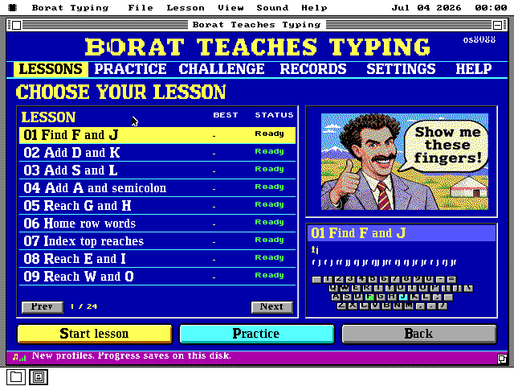
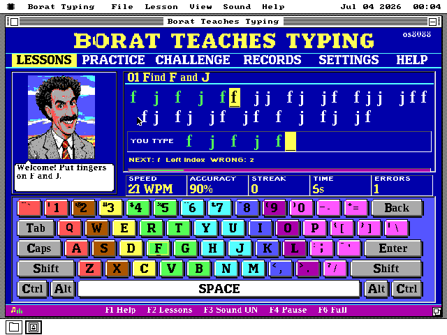
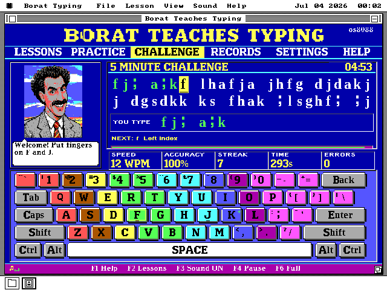
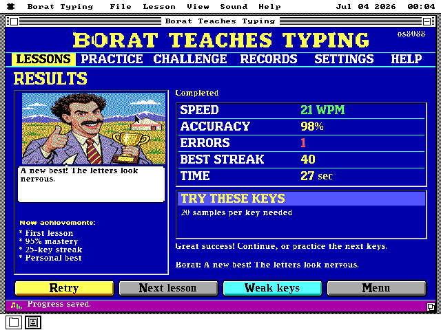
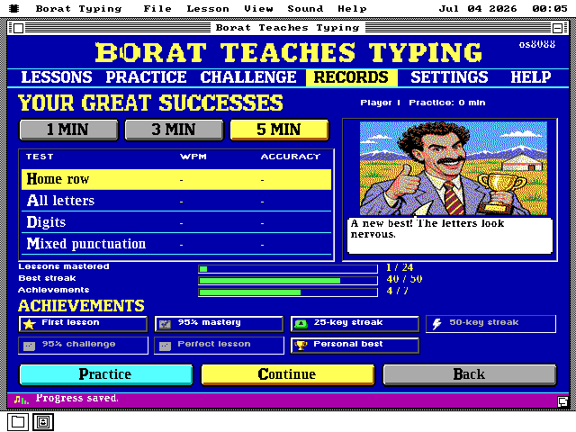
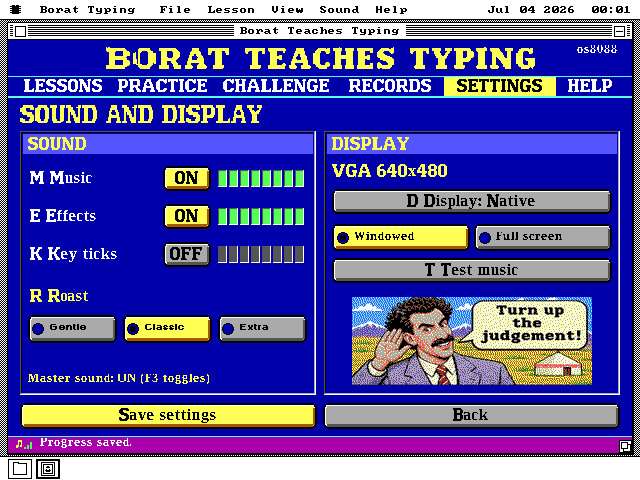
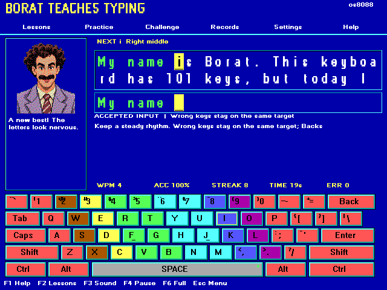
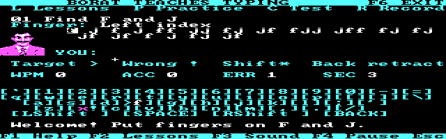
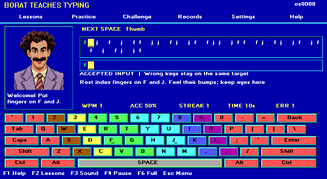
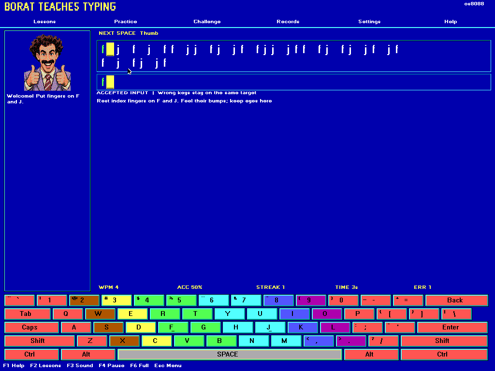

# Boratype acceptance evidence

Feature branch `codex/borat-teaches-typing` is based on
`528648017d103f335fa6fdbfbb0404ab92fb786f`.

## VGA redesign

These 640 × 480 captures come from the installed game on a 4.77 MHz VGA XT in
MartyPC. The tour used ordinary clicks and keystrokes, including an incorrect
key, a pause and resume, and a completed first lesson.

| Lesson selector | Live typing | Timed challenge |
| --- | --- | --- |
|  |  |  |
| **Results** | **Records** | **Sound and display** |
|  |  |  |

[Six visible poses of the pointing reaction](evidence/redesign/reaction.gif).
Each image in the loop is a capture of the guest display. In the game the
reaction plays once. The motion test checks every pixel in the 96 × 120
portrait against the independent reference for each frame.

The local test disk for this revision contains a 230,782-byte package
(SHA-256 `f148c9744a0c61306858bab1bdd171791d2ea23c515b1494f214e44187725abe`).
Three mistakes on the first lesson produced complete on-screen poses at
301, 468, 836, 1,003, 1,338 and 1,573 ms. Before the redesign, the first
pose reached only 50 of 120 rows before the eight-second reaction expired.
Across 30 queued hardware keystrokes, the longest time to the first completed
prompt write was 59.7 ms. The longest of 220 periodic callbacks was 71.2 ms.
These times use the guest clock. CRT scanout and physical hardware were
outside the measurement.

### Other display configurations

The same program ran with [CGA monochrome](evidence/redesign/cgamono.png),
[CGA four-color](evidence/redesign/cgacolor.png) and
[Hercules](evidence/redesign/herc.png) on MartyPC,
[EGA](evidence/redesign/ega.png) on 86Box and
[VESA](evidence/redesign/vesa.png) on QEMU. The EGA and protected-mode
286 runs saved, closed and reopened the program and restored the profiles
on a cold boot. Both VESA resolutions passed live input and desktop restoration.

The repository-wide full tier passed all 81 checks. Exact kernel budgets
passed for big, small, emu and mega. During the scoped game run, the practice
observer sampled an 8086 instruction boundary between the attempts and
correct-character increments. It now waits for the entire scored key before
asserting on the captured state. The recommended weak-key exercise and the
separately selected digit exercise subsequently passed. The package bytes
were identical throughout that verification repair.

## Installed application

24 authored lessons, strict guided input, sampled weak-key practice, four
profiles, 1/3/5-minute challenges, seven achievements, records, settings,
original music/effects and 65 original visual captions (40 roasts) are
implemented. The owner explicitly removed recorded clips from the shipped
disks. A personal Sound Blaster disk, built by `make boratypepcmdisk` from
the player's own recordings, was added later ([audio](audio.md)).
The normal C package, shared renderer/music kit, native fullscreen latch and
CGA FSX bracket are used. There is no new kernel API or budget.

```
make deps
make
make boratypedisk boratypebundle
make run RUNAPPS=build/boratype.img
```

Open `BORATYPE.O88` on B:. The four software images are `boratype.img`,
`boratype720.img`, `boratype120.img`, and `boratype360.img` in `build/`.
`BORATYPE.WPK` uses the existing software-library archive format. Everything
needed at runtime is packaged locally; SYSTEM/APPDATA is pre-created.

## Acceptance matrix

| Result | Configuration and actual scenario | Machine-readable evidence |
| --- | --- | --- |
| PASS | 4.77 MHz/640 KB VGA XT: named all four profiles; strict wrong/correct/Backspace/retype; full beginner and shifted mixed lessons; independent statistics; cover/uncover, minimum size, Help, native fullscreen, Save, readonly second instance and exported-disk cold reboot of all profiles | `build/boratype-final/vga/report.json` |
| PASS | CGA 640x200 mono XT: the same complete installed-app tour and cold reboot; minimum 480x128 client | `build/boratype-final/cgamono/report.json` |
| PASS | CGA 320x200 four-color: same engine, full 49-character lesson with error, measured VRAM commits and restored native desktop | `build/boratype-final/cgacolor/report.json` |
| PASS | Actual EGA 640x350 on 86Box: real wrong/correct input, running lesson in fullscreen, desktop restoration; separate full lesson/save/readonly/fullscreen-close/cold-reboot run | `build/boratype-final/ega/report.json`, `ega-reboot/report.json` |
| PASS | Real VESA.DRV 800x600x8 and 1024x768x16 on QEMU: native input, expanded fullscreen lesson, restored window | `build/boratype-final/vesa800/report.json`, `vesa1024/report.json` |
| PASS | Actual protected-mode286/Mega on 86Box: high region and drawing band above 1 MB; full lessons, all four profiles, fullscreen/resize, readonly close and cold reboot | `build/boratype-final/mega286/report.json` |
| PASS | Real no-input 60/180/300-second deadlines: exactly 1093/3278/5462 active ticks, neutral guidance, no false record; ranked and paused/unranked 1-minute comparison | `build/boratype-final/deadlines/report.json` |
| PASS | Seven actual storage fixtures: absent folder/files, truncation, unsupported version, invalid fields, readonly files and full FAT; preserved previous valid disk copy and live profile | `build/boratype-final/storage/report.json` |
| PASS | Public CHELLO/HEAPFRAG compaction moved resident region, shared part carve and band; immutable art/music, score, cold overlay, settings and resumed typing survived | `build/boratype-final/relocation/report.json` |
| TECHNICAL PASS | Speaker without SOUND.DRV; FM with real route change and SOUND detach/reattach; actual WAV activity, effects, mute, normal phase-preserving resume and no owned claims after close | `build/boratype-final/speaker/report.json`, `fm/report.json` |
| PASS | Native 19-error roast/low-accuracy/comeback/poor result; sampled F diagnosis, recommended drill, independently chosen digit group | `build/boratype-final/practice/report.json` |
| PASS | High-memory286 changed-caption, three-error message, mute/unmute and pause after the final caption repair | `build/boratype-final/high-caption/report.json` |
| PASS | Final four-row-caption XT feedback, periodic work and shipping stack guard | `build/boratype-final/performance/report.json` |
| BLOCKED | Subjective music-quality audition: the audio forwarding tool explicitly returned that audio input is unsupported. Waveforms/API results are not claimed as listening | Retained FM/speaker WAVs alongside their reports |
| NOT RUN | Physical XT/cards/CRT; no physical-machine result is implied by emulation | — |

The original 18-row deduplicated `boratype*` pass completed 18/18 with zero skips in
749.8 host seconds. An added fullscreen-playing screenshot check initially
hit two instrument timeouts before the application opened (EGA and VESA1024);
only those cases were retried, serially, and passed. A native practice tour
then corrected the label “Letters + digits” to “Digits”, matching the engine.
The full gate required the normal HIGH/HIGHMEM declarations; a complete
high-memory 286 tour passed after that one-byte class change. On the freshly
rebuilt canonical MartyPC, timing caught a 121ms whole-caption-line update.
Four-scanline caption strips repaired it. The affected face and practice
checks passed, followed by a passing strict timing rerun. The first timing
retry passed its assertions but left a probe breakpoint armed before capture;
that test cleanup was corrected without changing either 100ms limit.

Repository-wide gate: 80 checks passed, one unrelated `pd360` skipped because
its optional PageDesk capability was absent. The first full run had four host
timeouts, a stale MartyPC profile and the missing HIGH/HIGHMEM declarations;
the six failed rows passed 6/6 after correction, without repeating the others.
Exact `make budget-check` passed for big, small, emu and mega.

## Screens actually inspected

These are captured guest pixels, with their package/kernel identities in
[evidence/manifest.json](evidence/manifest.json). They are not generated UI
mockups. The full lesson is shown after intentional Resume, rather than using
a fullscreen Pause page as evidence for the expanded keyboard layout.

| VGA gameplay | CGA four-color |
| --- | --- |
|  |  |

| EGA | VESA1024 |
| --- | --- |
|  |  |

Also retained: [windowed VGA](evidence/vga-window.png),
[CGA mono](evidence/cga-mono.png), [VESA800](evidence/vesa800.png),
[Mega286](evidence/mega286.png), [results](evidence/vga-result.png),
[profiles](evidence/profiles.png), [settings](evidence/settings.png) and
[no-input guidance](evidence/no-input.png),
[weak-key diagnosis](evidence/weak-practice.png),
[Digits selection](evidence/digits-practice.png),
[comeback](evidence/comeback.png) and
[final high-memory caption](evidence/high-caption.png).

The session's comparison sheets are in `boratype-logs/final-sheets` beside
the worktrees: `primary.png` compares the supplied reference with actual
windowed/fullscreen/results output; `adapters-play.png` compares running
adapter faces; `vga-controls.png`, `storage.png` and `deadlines.png` inspect
those flows. `practice.png` covers all eight native reaction/practice captures,
including the selected Digits group. Cells are nearest-neighbour normalized
to 640x480 for comparison;
CGA/EGA aspect normalization is labelled. Native raw captures remain intact.

Inspection found readable prompt/target/input, full punctuation keyboard,
finger/Shift/error markers, wrapped captions, usable minimum controls and
honest no-input results. The visual target is an inspiration, not a pixel
match: native portraits are 96x120, scenery is omitted, controls are simpler,
and fixed 24px prompt typography leaves more empty space at large resolutions.
Some long single-line instructions and achievement summaries clip at their
bounds; the full controls/help and achievement list remain accessible.

## Resource and timing ledger

Final values are derived from the normal package build, never a raised limit.

| Item | Cost / observation |
| --- | --- |
| Native resident image | 53,264 bytes |
| BSS | 11,264 bytes |
| Resident+BSS | 64,528; 496 bytes below 0xFE00 |
| Eager C overlay | 16,983 bytes |
| Art/font part0 | 63,677 bytes |
| Music/effects/blink/large-font part1 | 12,823 bytes |
| Drawing band | 8,192 bytes, reused as CGA shadow |
| Observed app-owned claims at launch and active play | 65,024 region + 94,208 common part carve + 8,192 band = 167,424 bytes |
| Audio staging/PCM/file imports | None |
| Largest C frame | 30 bytes; all compiler/frame gates enabled |
| Shipping UI stack | 512 bytes; measured input probe samples and canary below; global high-water is not measured |
| Kernel source/API/budget changes | None |
| Final native package | 86,632 bytes |
| 360 KB disk occupancy | 93 of 354 clusters; all lessons/art/music/effects included |
| WPK | 89,598 bytes; 90 KB installation space reported by the existing tool |

The XT claims are observed steady snapshots. A bounded independent source
audit found no larger app-owned startup allocation on this accepted volume:
primary expansion is in-place, the common eager carve is retained, and the
band is the only later claim. The source-derived app-owned startup peak is
therefore 167,424 bytes for that layout. On Mega, the high region rounds to
65,536 bytes, giving 167,936 bytes (164 KiB) with the high 8KB band and same carve.
Its temporary low/high region-copy overlap is 130,560 bytes, before parts and
band exist, and is below that final total. Other volume cluster alignments
can change retained carve slack. Whole-machine/kernel loader high-water is
not measured. See kernel/loader.inc, kernel/mega.inc and apps/os88partsbody.inc.
No 640 KB claim is based on a host application.

On final application source `1b5e7cc21`, 30 hardware-enqueued keys completed
their first applicable prompt blit or mistake badge within **97.978ms**.
Complete callbacks peaked at 129.035ms; 220 periodic calls peaked at 99.062ms.
1,030 shipping-stack samples observed at most 156 of 512 bytes used, with
canary `0x5A57` intact. This is a sampled bound, not global high-water.
Both strict 100ms assertions passed on the current pinned MartyPC build.

Full public callbacks and monitor scanout are different quantities. CGA
measured 68.474ms from key route to first completed prompt cell and 91.260ms
to complete flush; BIOS polling before route and CRT scanout are separate.
The caption repair changes the native face only; CGA, scoring, files and
sound transport are unchanged.

The retained [machine-readable run summary](evidence/run-summary.json) records
per-run tool, source and artifact identities, including earlier adapter runs.
The final `boratype.o88` SHA256 is
`948364ac1bf561b3416228ff138e1e9db9841054aa8a337c1b225f16905d59d3`.
The 360 KB software image is
`cff202ed18f4c4c1a952308ec36255645fa61cb5d7482f5102a2bf368194f18a`;
the WPK is
`505bd6d28e9505874f1f5ff1e37498fcf597fb8205a961e194d5b212009136ca`.
These identify the tested local artifacts. Kernel build metadata can change
on later source commits; each report records its own exact kernel/package.

Full native PLAY/Resume paints can withhold the music sequencer for 132–136
OS ticks (about 7.3 seconds). Short speaker notes can expire during that work;
continuous music across a full paint is not claimed. Cosmetic queues coalesce
and may take seconds to become quiescent. Ordinary typing feedback is measured
separately. Audio waveforms confirm transport/routes/mute, not subjective
musical quality or physical-card loudness.

## Last package-policy closure

The full gate required the normal `OS88_HIGH | OS88_HIGHMEM` class bits. An
independent source audit found no forbidden segment arithmetic or BIOS/DMA
pointer; shared rendering uses opaque selectors and default FSX remains
protected as needed. At that stage, the native binary differed from the accepted
corrected-label binary only in byte 15, from 0 to `0xC0`. The subsequent
caption repair changes overlay code; those class bits remain set. On the actual 286, the
region mapped at 3,991,552 and band at 3,983,360; the complete native tour and
all-profile cold reboot passed there. The extended tour also corrected a
test helper: it checks KIND_FILES before interpreting I_SPTR as file state,
because a high package has a selector in that field. No application data
corruption was observed.

The copied older Marty runtime lacked the VGA128KB profile. It was replaced
with a fresh canonical build at pinned e15cb04f plus all 17 current patches,
including the matching current machine definitions. Earlier VGA/CGA/SB
profile definitions were compared and were identical; final XT timing and
the kernel-resident gate use the rebuilt instrument.

The final high-memory caption probe also passed on the four-row repair:
three errors selected a real reaction, its complete text was captured, and
mute/unmute/pause preserved the high-region/high-band instance. The actual
capture was inspected. Earlier full Mega lessons/profile/reboot evidence
remains separately identified by its own package hash.
