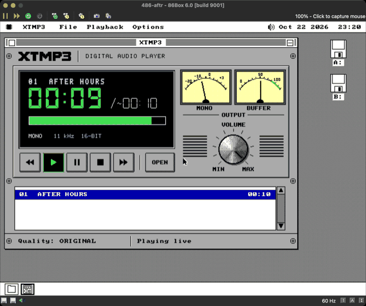
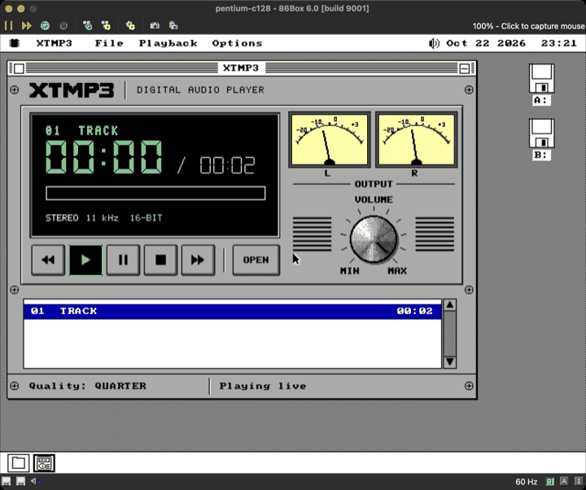
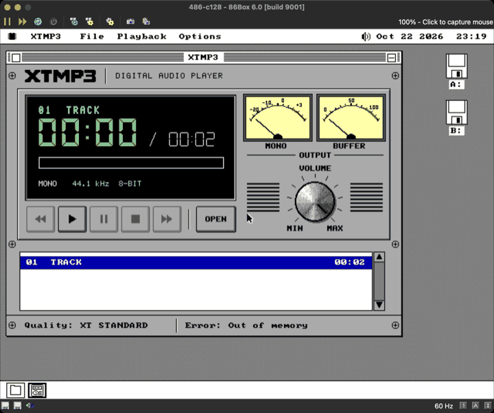
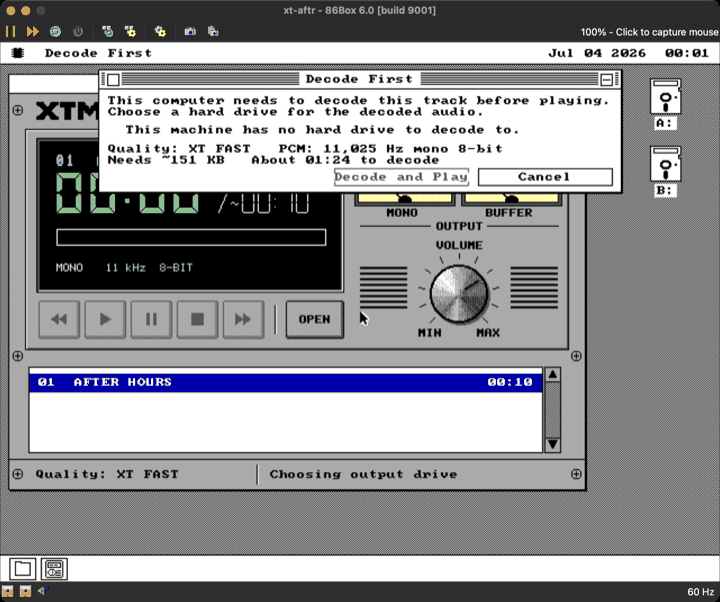
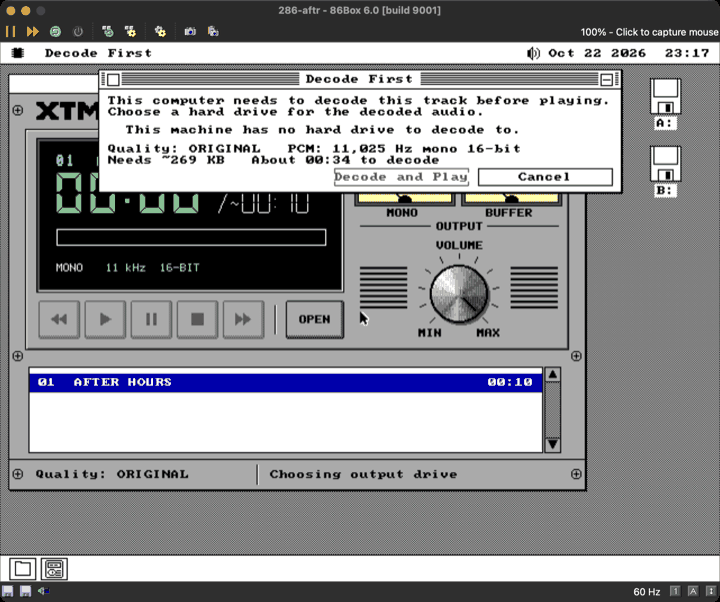
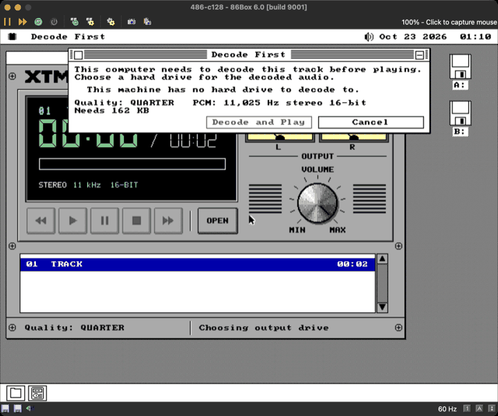
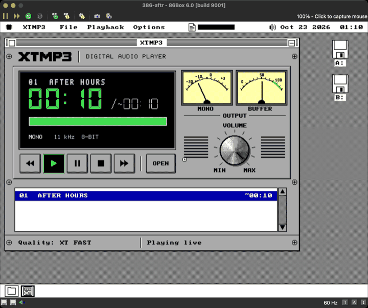

# XTMP3 in the field: the whole player, measured (S8's measurement, S10's numbers)

The other tracks measured parts: GRANULE alone on MartyPC (XT.md), the
STANDARD part behind a bench (STD.md), the engine over a stub (ENGINE.md).
This file measures the SHIPPED package, `XTMP3.O88` as built from
`feature/xtmp3` at 55a051b4, doing what a user does: open a track, let Auto
calibrate, decode first, finalise, then play the finished WAV. That is done
on MartyPC's 4.77 MHz XT, and the ladder is run on 86Box's XT, 286, 386, 486
and Pentium. SPEC.md §121.11 is where these numbers belong; the DOCS track
folds them in.

| file | what |
|---|---|
| `tests/xtmp3xt.py` | soak row `xtmp3xt`: the XT end to end on MartyPC, every number on the guest's cycle counter, every WAV checked bit for bit |
| `apps/xtmp3/x3rep.inc` | the `-DX3REPORT` build (`build/xtmp3r.o88`, never shipped): writes `SYSTEM\APPDATA\X3REPORT.TXT` for a machine that cannot be watched |
| `tools/x3field.py` | runs the 86Box matrix: launches each `vm/*-xtmp3` machine, captures its window, reads the report back off the floppy image |
| `vm/{xt,286,386,486,pentium}-xtmp3/` | the five machines; `make xt-xtmp3` (and the others) boots one to LOOK at |
| `docs/xtmp3/field/xtmp3xt.json` | the MartyPC figures, as the row wrote them |
| `docs/xtmp3/field/86box-matrix.json` | the 86Box figures and each machine's raw report |
| `docs/xtmp3/field/*.png` | the screens: `marty-*` off MartyPC's VGA, `86box-*` the emulator's window |

## 1. The instruments, and what each cannot show

**MartyPC** (`os8088_xt_vga_hdd_sb`): an IBM 5160 with an 8088 at
4,772,727 Hz, 640 KB, GLaBIOS, a VGA, an XT-IDE fixed disk and a Sound Blaster
DSP 2.01. The row drives it with `advance` in pseudo-random steps of 20,000 to
40,000 guest cycles (a fixed seed). Every step's stopping IP is a sample
UNIFORM IN GUEST CYCLES. Exec breakpoints on the engine's own procs stop the
same steps, and their cycle counts are the stamps. Seconds below are guest
cycles / 4,772,727. Host load moves none of it.

- **The CPU is credible.** MartyPC's 8088 lands within 0-4% of the field
  5150 on 45 of 47 `gfxbench` rows (PERFORMANCE.md Part 9), prefetch queue
  and bus included. Every decode figure here is that 8088.
- **The VGA is not a field card.** No field machine has an 8-bit VGA, so the
  face's VGA costs are MartyPC's model of its wait states. The CPU side of
  the drawing (composing the band, the dial canvas) is credible. The share
  that is VGA writes (`vga_pr_bufw`, 13% of a conversion) is the least
  certain number in this file.
- **The disk has no mechanics.** MartyPC's XT-IDE is the option ROM's CPU
  loop and nothing else (docs/MARTYPC-DEBUG.md): about 25 KB/s written and
  38 KB/s read, CPU-bound. A real ST-225 on a Xebec seeks and rotates, so the
  disk share here (about 1%) and the finalisation's 5.8 s are floors.
- **The ROM is GLaBIOS**, not IBM's. Disk counts are right and disk seconds
  are not (docs/MARTYPC-DEBUG.md's machine table). The hard disk is the
  XT-IDE's own ROM either way.

**86Box** (6.0 build 9001, the interpreter: `cpu_use_dynarec = 0`). The
profiles are the tree's sound machines with only the floppies and the uuid
changed. Every figure in a report is the guest's own `pit_now`, which 86Box
advances with its CPU model, so a host too slow to keep up makes the run
longer and leaves the figures alone.

- **86Box's timing is cycle-APPROXIMATE**: per-instruction cycle counts for
  each CPU family, cache and wait states modelled coarsely. It is the
  instrument this tree has for a 286 or better. It is not a field machine.
- **One cross-check exists and agrees.** 86Box's XT probes of the 11 kHz
  track read ORIGINAL 0.03, XT STANDARD 0.11 and XT FAST 0.12 audio seconds
  a wall second. MartyPC's read 0.03, 0.11 and 0.11 on the same track. That
  is within one probe's quantum, and it is the only machine both
  instruments model.
- **What 86Box cannot show here.** Nothing can be keyed or clicked from this
  host, so every run is what Auto does by itself. A decode-first verdict
  stops at the dialog, and no conversion is timed on 86Box. The sound was
  not listened to. The CMOS is BORROWED: an AT BIOS with an empty CMOS
  stops at "CMOS system options not set - Press F1", which the 486 did on
  its first run. So each run takes a checksum-valid CMOS of the same board
  from a checkout where somebody set it up, sets two 1.44 MB drives and
  re-sums it (`tools/x3field.py` `nvr_for`; the source is in the JSON).
  Each machine boots from a floppy, so its disk reads are floppy reads.

**QEMU** was used for one thing: to see the report build write its file. It
gave no number here.

## 2. The XT, end to end (MartyPC)

The track is `tests/xtmp3/AFTERHRS.MP3`: MPEG-2.5, 11,025 Hz mono, 24 kbps,
10.09 s of audio after the trim. The flow is Auto's:

1. A double-click opens it, and the ladder calibrates.
2. No live rung reaches 1.25x, so the decode-first dialog opens.
3. Enter on C:, then Enter in the Save dialog.
4. The conversion runs on the rung Auto chose offline (XT Standard), then
   finalisation.
5. The finished WAV plays through the card.

XT Fast and XT Speech are the same flow with the user's override (Q), after
Auto's dialog is cancelled.

| | XT Standard | XT Fast | XT Speech | Quarter (C128, below) |
|---|---|---|---|---|
| output | 11,025 Hz mono 8-bit | 11,025 Hz mono 8-bit | 5,512 Hz mono 8-bit | 11,025 Hz mono 8-bit |
| the job: Decode and Play to the WAV playing | **182.81 s** | **169.30 s** | **118.34 s** | **127.73 s** |
| ...of which setup: the part's fetch, OPEN, the ring, the temp file's header | 4.59 s (fetch 1.05, OPEN 3.32) | 3.88 s (1.05, 2.61) | 3.62 s (1.05, 2.36) | 0.33 s (resident from the probe) |
| ...the decode loop | 172.39 s | 159.58 s | 108.88 s | 121.53 s |
| ...finalisation (trim, lengths, fingerprint, re-read, rename, index) | 5.84 s | 5.83 s | 5.83 s | 5.86 s |
| **audio s a wall s, end to end** | **0.0552x** | **0.0596x** | **0.0853x** | **0.0117x** |
| audio s a wall s, the loop alone | 0.0585x | 0.0632x | 0.0927x | 0.0123x |
| the part alone (XT.md; std.md for Quarter) | 0.166x | 0.183x | 0.297x | 0.027x |
| cycles a granule in the loop (194 granules; C128 118) | 4,240,973 | 3,926,027 | 2,678,730 | 4,915,609 |
| X3S_PEAK during the conversion | 386 KB = 395,264 B | 338 KB = 346,112 B | 310 KB = 317,440 B | 200 KB = 204,800 B |
| XTMP3's own speed display | 0.05x | 0.06x | 0.09x | 0.01x |
| **the WAV against the model, bit for bit** | **exact**, 111,215 bytes | **exact**, 111,215 | **exact**, 55,608 | **exact**, 16,538 |

The models are `tools/x3simxt.py --profile std|fast|speech` for the XT rungs,
and `tools/x3sim.py`'s STANDARD model at divisor 4 with the mono downmix for
Quarter. Each is converted to U8 as the engine asks the part, then trimmed by
x3sim's rule (529 + the LAME delay at the head, padding - 529 at the tail).
The row reads the WAV off the VHD after the run. BROKEN ON PURPOSE (`--expect
fast` on the XT Standard WAV), the row FAILS at byte 6.

**The whole player is about three times slower than its decoder.** For a
3-minute 11 kHz song on this XT, that is 54 minutes on XT Standard, 50 on XT
Fast and 35 on XT Speech. XT.md, timing the part alone, said 18 and 10.

### 2.1 Where the loop's cycles go

The decode loop runs from the progress window opening to the last
`x3c_final`. Shares are of 26,955 guest-uniform samples (XT Standard),
24,956 (Fast), 17,033 (Speech) and 18,994 (Quarter).

| | XT Standard | XT Fast | XT Speech | Quarter |
|---|---|---|---|---|
| the backend part (reconstruction) | 38.1% | 37.3% | 33.9% | 39.4% (STANDARD) |
| FRONT (side info, scalefactors, Huffman) | 8.0% | 8.6% | 12.6% | 9.5% |
| **the face: the primary's x3f_/x3d_ code** | **16.1%** | **16.1%** | **16.1%** | **13.4%** |
| **the face: the kernel's drawing (VGA planar writes, blits, text)** | **28.4%** | **28.5%** | **28.8%** | **31.3%** |
| the engine (look-ahead, trim, meters' peaks) | 4.2% | 4.3% | 3.6% | 2.8% |
| kernel: scheduler, ISRs, idle, the UI task | 2.4% | 2.3% | 2.3% | 2.3% |
| the disk (XT-IDE ROM, kernel file system, BIOS) | 1.4% | 1.5% | 1.1% | 0.4% |
| the conversion's own code (stage, progress text) | 0.4% | 0.5% | 0.5% | 0.3% |
| other | 1.0% | 0.9% | 1.0% | 0.6% |

Per granule, XT Standard's part is 1.62 M cycles (XT.md's 1.51 M plus the
far call and the record's handover), and FRONT is 0.34 M (std.md's 0.31 M).
**The face is 1.89 M a granule: more than the decoder.** By label:

- `x3x_kslot` (the window and Lee kernels OPEN copies in) 20.5%;
- the kernel's `vga_pr_bufw` 13.0%, plus `vga_prow_emit` 3.3%;
- the face's band and canvas ops: `x3d_bor` 3.8%, `x3d_bshift` 2.8%,
  `x3d_plot` 2.7% and `x3f_dial4` 2.8%;
- `font_run_x` 2.9%, `gfx_blit1_x` 2.5% and `gfx_blit4` 2.1%;
- `x3_peak` (the meters' peaks during a conversion) 2.1%.

The full lists are in the JSON.

**The needles are why.** While a conversion runs, the face keeps animating:
- the MONO VU follows the decoded audio's peaks (`x3_peak` on every
  granule);
- the BUFFER gauge follows the progress;
- the time and the bar repaint.

The progress window covers part of the dials, and they are composed anyway.
If the face's two lines were taken away, the same loop would run at about
0.105x (XT Standard), 0.114x (Fast), 0.168x (Speech) and 0.022x (Quarter).
That is an ESTIMATE from the shares and has not been measured. It is the
size of what resting the needles during a conversion would buy (sent to the
integration track).

### 2.2 Calibration

| | wall time | its probes |
|---|---|---|
| AFTERHRS on MartyPC (XT-IDE) | **16.10 s** to the decision, 16.53 s to the dialog | ORIGINAL 0.03x in 5.84 s (fetch 1.07, OPEN 0.83, prime and probe 3.94); XT STANDARD 0.11x in 5.53 s (fetch 1.04, OPEN 3.32, prime and probe 1.16); XT FAST 0.11x in 4.73 s (fetch 1.05, OPEN 2.61, prime and probe 1.07) |
| C128 on MartyPC | **4.32 s**, 4.75 s to the dialog | QUARTER 0.01x in 4.32 s (fetch 1.07, OPEN 0.83, prime and probe 2.42). No XT rung is tried: their output is the source's 44.1 kHz, and a DSP 2.01 plays nothing above 22,222 Hz |
| AFTERHRS on 86Box's XT (floppy) | **27.00 s** | the same three probes; each part is fetched off a 360 KB floppy |
| C128 on 86Box's XT (floppy) | 7.17 s | QUARTER 0.01x |

Each probe's own timing is bounded as SPEC.md §121.5 says. A first granule
4x short of passing ends it after ONE timed granule. What is not bounded is
around it:
- the part's fetch: about 1.05 s from the XT-IDE, more off a floppy;
- the XT part's OPEN: 2.4 to 3.3 s, its expansion and Fletcher read-back;
- the ring's priming;
- the untimed warm-up granule: on Original that alone is 1.17 s, at 5.6 M
  cycles.

"A hopeless rung costs an XT under a second" holds for the timed part only.
A rung costs 4.7 to 5.8 s, and three of them are 16 s before the dialog. The
session's cache means a second track's probes are asked only once. The
re-fetch the engine's open item 3 names is the fetch column: 1.05 s per XT
rung after the first.

### 2.3 Memory

- **The heap at launch** (`x3_free0`): 434 KB free on the 640 KB VGA XT.
  It is 426 KB on 86Box's XT and 286, and 435 KB on its 386, 486 and
  Pentium.
- **During the conversion** X3S_PEAK is in the table above. XT Standard
  stays inside SPEC.md §121.10's 400,000 bytes at 395,264.
- **DURING CALIBRATION IT DOES NOT.** X3S_PEAK through the ladder's three
  probes reads **402 KB = 411,648 bytes** on MartyPC and 396 KB on 86Box's
  XT and 286. That is 5.5 to 11.6 KB over the budget. A probe holds the XT
  part unshrunk while it OPENs, plus the work, the probe's ring and the
  card's grant. The engine track's `xtpeak` leg checks only a conversion's
  peak. The row prints the calibration peak and does not assert it, because
  whether the budget binds the probes is the integration track's call.
- **Live XT with a card does not fit** beside 86Box's 486 heap (section 3).

### 2.4 The finished WAV's play, and the face's own costs

Each finished WAV played through the card to its end. Then:

- `x3_gran1` was armed for the whole play and **never reached**.
- `x3_grans` did not move (194 -> 194).
- No backend part was resident (`x3_bpart` = FFh).
- **No underrun** occurred, on any of the four.

The face, timed on this 4.77 MHz VGA XT:

| what | cost |
|---|---|
| one needle's redraw (`x3f_e_dial` that draws: the canvas box, BLIT4) | median **136-187 ms** by leg; 111-299 ms in all |
| a dial with nothing to draw | 0.16-0.17 ms |
| one `x3f_update` while a WAV plays | median 159-279 ms, up to 486 ms |
| **the face's share of the machine while a finished WAV plays** | **53.7-54.7%** at 11 kHz, **73.5%** at 5.5 kHz (Speech: more redraws, 46 in 10 s) |
| one knob redraw at READY (`x3f_e_knob` that draws: the 4-grey canvas, the ring, the indicator) | **400 ms** median (399-403 ms, six detents) |
| the knob with nothing to draw | 0.07 ms |

The face is cached correctly: an unchanged element costs a key compare. What
costs is the redraw itself. Needles are drawn at most every X3F_DIALT = 5
ticks while the meters move, so each 140 ms redraw comes about every 275 ms.
The SB's DMA carries the play, so none of it is heard. During a conversion
(section 2.1) all of it is time the decoder does not get.

**MartyPC's DSP 2.01 answers SOUND.DRV's mixer probe** (caps 029F carries
`SND_CAP_MIXER`), and the master reads 0. So the knob shows 0 here. That is
the emulator's card, not XTMP3: a DSP 2.01 has no mixer chip.

## 3. The selection matrix (86Box), at 55a051b4

This is the first build's matrix. The shipped build's re-run, and how it differs, is section 7.

Each machine boots `make xtmp3field`'s system floppy. Its `\AUTOSTRT`
opens B:\XTMP3, which teaches the machine the `.MP3` association, then
B:\XTMP3\TRACK.MP3. XTMP3 calibrates by itself and writes the report when
the dialog opens (EVENT D), when the stream has played out (E), or at the
first error (X). The figures are audio seconds a wall second on the
emulated clock.

| machine (vm/) | CPU, card | fixture | probes | Auto's decision | what played, the device format | underruns | X3S_PEAK | calibration |
|---|---|---|---|---|---|---|---|---|
| `xt-xtmp3` | 8088 4.77 MHz, SB 2.0 (DSP 2.01) | C128 44.1 kHz stereo 128k | QUARTER 0.01 | **Decode first** (QUARTER, derived) | the dialog: no hard drive | - | 178 KB | 7.17 s |
| | | AFTERHRS 11 kHz mono 24k | ORIGINAL 0.03, XT STD 0.11, XT FAST 0.12 | **Decode first** (XT FAST: the dialog says "About 01:24") | the dialog: no hard drive | - | 396 KB | 27.00 s |
| `286-xtmp3` | 286 12.5 MHz, SB16 | C128 | QUARTER 0.16, XT STD 0.10, XT FAST 0.21 | **Decode first** (QUARTER, derived) | the dialog | - | 396 KB | 6.34 s |
| | | AFTERHRS | ORIGINAL 0.30, XT STD 0.73, XT FAST 0.80 | **Decode first** (ORIGINAL 16-bit, "About 00:34") | the dialog | - | 396 KB | 8.61 s |
| `386-xtmp3` | 386DX 25 MHz, SB16 | C128 | QUARTER 0.37, XT STD 0.51, XT FAST 0.59 | **Decode first** (QUARTER, derived) | the dialog | - | 358 KB | 6.10 s |
| | | AFTERHRS | ORIGINAL 0.96, XT STD 2.21 | **live XT STANDARD** | 11,025 Hz mono 8-bit; **stepped to XT FAST** on its underrun | **1** | 358 KB | 4.96 s |
| `486-xtmp3` | 486DX2 66 MHz, SB16 | C128 | QUARTER 0.98, XT STD 1.48 | live XT STANDARD at 44,100 Hz mono 8-bit, then **"Error: Out of memory"**: nothing plays | - | 0 | 358 KB | 3.07 s |
| | | AFTERHRS | ORIGINAL 2.99 | **live ORIGINAL** | 11,025 Hz mono 16-bit | 0 | 156 KB | 2.10 s |
| `pentium-xtmp3` | P54C 133 MHz, SB16 | C128 | ORIGINAL 0.84, HALF 1.18, QUARTER 1.30 | **live QUARTER** | 11,025 Hz stereo 16-bit | 0 | 173 KB | 3.13 s |
| | | AFTERHRS | ORIGINAL 4.65 | **live ORIGINAL** | 11,025 Hz mono 16-bit | 0 | 156 KB | 1.95 s |

"Derived" marks a conversion rung that x3l_offpick's rule gives from the
report's own probes. Those reports were written before the report carried
the rung (OFFLINE now does). The two the dialogs show on screen agree with
the derivation.








The expected shape, against the measurement:

- **"An XT goes to Decode first."** CONFIRMED on both tracks and both
  instruments.
- **"A 386 or 286 lands on Half, Quarter or an XT rung."** HALF-TRUE.
  - The 386 plays the 11 kHz track live on XT Standard. It underran once
    and stepped to XT Fast, as §121.5 says it should.
  - The 386 decodes the 44.1 kHz track first.
  - **The 286 plays NEITHER track live.** On the 11 kHz track its best probe
    is XT Fast at 0.80x, against the 1.25x margin.
- **"A 486 stays on Original or Half."** TRUE for 11 kHz mono (Original
  2.99x). FALSE for 44.1 kHz stereo at 128 kbps. Quarter measures 0.98x, so
  Auto takes XT Standard at 1.48x, and the live XT path's claims do not fit
  beside the 486's 435 KB heap. The engine does not step on, so the player
  ends in **Error: Out of memory**. A 486 cannot play this file at all.
  Original would need about 3x what Quarter got.
- **The Pentium-133** plays the 44.1 kHz track on Quarter. Half measures
  1.18x, just under the margin.

## 4. What this asks of the engine (sent to the integration track)

1. **The face halves an XT's conversion.** Rest the VU and slow the BUFFER
   gauge in MD_CONV on CPU_8086 (or always), or skip `x3_peak` there.
   Measured headroom: 0.0585x to about 0.105x on XT Standard.
2. **The decode-first estimate is about twice too optimistic on an XT.**
   The dialog said "About 01:31" for XT Standard; the job took 3:03. The
   probe times the decoder, not the face's redraws or finalisation. Item 1
   would close most of the gap.
3. **Calibration exceeds 400,000 bytes:** 402 KB on MartyPC.
4. **A rung that runs out of memory ends in ERROR.** It should step to the
   next rung or to Decode first. Separately, Auto never asks whether a live
   XT rung's working set fits before it chooses one: the 486 on 44.1 kHz
   stereo.
5. **The offline pick sits on a knife edge on an XT.** `x3l_offpick` takes
   the best rung at 1/8 real time or better (12 x100). XT Fast measured 11
   on MartyPC and 12 on 86Box, so the same machine class converts on XT
   Standard under one instrument and XT Fast under the other.
6. **A 44.1 kHz source on an XT with a DSP 2.x** converts on Quarter at
   0.0117x end to end: about 4.3 hours for a 3-minute song. No XT rung is
   offered, because its output would be 44.1 kHz.

## 5. Repeating it

```
make && python3 tests/xtmp3xt.py --json build/x.json --shots build/shots
python3 tests/xtmp3xt.py --leg std --calonly        # the calibration alone
make xtmp3field && python3 tools/x3field.py --json build/m.json --shots build/s
make 486-xtmp3                                      # to LOOK at one (also xt-, 286-, 386-, pentium-)
```

The row is `xtmp3xt` in tests/suite.py (soak, about ten minutes of host
time). 86Box cannot assert, so the matrix is this procedure and its JSON.
`tools/x3field.py` kills each emulator by its own pid (SIGTERM does not stop
86Box) and leaves `vm/` untouched: it runs copies.

## 6. What remains unmeasured

- **Real hardware.** No 5150, XT, 286, 386, 486 or Pentium has run XTMP3.
  The field 5150 (docs/FIELD-MACHINES.md) has no hard disk, so its run is
  the decode-first dialog's "no hard drive" and the calibration.
- **A real hard disk.** The conversion's disk share and finalisation are
  MartyPC's mechanism-free XT-IDE.
- **The face on CGA and Hercules on the XT.** Only the VGA face was timed.
  The COMPACT layout has no dials.
- **Live XT play with a card** on an XT-class machine. No XT rung passes,
  so it never runs live there.
- **A conversion on 86Box.** It needs keys this host cannot send.
- **The 386's underruns' cause**: 1 at 55a051b4 and 11 on the shipped build
  (section 7.1). The report carries the count, not the moment.
- **Listening.** No output was heard, on any machine.

## 7. Round 2: the shipped build, re-run (feature/xtmp3 d5e53fea)

The integration track acted on sections 2 to 4:
- the face rests while converting;
- an 8086 probes XT Standard alone;
- the probe's OPEN is reused;
- calibration fits under 400,000 bytes;
- a rung that cannot start falls through;
- the XT backend's card ring is the 8 KB grant.

It re-measured XT Standard on MartyPC itself (ENGINE.md section 12):
- conversion 0.0552x -> **0.0946x**, with the face's share 44.6% -> 9.8%;
- calibration 16.1 s -> **6.4 s**;
- calibration peak 402 KB -> 387 KB.

FIELD re-ran two things on that build: the 86Box matrix (the same
`-DX3REPORT` disks and procedure), and the speaker. Both ran first on
70323ad3, then once more on d5e53fea, which added the drive dialog's
greying of 32 KB-cluster drives. The tables below are d5e53fea's. The only
figure that moved is the 286's Original probe on AFTERHRS, 0.29 -> 0.30;
every decision, peak, calibration time and underrun count was identical.

### 7.1 The matrix (86Box, `docs/xtmp3/field/86box-matrix-r2.json`)

The report now carries OFFLINE (the conversion's rung) and PASS (the
ladder's re-runs after a rung that could not start: 0 on every machine).

| machine | track | probes | Auto's decision | what ran | X3S_PEAK | calibration |
|---|---|---|---|---|---|---|
| XT 4.77, SB 2.0 | AFTERHRS | XT STD 0.05 (an 8086 probes it alone) | Decode first, on XT STANDARD | the dialog: no hard drive | 381 KB | **10.08 s** (27.00) |
| | C128 | QUARTER 0.01 | Decode first, on QUARTER | the dialog | 179 KB | 7.89 s |
| 286/12.5, SB16 | AFTERHRS | ORIG 0.30, XT STD 0.73, XT FAST 0.78 | Decode first, on ORIGINAL | the dialog | 381 KB | 9.28 s |
| | C128 | QUARTER 0.15, XT STD 0.10, XT FAST 0.21 | Decode first, on QUARTER | the dialog | 381 KB | 7.62 s |
| 386DX/25, SB16 | AFTERHRS | ORIG 0.96, XT STD 2.14 | **live XT STANDARD**, 11,025 Hz mono 8-bit | **11 underruns** (1 at 55a051b4), stepped to XT FAST | 343 KB | 5.45 s |
| | C128 | QUARTER 0.37, XT STD 0.47, XT FAST 0.51 | Decode first, on QUARTER | the dialog | 343 KB | 7.15 s |
| 486DX2/66, SB16 | AFTERHRS | ORIG 3.08 | **live ORIGINAL**, 11,025 Hz mono 16-bit | no underrun | 157 KB | 2.34 s |
| | C128 | QUARTER 0.98, XT STD 1.15, XT FAST 1.17 | **Decode first, on QUARTER** (11,025 Hz stereo 16-bit; "Needs 162 KB") | the dialog: **no "Out of memory"** | 343 KB | 5.39 s |
| Pentium/133, SB16 | AFTERHRS | ORIG 4.88 | **live ORIGINAL** | no underrun | 157 KB | 2.17 s |
| | C128 | ORIG 0.75, HALF 0.98, QUARTER 1.30 | **live QUARTER**, 11,025 Hz stereo 16-bit | no underrun | 174 KB | 4.25 s |




**The 486 and C128 no longer end in "Out of memory".** It did not reach
the fall-through, though: XT Standard now probes at **1.15x**, where the
first build read 1.48x, and XT Fast at 1.17x. So no live rung passes the
1.25x margin, and Auto asks for a drive, converting on Quarter. The ladder
ran once (PASS 0). Two things are still unmeasured on 86Box: the
fall-through itself (the engine's `rungfail` leg proves it on QEMU), and
whether a live XT Standard start now fits on that heap.

The XT rungs' probes read lower across the board in this build. The 486's
XT Standard went 1.48 -> 1.15, the 386's 2.21 -> 2.14, and 86Box's XT
0.11 -> 0.05. The Pentium's Half went 1.18 -> 0.98. The decisions moved
only on the 486. FIELD has not traced why; the probe's code changed in
round 2 (the 8 KB grant, the OPEN reuse). On the XT, 0.05 (against
0.11 at 55a051b4) is far below the 1.25x margin either way, so the
decision cannot move.

**The 386's live XT Standard underran 11 times**, against once on the
first build, and still stepped to XT Fast. It plays from a floppy through
the 8 KB grant, which is 0.74 s of 11 kHz 8-bit audio, where the first
build's grant was 16 KB. That looks like the cause, but it is not proven:
the report counts underruns and does not time them. **Sent to the
integration track as a possible regression.**

Every peak is at or under 381 KB = 390,144 bytes, calibrating included.

### 7.2 The PC speaker's sound (MartyPC, `xtmp3xt --leg spk`)

QEMU renders no PWM, so S9's last gap was whether a finished XTMP3 WAV
SOUNDS right through the speaker. The `spk` leg answers it on
tests/apspk.py's machine (`os8088_5150_herc_hdd_gla`: a card-less 640 KB
5150 with a Hercules and an XT-IDE disk) with the shipped build:

1. AFTERHRS is double-clicked. Auto finds no card and asks for a drive.
2. Enter, Enter: the conversion runs on XT Standard. The WAV off the VHD is
   bit-exact to `tools/x3simxt.py`.
3. The finished file plays in the Audio Player's bracket (MD_SPK).
4. Port 42h is traced from the door's open. Its first **800 writes are
   `tools/os88spkfx.py`'s counts for the WAV's own bytes**, exactly as
   tests/apspk.py models them: 11,025 Hz stepped to 8,000 by the
   resampler, then the shaper. They start after one silent pulse, at the
   model's offset 0. **2.0%** of pulses were lost to IF = 0.
5. `x3_gran1` was armed for the whole play and **never reached**.
6. Channel 2 and the sample ISR were given back at the end.

The play fell one rung mid-way, to 5,512 Hz. The ring ran dry 24 times,
and 10.08 s of audio took 11.06 s. That is apspk's known lag (its `box3`
leg): MartyPC's XT-IDE is copied by the CPU beside 8088 pulses. A DMA disk
is the other answer, and was not available.

The first run of the leg modelled the pulses at the END's rung (5,512 Hz)
and failed at the first differing count. The leg now models the first
door's rung, which is the rung the traced writes were made at. That failed
run is the negative control: the comparison distinguishes the two rates.

### 7.3 Round 3: the 386 and the 486 once more

On round 3 (`feature/xtmp3` 3e3a9306) the integration track made two
changes: the probe starts after the face is drawn, and a live XT stream
prefers the 16 KB card grant with an 8 KB look-ahead. FIELD re-ran two
cases once each, with the same disks and procedure.

| machine | track | probes | decision | what ran | X3S_PEAK | calibration |
|---|---|---|---|---|---|---|
| 386DX/25, SB16 | AFTERHRS | ORIG 0.96, XT STD 2.14 | **live XT STANDARD** | **one underrun** (11 on round 2, one at 55a051b4), stepped to XT FAST | 350 KB = 358,400 B | 5.76 s |
| 486DX2/66, SB16 | C128 | QUARTER 0.97, XT STD 1.15, XT FAST 1.16 | **Decode first, on QUARTER** | the dialog; no "Out of memory" | 344 KB | 6.09 s |

- **The 386's underruns went from 11 to one.** That fits round 2's 8 KB
  grant (0.74 s of audio) being the cause. One underrun still steps it
  down to XT Fast. Its moment is not measured, because the report counts
  it and does not time it.
- **The 486's pick did not move.** The probe that no longer pays a face
  redraw gives the same figures to the hundredth: 0.97, 1.15 and 1.16
  against 0.98, 1.15 and 1.17. So the drop from 55a051b4's 1.48x on XT
  Standard is not the face. It is still untraced.
